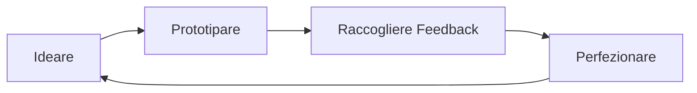
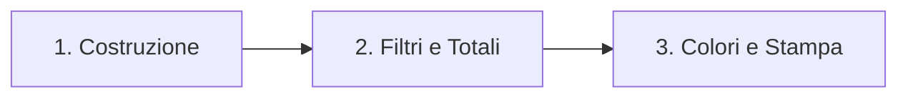

# Fondamenti della Piattaforma e dei Modelli di Claude

## Panoramica

La maggior parte dei professionisti che utilizza Claude inizia imparando una o due delle sue funzionalità principali. Questo approccio è efficace per le attività semplici.

Per attività ricorrenti, progetti di squadra e risultati che devono superare una fase di revisione, le scelte effettuate in Claude prima ancora di scrivere un prompt determinano il livello massimo di qualità raggiungibile nella sessione.

Questo modulo definisce il quadro di riferimento per le quattro decisioni fondamentali alla base di ogni interazione con Claude: quale punto di accesso utilizzare, quali funzionalità attivare, quale modello selezionare e come gestire il contesto durante la sessione. Queste quattro decisioni determinano se le sessioni possano basarsi sul lavoro svolto in precedenza o se richiedano una riconfigurazione costante.

Al termine di questo modulo, sarai in grado di:

1. Selezionare il punto di accesso e le funzionalità di Claude più adatti a una specifica attività professionale.
2. Distinguere tra Haiku, Sonnet e Opus in base alle loro capacità e all'idoneità per le diverse attività.
3. Abbinare la scelta del modello ai requisiti dell'attività, valutando i compromessi tra qualità, velocità e volume di lavoro.
4. Gestire i limiti del contesto e utilizzare le funzionalità di memoria per mantenere la continuità tra le sessioni.

Quattro decisioni determinano il livello massimo di qualità di ogni sessione con Claude: punto di accesso, funzionalità attivate, modello e gestione del contesto. Questo modulo fornisce le basi per tutte e quattro le decisioni. I moduli successivi presuppongono che tu sia in grado di compiere queste scelte autonomamente, senza dover tornare a consultare questa sezione.

### Cosa aspettarsi dall'IA generativa

Prima di scegliere i punti di accesso e i modelli, è importante conoscere cinque caratteristiche comportamentali di Claude, valide a prescindere dalla funzionalità utilizzata. Comprenderle prima di creare flussi di lavoro con Claude aiuta a evitare le più comuni fonti di frustrazione e le aspettative disattese.

#### Proprietà 1 - Le risposte variano

Se poni a Claude la stessa domanda due volte, otterrai due risposte diverse. Entrambe possono essere utili, ma nessuna delle due va considerata come l'unica risposta corretta. È così che funziona l'IA generativa: i risultati vengono generati in base a probabilità, anziché essere recuperati da un database fisso. Prevedi delle variazioni in qualsiasi flusso di lavoro che richieda risultati costanti e integra una fase di revisione nel processo.

#### Proprietà 2 - Il tono sicuro non è un segnale di accuratezza

Claude scrive con una fluidità costante indipendentemente dal fatto che la risposta sia effettivamente corretta. Una statistica inventata appare con la stessa sicurezza di una verificata. Il modulo 3 sviluppa le abitudini di verifica; senza di esse, la fluidità non segnala nulla riguardo all'accuratezza.

#### Proprietà 3 - Il contesto ha un limite

Ogni conversazione con Claude è soggetta a un limite di memoria di lavoro. Quando la conversazione si avvicina a tale limite, claude.ai riassume automaticamente i messaggi precedenti per consentire la prosecuzione della sessione (nei piani a pagamento con esecuzione del codice abilitata). I riassunti comportano una riduzione dei dettagli; è per questo che le istruzioni seguite all'inizio di una sessione della durata di due ore possono perdere efficacia verso la fine. La lezione 6 illustra le strategie per gestire questo aspetto: quando ricominciare, quando riassumere e quando mantenere la continuità.

#### Proprietà 4 - La conoscenza ha un confine di addestramento

I dati di addestramento di Claude hanno una data limite. Le informazioni successive a tale data esulano dalle conoscenze affidabili di Claude, a meno che non si colleghi una fonte aggiornata, si attivi la ricerca web nella chat o si utilizzi la funzione Research. Ciò riguarda eventi recenti, normative vigenti e dati di mercato aggiornati. Quando la pertinenza è importante, è opportuno verificare le informazioni o collegare una fonte.

#### Proprietà 5 - Le procedure configurate producono comunque risultati variabili

Una Skill configurata per eseguire la stessa procedura ogni volta riduce la variabilità dei risultati ma non la elimina. Anche un flusso di lavoro ben configurato produce output diversi ogni volta che viene eseguito. La revisione rimane parte del tuo flusso di lavoro indipendentemente da quanto accuratamente una Skill sia costruita. Sebbene la configurazione riduca la variazione, non elimina la necessità di controllare l'output.

---

## Modulo 1 - Chat, Projects, Artifacts, Research

Claude si presenta attraverso un'unica interfaccia, la quale offre tuttavia quattro distinti punti di accesso operativo: Chat, Progetti, Artifacts e Modalità di ricerca. Scegliere quello più adatto prima di iniziare a lavorare determina l'efficienza della sessione e stabilisce se il contesto costruito oggi verrà mantenuto anche per il domani.

### Logica di selezione

| Tipo di attività | Punto di accesso |
| --- | --- |
| Domanda occasionale o compito rapido, senza intenzione di riutilizzo | Chat |
| Lavoro ricorrente con requisiti di contesto stabili | Progetto |
| L'output è un deliverable che il destinatario aprirà e leggerà | Artifact |
| Richiede un'indagine o sintesi approfondita da più fonti (ricerche rapide di informazioni correnti: ricerca web in Chat) | Modalità di ricerca |

### Chat

La Chat è il punto di accesso predefinito: una conversazione non strutturata. Una Chat viene salvata nella cronologia e può essere ripresa in seguito; inoltre, la funzione "Memoria" e la ricerca nelle conversazioni passate consentono di trasferire informazioni di contesto fondamentali nelle nuove sessioni. Tuttavia, ciò che la Chat non offre è la persistenza strutturata tipica di un Progetto, le istruzioni permanenti e una base di conoscenza curata. Utilizza la Chat per domande estemporanee, bozze rapide, esplorazione tramite prompt e attività che non dovrai ripetere. È ideale per qualsiasi compito che inizi e si concluda all'interno della stessa sessione. Se però ti ritrovi ad aprire una nuova Chat incollando lo stesso paragrafo di contesto usato la settimana precedente, significa che quel flusso di lavoro ha superato i limiti della Chat.

### Projects

I "Progetti" sono spazi di lavoro persistenti. Ogni Progetto comprende tre elementi:

Istruzioni permanenti: ciò che Claude deve sapere e applicare costantemente in tutte le conversazioni all'interno di quello spazio.
Base di conoscenza: documenti, policy e file di riferimento caricati una sola volta, affinché Claude possa attingervi senza doverli ricaricare a ogni sessione.
Cronologia delle conversazioni: ogni Progetto gestisce un proprio elenco di conversazioni, distinto dalla cronologia generale. Le conversazioni all'interno di un Progetto condividono le istruzioni e la base di conoscenza del Progetto stesso, ma non condividono il contesto tra loro.
I Progetti risolvono il principale ostacolo alla produttività nel lavoro professionale assistito dall'IA: la necessità di dover rispiegare il contesto di base a ogni sessione. È sufficiente definire il contesto una sola volta nelle istruzioni permanenti e nella base di conoscenza del Progetto; tutte le conversazioni successive partiranno con quel contesto già impostato.

#### Quando vale la pena creare un Progetto

Il compito si ripete, il contesto di base è stabile e il formato dell'output è coerente. Se si verificano almeno due di queste condizioni, un Progetto fa risparmiare più tempo di quanto ne richieda la creazione.

### Artifacts

Gli Artifact sono il formato di output ideale quando il risultato è un elemento da consegnare (deliverable) piuttosto che una risposta discorsiva. Quando Claude genera un Artifact, questo appare come un blocco separato e modificabile a fianco della chat, anziché integrarsi nel flusso della conversazione. Utilizza gli Artifact per bozze di documenti, tabelle di dati, report formattati e codice. Usa invece le risposte integrate nel testo per quelle informazioni su cui intendi agire direttamente all'interno della conversazione.

### Research

La funzione Research consente una sintesi approfondita basata su più fonti (disponibile nei piani a pagamento). La chat standard permette di effettuare ricerche sul Web: tale funzionalità è disponibile in tutti i piani Claude tramite un'opzione attivabile direttamente nell'area di inserimento del testo della chat; nei piani Team ed Enterprise, un Owner o Primary Owner deve prima abilitare la ricerca sul Web per l'area di lavoro nelle impostazioni delle funzionalità dell'organizzazione, affinché i membri possano poi attivarla. La documentazione ufficiale non specifica se l'opzione sia attiva o disattiva per impostazione predefinita. La funzione Research si spinge oltre: esegue ricerche in più passaggi su diverse fonti e ne elabora una sintesi. Utilizza Research quando l'attività richiede un'analisi approfondita che spazi tra varie fonti o la sintesi di informazioni aggiornate, andando oltre una semplice consultazione rapida.

Ecco il testo riorganizzato, tradotto e formattato in ottimo **Markdown** in italiano:

### Un confronto pratico

**Punto d'ingresso errato · La stessa configurazione, ogni settimana**
Una coordinatrice di progetto redige report settimanali sullo stato dei lavori. Ogni lunedì apre una nuova **Chat** e digita sempre la stessa introduzione: il nome del progetto, la struttura del team, l'elenco degli stakeholder, i requisiti di formato del report e gli elementi in sospeso della settimana precedente. Claude produce un buon report, ma la sessione dura 40 minuti, circa 12 dei quali spesi unicamente per caricare il contesto.

**Punto d'ingresso corretto · Configuri una volta, ne benefici ogni sessione**
La coordinatrice crea un **Project**. Le informazioni di background del progetto, la struttura del team e l'elenco degli stakeholder vengono inseriti nella *knowledge base*. Il formato del report e le istruzioni permanenti (*standing instructions*) sulle soglie di escalation vengono inseriti nelle istruzioni del Progetto. Il lunedì apre il Progetto e incolla semplicemente gli aggiornamenti della settimana. Il contesto è già presente, quindi la sessione dura solo 25 minuti.

> La qualità del report è la stessa, ma la scelta del punto d'ingresso corretto ha eliminato il "costo di configurazione" settimanale.

#### Come capire se vale la pena creare un Progetto?

Porsi queste tre domande:

1. **Il task è ricorrente?**
2. **Il contesto di background è lo stesso in tutte le sessioni?**
3. **Il formato di output è costante?**

Se la risposta è **sì** a due o più domande, crea un Progetto. Il tempo impiegato per la configurazione iniziale verrà recuperato nel giro di due o tre sessioni.

### Skill ed Esecuzione di Codice

I punti d'ingresso determinano *dove* lavori. Il livello di capacità (*capability layer*) determina *cosa* Claude può fare all'interno di quel punto d'ingresso.

Tre funzionalità estendono il comportamento predefinito di generazione del testo di Claude in modi fondamentali per il lavoro professionale:

* **Skill:** per procedure coerenti;
* **Code Execution:** per calcoli verificati;
* **Memory:** per garantire continuità tra le sessioni.

#### Il modello a quattro livelli

La relazione tra i livelli si struttura in questo modo:

| Livello | Ruolo | Descrizione |
| --- | --- | --- |
| **Project** | **Mantiene il contesto** | Definisce le conoscenze di background e le istruzioni permanenti valide per questo flusso di lavoro. |
| **Skill** | **Definisce le procedure** | Stabilisce come un compito specifico debba essere eseguito in modo coerente, ogni volta. |
| **Code Execution** | **Verifica i calcoli** | Garantisce che il risultato sia esatto e matematicamente corretto, non semplicemente plausibile. |
| **Memory** | **Conserva la continuità** | Mantiene le informazioni rilevanti tra una sessione e l'altra senza doverle reinserire. |

I livelli sono indipendenti. È possibile combinare qualsiasi livello in base alle esigenze del task: una domanda occasionale non ne richiede nessuno, mentre un flusso di lavoro analitico e ricorrente potrebbe utilizzarli tutti e quattro.

Ecco il testo tradotto in italiano, riorganizzato e formattato in ottimo **Markdown**:

#### Skill (Abilità)

Le **Skill** sono procedure riutilizzabili. Anthropic fornisce Skill integrate per i task professionali più comuni: creazione, modifica e analisi di fogli Excel, documenti Word, presentazioni PowerPoint e PDF. È anche possibile aggiungere Skill personalizzate tramite le impostazioni per flussi di lavoro specifici. Le Skill vivono a livello di account (non all'interno di un singolo Progetto) e Claude le attiva automaticamente quando rilevanti in qualsiasi conversazione, sia all'interno che all'esterno di un Progetto. Se la configurazione di un Progetto definisce le sue *standing instructions* e la sua *knowledge base*, una Skill attiva indica a Claude di seguire una procedura definita per quel tipo di task, in modo coerente, ovunque si applichi.

Ci sono due aspetti fondamentali da tenere a mente riguardo alle Skill:

1. **Riducono la variabilità, ma non la eliminano:** Una Skill che genera report settimanali in un formato coerente produrrà comunque un testo leggermente diverso a ogni esecuzione. La revisione umana rimane una fase fondamentale del flusso di lavoro, indipendentemente da quanto bene sia configurata la Skill.
2. **Richiedono una valutazione di affidabilità:** Una Skill ha accesso a tutto ciò a cui si dà accesso a Claude durante la sessione. Prima di abilitare una Skill di terze parti, è necessario esaminarne la fonte e i permessi richiesti. Le Skill fornite da Anthropic e quelle approvate dalla propria organizzazione rappresentano il punto di partenza a minor rischio.

#### Esecuzione di Codice (Code Execution)

L'Esecuzione di Codice è l'ambiente di calcolo protetto (*sandbox*) di Claude. Il modello scrive ed esegue il codice internamente, restituendo infine il risultato. L'utente non deve scrivere alcun codice.

> **Perché questa distinzione è importante:** Claude genera testi producendo la sequenza di parole più probabile. Questo approccio funziona bene per i task linguistici. Per i calcoli, tuttavia, rischia di generare numeri dall'aspetto plausibile che potrebbero non essere accurati. L'Esecuzione di Codice garantisce un risultato verificato eseguendo direttamente il calcolo matematico.

**Utilizzare l'Esecuzione di Codice anziché chiedere a Claude di calcolare nel testo quando:**

* Qualsiasi output numerico deve essere utilizzato o rendicontato (calcoli, proiezioni, sintesi di cifre);
* I dati devono essere trasformati o puliti (normalizzazione delle date, rimozione dei duplicati, formattazione dei campi);
* L'output deve essere un grafico o una visualizzazione di dati;
* L'output deve essere un file reale scaricabile (`.xlsx`, `.pptx`, `.docx`, `.pdf`).

#### Memoria (Memory)

La Memoria conserva i fatti rilevanti per il lavoro tra diverse sessioni, eliminando la necessità di reinserire lo stesso contesto ogni volta. Tra i dati che i professionisti salvano di solito nella Memoria rientrano: il contesto del proprio ruolo, le preferenze di formato dell'output, i nomi dei collaboratori frequenti e i vincoli permanenti validi tra più progetti.

##### Cura e gestione della Memoria

La Memoria è davvero utile solo se curata attivamente. Un'informazione accurata lo scorso trimestre ma mai revisionata può diventare fuorviante. È buona norma:

* Revisionare periodicamente i dati memorizzati (almeno una volta al mese per gli utenti attivi);
* Eliminare o aggiornare le voci non più valide;
* Mantenere il set di dati concentrato solo sulle informazioni che ricorrono realmente tra le sessioni.
* **Memoria circoscritta al Progetto (*Project-scoped Memory*):** Mantiene i contesti separati per ciascun Progetto. Il contesto del *Cliente A* non apparirà mai nelle sessioni del *Cliente B*. Creare Progetti distinti per flussi di lavoro separati farà sì che la Memoria segua gli stessi confini.
* **Modalità Incognito:** Mantiene la sessione fuori dalla Memoria e dalla cronologia delle chat (si applica alle chat singole, fuori dai Progetti). È l'ideale per conversazioni riservate o lavori esplorativi con dati confidenziali. *Nota: non sovrascrive le politiche aziendali di conservazione dei dati.*
* **Importazione delle memorie da altre piattaforme IA:** Se il percorso di importazione automatica non è disponibile nel proprio account, l'alternativa documentata consiste nell'aggiungere manualmente i fatti chiave nella Memoria tramite le impostazioni dedicate, anziché inserirli nella *knowledge base* di un Progetto.

### Caso di studio: Un report mensile diventato più veloce e preciso

#### Configurazione iniziale

Un'analista aziendale doveva produrre un report di tracciamento normativo una volta al mese. Il task era costante: prendere gli aggiornamenti normativi del mese, identificare quali si applicavano al portafoglio aziendale, sintetizzarne le implicazioni e formattare l'output secondo un modello definito. Si trattava di un lavoro ad alto impatto (*high-stakes*), ma con una struttura ripetibile.

Per i primi due mesi, l'analista ha eseguito il flusso di lavoro in **Chat**. Ogni sessione doveva caricare i documenti normativi, incollare nuovamente il contesto del portafoglio e digitare da capo le istruzioni di formato, eseguendo poi una verifica manuale su ogni dato numerico. Ha individuato due errori nel primo mese e uno nel secondo, tutti prima dell'invio del report.

#### Ricostruzione del flusso

Nel terzo mese, ha riorganizzato il flusso di lavoro sfruttando i diversi livelli di capacità:

* Il contesto del portafoglio e le istruzioni di formato permanenti sono stati inseriti nel **Progetto**;
* I report precedenti sono stati caricati nella ***Knowledge Base***;
* È stata abilitata una **Skill** per la formattazione dell'output;
* I calcoli numerici sono stati affidati all'**Esecuzione di Codice**.

#### Risultati

Il tempo per sessione è sceso **da 65 a 30 minuti**, mantenendo comunque attivo il passaggio di verifica. Nessun errore è stato riscontrato dal terzo all'ottavo mese.

#### Le domande guida prima della ricostruzione

| Domanda | Livello di capacità corrispondente |
| --- | --- |
| *Quali parti di questo task sono uguali ogni volta?* | **Standing instructions + Skill** |
| *Quale materiale di riferimento ricorre tra le sessioni?* | **Knowledge base** |
| *Quali output devono essere calcolati in modo corretto e non solo "suonare bene"?* | **Code Execution** |
| *Quale contesto voglio portare tra le sessioni senza doverlo reinserire?* | **Memory** |

### Haiku, Sonnet, Opus

Il livello di capacità (*capability layer*) determina *cosa* fa Claude. Il modello determina *quanto bene* lo fa e a quale costo in termini di velocità.

I diversi livelli di modello della famiglia Claude coprono uno spettro che va dall'efficiente-e-veloce al rigoroso-e-capace. Scegliere il livello adatto al compito evita sia di sovra-progettare il lavoro di routine, sia di sottovalutare le analisi ad alto impatto (*high-stakes*).

#### 1. Haiku

È il modello più veloce ed efficiente della famiglia Claude. Gestisce molto bene i task strutturati: classificazione, estrazione, formattazione, sintesi semplici e volumi elevati di lavoro di routine dove la velocità è fondamentale e il costo di un output imperfetto è basso. Quando un task viene eseguito su grandi volumi (centinaia di elementi in sequenza), il vantaggio di velocità di Haiku diventa esponenziale.

#### 2. Sonnet

È il livello bilanciato. Gestisce l'intera gamma di compiti professionali garantendo un'elevata qualità trasversale: stesura di testi, sintesi, analisi, supporto alla ricerca e revisione di documenti. Per la maggior parte dei professionisti e dei *knowledge worker*, Sonnet è il punto di partenza ideale. Se la qualità risulta insufficiente per un task complesso, si passa a Opus; se invece i requisiti primari sono la velocità e il volume su compiti altamente strutturati, si considera Haiku.

#### 3. Opus

È il livello dalle capacità più avanzate rispetto a Sonnet e Haiku. Va utilizzato per task che richiedono un giudizio sfumato, ragionamenti complessi a più fasi, input ambigui da interpretare o per qualsiasi lavoro in cui la qualità prevale nettamente sulla velocità. Deliverable destinati ai clienti, analisi di documenti complessi, pianificazione strategica e sintesi ad alto impatto basate su fonti multiple sono i candidati tipici per Opus.

#### Logica di decisione

| Profilo del Task | Modello consigliato |
| --- | --- |
| Estrazione o classificazione di routine e strutturata su grandi volumi | **Haiku** |
| Maggior parte delle attività professionali di stesura, sintesi e analisi | **Sonnet** |
| Giudizio complesso, output ad alto impatto, input ambigui o multilivello | **Opus** |

#### Utilizzo e costi

Opus offre prestazioni superiori sui task complessi, con il compromesso di un'esecuzione più lenta. Per la maggior parte del lavoro concettuale, Sonnet gestisce le attività in modo ottimale. È consigliabile riservare Opus solo ai lavori in cui il tetto di qualità massimo è davvero determinante, mentre è preferibile usare Haiku dove il volume e la velocità sono i requisiti principali e il compito ha una struttura chiara.

**Un'ulteriore dimensione da considerare:**
Nei piani a consumo o con budget d'uso (incluso l'accesso tramite API), questo compromesso tra velocità e capacità diventa anche un **compromesso di costo per singola chiamata**. Un livello superiore come Opus consuma più crediti per chiamata rispetto a Haiku o Sonnet; pertanto, in questi piani, "efficienza" significa sia costo che velocità. Sull'interfaccia standard dell'abbonamento `claude.ai`, l'efficienza (velocità e disponibilità di utilizzo) rappresenta il parametro pratico per valutare il costo, senza che la logica di selezione sopra descritta cambi.

> *Nota:* Il selettore dei modelli, il modello predefinito e i comportamenti di passaggio automatico variano a seconda del piano. La logica decisionale illustrata sopra rimane valida a prescindere dai livelli specifici disponibili.

#### Limiti di contesto, igiene della conversazione e gestione della memoria

La selezione del modello e la configurazione delle capacità determinano *cosa* Claude può fare in una sessione. La gestione del contesto determina *per quanto tempo* può farlo bene. Ogni conversazione con Claude ha un budget limitato di memoria di lavoro, e questo budget si esaurisce man mano che la conversazione si allunga. Una gestione deliberata del contesto mantiene le sessioni coerenti anche durante lavori lunghi o complessi.

#### La finestra di contesto in termini pratici

Ogni conversazione ha un limite di memoria di lavoro. Man mano che messaggi e documenti caricati si accumulano, la finestra di contesto (*context window*) si riempie. Quando ci si avvicina al limite, `claude.ai` sintetizza automaticamente i messaggi precedenti per liberare spazio (nei piani a pagamento con Esecuzione di Codice abilitata), mentre la cronologia completa rimane disponibile per riferimento.

**In termini pratici:** una sessione molto lunga in cui sono state fornite istruzioni dettagliate nei primi 10 minuti potrebbe produrre risposte 90 minuti dopo che non seguono più quelle istruzioni. Questo non accade perché Claude le stia ignorando, ma perché i dettagli possono essere compressi quando il contesto precedente viene sintetizzato.

##### Segnali che la conversazione necessita di un intervento

* Claude smette di seguire istruzioni che aveva applicato correttamente all'inizio della stessa sessione;
* Le risposte fanno riferimento solo all'ultimo scambio di messaggi, ignorando decisioni o contesti precedenti;
* L'accuratezza diminuisce con modalità riconducibili alla perdita del contesto iniziale.

#### Tre strategie quando il contesto degrada

1. **Riavviare (*Restart*):** Aprire una nuova conversazione. Le istruzioni permanenti (*standing instructions*) e la *knowledge base* del Progetto vengono traslate automaticamente, mentre il filo della conversazione singola no. Riavviare è la scelta giusta quando la sessione attuale si è allontanata troppo dall'obiettivo o quando si inizia un compito del tutto nuovo all'interno dello stesso flusso di lavoro.
2. **Sintetizzare (*Summarize*):** Prima di avviare una nuova conversazione, chiedere a Claude di produrre una sintesi dello stato attuale: decisioni prese, lavoro in corso e questioni aperte. Incollare questa sintesi all'inizio della nuova conversazione come contesto. In questo modo si preserva la continuità del lavoro senza portarsi dietro una finestra di contesto degradata.
3. **Persistere (*Persist*):** Per le informazioni che devono rimanere disponibili in tutte le sessioni future, salvarle nella **Memoria** o aggiornare la *knowledge base* del Progetto. Salvare le informazioni giuste al momento giusto è più efficiente che reinserirle continuamente. Un Progetto ben gestito e con una *knowledge base* aggiornata riduce l'impatto dei limiti di contesto delle singole sessioni.

#### Cura della Memoria

La Memoria funziona al meglio quando rimane aggiornata. Una voce salvata tre mesi fa e mai più revisionata può diventare fuorviante.

È raccomandato trattare la Memoria come un archivio operativo:

* Revisionarla con una cadenza regolare;
* Eliminare le voci obsolete;
* Aggiornare i dati che hanno subito variazioni.

> **Regola chiave:** L'accuratezza delle memorie salvate conta molto di più della loro quantità.

#### Limiti di utilizzo (*Usage limits*)

I limiti di utilizzo di Claude operano su più finestre temporali: una finestra di sessione breve a scorrimento, oltre a limiti settimanali sui piani a pagamento che si applicano a tutti i modelli (con un riparto settimanale separato per il livello di modello più elevato).

Sessioni prolungate con i livelli di modello più avanzati possono raggiungere il limite prima del completamento del lavoro. Per le attività ad alta intensità, pianificare in anticipo è molto più efficiente che gestire un'interruzione imprevista:

* Suddividere i compiti complessi in segmenti;
* Salvare i progressi intermedi nella *knowledge base*;
* Riavviare da una sintesi invece di estendere all'infinito una singola sessione.

---

## Quiz Modulo 1 - Selezione della piattaforma e del modello

Cinque domande in formato scenario. Ciascuna presenta una situazione professionale: seleziona la risposta che applica al meglio il framework di selezione del modulo. *(Tempo stimato: 5 minuti circa)*

### **Q1**

Un'analista delle operazioni esegue una riconciliazione settimanale dell'inventario. Ogni settimana carica un nuovo file di inventario, lo confronta con un documento sulle soglie di riordino che non cambia da un anno e produce un report eccezioni formattato. Quale configurazione si adatta meglio a questo flusso di lavoro?

* **A.** Una nuova conversazione in Chat ogni settimana, incollando il documento delle soglie e il file di inventario.
* **B.** Un Progetto (*Project*) con il documento delle soglie nella *knowledge base*, istruzioni permanenti (*standing instructions*) per il formato delle eccezioni e l'Esecuzione di Codice (*Code Execution*) per i calcoli di confronto.
* **C.** Ricerca (*Research*) caricando il file di inventario ogni settimana.
* **D.** Artifact salvati dalla sessione di ciascuna settimana come meccanismo principale di continuità.

> **Risposta corretta:** **B**
> **Motivazione:** Task ricorrente $\rightarrow$ *Project*; Documento di riferimento statico $\rightarrow$ *Knowledge base*; Formato di output coerente $\rightarrow$ *Standing instructions* o *Skill*; Confronto numerico preciso $\rightarrow$ *Code Execution*.

### **Q2**

Un pianificatore finanziario chiede a Claude di calcolare l'interesse composto su uno scenario di portafoglio con cinque variabili di input. Quale approccio produce il risultato più affidabile?

* **A.** Chiedere a Claude di calcolarlo in una conversazione via Chat e revisionare la risposta manualmente.
* **B.** Caricare le variabili in un Progetto e chiedere a Claude di stimare la cifra.
* **C.** Utilizzare l'Esecuzione di Codice (*Code Execution*) per eseguire il calcolo e restituire un risultato verificato.
* **D.** Utilizzare Ricerca (*Research*) per trovare scenari di portafoglio comparabili da fonti pubbliche.

> **Risposta corretta:** **C**
> **Motivazione:** L'Esecuzione di Codice produce un risultato computazionale verificato al 100%. La generazione di testo standard produce una stima plausibile che potrebbe contenere errori aritmetici.

### **Q3**

Un team legale deve esaminare 500 contratti di fornitura standard e classificare ciascuno come a rischio basso, medio o alto in base a una rubrica chiara e ben definita. I criteri di classificazione sono inequivocabili e il lavoro verrà completato in un'unica sessione. Quale modello è il più appropriato?

* **A.** **Opus**, per la massima accuratezza su contenuti legali.
* **B.** **Sonnet**, per prestazioni bilanciate su tutti i task professionali.
* **C.** **Haiku**, per una classificazione strutturata, veloce ed efficiente su grandi volumi.
* **D.** Il modello predefinito, poiché la selezione del modello non è modificabile per questo tipo di attività.

> **Risposta corretta:** **C**
> **Motivazione:** La classificazione strutturata ad alto volume con una rubrica univoca è il caso d'uso ideale per Haiku. Opus sarebbe servito qualora la classificazione avesse richiesto un giudizio ricco di sfumature.

### **Q4**

Un consulente lavora in una singola sessione con Claude da due ore su un'analisi complessa. Negli ultimi 30 minuti, le risposte hanno smesso di riflettere il framework analitico definito all'inizio della sessione. Qual è la reazione più adeguata?

* **A.** Aumentare il livello del modello a Opus per ripristinare la qualità dell'output.
* **B.** Ripetere il framework analitico nella conversazione corrente per ripristinare il contesto.
* **C.** Avviare una nuova conversazione, incollare un riassunto delle decisioni e dei progressi fatti e proseguire da lì.
* **D.** Abilitare Ricerca (*Research*) per dare a Claude accesso a un ulteriore contesto esterno.

> **Risposta corretta:** **C**
> **Motivazione:** La sessione ha raggiunto il degrado del contesto (*context degradation*). Avviare una nuova conversazione partendo da una sintesi è la soluzione corretta. Ripetere le istruzioni (B) estende solo una sessione ormai degradata; cambiare modello (A) non risolve l'esaurimento della finestra di contesto.

### **Q5**

Un consulente lavora su due clienti diversi utilizzando Claude e vuole garantire che il contesto delle sessioni del *Cliente A* non compaia mai nelle sessioni del *Cliente B*. Qual è la configurazione corretta?

* **A.** Utilizzare la modalità Incognito per tutte le sessioni per impedire qualsiasi salvataggio in Memoria.
* **B.** Cancellare manualmente la Memoria all'inizio di ogni sessione prima di passare da un cliente all'altro.
* **C.** Creare Progetti distinti per ciascun cliente e utilizzare la Memoria circoscritta al Progetto (*Project-scoped Memory*).
* **D.** Utilizzare un livello di modello diverso per ciascun cliente per mantenere distinti i contesti.

> **Risposta corretta:** **C**
> **Motivazione:** La Memoria circoscritta al Progetto mantiene i contesti di memoria isolati per ciascun Progetto. Configurare Progetti separati per cliente con *Project-scoped Memory* è l'architettura corretta.

### Sintesi dei Principi Chiave

Ecco una sintesi strategica dei **5 principi chiave** del modulo da tenere sempre come punto di riferimento operativo:

1. **La scelta del punto d'ingresso viene prima del prompt:**

* **Chat:** Per compiti estemporanei e risposte rapide (*one-off*).
* **Projects:** Per flussi di lavoro ricorsivi con contesto e documenti di riferimento stabili.
* **Artifacts:** Per creare, isolare e iterare su deliverable specifici (codice, documenti completi, dashboard).
* **Research:** Per task che richiedono informazioni aggiornate e sintesi da fonti web multiple.

2. **I quattro livelli di capacità risolvono quattro problemi distinti:**

* **Projects** $\rightarrow$ *Mantengono il contesto* (Knowledge Base + Standing Instructions).
* **Skills** $\rightarrow$ *Definiscono procedure ripetibili e coerenti*.
* **Code Execution** $\rightarrow$ *Garantiscono l'accuratezza matematica e la trasformazione dati*.
* **Memory** $\rightarrow$ *Preservano la continuità e i fatti chiave tra le sessioni*.

3. **Livelli di modello (Model Tiers): Il bilanciamento tra velocità e capacità:**

* **Haiku:** Per compiti strutturati ad alto volume e di routine dove la velocità è prioritaria.
* **Sonnet:** Il punto di partenza ideale per la maggior parte del lavoro professionale concettuale.
* **Opus:** Per analisi complesse, ragionamenti multilivello e deliverable ad alto impatto (*high-stakes*).

4. **Il contesto è un budget da gestire attivamente:**

* Le conversazioni troppo lunghe soffrono di degrado del contesto (*context degradation*).
* Le tre strategie difensive sono: **Riavviare** la sessione, **Sintetizzare** i progressi per la chat successiva e **Persistere** le informazioni chiave salvandole nella Memoria o nella Knowledge Base.

5. **La variabilità è intrinseca, la revisione è strutturale:**

* L'IA genera risposte con un margine di variabilità naturale ad ogni esecuzione.
* La configurazione corretta della piattaforma imposta l'ambiente ideale, ma il **protocollo di verifica e revisione umana** (approfondito nel Modulo 3) rimane l'anello finale e insostituibile del flusso di lavoro.

Ecco il testo riorganizzato, tradotto in italiano e perfettamente formattato in **Markdown**:

---

## Modulo 2 - Prompting ed Esecuzione dei Task

La stessa richiesta, formulata in due modi diversi, produce due livelli di qualità completamente differenti.

Se chiedi a Claude di *"scrivere qualcosa sui nostri risultati del Q3"*, otterrai un paragrafo generico. Se invece specifichi il pubblico di riferimento, i tre risultati principali da evidenziare, il formato e la lunghezza, otterrai una bozza che potrai quasi inviare direttamente. Il modello non è diventato più intelligente tra le due richieste: **è il prompt ad essere migliorato**.

Questo modulo tratta il *prompting* come una disciplina di comunicazione con una struttura ben definita, e non come un talento casuale. Nel framework di AI Fluency, questa struttura prende il nome di **Descrizione** (*Description*): la competenza di indicare a Claude con precisione ciò che desideri. La Descrizione è la colonna vertebrale di questo modulo e la base su cui si sviluppa l'intero corso.

### Obiettivi del Modulo

Al termine di questo modulo sarai in grado di:

1. **Creare prompt efficaci** per task aziendali e tecnici utilizzando una struttura a componenti ripetibile.
2. **Applicare tecniche di scomposizione dei task** (*task decomposition*) per strutturare richieste complesse e articolate in più fasi.
3. **Iterare i prompt in modo diagnostico** per migliorare la qualità dell'output.
4. **Adattare la strategia di prompting** al tipo di task: analisi, ricerca, stesura di testi o brainstorming.

### Anatomia di un Prompt Efficace

Un prompt solido si costruisce tramite componenti specifiche; la maggior parte dei prompt deboli pecca proprio per la mancanza di una o più di esse.

Riconoscere ed esplicitare i componenti trasforma il *prompting* da un processo basato su tentativi a una vera e propria **checklist** da verificare prima di inviare qualsiasi richiesta complessa.

#### Lo Stack dei Componenti (Component Stack)

Sono cinque i componenti che sostengono quasi tutto il peso di un prompt professionale:

| Componente | Ruolo e Funzione |
| --- | --- |
| **Role** *(Ruolo)* | Chi vuoi che sia Claude per questo task: un analista finanziario, un editor, un revisore di policy. Il ruolo imposta il vocabolario, la profondità e i presupposti che Claude applicherà. |
| **Context** *(Contesto)* | Le informazioni di background che Claude non può conoscere a meno che non sia tu a fornirle: il pubblico, la situazione, le decisioni precedenti, il materiale di origine. È il componente che i professionisti omettono più di frequente. |
| **Task** *(Compito)* | L'azione specifica, espressa tramite un’istruzione chiara. *"Sintetizza"*, *"confronta"*, *"bozza"*, *"identifica"*: un verbo principale espresso in modo univoco. |
| **Constraints** *(Vincoli)* | I limiti e i paletti: lunghezza, tono, cosa includere, cosa escludere, cosa evitare. I vincoli servono a mantenere l'output utilizzabile senza dover effettuare pesanti modifiche manuali. |
| **Output format** *(Formato di output)* | La forma del risultato finale: una tabella, un elenco puntato, un memo di tre paragrafi, una bozza di email. Definire il formato all'inizio evita un'ulteriore iterazione. |

> **Nota:** Non tutti i prompt richiedono tutti e cinque i componenti. Una domanda rapida necessita solo di un *Task* ed eventualmente di un *Constraint*. Un deliverable per un cliente, invece, li richiede tutti e cinque. L'abilità sta nel comprendere quali componenti siano necessari per un determinato compito.

### La Descrizione nella Pratica

La competenza della **Descrizione** consiste nell'abitudine di rendere esplicito ciascun componente anziché presumere che Claude lo deduca. A meno che tu non abbia collegato una fonte tramite un connettore, Claude non può vedere la tua casella di posta, l'organigramma aziendale o la riunione della settimana scorsa.

Qualsiasi informazione che risieda solo nella tua testa rappresenta un **divario di contesto** (*context gap*), che costituisce la causa principale per cui un prompt sottoperforma.

#### Diagnosticare un prompt debole

Quando un output delude le aspettative, basta analizzarlo alla luce dello *Stack dei Componenti* per individuare la lacuna:

* **Mancanza di contesto:** produce un output generico.
* **Verbo di task ambiguo:** porta a un'azione errata.
* **Assenza di vincoli:** genera un output con tono o lunghezza sbagliati.

### Esempio Pratico di Costruzione

#### Prompt Debole (Tutto lasciato implicito)

> *"Scrivi un riassunto delle nostre operazioni trimestrali."*

* **Risultato:** Claude produce tre paragrafi plausibili che potrebbero descrivere quasi qualsiasi azienda. Nessun pubblico, nessuna cifra, nessun formato, nessuna nozione di ciò che conta davvero. L'output non è "sbagliato", ma è del tutto **inutilizzabile**.

#### Prompt Forte (Componenti resi espliciti)

> *"Sei un analista operativo (**Role**). Sto preparando un aggiornamento di una pagina per il nostro direttore regionale, che si concentra sul throughput e sui costi e non sui dettagli di processo (**Context e Audience**). Sintetizza i dati sulle operazioni del Q3 in allegato (**Task**), coprendo solo le tre metriche che si sono discostate di oltre il 10% rispetto all'obiettivo (**Constraints**). Formatta l'output come un breve titolo seguito da tre punti elenco, ciascuno composto da una sola frase (**Output format**)."*

* **Risultato:** A parità di modello e dati, il secondo prompt produce una bozza che l'analista può perfezionare in due minuti anziché doverla ricostruire da zero.

### Scomposizione dei Task per Richieste Complesse (Task Decomposition)

Alcune richieste sono troppo ampie per essere specificate in un'unica istruzione. Quando un compito comprende diverse fasi distinte, racchiuderlo in un solo prompt porta a un lavoro superficiale su ciascun passaggio.

La **scomposizione** consiste nel dividere un problema articolato in passaggi discreti e ordinati, per poi eseguirli in sequenza.

#### L'approccio a prompt singolo (Sottoperformante)

> *"Valuta questi tre fornitori e dimmi quale scegliere."*

Claude deve inventare i criteri, applicarli, valutare i compromessi e raccomandare, tutto in un unico passaggio. Eseguirà ognuna di queste fasi in modo superficiale e non permetterà di comprendere il ragionamento alla base della raccomandazione.

#### L'approccio scomposto in sequenza

```mermaid
[ Step 1: Ricavare i criteri ] 
              │
              ▼
[ Step 2: Valutare i fornitori ]
              │
              ▼
[ Step 3: Evidenziare i compromessi ]
              │
              ▼
[ Step 4: Raccomandare la scelta ]

```

1. **Ricavare i criteri:** Dal documento dei requisiti, ricavare i criteri di valutazione rilevanti e ponderarli.
2. **Valutare i fornitori:** Assegnare un punteggio a ciascun fornitore rispetto ai criteri definiti.
3. **Evidenziare i compromessi:** Identificare punti di forza e debolezze di ciascun candidato.
4. **Raccomandare:** Effettuare la scelta finale sulla base dell'analisi svolta.

> **Vantaggio:** Ogni passaggio produce un risultato intermedio verificabile. Se i criteri nello Step 1 sono errati, li correggi prima del punteggio, non dopo la raccomandazione finale.

---

### Caso Pratico: Scomposizione in Parallelo

**Scenario:** Un responsabile della comunicazione deve trasformare una complessa variazione di policy di 20 pagine in tre deliverable distinti: un annuncio interno, una FAQ per il personale e un breve briefing per gli executive.

**Sequenza di scomposizione ideale:**

1. **Step 1:** Estrarre le modifiche sostanziali dal documento di policy e spiegare cosa comportano in concreto.
2. **Step 2:** Confermare che l'estrazione sia completa e accurata prima di costruire qualsiasi deliverable.
3. **Step 3:** Redigere l'annuncio per il personale basandosi sull'elenco delle modifiche confermate, adattandolo al pubblico generale.
4. **Step 4:** Redigere la FAQ, anticipando le domande che il personale porrà probabilmente su tali modifiche.
5. **Step 5:** Redigere il briefing per gli executive, sintetizzandolo per evidenziare unicamente decisioni e impatto strategico.

### Perché questo ordine

I passaggi 1 e 2 costruiscono una base verificata su cui si basano tutti e tre i deliverable. Redigere qualsiasi deliverable prima che l'elenco delle modifiche sia confermato rischia di propagare lo stesso errore in tre documenti. Sequenziare prima l'estrazione condivisa e ad alto rischio; lasciare che le bozze parallele seguano.

Ecco la traduzione in italiano del testo, organizzata e formattata in ottimo **Markdown**:

---

### Iterare i Prompt per Migliorare l'Output

Raramente la prima bozza generata da Claude risulta perfetta. La vera abilità non sta nel riscrivere da capo l'intero prompt quando l'output delude, ma nel **leggere e analizzare l'output per diagnosticare quale componente sia venuta meno**, per poi correggere unicamente quel punto.

---

#### Le carenze dell'output come strumento diagnostico

Ogni tipo di insoddisfazione rispetto all'output rimanda a una componente specifica dello *Stack dei Componenti*:

| Sintomo | Causa probabile | Correzione da applicare |
| --- | --- | --- |
| **L'output è generico o fuori strada** | Il contesto (*Context*) era troppo debole | Aggiungi le informazioni di background che Claude non poteva dedurre. |
| **L'output ha risposto alla domanda sbagliata** | Il verbo d'azione (*Task*) era ambiguo | Rendi l'istruzione più affilata e univoca. |
| **L'output ha lunghezza, tono o forma errati** | Mancavano i vincoli (*Constraints*) o il formato (*Format*) | Aggiungi i vincoli e specifica la struttura dell'output. |
| **L'output è quasi corretto ma manca in una sezione** | La struttura generale è valida | Itera **unicamente** su quella sezione; non scartare la bozza se è in gran parte corretta. |

---

#### Revisione mirata vs Riscrittura totale

Quando riscrivi da capo l'intero prompt, rischi di perdere le parti che funzionavano e non riesci a capire quale modifica specifica abbia risolto il problema.

Modifica **solo la singola componente** indicata dalle carenze dell'output, invia di nuovo il prompt e confronta il risultato.

---

#### Un ciclo di iterazione pratico

Ecco come funziona il ciclo *Diagnostica $\rightarrow$ Correzione* attraverso tre passaggi:

##### **Round 1**

* **Prompt:** *"Scrivi un'email di follow-up al cliente sul ritardo del deliverable."*
* **Output:** Un'email generica di tre paragrafi dal tono leggermente difensivo, che non specifica né la motivazione del ritardo né la nuova data di consegna.
* **Diagnosi:** Il contesto è debole (nessuna causa, nessuna nuova data) e manca un vincolo sul tono.

##### **Round 2**

* **Prompt:** *"Scrivi un'email di follow-up al cliente per informarlo di un ritardo di due giorni sul deliverable delle analisi. La causa è stata un problema di qualità dei dati che ora abbiamo risolto; la nuova consegna è prevista per giovedì. Tono: responsabile e professionale, senza eccedere nelle scuse. Mantieni il testo sotto le 120 parole."*
* **Output:** Una nota sintetica, professionale e responsabile con la causa, la nuova data e una chiusura sicura.
* **Diagnosi:** Molto buono; manca unicamente l'oggetto dell'email.

##### **Round 3**

* **Prompt:** *"Bene. Ora aggiungi un oggetto che trasmetta una sensazione di risoluzione del problema, anziché solo di ritardo."*

> **Risultato:** Tre passaggi focalizzati, ognuno dei quali ha modificato **esattamente la componente** rivelata dall'output precedente, mantenendo il testo che già funzionava.

---

#### Capire quando fermarsi

L'iterazione si considera conclusa quando ogni nuovo round produce modifiche marginali e non miglioramenti sostanziali. A quel punto, insistere con il *prompting* porta benefici inferiori rispetto a una rapida modifica manuale del testo. Riconoscere il punto di rendimento decrescente fa parte delle competenze chiave: l'obiettivo è un **risultato operativo e utilizzabile**, non un prompt perfetto.

---

### Adattare la Strategia in Base al Tipo di Task

Sebbene lo *Stack dei Componenti* si applichi a qualsiasi richiesta, le priorità cambiano a seconda dell'attività.

I quattro tipi principali di task richiedono un diverso bilanciamento tra **specificità** (controllo) e **latitudine creativa** (libertà):

```text
Analisi      ──────► Alta Specificità (Bassa Libertà Creativa)
Ricerca      ──────► Alta Disciplina sulle Fonti e Ambito Chiaro
Stesura      ──────► Bilanciato (Forma definita, Formulazione libera)
Brainstorming ────► Alta Libertà Creativa (Bassi Vincoli Iniziali)

```

---

#### 1. Analisi (Analysis)

Richiede vincoli stringenti e criteri espliciti. Bisogna indicare a Claude cosa misurare, rispetto a quale standard e come gestire le ambiguità.

* **Cosa stringere:** Criteri, standard di valutazione, ambito.
* **Cosa lasciare libero:** La formulazione linguistica.

#### 2. Ricerca (Research)

Richiede un ambito chiaro e rigorosa disciplina sulle fonti. È necessario definire la domanda, i confini dell'indagine e se occorrono fonti aggiornate. Per esigenze di attualità rapide basta abilitare la ricerca web, mentre per indagini approfondite si ricorre alle funzionalità di *Research*.

* **Cosa stringere:** La domanda di ricerca, le fonti da usare, le citazioni obbligatorie.
* **Cosa lasciare libero:** L'approccio di sintesi dei dati.

> **Nota sulle citazioni:** Le citazioni sono direttamente verificabili quando provengono da una fonte radicata (ricerca web o risultati di *Research*); le citazioni generate unicamente dalla memoria di addestramento del modello possono sembrare altrettanto sicure, ma vanno sempre verificate in modo indipendente.

#### 3. Stesura (Drafting)

Richiede la definizione esplicita di pubblico, tono e formato, lasciando a Claude la libertà di trovare la migliore formulazione.

* **Cosa stringere:** Pubblico target, tono, formato dell'output.
* **Cosa lasciare libero:** La scelta puntuale delle parole.

#### 4. Brainstorming

Richiede vincoli minimi e massima latitudine. Un'eccessiva specificità iniziale uccide la divergenza e la varietà delle idee. È bene definire solo l'obiettivo e i paletti invalicabili, richiedendo un ampio volume e varietà di opzioni prima di iniziare a filtrare.

* **Cosa stringere:** Esclusivamente l'obiettivo e le linee guida fondamentali.
* **Cosa lasciare libero:** Quantità, ampiezza e direzione delle idee.

---

#### Guida Rapida alla Strategia

| Tipo di Task | Cosa stringere (*Controllo*) | Cosa lasciare libero (*Raggio d'azione*) |
| --- | --- | --- |
| **Analisi** | Criteri, standard, ambito | Formulazione |
| **Ricerca** | Domanda, fonti, citazioni | Approccio di sintesi |
| **Stesura** | Pubblico, tono, formato | Scelta delle parole |
| **Brainstorming** | Solo obiettivo e paletti di sicurezza | Quantità e direzione |

---

#### Quattro Mini-Esempi Pratici

* **Analisi:** *"Confronta questi due contratti di fornitura su termini di pagamento, diritti di recesso e limiti di responsabilità. Per ciascun punto, indica quale contratto è più favorevole per noi e perché, strutturando la risposta in una tabella a tre righe."*
* **Ricerca:** *"Utilizzando fonti aggiornate, sintetizza come tre concorrenti (da me nominati) hanno posizionato i loro lanci nel Q2. Cita ogni fonte utilizzata e segnala qualsiasi dato che non riesci a verificare."*
* **Stesura:** *"Redigi un post di LinkedIn di 150 parole per annunciare la nostra nuova funzionalità di reportistica, rivolto ai responsabili operativi, con un tono sicuro ma non troppo commerciale."*
* **Brainstorming:** *"Forniscimi 20 angolazioni diverse per una campagna di marketing sull'accelerazione della chiusura di fine mese. Spazia ampiamente e non fare auto-censura per ora."*

---

## Esercizio

### Ripara il Prompt Sottoperformante

Questo esercizio mette insieme l'intero modulo: un prompt debole, l'output deludente e il tuo compito di diagnosticare cosa manca per ripararlo utilizzando lo Stack dei Componenti (Component Stack).

Di seguito trovi il prompt debole, l'output generato e l'obiettivo reale dell'autore. Lavora in tre passaggi: individua le lacune di specifica, associa ogni correzione al componente corrispondente e infine assembla il prompt riparato.

Il prompt debole
"Sintetizza i riscontri dei clienti e dimmi cosa fare."

L'output prodotto
Un elenco generico di cinque punti con temi astratti ("i clienti desiderano un supporto più veloce", "il prezzo è una preoccupazione") e consigli vaghi ("valuta di migliorare i tempi di risposta"). Niente è legato ai dati reali, non ci sono priorità né indicazioni operative.

L'obiettivo reale dell'autore
Un product manager possiede 200 risposte a un sondaggio e ha bisogno di individuare i tre problemi principali per frequenza, ciascuno accompagnato da una citazione rappresentativa, ordinati in modo da poter decidere cosa correggere in questo trimestre.

### Fase 1 di 3 · Diagnosticare le lacune

Seleziona tutti i componenti che nel prompt risultano mancanti o sotto-specificati:

[ ] Role (Ruolo)

[ ] Context (Contesto)

[ ] Task (specificity) (Compito / Specificità)

[ ] Constraints (Vincoli)

[ ] Output format (Formato di output)

Ecco le selezioni corrette per la **Fase 1 di 3 (Diagnosticare le lacune)**:

Devi selezionare **tutti i 5 componenti** (poiché il prompt originale *"Summarize the customer feedback and tell me what to do"* manca completamente di ognuno di questi elementi rispetto all'obiettivo reale):

* **[X] Role**
* **[X] Context**
* **[X] Task (specificity)**
* **[X] Constraints**
* **[X] Output format**

#### **Motivazione dettagliata dei gap:**

1. **Role:** Manca il ruolo professionale (*Product Manager che deve prendere decisioni sulle funzionalità/fix del trimestre*).
2. **Context:** Manca il contesto dei dati e della decisione (*ci sono 200 risposte al sondaggio e serve decidere cosa risolvere in questo trimestre*).
3. **Task (specificity):** Il task è generico ("summarize", "tell me what to do") anziché specifico (*individuare i problemi principali per frequenza e considerarne l'impatto*).
4. **Constraints:** Mancano i vincoli di quantità e selezione (*solo i primi 3 problemi in ordine di frequenza, ciascuno accompagnato da una citazione rappresentativa*).
5. **Output format:** Manca la struttura richiesta per l'output (*un elenco classificato/prioritizzato con problema, frequenza e citazione diretta*).

### Fase 2 di 3 · Associare ogni correzione al componente corrispondente

Trascina ciascun frammento sul componente che soddisfa. Un frammento non appartiene a nessuna categoria (*distrattore*).

Frammenti: "You are a product analyst", "Attached are 200 customer survey responses", "Identify the three most frequently raised issues, ranked by how many responses mention each", "For each issue include one representative verbatim quote and the approximate share of responses it appears in; use code execution to count accurately rather than estimating", "Format as a ranked list, most frequent first", "Make the summary sound professional and polished"

Categorie: Role, Context, Task, Constraints, Output format, Does not belong

Ecco le risposte corrette:

* **1. ROLE**
* **Frammento:** *"You are a product analyst"*

* **2. CONTEXT**
* **Frammento:** *"Attached are 200 customer survey responses"*

* **3. TASK**
* **Frammento:** *"Identify the three most frequently raised issues, ranked by how many responses mention each"*

* **4. CONSTRAINTS**
* **Frammento:** *"For each issue include one representative verbatim quote and the approximate share of responses it appears in; use code execution to count accurately rather than estimating"*

* **5. OUTPUT FORMAT**
* **Frammento:** *"Format as a ranked list, most frequent first"*

* **6. DOES NOT BELONG (Non appartiene)**
* **Frammento:** *"Make the summary sound professional and polished"*
* *(Motivazione: È un'istruzione generica di riempimento che non aggiunge valore né specifica alcun vincolo o formato concreto).*

### Fase 3 di 3 · Assemblare il prompt riparato

Ordina i cinque frammenti nella sequenza logica dello stack dei componenti (**Role -> Context -> Task -> Constraints -> Output format**):

1. **You are a product analyst** *(Role)*
2. **Attached are 200 customer survey responses** *(Context)*
3. **Identify the three most frequently raised issues, ranked by how many responses mention each** *(Task)*
4. **For each issue include one representative verbatim quote and the approximate share of responses it appears in; use code execution to count accurately rather than estimating** *(Constraints)*
5. **Format as a ranked list, most frequent first** *(Output format)*

---

### Risultato Finale

Hai diagnosticato tutte e cinque le lacune, associato ogni correzione al componente corretto e scartato il distrattore sul tono (un'istruzione apparentemente elegante che non colma alcuna lacuna). Questa è una **specifica completa**: ogni componente ha un peso fondamentale da cui dipende la qualità dell'output.

#### Il Prompt Completo Ricostruito

> *"You are a product analyst (**role**). Attached are 200 customer survey responses (**context**). Identify the three most frequently raised issues (**task**), ranked by how many responses mention each, and for each issue include one representative verbatim quote and the approximate share of responses it appears in (**constraints**). Use code execution to count accurately rather than estimating. Format as a ranked list, most frequent first (**output format**)."*

### Miglioramenti documentati

* **Aggiunti Ruolo e Contesto (*Role & Context*):** In questo modo l'analisi è saldamente ancorata alle risposte reali del sondaggio.
* **Sostituito il Task generico:** Inserita un'istruzione specifica, ordinata in classifica e con dati quantificabili.
* **Aggiunti i Vincoli (*Constraints*):** Richiesta una citazione testuale rappresentativa e la percentuale di frequenza, rendendo l'output immediatamente operativo.
* **Specificata l'Esecuzione di Codice (*Code Execution*):** Garantisce che i conteggi delle frequenze siano verificati matematicamente e non stimati a occhio.
* **Definito il Formato di Output (*Output Format*):** Impostata la struttura in modo che il risultato sia subito pronto per prendere decisioni strategiche.

## Quiz Modulo 2 - Fondamenti del Prompting

Cinque domande basate su scenari. Ognuna presenta una situazione; seleziona la risposta che meglio si applica al framework di prompting del modulo. Tempo stimato: circa cinque minuti.

### **Q1**

Il prompt di un responsabile marketing, *"Scrivi un post sulla nostra nuova funzionalità"*, produce un testo generico. Quale singola modifica migliorerà maggiormente il risultato?

* **A.** Chiedere a Claude di impegnarsi di più ed essere più creativo.
* **B.** Aggiungere il contesto (pubblico target, canale, beneficio chiave della funzionalità) e il formato di output.
* **C.** Passare a un modello più potente e reinviare lo stesso prompt.
* **D.** Eseguire lo stesso prompt più volte e scegliere l'output migliore.

> **Risposta corretta:** **B. Add context (audience, channel, the feature's key benefit) and the output format**
> **Motivazione:** Per trasformare un prompt generico in un contenuto mirato ed efficace, la soluzione migliore è fornire il contesto operativo (pubblico di destinazione, canale di pubblicazione e punto di forza della funzionalità) e definire chiaramente il formato di output.

### **Q2**

Un analista ha bisogno che Claude valuti cinque fornitori rispetto a un documento di requisiti e ne raccomandi uno. Quale approccio produce il risultato più affidabile?

* **A.** Richiedere la valutazione e la raccomandazione in un unico prompt.
* **B.** Scomporre il task in: ricavare i criteri, valutare ciascun fornitore, identificare i compromessi e infine raccomandare.
* **C.** Chiedere a Claude di raccomandare prima un fornitore e giustificare la scelta successivamente.
* **D.** Avviare cinque conversazioni separate, una per fornitore, senza criteri condivisi.

> **Risposta corretta:** **B. Decompose into derive-criteria, score-each, identify trade-offs, then recommend**
> **Motivazione:** Per analisi e decisioni complesse, la scomposizione del compito (*task decomposition*) in passaggi sequenziali (ricavare i criteri, valutare i singoli fornitori, identificare i compromessi e infine raccomandare) produce il risultato più affidabile, trasparente e verificabile.

### **Q3**

Un memo redatto da Claude è risultato accurato, ma decisamente troppo lungo e formale per il pubblico a cui è destinato. Qual è il passaggio successivo più efficiente?

* **A.** Riscrivere l'intero prompt da capo.
* **B.** Cambiare modello e rigenerare.
* **C.** Regolare i componenti dei vincoli e del formato (lunghezza e tono) e reinviare.
* **D.** Tagliare manualmente il memo e abbandonare il prompt.

> **Risposta corretta:** **C. Adjust the constraint and format components (length and tone) and resend**
> **Motivazione:** Poiché la sostanza e l'accuratezza del contenuto sono già corrette, è sufficiente regolare i componenti relativi ai vincoli (*constraints*) e al formato (lunghezza e tono) per adattare l'output alle esigenze del pubblico senza perdere il lavoro già fatto.

### **Q4**

Un team desidera ottenere la più ampia gamma possibile di concetti per una campagna di marketing prima di restringere il campo. Come dovrebbe essere calibrato il prompt?

* **A.** Applicare vincoli rigidi fin dall'inizio su lunghezza, formato e terminologia.
* **B.** Fornire l'obiettivo e pochi paletti di sicurezza, quindi chiedere volume e varietà prima di filtrare.
* **C.** Richiedere un'unica idea migliore per risparmiare tempo.
* **D.** Specificare l'esatta direzione creativa in modo che Claude rimanga coerente con il messaggio.

> **Risposta corretta:** **B. Give the goal and a few guardrails, then ask for volume and range before filtering**
> **Motivazione:** Per le fasi di brainstorming ed esplorazione ideativa, i vincoli troppo rigidi vanno evitati all'inizio. È preferibile definire l'obiettivo generale con pochi paletti, richiedere una vasta gamma di idee e solo successivamente applicare i filtri di selezione.

### **Q5**

Un prompt chiede a Claude di *"calcolare la dimensione media dei contratti e sintetizzare il trend"*. La sintesi è corretta, ma la media sembra errata. Qual è la correzione migliore?

* **A.** Fidarsi del numero; Claude di solito è preciso con l'aritmetica.
* **B.** Aggiungere il vincolo di utilizzare l'esecuzione di codice per il calcolo, in modo che la cifra sia verificata.
* **C.** Chiedere a Claude di ricalcolare la media tre volte e fare la media di quei risultati.
* **D.** Rimuovere completamente il calcolo dal prompt.

> **Risposta corretta:** **B. Add a constraint to use code execution for the calculation, so the figure is verified**
> **Motivazione:** I modelli di linguaggio generano testo basandosi su probabilità e possono commettere errori nei calcoli matematici. Aggiungere il vincolo di utilizzare l'Esecuzione di Codice (*Code Execution*) garantisce che la media e i calcoli siano accurati e deterministici.

### Punti Chiave (*Key Takeaways*)

Cinque principi fondamentali da tenere sempre a mente per questo modulo:

#### **01. La struttura guida la qualità, non l'astuzia**

I cinque componenti (*Role, Context, Task, Constraints, Output Format*) sostengono la quasi totalità dei prompt professionali. Verificali sempre prima di inviare qualsiasi richiesta importante.

#### **02. Il contesto è il componente che dimenticherai più spesso**

Claude non può vedere ciò che risiede solo nella tua testa. La causa più comune di un output generico è un divario di contesto (*context gap*), non un limite del modello.

#### **03. Scomponi il lavoro complesso in passaggi ordinati**

Le richieste articolate in più fasi hanno successo quando ogni singolo passaggio produce un risultato verificabile e quando la base fondamentale per le decisioni ad alto impatto viene definita per prima.

#### **04. Itera unicamente sul componente che è venuto meno**

Leggi l'output deludente come una diagnosi, modifica l'unico elemento indicato dalla carenza e fermati quando i nuovi round non apportano più miglioramenti effettivi.

#### **05. Adatta la strategia al tipo di task**

L'analisi richiede vincoli e precisione; il brainstorming richiede ampiezza e libertà creativa. Decidi dove ti serve controllo e dove ti serve varietà, quindi imposta i vincoli di conseguenza.

---

## Modulo 3 · Valutazione e Verifica dell'Output di Claude

Claude ti ha fatto risparmiare venti minuti nella stesura di un'analisi. Tuttavia, una singola cifra inventata all'interno di quell'analisi, se inviata a un cliente o a un organo di controllo, può richiedere ben più di venti minuti per essere corretta e rimediata.

Questa è l'asimmetria centrale nell'uso professionale dell'IA: **il tempo risparmiato è piccolo e immediato, mentre il costo di un errore non verificato è enorme e si presenta in un secondo momento**.

Questa rappresenta la sezione più ampia dell'esame di certificazione, e la ragione è la **responsabilità** (*accountability*). Quando apponi il tuo nome su un deliverable, diventi responsabile di ogni singola affermazione in esso contenuta, sia che le parole le abbia scritte tu, sia che le abbia generate Claude. Questo modulo fornisce la disciplina necessaria per sostenere con sicurezza il lavoro assistito dall'IA.

### Un breve caso di studio a scopo cautelativo

Un consulente ha chiesto a Claude di estrarre statistiche di supporto per una presentazione sul dimensionamento del mercato destinata a un cliente. Claude ha restituito cinque dati precisi, esposti con un tono sicuro e autorevole. Quattro di questi erano corretti. Uno dei dati, un tasso di crescita, era inventato, ma sufficientemente verosimile da non sollevare dubbi.

I dati sono stati inseriti nella presentazione, la presentazione è stata inviata al cliente e l'analista del cliente ha individuato la cifra inventata proprio durante la riunione.

I dieci minuti risparmiati nella ricerca sono costati un duro colpo alla credibilità e una settimana di lavoro per ricostruire la fiducia compromessa. A schermo, nessuna di quelle cifre sembrava errata. Questo è esattamente il problema che il modulo intende risolvere: **il costo di un errore mancato non si paga nel momento in cui si risparmia tempo, ma successivamente, di fronte a chi ci ha accordato la propria fiducia**.

### Le due competenze chiave del framework

Due competenze dell'*AI Fluency Framework* ancorano questo modulo:

* **Discernimento (*Discernment*):** La capacità di valutare criticamente l'output rispetto ai requisiti, alle fonti e agli standard professionali. Rappresenta il *come* si effettua la revisione.
* **Diligenza (*Diligence*):** La capacità di decidere quando la verifica è obbligatoria e di assumersi la responsabilità del risultato. Rappresenta il *perché* la revisione deve essere eseguita.

### Obiettivi del Modulo

Al termine di questo modulo sarai in grado di:

1. **Valutare l'output** generato da Claude in termini di accuratezza e completezza.
2. **Identificare allucinazioni**, incongruenze e bias nelle risposte.
3. **Applicare tecniche di fact-checking** e validazione.
4. **Determinare quando la revisione umana** o una verifica aggiuntiva sono obbligatorie.
5. **Modificare, adattare, affinare e confrontare** l'output per il pubblico di destinazione.
6. **Selezionare i formati di output appropriati** e organizzare le informazioni per risultati ottimali.

### Il principio fondamentale del Modulo

Sei responsabile di tutto ciò che rilasci e invii, anche se creato con l'aiuto di Claude. Impara a valutare l'output in modo sistematico, a riconoscere i pattern di errore, a integrare la verifica nei tuoi prompt, a conoscere le soglie in cui la revisione umana è obbligatoria e a scegliere il formato di output che corrisponde all'affidabilità richiesta dal compito.

### Discernimento: Valutare Accuratezza, Completezza e Idoneità

La valutazione non è una sensazione generica su quanto l'output "sembri fatto bene". È un controllo rispetto a **tre riferimenti fissi**:

1. I requisiti impostati;
2. Il materiale di origine;
3. Gli standard professionali del tuo settore.

Il protocollo di discernimento consiste nell'eseguire questo controllo sempre allo stesso modo, affinché la qualità non dipenda dalla fretta del momento.

#### I tre riferimenti di valutazione

* **Requisiti (*Requirements*):** L'output risponde a ciò che hai chiesto? Rileggi la richiesta originale e conferma che ogni parte sia stata affrontata, non solo le sezioni più semplici.
* **Materiale di origine (*Source material*):** Laddove l'output si basa su documenti forniti, corrisponde ad essi? Traccia le singole affermazioni fino alla fonte originale anziché fidarti che Claude abbia letto tutto con attenzione.
* **Standard professionali (*Professional standards*):** Questo lavoro supererebbe il controllo nel tuo settore? Un numero privo di unità di misura, una raccomandazione senza motivazione o una citazione introvabile violano gli standard professionali, anche se il testo è fluido e ben scritto.

#### Calibrazione della posta in gioco (*Stakes calibration*)

La profondità della revisione dipende dalla posta in gioco, e la posta in gioco dipende dal contesto specifico, non è universale.

* **Lavori a tolleranza zero (*High-Stakes*):** In ambiti come analisi legali, dati finanziari o report di conformità normativa, l'accuratezza supera completamente la velocità e ogni affermazione deve essere verificata.
* **Brainstorming interno (*Low-Stakes*):** Per idee o discussioni informali, è appropriata una revisione più leggera.

> **Rischio principale:** Applicare una revisione superficiale a contesti ad alto impatto. Determina la posta in gioco prima di decidere la profondità della verifica.

#### Il triage a tre vie

Dopo la revisione, assegna all'output uno di questi tre stati, fornendo una motivazione documentata:

| Verdetto | Quando si applica | Azione |
| --- | --- | --- |
| **Pronto all'uso** *(Ready to use)* | Soddisfa i requisiti, corrisponde alle fonti e rispetta gli standard professionali. | **Invia/Pubblica.** |
| **Necessita di revisione** *(Needs revision)* | Il risultato è vicino all'obiettivo, ma rimane una lacuna specifica. | **Annota la lacuna e itera con il prompt.** |
| **Richiede intervento umano** *(Needs human override)* | La posta in gioco, gli errori o l'incertezza indicano che l'output non può basarsi solo sulla bozza di Claude. | **Inoltra a uno specialista umano.** |

#### La completezza è una revisione separata

* **Accuratezza:** Chiede se ciò che è presente sia corretto.
* **Completezza:** Chiede se manca qualcosa di fondamentale.

Questi due aspetti possono fallire in modo indipendente: un output può essere del tutto accurato eppure omettere l'unico fattore determinante per una decisione. Esamina sempre l'output sotto entrambi i punti di vista. Gli elementi mancanti sono più difficili da individuare rispetto a quelli errati, poiché nulla a schermo richiama direttamente l'attenzione su di essi.

#### Applicazione del protocollo su tre casi reali

Il protocollo risulta più efficace sugli output che non sono né palesemente buoni né palesemente sbagliati. Ecco come si applica a tre casi reali con verdetti differenti:

##### Output 1: Sintesi dei prezzi dei concorrenti

* **Contesto:** È stato chiesto a Claude di sintetizzare i prezzi pubblici di tre concorrenti estratti da PDF caricati. La sintesi appare pulita e ben organizzata.
* **Verifica sui 3 riferimenti:** Requisiti soddisfatti (copre tutti e tre i concorrenti), ma il controllo sulle fonti fallisce: un prezzo è indicato come "$40/utente", mentre il PDF caricato riporta "$40/utente, minimo 10 licenze". L'omissione altera completamente il confronto.
* **Verdetto:** **Necessita di revisione (*Needs revision*)**. La soluzione è un nuovo prompt vincolato alla fonte, non una riscrittura manuale.

##### Output 2: Raccomandazione per un processo interno

* **Contesto:** Sono state chieste tre opzioni per ridurre i tempi di gestione delle fatture. L'output fornisce tre opzioni ragionevoli con i relativi compromessi.
* **Verifica sui 3 riferimenti:** Requisiti soddisfatti, nessuna fonte esterna da verificare, standard professionali rispettati, bassa posta in gioco (spunto per discussione interna).
* **Verdetto:** **Pronto all'uso (*Ready to use*)**. Eccedere nelle verifiche in questo caso vanificherebbe il tempo risparmiato dallo strumento.

##### Output 3: Analisi delle lacune di conformità (*Compliance gap*)

* **Contesto:** È stato chiesto a Claude di confrontare la policy aziendale sulla gestione dei dati con una normativa specifica e di evidenziare le lacune. Claude individua quattro lacune con grande sicurezza.
* **Verifica sui 3 riferimenti:** I requisiti sembrano soddisfatti, ma il testo della normativa non è stato caricato; Claude ha quindi lavorato basandosi sul ricordo dei dati di addestramento di una norma che potrebbe essere cambiata, e la posta in gioco è di tipo regolatorio/legale.
* **Verdetto:** **Richiede intervento umano (*Needs human override*)**. L'output rappresenta un'ottima base di partenza per un esperto di conformità, ma non un suo sostituto.

### Allucinazioni, Incongruenze e Bias

> **Principio chiave:** *Plausibile* non significa *verificato*. Claude scrive in modo fluido sia quando ha ragione sia quando sbaglia; pertanto, non ci si può affidare al tono o alla sicurezza del testo per individuare un errore.

Riconoscere i segnali specifici di errore permette di individuarli rapidamente anziché leggere ogni riga con lo stesso livello di sospetto.

#### Pattern di allucinazione

* **Affermazioni plausibili ma non supportate:** Dichiarazioni che suonano ragionevoli e coerenti con l'argomento, ma prive di riscontro nelle fonti o nei fatti. Sono le più pericolose perché nulla a schermo ne tradisce l'inaccuratezza.
* **Dettagli specifici inventati:** Statistiche, date, nomi, citazioni o riferimenti normativi del tutto fabbricati. La precisione espressiva viene percepita come autorevolezza, ed è esattamente questo a rendere persuasivi i dati inventati.
* **Tono sicuro che maschera l'incertezza:** Claude modula raramente il tono in proporzione alla sua reale certezza. Un'ipotesi azzardata e un fatto ben fondato vengono espressi con la stessa voce autorevole.

#### Incongruenze e bias

* **Contraddizioni interne:** In un output lungo, un'affermazione iniziale può essere in contrasto con una successiva. I documenti estesi sono il luogo in cui le contraddizioni si nascondono più facilmente, poiché raramente si tiene d'occhio l'intero testo contemporaneamente.
* **Bias di conferma nella formulazione:** Se il prompt suggerisce una risposta preferita, Claude potrebbe inclinarsi a favore di essa. Presta attenzione agli output che concordano troppo facilmente con una tesi che dovrebbe rimanere aperta.

#### Un errore di completezza da ricordare

*Pattern ricorrente sul campo:* Un professionista chiede a Claude di confrontare un gruppo di documenti e identificare le differenze. L'output elenca diverse discrepanze e appare approfondito, ma ha tralasciato le differenze presenti nell'unico file davvero fondamentale del gruppo. I fallimenti di completezza si concentrano dove l'attenzione è minore, e una sintesi sicura dei file semplici può mascherare il silenzio su quello complesso.

#### Allucinazione di capacità (*Capability hallucination*)

Claude può dichiarare di aver compiuto un'azione che in realtà non è in grado di eseguire, come *"Ho inviato l'email al tuo team"* o *"Ho salvato il file"*. All'interno di `claude.ai`, Claude opera esclusivamente con la conversazione, i connettori abilitati e i file caricati; non esegue azioni esterne per le quali non le sia stato fornito uno strumento specifico.

> **Regola:** Considera qualsiasi azione esterna dichiarata come non verificata finché non ne confermi direttamente l'effettiva esecuzione.

### Galleria dei Pattern di Errore

Ciascun pattern è mostrato nella modalità in cui appare realmente sul campo, affinché sia possibile riconoscerne il segnale distintivo.

#### 1. Dettaglio specifico inventato sul campo

* **Prompt:** *"Quale percentuale di aziende SaaS di medie dimensioni ha adottato strumenti di IA nel 2025?"*
* **Output:** *"Circa il 63% delle aziende SaaS di medie dimensioni ha adottato almeno uno strumento di IA nel 2025, in aumento rispetto al 41% del 2024."*
* **Analisi:** I numeri sono precisi, il trend è plausibile, ma non c'è alcuna fonte. La precisione stessa è l'elemento sospetto: cifre reali così specifiche sono accompagnate da una citazione; un 63% privo di fonte è un'ipotesi travestita da numero.

#### 2. Tono sicuro che maschera l'incertezza

* **Prompt:** *"Questa clausola è applicabile e valida nel nostro stato?"*
* **Output:** Una risposta di quattro frasi che afferma con decisione che la clausola è valida, usando lo stesso tono sicuro che Claude impiega per l'aritmetica.
* **Analisi:** La validità legale dipende dalla giurisdizione specifica ed è sensibile alle date; è esattamente il tipo di affermazione che dovrebbe esprimere cautela e che invece non lo fa. La sicurezza espressiva non costituisce una prova.

#### 3. Contraddizione interna in un output lungo

* **Contesto:** In un'analisi di mercato di dieci pagine, a pagina due si afferma che il mercato potenziale è di *"circa 2 miliardi di dollari"*, mentre a pagina otto si elabora una proiezione basata su *"un mercato di 2,6 miliardi di dollari"*.
* **Analisi:** Entrambe le frasi risultano corrette se lette isolatamente. La contraddizione diventa visibile solo mantenendo una visione d'insieme dell'intero documento, motivo per cui gli output lunghi richiedono un passaggio di verifica sulla coerenza globale e non solo una lettura paragrafo per paragrafo.

### Tecniche di Fact-Checking e Ancoraggio (*Grounding*)

> **Principio operativo:** La verifica più efficace è quella integrata all'interno del prompt stesso, prima ancora che l'output venga generato.

Adottare specifiche abitudini nella scrittura dei prompt riduce le allucinazioni alla radice anziché doverle individuare a posteriori, rendendo tutto ciò che rimane molto più semplice da sottoporre ad audit.

#### Progettare il prompt per la verificabilità

* **Consentire il "Non lo so":** Riserva a Claude la possibilità esplicita di ammettere l'incertezza. Senza questo permesso, un modello sotto pressione per fornire una risposta tenderà con maggiore probabilità a colmare la lacuna con contenuti inventati.
* **Ristringere il campo alle sole fonti fornite:** Per i lavori sui documenti, istruisci Claude a rispondere unicamente sulla base dei materiali che hai fornito e a segnalare qualsiasi elemento non coperto da tali materiali. Questo trasforma una generazione a risposta aperta in un recupero di dati circoscritto.
* **Richiedere citazioni verificabili:** Richiedi la fonte specifica e la posizione esatta a supporto di ogni affermazione, in una forma che tu possa controllare. Una citazione che non puoi tracciare non è una citazione.

#### Tecniche di ancoraggio (*Grounding*)

* **Prima cita, poi analizza:** Per i documenti lunghi, chiedi a Claude di estrarre le citazioni di supporto prima di trarre conclusioni. Ancorare l'analisi alle citazioni estratte rende visibili sia il ragionamento sia eventuali errori.
* **Confronto Best-of-N:** Esegui nuovamente la stessa richiesta e confronta i risultati. Dove le esecuzioni concordano, la sicurezza aumenta; dove divergono, hai individuato i punti deboli che richiedono un controllo umano.
* **Validare rispetto a fonti autorevoli:** Per le affermazioni davvero importanti, effettua una verifica rispetto a un riferimento esterno affidabile anziché basarti su una seconda risposta di Claude. Gli strumenti integrati aiutano in questo contesto: ad esempio, *Claude per Excel* può produrre citazioni a livello di singola cella che collegano le cifre direttamente ai dati di input.

#### Prompt Verbatim (Pronti all'uso)

Ciascuna tecnica corrisponde a una formula precisa che puoi incollare direttamente. La scelta della formulazione costituisce l'abilità principale:

##### Permesso di non sapere

> *"Se la risposta non è supportata dai documenti che ho fornito, dichiaralo esplicitamente anziché stimarla. È perfettamente accettabile rispondere: 'I materiali forniti non coprono questo aspetto'."*

##### Restrizione della fonte

> *"Rispondi utilizzando esclusivamente il contratto allegato. Non fare ricorso alle tue conoscenze generali. Per qualsiasi elemento che il contratto non tratta, elencalo sotto la voce 'Non coperto da questo documento'."*

##### Citazione verificabile

> *"Per ogni affermazione, cita tra parentesi la sezione e il numero di clausola da cui proviene, in modo che io possa verificarla rispetto alla fonte."*

##### Ancoraggio tramite citazioni

> *"Prima di procedere con l'analisi, estrai dal documento le frasi esatte che si riferiscono alla mia domanda. Successivamente, basa la tua analisi unicamente su tali citazioni."*

#### La checklist di verifica

Prima di fare affidamento su un output, chiediti:

* [ ] Ho consentito di esprimere incertezza?
* [ ] Ho ristretto il campo alle sole fonti pertinenti dove necessario?
* [ ] Ho richiesto citazioni che io possa sottoporre ad audit?
* [ ] Ho verificato le affermazioni ad alto impatto rispetto a una fonte autorevole?

> Integrare questi elementi all'interno del prompt è notevolmente più economico rispetto al dover ricostruire la fiducia nell'output a posteriori.

### Diligenza: Quando la Revisione Umana Non è Negoziabile

Alcuni output non devono **mai** essere inviati sotto forma di semplice bozza generata da Claude, indipendentemente da quanto appaiano ben fatti.

**Diligenza** significa conoscere queste soglie in anticipo, in modo che la decisione di inoltrare la pratica a un controllo umano sia dettata da una politica definita e non presa sull'onda del momento, dopo che si è già verificato un errore.

#### Quattro soglie di rischio

| Soglia | Domanda guida | Implicazione |
| --- | --- | --- |
| **Posta in gioco** *(Stakes)* | *Qual è il costo se questo dato è errato?* | Gli errori ad alto costo richiedono una revisione umana a prescindere dalla sicurezza apparente dell'output. |
| **Reversibilità** *(Reversibility)* | *L'azione può essere annullata?* | Un passaggio irreversibile (un deliverable inviato a un cliente, un report depositato) richiede uno standard molto più elevato rispetto a una bozza modificabile. |
| **Destinatari** *(Audience)* | *Chi vedrà l'output?* | Pubblico esterno, dirigenti ed enti regolatori alzano il livello di revisione richiesto rispetto a bozze di lavoro interne. |
| **Esposizione normativa** *(Regulatory exposure)* | *Una norma, un contratto o una legge disciplinano questo aspetto?* | I contenuti regolamentati comportano obblighi che l'assistenza dell'IA non elimina. |

#### La lista del "Non inviare mai senza revisione"

Definisci questi punti in anticipo e considerali vincolanti:

* Deliverable finali destinati ai clienti;
* Calcoli rilevanti ai fini di audit o finanziariamente materiali;
* Qualsiasi elemento che coinvolga dati regolamentati, confidenziali o altamente sensibili;
* Comunicazioni pubbliche o legali in cui una dichiarazione errata comporta conseguenze durature.

#### Iterazione vs Scalabilità all'intervento umano (*Escalation*)

Un'iterazione produttiva migliora l'output a ogni passaggio. Quando i passaggi smettono di apportare miglioramenti, si raggiungono rendimenti decrescenti: la mossa corretta non è inviare un altro prompt, ma ricorrere a un esperto umano. Riconoscere questo limite fa parte della **Diligenza**: nessun prompt aggiuntivo può generare il giudizio critico che la situazione richiede.

##### La responsabilità dell'output

La responsabilità non si trasferisce allo strumento. Il lavoro prodotto con Claude diventa il **tuo** lavoro nel momento in cui lo invii, e lo standard professionale richiesto è esattamente lo stesso che se lo avessi prodotto da solo. La Diligenza è l'abitudine di agire in coerenza con questo principio.

#### Tre scenari di escalation

1. **Il "Sì" rapido:** Claude redige l'ordine del giorno per una riunione interna. Bassa posta in gioco, azione reversibile, pubblico interno, nessuna esposizione normativa. Tutte e quattro le soglie danno via libera. Nessuna escalation necessaria: è il classico caso di routine su cui è possibile procedere rapidamente.
2. **L'ingannevole "Sembra fatto bene":** Claude produce una sintesi finanziaria per il consiglio di amministrazione che appare impeccabile. La posta in gioco è alta, il pubblico è dirigenziale e il risultato sarà in parte irreversibile una volta presentato: tre soglie di rischio vengono attivate. L'aspetto pulito dell'output è irrilevante: il testo va sottoposto a un revisore umano e le cifre devono essere ricalcolate tramite *Code Execution*.
3. **Il declino graduale:** Hai iterato una proposta per un cliente per cinque volte. Dal terzo al quinto passaggio il testo non è quasi cambiato. Rendimenti decrescenti uniti a un deliverable esterno ad alto impatto: interrompi il *prompting* e affida il testo a un collega per una lettura indipendente. Il segnale per passare all'intervento umano è la curva dei miglioramenti che si appiattisce, non necessariamente la presenza di un errore visibile.

### Revisione e Adattamento dell'Output per il Pubblico

> **Principio operativo:** Claude stende la bozza; tu consegni il lavoro.

Il divario tra una bozza grezza e un deliverable finito è rappresentato dal **passaggio di revisione** (*editing pass*): è in questo momento che vengono applicati i tuoi standard professionali e la tua conoscenza del pubblico di destinazione. Una bozza accurata non è ancora un lavoro finito.

#### Da output grezzo a deliverable

Tre passaggi trasformano una bozza in qualcosa su cui apporresti con sicurezza la tua firma:

1. **Chiarezza (*Clarity*):** Elimina le espressioni dubitative, rendi più incisive le frasi disperse e rimuovi tutto ciò che non aggiunge valore reale. Claude tende alla prolissità; la revisione deve puntare alla precisione.
2. **Tono (*Tone*):** Adatta il registro linguistico al tipo di relazione e all'occasione. Lo stesso contenuto viene recepito in modo diverso da un collega, da un cliente o da un organo di controllo.
3. **Formattazione (*Formatting*):** Struttura l'output in base a come verrà letto: scansionabile per un dirigente, dettagliato per un team di lavoro, pulito ed elegante per un destinatario esterno.

#### Calibrazione in base al pubblico

Un'unica analisi deve spesso tradursi in più deliverable distinti:

* **Un executive summary:** Apre direttamente con la decisione e l'impatto strategico.
* **Una versione per il team operativo:** Mantiene i dettagli metodologici e operativi.
* **Una comunicazione esterna:** Controlla rigorosamente ciò che viene divulgato e come viene inquadrato.

> I fatti di base rimangono invariati; la selezione, la profondità e il tono variano in funzione del lettore.

#### Confrontare gli output prima di revisionare

Quando la qualità è fondamentale, genera più di una bozza (attraverso diverse esecuzioni o diversi modelli) e scegli la base più solida da cui partire per la revisione, anziché impegnarti subito sulla prima risposta ottenuta. Confrontare diverse opzioni è più efficiente che tentare di recuperare una bozza debole, e permette di scoprire angolazioni di analisi che potresti non aver richiesto nel prompt iniziale.

#### Una trasformazione pratica: Un'analisi, due pubblici

##### Output grezzo (Estratto)

> *"L'analisi indica che il tempo di elaborazione è aumentato di circa il 18% nel Q3, il che potrebbe essere attribuibile a una combinazione di volumi più elevati e all'inserimento di tre nuovi membri dello staff che erano ancora in fase di affiancamento durante il periodo, e si raccomanda che il team valuti se una documentazione di processo aggiuntiva possa aiutare a mitigare effetti simili nei futuri cicli di inserimento."*

#### Versione per Executive

> *"Nel Q3 i tempi di elaborazione sono aumentati del 18%, a causa dell'aumento dei volumi e dell'inserimento di tre nuovi dipendenti. Si raccomanda di standardizzare la documentazione di onboarding per limitare questo effetto in futuro."*

Apre direttamente con il dato numerico e con la decisione strategica; tutto riassunto in un'unica frase.

#### Versione per il Team Operativo (*Working-team*)

> *"I tempi di elaborazione sono cresciuti di circa il 18% nel Q3. Due i fattori principali: volumi più elevati e tre nuovi collaboratori ancora in fase di affiancamento. Azione: redigere la documentazione di onboarding affinché il prossimo gruppo possa integrarsi più rapidamente (responsabile e tempistiche da confermare nello standup)."*

Conserva la metodologia e aggiunge il passaggio operativo successivo.

> **Stessi fatti, stesso 18%:** La versione per gli executive elimina la spiegazione metodologica e punta sull'impatto strategico; la versione per il team mantiene i dettagli e assegna un'azione concreta. Nessuna delle due è una semplice bozza grezza, la quale non servirebbe adeguatamente a nessuno dei due pubblici.

### Scegliere i Formati di Output: In-line, Artifact, Strutturati ed Esecuzione di Codice

La scelta del formato di output è una **decisione sull'affidabilità**, non una semplice preferenza estetica. Il formato corretto dipende dall'uso a cui è destinato il risultato e, soprattutto, da quanto i dati numerici debbano essere certi e verificabili.

#### Formati in base allo scopo

* **In-line (Nel testo della chat):** Per risposte conversazionali su cui agire direttamente all'interno della chat. Rapido, contestuale, non pensato per diventare un documento autonomo.
* **Artifacts (Elementi separati):** Per documenti e codice. Un blocco separato e modificabile da perfezionare e riutilizzare. È la sede ideale per un deliverable finale anziché per una semplice risposta.
* **Formati Strutturati:** Per i dati. Tabelle e schemi definiti che lettori o strumenti a valle possono consumare ed elaborare direttamente.

#### L'Esecuzione di Codice come percorso per un output verificato

Quando i dati numerici devono essere esatti, chiedi a Claude di calcolarli anziché scriverli in testo libero. La generazione del testo standard produce una cifra dall'aspetto plausibile; l'**Esecuzione di Codice** (*Code Execution*) esegue la formula matematicamente e restituisce un risultato calcolato e verificabile, insieme a grafici e file elaborati.

> **Nota sull'affidabilità:** Il determinismo si applica al calcolo eseguito. Poiché Claude scrive il codice, la logica stessa potrebbe comunque contenere un bug: la garanzia sta nel fatto che puoi leggere, verificare e ri-eseguire il calcolo, ma il codice non è automaticamente esente da errori.

##### La stessa attività di dati gestita nei due modi

* **Task:** Un foglio di calcolo con i dati di vendita caricato in sessione; riportare il fatturato totale del Q3 e i tre clienti principali.
* **Percorso in Testo Libero (Prose):** *"Il fatturato totale del Q3 è stato di circa 4,7 milioni di dollari, con i clienti principali rappresentati da Northwind, Contoso e Globex."*
*Risultato:* Fluido, veloce e **non verificabile**. Il totale è la migliore stima del modello per sommare una colonna che non può sommare in modo deterministico, e un totale errato qui si ripercuote su ogni slide successiva.
* **Percorso con Esecuzione di Codice:** Claude scrive ed esegue il codice sul file reale, restituendo **$4.712.380** come somma calcolata, i tre clienti principali classificati in base ai loro totali reali e un grafico a barre.
*Risultato:* Il numero è direttamente tracciabile fino alle righe di dati che lo hanno generato. Quando la cifra deve guidare una decisione, **questo è l'unico percorso che merita fiducia**.

#### Curare gli Input per Modellare l'Output

**Input ordinati producono output ordinati.** Fornire materiale di origine pulito e ben etichettato, specificando la struttura desiderata per la risposta, permette a Claude di restituire un risultato già organizzato anziché un testo da ristrutturare manualmente.

##### Tre tecniche fondamentali per la gestione degli input

1. **Rimuovere i duplicati:** Elimina le fonti duplicate per evitare che Claude debba riconciliare tre copie quasi identiche dello stesso documento.
2. **Etichettare e strutturare i materiali:** Rendi esplicito il ruolo di ciascun file fornito (es. *"Questa è la policy approvata; queste sono le bozze di risposta"*).
3. **Sfoltire il materiale non pertinente:** Elimina le informazioni non rilevanti per la domanda. Il "rumore" presente negli input si trasforma inevitabilmente in rumore nell'output.

> Input puliti, ben etichettati e ridotti all'essenziale producono un risultato nettamente più chiaro rispetto a un grande accumulo di dati indifferenziati.

Ecco il quiz del Modulo 3 perfettamente tradotto, strutturato e formattato in **Markdown** in italiano, completo di domande, opzioni di risposta e relative spiegazioni:

---

## Quiz Modulo 3 · Valutazione e Validazione dell'Output

Sette domande in stile scenario che enfatizzano l'esercizio del giudizio critico. Ciascuna presenta una situazione professionale: seleziona la risposta che applica al meglio il framework di valutazione del modulo. *(Tempo stimato: 5 minuti circa)*

### **Q1**

Un report prodotto da Claude risulta accurato su ogni singola cifra verificata, ma sospetti che un fattore rilevante sia stato completamente tralasciato. Che cosa richiede una revisione completa basata sul **Discernimento** (*Discernment*)?

* **A.** Niente di più; ogni cifra è corretta, quindi il report è solido.
* **B.** Una verifica di completezza separata rispetto ai requisiti, cercando gli elementi mancanti e non solo quelli errati.
* **C.** Eseguire nuovamente il report utilizzando un modello più potente.
* **D.** Chiedere a Claude se ha tralasciato qualcosa e fidarsi della risposta.

> **Risposta corretta:** **B. A separate completeness check against the requirements, looking for missing elements, not just wrong ones**
> **Motivazione:** Il protocollo di Discernimento (*Discernment*) richiede di valutare non solo l'accuratezza dei dati presenti, ma anche la completezza per individuare omissioni o fattori chiave tralasciati nell'analisi.

### **Q2**

Un'analisi di mercato include una statistica precisa ed espressa con grande sicurezza, ma priva di alcuna fonte allegata. Qual è il rischio più probabile?

* **A.** L'output va bene; le cifre precise e sicure sono solitamente affidabili.
* **B.** Un dettaglio specifico inventato (*fabricated specific*): un dettaglio fabbricato che appare autorevole proprio perché preciso.
* **C.** Un problema di formattazione che non influisce sull'accuratezza.
* **D.** Un problema relativo al livello del modello, risolvibile cambiando modello.

> **Risposta corretta:** **B. A fabricated specific: invented detail that reads as authoritative because it is precise**
> **Motivazione:** Una statistica precisa espressa con tono confidenziale ma priva di fonte è il tipico caso di "allucinazione dettagliata" (*fabricated specific*), che appare autorevole proprio grazie alla sua precisione apparente.

### **Q3**

Hai bisogno che Claude risponda a delle domande basandosi rigorosamente ed esclusivamente su un contratto caricato, senza inventare nulla. Quale tecnica di prompting riduce maggiormente il rischio di allucinazioni?

* **A.** Porre la domanda e fidarsi che Claude rimanga all'interno del documento.
* **B.** Limitare la risposta al solo documento fornito, consentire esplicitamente di rispondere *"Non lo so"* e richiedere citazioni di clausole specifiche.
* **C.** Porre la stessa domanda cinque volte e fare la media delle risposte.
* **D.** Utilizzare il modello più potente e porre la domanda in un'unica frase.

> **Risposta corretta:** **B. Restrict the answer to the provided document, permit "I don't know," and require citations to specific clauses**
> **Motivazione:** Vincolare la risposta al solo documento caricato, consentire esplicitamente di rispondere "Non lo so" se l'informazione non è presente e richiedere citazioni puntuali per ciascuna clausola riduce al minimo il rischio di allucinazioni.

### **Q4**

Claude ha estratto alcune cifre dai file sorgente e le ha inserite in una tabella di riconciliazione destinata a un report regolatorio ufficiale. La tabella è ordinata e ben formattata, ma il totale parziale non corrisponde alla somma delle voci soprastanti. Qual è l'azione corretta da intraprendere prima di utilizzare la tabella?

* **A.** Accettare la tabella; la formattazione è pulita e il resto delle cifre sembra corretto.
* **B.** Ricalcolare le cifre con l'Esecuzione di Codice (*Code Execution*), confermare il totale parziale e risolvere la discrepanza prima di utilizzare la tabella.
* **C.** Inviare subito il report e segnalare la discrepanza del totale all'organo di controllo successivamente.
* **D.** Chiedere a Claude di riformattare la tabella per renderla più pulita e reinviarla.

> **Risposta corretta:** **B. Recompute the figures with code execution, confirm the subtotal reconciles, and resolve the discrepancy before the table is used**
> **Motivazione:** Poiché il documento è destinato a un invio ufficiale/regolatorio, qualsiasi discrepanza matematica deve essere ricalcolata e verificata con l'Esecuzione di Codice per eliminare l'errore prima dell'uso.

### **Q5**

Un'unica analisi deve essere inviata sia al team aziendale degli executive sia al gruppo di lavoro operativo. Qual è l'approccio migliore?

* **A.** Inviare la stessa bozza completa a entrambi i pubblici.
* **B.** Produrre una versione per executive che apre direttamente con decisioni e impatti, e una versione per il team operativo che mantiene dettagli e metodologia.
* **C.** Inviare agli executive l'output grezzo di Claude per risparmiare tempo.
* **D.** Chiedere a Claude di scegliere quale pubblico sia più importante.

> **Risposta corretta:** **B. Produce an executive version leading with decision and impact, and a working-team version keeping detail and method**
> **Motivazione:** L'adattamento dell'output al pubblico target (*Audience fit*) richiede di separare la sintesi per il management (focalizzata su decisioni e impatto) dal documento per il team operativo (ricco di dettagli tecnici e metodologici).

### **Q6**

Un deliverable dipende da un calcolo finanziario a più variabili che deve essere assolutamente esatto. Quale percorso di output è il più affidabile?

* **A.** Chiedere a Claude di calcolarlo nel testo (*inline*) e controllare il numero.
* **B.** Richiedere la cifra all'interno di una tabella formattata.
* **C.** Utilizzare l'Esecuzione di Codice (*Code Execution*) in modo che il calcolo venga eseguito e il risultato sia verificato.
* **D.** Utilizzare Ricerca (*Research*) per trovare una cifra pubblicata comparabile.

> **Risposta corretta:** **C. Use code execution so the calculation is run and the result is verified**
> **Motivazione:** L'Esecuzione di Codice (es. script Python) è l'unico metodo affidabile e deterministico per eseguire calcoli finanziari complessi con garanzia di accuratezza matematica.

### **Q7**

Un utente incolla sei file sorgente sovrapposti, tra cui diverse bozze quasi identiche dello stesso memo, e chiede a Claude di sintetizzare la policy. La sintesi restituita risulta confusa e ripete punti contraddittori. Che cosa migliora maggiormente la qualità dell'output?

* **A.** Passare a un livello di modello superiore ed eseguire di nuovo gli stessi sei file.
* **B.** Rimuovere i duplicati e sfoltire le fonti fino a mantenere l'unica versione approvata, etichettare ciascun input rimanente e poi rieseguire.
* **C.** Chiedere a Claude di rendere la sintesi più lunga e dettagliata.
* **D.** Incollare di nuovo tutti e sei i file in una nuova conversazione.

> **Risposta corretta:** **B. De-duplicate and prune the sources to the single approved version, label what each remaining input is, then re-run.**
> **Motivazione:** La qualità dell'output dipende direttamente dalla pulizia del contesto in ingresso (*Context hygiene*). Rimuovere bozze duplicate o contraddittorie ed etichettare chiaramente le fonti rimanenti risolve alla radice la confusione del modello.

### Punti Chiave (*Key Takeaways*)

Sei principi fondamentali da tenere sempre a mente per questo modulo:

#### **01. La responsabilità rimane tua**

Sei responsabile di ogni singola affermazione contenuta in ciò che invii o pubblichi, sia che l'abbia scritta tu sia che l'abbia generata Claude. Ecco perché questa rappresenta la sezione più ampia dell'esame.

#### **02. Valuta rispetto a tre riferimenti**

Requisiti impostati, materiale di origine e standard professionali. Esegui sempre lo stesso controllo e calibra la profondità della revisione in base alla posta in gioco.

#### **03. Plausibile non significa verificato**

Dettagli specifici inventati, incertezza mascherata da sicurezza e lacune di completezza appaiono tutti apparentemente competenti. Impara a riconoscerne i segnali per individuarli rapidamente.

#### **04. Integra la verifica direttamente nel prompt**

Concedi la possibilità di rispondere *"Non lo so"*, limita le risposte alle sole fonti fornite e richiedi citazioni verificabili. Prevenire l'errore è notevolmente più economico che ricostruire la fiducia a posteriori.

#### **05. Conosci le soglie di rischio in anticipo**

Posta in gioco, reversibilità dell'azione, pubblico di destinazione ed esposizione normativa determinano quando la revisione umana è obbligatoria. Stabilisci il confine prima che si presenti il problema, non dopo.

#### **06. Scegli il formato in base all'affidabilità richiesta**

Quando i dati numerici devono essere esatti, calcolali tramite l'Esecuzione di Codice (*Code Execution*) anziché generarli sotto forma di testo libero (*prose*).

---

## Modulo 4 · Integrazione nei Flussi di Lavoro e Progettazione delle Soluzioni

C'è una differenza sostanziale tra *"uso Claude"* e *"il nostro flusso di lavoro usa Claude"*.

La prima è un'abitudine di produttività personale. La seconda è un **processo ripetibile**, gestito da un team, in cui Claude esegue passaggi specifici ogni singola volta. Il valore si moltiplica solo quando si compie questo passaggio in modo deliberato, ma la transizione può fallire se i team automatizzano i passaggi sbagliati.

### Due team, stesso strumento, risultati opposti

Considera due team che hanno adottato Claude per lo stesso processo di revisione dei contratti:

* **Primo team:** Ha mappato il lavoro e ha affidato a Claude la stesura delle modifiche (*redline*), mentre un legale manteneva la responsabilità di ogni decisione finale. **Risultato:** Il tempo di revisione si è dimezzato e la qualità è rimasta elevata.
* **Secondo team:** Ha indirizzato Claude sull'intero processo, lasciandogli approvare clausole a basso rischio senza supervisione. **Risultato:** Nel giro di un mese, una clausola approvata ha creato un vincolo di cui nessuno si era accorto, costringendo il team a ritirare completamente lo strumento.

> **Stesso prodotto, stesso processo:** La differenza è dipesa esclusivamente da *quali passaggi* ciascun team ha scelto di delegare.

Questo modulo insegna a compiere tale scelta con criterio. La competenza di riferimento dell'*AI Fluency Framework* è la **Delega (*Delegation*)**: decidere, per ciascun passaggio, se il lavoro sia adatto all'IA, da riservare all'essere umano o da svolgere in collaborazione. Una delega effettuata in modo deliberato è ciò che trasforma i successi individuali in valore strutturato per il flusso di lavoro.

### Obiettivi del Modulo

Al termine di questo modulo sarai in grado di:

1. **Utilizzare Claude per analizzare requisiti** e casi d'uso.
2. **Sfruttare Claude per la ricerca**, la pianificazione e l'ottimizzazione dei processi.
3. **Impiegare Claude a supporto della progettazione**, dello sviluppo e dell'iterazione delle soluzioni.
4. **Integrare Claude nei flussi di lavoro esistenti** per potenziarli o riprogettarli.
5. **Comunicare il valore e i limiti di Claude** agli stakeholder in modo accurato e trasparente.

### Il principio fondamentale del Modulo

Il valore nel flusso di lavoro deriva dal decidere quali passaggi delegare, non dall'automatizzare ogni cosa. Impara ad analizzare i requisiti con Claude, a costruire piani su analisi verificate, a iterare sulle soluzioni, a mappare un flusso di lavoro secondo i criteri di Delega e a descrivere il risultato agli stakeholder senza sovrastimare le capacità dello strumento.

### Analizzare Requisiti e Casi d'Uso con Claude

La maggior parte del lavoro reale parte da input disordinati: un lungo documento, un thread di email incomplete, una richiesta verbale. Prima di poter costruire qualsiasi cosa, i requisiti devono essere estratti, strutturati e sottoposti a stress-test.

Claude è un partner ideale per questo tipo di traduzione: prende materiale non strutturato e lo restituisce sotto forma di struttura, estraendo i requisiti da un documento, organizzandoli ed evidenziando ciò che risulta ambiguo o mancante.

> **Regola operativa:** Carica gli input grezzi e chiedi a Claude un'analisi strutturata, anziché una sintesi discorsiva.

#### Tradurre i bisogni aziendali in definizioni operative dei task

Un bisogno aziendale espresso come *"abbiamo bisogno di una reportistica migliore"* non è operativo. Claude aiuta a convertire quel bisogno generale in definizioni di task specifiche: *quale report, per chi, con quale frequenza, attinto da quali dati e in quale formato*. Ciascun elemento diventa un requisito concreto su cui costruire il lavoro e verificare il completamento.

#### Caso di Studio Pratico: Flusso di risposta a un RFP (Richiesta di Offerta)

##### Il flusso di lavoro

Un team di proposte commerciali risponde alle RFP dei clienti. Gli input sono un documento RFP di 40 pagine e un thread di email interne sparse contenente le risposte. Il task ricorrente consiste nel trasformare questo materiale in un elenco strutturato di requisiti a cui rispondere.

##### Il prompt

> *"Dall'RFP allegato e dal thread di email, estrai ogni singolo requisito distinto che il cliente ci chiede di affrontare. Per ciascuno, fornisci un breve titolo, la sezione esatta dell'RFP da cui proviene, se il nostro thread contiene già una risposta e qualsiasi requisito che risulti ambiguo e richieda chiarimenti. Restituisci il tutto sotto forma di tabella."*

##### L'output

Una tabella di requisiti su cui l'intero team può lavorare: ogni riga rappresenta un requisito, tracciato fino alla sua sezione nell'RFP, contrassegnato come "evaso" o "aperto", con le ambiguità evidenziate per formulare una richiesta di chiarimento al cliente.

> **Configurazione dell'architettura:** Questo flusso va gestito come **Project**, non come una semplice Chat occasionale. Le proposte vincenti del passato risiedono nella *Knowledge Base*, le *Skill* eseguono i passaggi di formattazione e le *Standing Instructions* mantengono le regole di estrazione. La *Knowledge Base* e le istruzioni vivono nella configurazione del Progetto, mentre le *Skill* operano a livello di account e si applicano ovunque.

#### Stress-test dei requisiti

L'estrazione rappresenta solo la prima fase; lo **stress-test** è ciò che rende l'output davvero affidabile. Chiedi a Claude di mettere alla prova il suo stesso elenco:

> *"Esamina i requisiti che hai estratto. Quali risultano ambigui così come sono scritti? Quali potrebbero essere interpretati in due modi diversi dal nostro team? Quali implicano un requisito che l'RFP cita solo indirettamente?"*

Questo passaggio fa emergere i requisiti nascosti — quelli sepolti in una clausola secondaria o impliciti in un criterio di valutazione — che spesso fanno perdere le gare d'appalto quando vengono trascurati. L'elenco strutturato unito allo stress-test costituisce una base nettamente più solida rispetto a ciascuno dei due elementi preso singolarmente.

### Ricerca, Pianificazione e Ottimizzazione dei Processi

Il lavoro di pianificazione combina solitamente due elementi che Claude gestisce in modo molto diverso: la **sintesi** (in cui eccelle) e il **calcolo** (in cui deve essere verificato).

> I flussi di pianificazione più solidi affiancano alla capacità di sintesi di Claude l'analisi eseguita tramite **Esecuzione di Codice**, in modo che il piano poggino su numeri matematicamente calcolati e non generati come testo.

#### Ricerca e sintesi

Claude è in grado di sintetizzare informazioni da più fonti per sviluppare un piano: raccogliere le considerazioni, strutturare le opzioni e delineare i compromessi. Per informazioni aggiornate successive all'addestramento, la ricerca web in chat gestisce i riscontri rapidi, mentre *Research* fornisce analisi approfondite e aggiornate. La sintesi è fondamentale, ma è anche il punto in cui possono insinuarsi affermazioni non verificate: la disciplina di verifica del Modulo 3 si applica quindi nell'intero processo.

#### Esecuzione di codice per analisi verificate

Quando un piano dipende dai numeri, fallo calcolare a Claude. Carica il dataset e usa l'Esecuzione di Codice (*Code Execution*) per eseguire i calcoli, produrre grafici di trend ed elaborare i file. Un piano di allocazione delle risorse basato su un tasso di utilizzo stimato a occhio è solo un'ipotesi; un piano basato sull'analisi eseguita via codice dei dati reali dei fogli presenze è un piano operativo.

#### Caso di Studio Pratico: Pianificazione della capacità operativa

##### Il flusso di lavoro

Un responsabile operativo deve pianificare l'organico per il trimestre successivo. Il flusso: caricare i dati sul volume dei ticket degli ultimi quattro trimestri, usare l'Esecuzione di Codice per calcolare il trend e la produttività media per analista, quindi far sintetizzare a Claude una raccomandazione sull'organico basata su cifre verificate.

##### Il prompt

> *"Utilizzando l'Esecuzione di Codice sui dati dei ticket allegati, calcola la crescita trimestrale del volume e il numero medio di ticket risolti per analista. Successivamente, sulla base di tali cifre, raccomanda l'organico necessario per mantenere il nostro attuale tempo di risoluzione nel prossimo trimestre, mostrando tutti i presupposti utilizzati."*

La raccomandazione è affidabile tanto quanto i numeri sottostanti. Poiché le cifre derivano da un calcolo di codice anziché da testo generato, il piano può essere difeso punto su punto.

#### Dove l'IA trasforma davvero il piano

Non tutti i passaggi di un flusso di pianificazione traggono lo stesso vantaggio da Claude:

* **Passaggi di sintesi (IA):** Dove occorre valutare e strutturare molteplici considerazioni, l'IA offre il massimo valore.
* **Passaggi di giudizio (Umano):** Dove occorre valutare la propensione al rischio o le dinamiche organizzative, la decisione rimane umana.

Nel piano di capacità, il valore di Claude sta nel trasformare quattro trimestri di dati in una raccomandazione solida; la decisione finale di assumere, rispetto ai vincoli di budget e di blocco del personale che Claude non può vedere, spetta interamente al responsabile operativo.

### Progettazione, Sviluppo e Iterazione delle Soluzioni

Claude è un **collaboratore di progettazione**, non un distributore automatico. Il valore emerge chiaramente attraverso un ciclo esplicito:



Mantenere questo ciclo all'interno di un **Project** garantisce che il contesto, i vincoli e le decisioni precedenti rimangano stabili, consentendo a ogni iterazione di costruire sulla precedente anziché dover ripartire da zero.

### Caso di Studio Pratico: Flusso di Risposta a un RFP (Richiesta di Offerta)

#### Il flusso di lavoro

Un team di proposte commerciali risponde alle RFP dei clienti. Gli input sono un documento RFP di 40 pagine e un thread di email interne sparse contenente le risposte. Il task ricorrente consiste nel trasformare questo materiale in un elenco strutturato di requisiti a cui rispondere.

#### Il prompt

> *"Dall'RFP allegato e dal thread di email, estrai ogni singolo requisito distinto che il cliente ci chiede di affrontare. Per ciascuno, fornisci un breve titolo, la sezione esatta dell'RFP da cui proviene, se il nostro thread contiene già una risposta e qualsiasi requisito che risulti ambiguo e richieda chiarimenti. Restituisci il tutto sotto forma di tabella."*

#### L'output

Una tabella di requisiti su cui l'intero team può lavorare: ogni riga rappresenta un requisito, tracciato fino alla sua sezione nell'RFP, contrassegnato come "evaso" o "aperto", con le ambiguità evidenziate per formulare una richiesta di chiarimento al cliente.

> **Configurazione dell'architettura:** Questo flusso va gestito come **Project**, non come una semplice Chat occasionale. Le proposte vincenti del passato risiedono nella *Knowledge Base*, le *Skill* eseguono i passaggi di formattazione e le *Standing Instructions* mantengono le regole di estrazione. Non è richiesto alcun sviluppo tecnico. Le *Standing Instructions* e la *Knowledge Base* risiedono nella configurazione del Progetto, mentre le *Skill* operano a livello di account e si applicano ovunque. *(Il Modulo 5 approfondirà questa configurazione).*

#### Stress-test dei requisiti

L'estrazione rappresenta solo la prima fase; lo **stress-test** è ciò che rende l'output davvero affidabile. Chiedi a Claude di mettere alla prova il suo stesso elenco:

> *"Esamina i requisiti che hai estratto. Quali risultano ambigui così come sono scritti? Quali potrebbero essere interpretati in due modi diversi dal nostro team? Quali implicano un requisito che l'RFP cita solo indirettamente?"*

Questo passaggio fa emergere i requisiti nascosti — quelli sepolti in una clausola secondaria o impliciti in un criterio di valutazione — che spesso fanno perdere le gare d'appalto quando vengono trascurati. L'elenco strutturato unito allo stress-test costituisce una base nettamente più solida rispetto a ciascuno dei due elementi preso singolarmente: è la competenza del **Discernimento** (*Discernment*) del Modulo 3 applicata alla fase dei requisiti.

### Ricerca, Pianificazione e Ottimizzazione dei Processi

Il lavoro di pianificazione combina solitamente due elementi che Claude gestisce in modo molto diverso: la **sintesi** (in cui eccelle) e il **calcolo** (in cui deve essere verificato).

> I flussi di pianificazione più solidi affiancano alla capacità di sintesi di Claude l'analisi eseguita tramite **Esecuzione di Codice** (*Code Execution*), in modo che il piano poggi su numeri matematicamente calcolati e non generati come testo.

#### Ricerca e sintesi

Claude è in grado di sintetizzare informazioni da più fonti per sviluppare un piano: raccogliere le considerazioni, strutturare le opzioni e delineare i compromessi. Per informazioni aggiornate successive all'addestramento, la ricerca web in chat gestisce i riscontri rapidi, mentre *Research* fornisce analisi approfondite e aggiornate. La sintesi è fondamentale, ma è anche il punto in cui possono insinuarsi affermazioni non verificate: la disciplina di verifica del Modulo 3 si applica quindi nell'intero processo.

#### Esecuzione di codice per analisi verificate

Quando un piano dipende dai numeri, fallo calcolare a Claude. Carica il dataset e usa l'Esecuzione di Codice (*Code Execution*) per eseguire i calcoli, produrre grafici di trend ed elaborare i file. Un piano di allocazione delle risorse basato su un tasso di utilizzo stimato a occhio è solo un'ipotesi; un piano basato sull'analisi eseguita via codice dei dati reali dei fogli presenze è un piano operativo.

#### Caso di Studio Pratico: Pianificazione della capacità operativa

##### Il flusso di lavoro

Un responsabile operativo deve pianificare l'organico per il trimestre successivo. Il flusso: caricare i dati sul volume dei ticket degli ultimi quattro trimestri, usare l'Esecuzione di Codice per calcolare il trend e la produttività media per analista, quindi far sintetizzare a Claude una raccomandazione sull'organico basata su cifre verificate.

##### Il prompt

> *"Utilizzando l'Esecuzione di Codice sui dati dei ticket allegati, calcola la crescita trimestrale del volume e il numero medio di ticket risolti per analista. Successivamente, sulla base di tali cifre, raccomanda l'organico necessario per mantenere il nostro attuale tempo di risoluzione nel prossimo trimestre, mostrando tutti i presupposti utilizzati."*

La raccomandazione è affidabile tanto quanto i numeri sottostanti. Poiché le cifre derivano da un calcolo di codice anziché da testo generato, il piano può essere difeso punto su punto. Identificare quali passaggi di un piano si basano su un dato numerico è il modo in cui decidi dove le intuizioni dell'IA influiscono sulla risposta.

#### Dove l'IA trasforma davvero il piano

Non tutti i passaggi di un flusso di pianificazione traggono lo stesso vantaggio da Claude:

* **Passaggi di sintesi (IA):** Dove occorre valutare e strutturare molteplici considerazioni, l'IA offre il massimo valore.
* **Passaggi di giudizio (Umano):** Dove occorre valutare la propensione al rischio o le dinamiche organizzative e politiche, la decisione rimane umana.

> Una rapida scansione del flusso di lavoro alla ricerca dei passaggi ad alta densità di sintesi ti indica dove applicare Claude e dove lasciare la decisione a una persona.

Nel piano di capacità, il valore di Claude sta nel trasformare quattro trimestri di dati in una raccomandazione solida; la decisione finale di assumere, rispetto ai vincoli di budget e di blocco del personale che Claude non può vedere, spetta interamente al responsabile operativo.

### Progettazione, Sviluppo e Iterazione delle Soluzioni

Claude è un **collaboratore di progettazione**, non un distributore automatico. Il valore emerge chiaramente attraverso un ciclo esplicito: *ideare, prototipare, raccogliere feedback, perfezionare*.

Trattarlo come un ciclo e mantenere stabile il contesto di progettazione tra un'iterazione e l'altra è ciò che produce una soluzione concreta anziché una serie di bozze frammentate.


#### Il ciclo di iterazione

L'ideazione produce opzioni; un prototipo ne rende una concreta; il feedback evidenzia cosa non va; il perfezionamento lo corregge; e il ciclo si ripete finché la soluzione non risulta solida. Eseguire questo processo all'interno di un **Project** mantiene stabili il contesto, i vincoli e le decisioni precedenti, garantendo che ogni iterazione costruisca sulla precedente anziché dover ripartire da capo.

#### Caso di Studio Pratico: Uno strumento di processo interno

*Tre iterazioni, nessun codice scritto manualmente.*

Un team di business analytics aveva bisogno di un piccolo strumento interno per tracciare e visualizzare un set di metriche aggiornate. Anziché commissionare uno sviluppo software, hanno chiesto a Claude di produrlo come **Artifact web**, perfezionandolo attraverso semplici iterazioni:



1. **Ciclo 1 · Costruzione:**

> *"Crea un Artifact dashboard semplice che mostri queste cinque metriche dai dati allegati, con un grafico per ciascuna."*
> *Risultato:* Claude produce un Artifact perfettamente funzionante.

1. **Ciclo 2 · Filtri e totali:** Aggiunta di filtri dinamici e totali di riga.
2. **Ciclo 3 · Colori e stampa:** Rifinitura del layout visivo e della formattazione per la stampa.

#### Sapere quando passare all'escalation

L'Artifact ha funzionato perché serviva a un'esigenza interna di un piccolo team. Quando una soluzione diventa un sistema da cui altri dipendono — con requisiti di operatività (*uptime*), sicurezza o integrazione —, supera la portata del livello *Associate* e rientra nelle competenze di livello *Developer* o *Architect*.

> **Il segnale di escalation:** Nel momento in cui le persone iniziano a fare affidamento su uno strumento come infrastruttura critica, la sua creazione non è più un semplice esercizio di *prompt-and-iterate*.

### Mappatura della Delega: Riprogettare i Flussi di Lavoro con Claude all'Interno

Questa è la competenza centrale del modulo. Prima di riprogettare un flusso di lavoro attorno a Claude, mappalo passo dopo passo e decidi, per ciascun passaggio, chi ne detiene la responsabilità: **l'IA, l'essere umano o entrambi in collaborazione**.

La mappatura viene valutata in base a **tre criteri**, e applicarli correttamente determina se il flusso di lavoro genererà valore cumulativo o accumulerà silenziosamente dei rischi.

#### Tre passaggi, tre criteri

Per ciascun passaggio del flusso di lavoro, classifica l'attività come *adatta all'IA*, *riservata all'umano* o *collaborativa*, valutandola rispetto a:

| Criterio | Definizione e Regola |
| --- | --- |
| **Reversibilità** *(Reversibility)* | *Il passaggio può essere annullato se Claude sbaglia?* I passaggi reversibili tollerano una maggiore delega; quelli irreversibili richiedono l'intervento umano. |
| **Posta in gioco** *(Stakes)* | *Qual è il costo di un errore in questo passaggio?* I passaggi ad alto costo rimangono di proprietà o sotto la revisione dell'essere umano. |
| **Responsabilità** *(Accountability)* | *Chi risponde del risultato di questo passaggio?* La responsabilità legale e formale non si delega, anche quando la stesura della bozza viene affidata all'IA. |

#### Costruire la riprogettazione

Una volta completata la mappatura, integra lo strumento corretto in ciascun passaggio affidato all'IA:

* Una **Skill** per i passaggi procedurali ripetibili;
* L'**Esecuzione di Codice** per i passaggi sui dati.

> La coerenza garantita da una Skill configurata supera qualsiasi prompt "eroico" basato sulla memoria del singolo operatore. I passaggi riservati all'essere umano diventano **varchi di revisione espliciti** (*review gates*), non semplici dettagli secondari.

#### Mappatura Pratica: Revisione dei Contratti

La revisione contrattuale è un classico flusso di lavoro a vittoria rapida per i team aziendali; vale la pena mapparlo completamente:

| Passaggio del Flusso | Tipo di Delega | Motivazione |
| --- | --- | --- |
| **Estrarre le clausole dal contratto** | **Adatto all'IA** | Reversibile, bassa posta in gioco, attività meccanica. |
| **Segnalare le difformità dal playbook aziendale** | **Adatto all'IA** | Reversibile; una *Skill* contiene le regole del playbook. |
| **Redigere le modifiche (*redline*) e le motivazioni** | **Collaborativo** | L'IA redige la bozza, l'umano valuta ogni modifica. |
| **Approvare o rifiutare ciascuna modifica** | **Riservato all'Umano** | Alta posta in gioco; la responsabilità non si delega. |
| **Calcolare l'esposizione finanziaria di una penale** | **Adatto all'IA (*Code Execution*)** | Calcolo numerico; deve essere calcolato, non stimato. |
| **Firmare e inviare il contratto** | **Riservato all'Umano** | Irreversibile, esterno, legalmente vincolante. |

> **Nota:** L'IA svolge un lavoro sostanziale (inclusa la bozza di *redline*), non una semplice sintesi. L'essere umano mantiene la titolarità delle decisioni e dei passaggi irreversibili. **Questa separazione costituisce la vera riprogettazione del processo.**

#### Riconoscere la sovra-delega (*Over-delegation*)

Attribuire all'IA più di quanto il profilo di rischio giustifichi è un errore: ad esempio, lasciare che Claude approvi clausole o invii il contratto solo perché ne ha redatto bene la bozza. La qualità della stesura **non è una licenza per delegare la decisione**. Quando la mappa assegna all'IA un passaggio irreversibile o ad alta responsabilità, si verifica una sovra-delega (ed è esattamente dove ha sbagliato il secondo team citato nell'introduzione).

##### Errori comuni di mappatura

* **Delega per "effetto alone" (*Halo delegation*):** Un passaggio viene affidato all'IA solo perché il passaggio precedente è andato bene. Ogni passaggio va invece giudicato autonomamente.
* **Far decadere il collaborativo nell'automatizzato:** Il principio *"l'IA redige, l'umano revisiona"* diventa silenziosamente *"l'IA redige"* quando il varco di revisione non viene presidiato. Un passaggio collaborativo senza un vero revisore è un passaggio automatizzato privo di controllo.
* **Mappare lo strumento anziché il lavoro:** I team a volte mappano il flusso attorno alle funzionalità che preferiscono (es. una Skill che hanno creato) anziché sui passaggi reali del processo. Mappa prima il lavoro, poi adatta le funzionalità.

### Comunicare Valore e Limiti agli Stakeholder

Integrare Claude in un flusso di lavoro di team significa descriverlo a persone che non lo hanno progettato: un manager, un cliente, un responsabile della gestione del rischio.

La credibilità deriva da affermazioni accurate, il che significa comunicare i limiti con la stessa chiarezza con cui si comunica il valore. Sovrastimare le capacità è il modo più rapido con cui i team perdono la fiducia degli stakeholder al primo errore visibile.

#### Descrivere le capacità in modo accurato

Dichiara ciò che Claude può fare in modo affidabile per il caso d'uso e ciò che non può fare, senza enfatizzazioni o falsa modestia.

* *Accurato e credibile:* **"Claude redige la prima bozza di redline, che viene poi revisionata da un legale."**
* *Sovrastimato e rischioso:* **"Claude gestisce la revisione dei contratti."** *(Invita a una fiducia cieca che il primo errore distruggerà).*

#### Lo stesso flusso di lavoro per pubblici diversi

Consideriamo il flusso di revisione contrattuale interpretato da diverse prospettive:

* **Responsabile Legale (Alta competenza):**

> *"Claude estrae le clausole, segnala le difformità dal playbook e redige la prima bozza di redline. Non approva le modifiche: quel varco rimane a tuo carico. Modalità di errore nota: può tralasciare vincoli impliciti, quindi le segnalazioni sulle difformità sono uno spunto per la tua lettura, non un suo sostituto."*

* **Executive di Divisione / Direzione:**

> *"Il flusso riduce i tempi di prima revisione del 50%. L'IA esegue l'estrazione meccanica e la bozza di redline, mentre il nostro legale approva ogni singola modifica prima dell'invio."*

* **Funzione di Rischio del Cliente:**

> *"Utilizziamo Claude all'interno di un ambiente sicuro per l'estrazione e la bozza iniziale. I punti di controllo umani presidiano ogni passaggio irreversibile e le decisioni finali rimangono interamente in capo al nostro personale qualificato."*

> Si tratta dello stesso flusso e dello stesso varco umano; ciò che cambia è il livello di dettaglio di cui ciascun pubblico necessita per riporre fiducia nel processo.

#### Calibrare il messaggio al pubblico

Adatta il messaggio al livello di alfabetizzazione sull'IA del tuo interlocutore:

* Uno **stakeholder tecnico** desidera i dettagli sulle funzionalità e sui pattern di errore;
* Un **executive** desidera conoscere i risultati, i controlli attivi e la gestione del rischio.

Le aspettative impostate devono corrispondere ai reali confini di capacità dello strumento, in modo che nessuno rimanga sorpreso in seguito. Questa è la competenza della **Descrizione** (*Description*) del Modulo 2 applicata verso l'esterno: la stessa specifica precisa di ciò che lo strumento può e non può fare, ora rivolta agli stakeholder anziché a Claude.

#### Documentare la supervisione umana

Identifica chiaramente i varchi di revisione che rimangono attivi: *"Ogni output destinato a un cliente passa al vaglio della revisione umana"*. È questo il controllo che rende difendibile il flusso di lavoro. Gli stakeholder si fidano di più di un flusso basato sull'IA quando i punti di controllo umani sono espliciti e trasparenti.

#### Comunicazione Efficace vs Comunicazione Errata

| Comunicazione Sovrastimata (Errata) | Comunicazione Accurata (Efficace) |
| --- | --- |
| *"Il nostro nuovo sistema di IA revisiona i contratti automaticamente."* <br>

<br> *(Crea un'aspettativa che il flusso non soddisfa e nasconde il controllo umano).* | *"Claude redige la bozza di redline e segnala le difformità dal playbook; il nostro responsabile legale revisiona e approva ogni modifica prima dell'invio. I tempi di revisione del team si sono dimezzati, mantenendo lo stesso standard di approvazione."* |

##### Espressioni da evitare perché sovrastimano le capacità

* **"Completamente automatizzato":** Non è quasi mai vero, e il primo errore visibile lo svelerà immediatamente.
* **"Claude gestisce X":** Elimina il controllo umano dalla frase.
* **"È fondamentalmente bravo quanto una persona in Y":** Imposta uno standard che lo strumento finirà per disattendere pubblicamente.

> Ciascuna di queste frasi sostituisce un'affermazione difendibile e circoscritta con una gonfiata. La correzione è sempre la stessa: **dichiara ciò che lo strumento fa, quindi identifica il punto di controllo umano.**

Esercizio:
Ecco il testo tradotto in italiano, organizzato e formattato in **Markdown**:

---

### Esercizio: Riprogettare un Flusso di Lavoro con i Criteri di Delega

La mappatura della delega (*delegation mapping*) è il metodo ripetibile per un'integrazione più sicura dei flussi di lavoro. Questo esercizio richiede di mappare un flusso di lavoro reale dall'inizio alla fine, esattamente come faresti prima di riprogettarne uno in ambito lavorativo.

Di seguito è riportato un flusso di lavoro per l'approvazione delle note spese. Classifica ciascun passaggio come **automatizzato** (*automate*), **umano** (*human*) o **collaborativo** (*collaborative*), e individua quale passaggio è gestito al meglio da una **Skill** e quale dall'**Esecuzione di Codice** (*Code Execution*).

| Passaggio del Flusso | Delega | Strumento / Funzionalità |
| --- | --- | --- |
| **Passaggio 1:** Estrarre voci e importi dalle ricevute inviate | **Automatizzato** *(Automate)* | Nessuno |
| **Passaggio 2:** Verificare ciascuna spesa rispetto alla politica aziendale sui viaggi | **Automatizzato / Collaborativo** | **Skill** |
| **Passaggio 3:** Calcolare il totale della nota spese e l'importo sopra/sotto i limiti stabiliti | **Automatizzato** *(Automate)* | **Esecuzione di Codice** *(Code Execution)* |
| **Passaggio 4:** Redigere una nota di sintesi per spiegare le voci segnalate | **Automatizzato / Collaborativo** | Nessuno |
| **Passaggio 5:** Approvare o rifiutare la nota spese | **Riservato all'Umano** *(Human)* | Nessuno |
| **Passaggio 6:** Inviare la nota spese approvata all'ufficio contabilità per il pagamento | **Riservato all'Umano** *(Human)* | Nessuno |

---

## Quiz Modulo 4 - Integrazione nei Flussi di Lavoro e Progettazione delle Soluzioni

Cinque domande in stile scenario. Ciascuna presenta una situazione professionale: seleziona la risposta che applica al meglio il framework di integrazione del modulo. *(Tempo stimato: 5 minuti circa)*

### **Q1**

Un'analista aziendale ha utilizzato Claude per estrarre i requisiti dalla scheda di integrazione di un fornitore. Claude ha restituito i quattro requisiti sottostanti. Quale risulta più ambiguo così com'è scritto, col rischio di portare due ingegneri a sviluppare soluzioni completamente diverse?

* **A.** Il sistema deve esportare i report sia in formato PDF che CSV.
* **B.** Il sistema dovrebbe gestire un numero elevato di utenti simultanei.
* **C.** La pagina di login deve supportare il single sign-on tramite il provider di identità esistente dell'azienda.
* **D.** Le email di ripristino della password devono essere inviate entro cinque minuti dalla richiesta.

> **Risposta corretta:** **B. The system should handle a large number of concurrent users.**
> **Motivazione:** La frase *"a large number of concurrent users"* è un requisito vago e non quantificato. Senza un valore preciso (es. 10.000 utenti contemporanei), due sviluppatori interpreteranno la scala dell'infrastruttura in modo totalmente diverso.

### **Q2**

Un piano di capacità dipende dai dati di crescita e di produttività estratti da un dataset caricato. Come dovrebbero essere prodotti tali dati?

* **A.** Chiedere a Claude di stimarli partendo dai dati nel testo libero.
* **B.** Utilizzare l'Esecuzione di Codice (*Code Execution*) per calcolarli, quindi far sintetizzare il piano a Claude basandosi sui numeri verificati.
* **C.** Utilizzare Ricerca (*Research*) per trovare le medie del settore.
* **D.** Far richiamare a Claude le cifre tipiche dai suoi dati di addestramento.

> **Risposta corretta:** **B. Use code execution to compute them, then have Claude synthesize the plan from the verified numbers**
> **Motivazione:** I dati numerici di capacità e crescita devono essere calcolati in modo deterministico tramite l'Esecuzione di Codice per garantire l'accuratezza, lasciando poi all'IA il compito di sintetizzare il piano d'azione finale.

### **Q3**

Una dashboard creata come Artifact su Claude, nata come semplice aiuto interno, viene ora utilizzata quotidianamente da tre dipartimenti per la reportistica. Che cosa segnala questa situazione?

* **A.** Niente; continuare a iterare tramite prompt come prima.
* **B.** È diventata un sistema da cui altri dipendono e dovrebbe essere affidata alle competenze di uno sviluppatore o di un architetto software.
* **C.** Passare a un livello di modello più potente e proseguire.
* **D.** Spostarla in modalità Incognito per sicurezza.

> **Risposta corretta:** **B. It has become a system others depend on and should be escalated toward Developer or Architect expertise**
> **Motivazione:** Quando uno strumento nato come esperimento individuale diventa un processo critico aziendale (*shadow IT* $\rightarrow$ *production*), deve essere preso in carico da sviluppatori o architetti per garantirne la stabilità, la sicurezza e la manutenibilità nel tempo.

### **Q4**

Nella riprogettazione di un flusso di revisione dei contratti, quale passaggio deve rimanere **riservato all'essere umano** (*human-retained*)?

* **A.** Estrarre le clausole dal documento.
* **B.** Segnalare le difformità dal playbook aziendale.
* **C.** Approvare o rifiutare ciascuna modifica e firmare il contratto.
* **D.** Calcolare l'esposizione finanziaria di una clausola penale.

> **Risposta corretta:** **C. Approving or rejecting each change and signing the contract**
> **Motivazione:** La decisione finale di approvare, rifiutare e firmare un contratto ha valore legale ed elevato impatto finanziario (*High-Stakes*), pertanto la responsabilità e l'autorità formale devono rimanere esclusivamente umane (*Human-retained*).

### **Q5**

Quale descrizione di un flusso contrattuale assistito dall'IA genera la maggiore fiducia negli stakeholder?

* **A.** *"La nostra IA revisiona i contratti automaticamente."*
* **B.** *"Claude redige la prima bozza di modifica e segnala le difformità dal playbook; il nostro responsabile legale revisiona e approva ogni modifica prima dell'invio."*
* **C.** *"Claude ora gestisce tutto il lavoro legale."*
* **D.** *"L'IA è completamente autonoma, quindi non abbiamo più bisogno della revisione legale."*

> **Risposta corretta:** **B. "Claude drafts the redline and flags playbook departures; our legal lead reviews and approves every change before sending."**
> **Motivazione:** Questa spiegazione definisce con la massima trasparenza la distinzione dei ruoli: la macchina assiste nella fase di estrazione e bozza, mentre l'esperto umano mantiene la piena supervisione e approvazione formale.

### Punti Chiave (*Key Takeaways*)

Cinque principi fondamentali da tenere sempre a mente per questo modulo:

#### **01. Delega in modo deliberato, non automatizzare indiscriminatamente**

Il valore nel flusso di lavoro deriva dallo scegliere con cura quali passaggi affidare a Claude, non dal consegnargli l'intero processo a scatola chiusa.

#### **02. Claude è un partner per l'analisi dei requisiti**

Fornisci input disordinati per ottenere bisogni strutturati, tracciabili e verificabili su cui il team possa agire concretamente.

#### **03. Costruisci i piani su numeri verificati**

Affianca la capacità di sintesi di Claude all'Esecuzione di Codice (*Code Execution*), in modo che le cifre alla base di un piano siano calcolate matematicamente e non generate come testo.

#### **04. Mappa ogni passaggio rispetto a tre criteri**

Reversibilità, posta in gioco e responsabilità determinano se un passaggio è adatto all'IA, da riservare all'essere umano o da svolgere in collaborazione.

#### **05. Comunica i limiti con la stessa chiarezza del valore**

Dichiarazioni accurate sulle capacità dello strumento e l'indicazione esplicita dei varchi di controllo umani sono ciò che conquista e mantiene la fiducia degli stakeholder.

Ecco la traduzione in italiano del testo, riorganizzata e perfettamente formattata in **Markdown**:

---

## Modulo 5 - Gestione della Configurazione e della Conoscenza

C'è una linea di demarcazione netta tra l'**usare Claude** e l'**operare con Claude**.

* **Usare Claude:** Significa scrivere un buon prompt oggi.
* **Operare con Claude:** Significa costruire un ambiente in cui il contesto corretto, le istruzioni e le procedure sono già predisposti, garantendo che ogni conversazione parta da una linea di base configurata anziché da un foglio bianco.

La configurazione è una **leva strategica**: la imposti una sola volta e ne trai beneficio in ogni singola conversazione successiva. È anche il passaggio fondamentale che trasforma l'abilità individuale in una vera e propria capacità di team. Quando il *Project*, le istruzioni e la conoscenza sono accuratamente curati, due persone che pongono la stessa domanda otterranno risposte della stessa identica qualità. Quando non lo sono, ognuno reinventa il contesto quotidianamente e le risposte finiscono per divergere.

C'è poi una seconda metà di questa disciplina: la **manutenzione**. Le configurazioni invecchiano. Un'istruzione permanente (*standing instruction*) scritta per il processo del trimestre scorso, una *knowledge base* piena di documenti superati o una *Skill* non più aggiornata degraderanno silenziosamente l'output. Un ambiente ben configurato viene costruito in modo deliberato e revisionato con una cadenza regolare.

### Obiettivi del Modulo

Al termine di questo modulo sarai in grado di:

1. **Configurare i Progetti Claude** (*Claude Projects*) con istruzioni e fonti di conoscenza.
2. **Gestire la conoscenza caricata** e i connettori come Google Drive e Gmail.
3. **Creare istruzioni efficaci** a livello di sistema.
4. **Informare, mantenere e aggiornare** configurazioni, fonti di conoscenza e istruzioni.

### Il principio fondamentale del Modulo

Configura una volta, trai beneficio in ogni conversazione e mantieni l'ambiente aggiornato affinché rimanga affidabile. Impara a configurare le istruzioni, le fonti di conoscenza e la Memoria circoscritta (*scoped Memory*) di un Progetto; gestisci i connettori e i loro confini; scrivi istruzioni persistenti ed efficaci; esegui le revisioni di manutenzione necessarie a evitare che una configurazione degradi nel tempo.

### Configurare i Progetti Claude (*Claude Projects*)

Un Progetto dispone di diversi spazi di configurazione: l'abilità principale sta nell'inserire ciascun elemento di un'esigenza ricorrente nello spazio corretto. Le **istruzioni** governano il comportamento, la **knowledge base** contiene i fatti, le **Skill** trasportano le procedure e la **Memoria circoscritta** garantisce la continuità.

#### I quattro meccanismi di configurazione

| Meccanismo | Ruolo e Contenuto |
| --- | --- |
| **Istruzioni Permanenti** *(Standing Instructions)* | Definiscono come Claude deve comportarsi in ogni conversazione all'interno del Progetto: tono, formati predefiniti, abitudini di verifica. **Riguardano il comportamento, non i fatti.** |
| **Knowledge Base** *(Base di Conoscenza)* | I documenti, le policy e i file di riferimento a cui Claude deve attingere senza doverli ricaricare ogni volta. **Riguardano i fatti e i riferimenti, non il comportamento.** |
| **Skills** | Procedure ripetibili che Claude deve seguire in modo coerente per un determinato tipo di task. Riguardano le procedure. Vivono a livello di account (sezione *Customize*) e non dentro un singolo Progetto: una Skill creata è riutilizzabile in qualsiasi Progetto ne abbia bisogno. |
| **Memoria Circoscritta** *(Scoped Memory)* | Garantisce la continuità all'interno del Progetto, mantenuta separata dagli altri Progetti per evitare che il contesto trapassi da un flusso di lavoro all'altro. |

#### Scegliere il meccanismo corretto

La domanda ricorrente è: *istruzione, conoscenza o Skill?*

* **Una regola di comportamento** (*"cita sempre le fonti"*) $\rightarrow$ È un'**Istruzione**.
* **Un dato di fatto** (*"i codici colore del nostro brand sono questi HEX"*) $\rightarrow$ È **Conoscenza** (*Knowledge*).
* **Una procedura multi-passaggio** (*"formatta i risultati nel nostro template di report standard"*) $\rightarrow$ È una **Skill**, creata a livello di account (*Customize*) e riutilizzata in qualsiasi Progetto.

> **L'errore di configurazione più comune:** Inserire una procedura nelle istruzioni o una regola di comportamento nella base di conoscenza rende il Progetto molto più difficile da gestire e manutenere.

#### Caso di Studio Pratico: Workspace per l'account di un cliente

*Un Progetto per ciascun cliente.*

Un consulente configura un Progetto per il **Cliente A**:

* **Istruzioni permanenti:** *"Scrivi con un registro formale. Cita sempre il documento sorgente per qualsiasi affermazione fattuale. Segnala qualsiasi elemento di cui non sei sicuro anziché tirare a indovinare."*
* **Knowledge Base:** La guida di stile del brand del cliente, il contratto di lavoro (*Statement of Work*) attuale e gli ultimi tre report di avanzamento.
* **Skill (a livello di account, riutilizzata qui):** Lo strumento di formattazione dei report di avanzamento della società, che risiede sotto *Customize* a livello di account ed è disponibile per qualsiasi Progetto, così che ogni aggiornamento settimanale mantenga la stessa struttura.
* **Memoria Circoscritta:** I nomi degli stakeholder del cliente e le loro preferenze stabili, che non compariranno **mai** nel Progetto del Cliente B.

> Negli piani *Team* o *Enterprise*, il Progetto può essere condiviso con il team di progetto tramite permessi specifici, in modo che tutti lavorino partendo dalla stessa linea di base.

#### La Memoria Circoscritta come meccanismo primario

La Memoria viene spesso considerata un dettaglio secondario, ma in un Progetto rappresenta uno spazio di configurazione al pari degli altri:

* Le **Istruzioni** dicono come Claude deve comportarsi;
* La **Knowledge Base** definisce ciò che è vero;
* Le **Skill** trasportano procedure riutilizzabili a livello di account;
* La **Memoria Circoscritta** conserva ciò che il Progetto ha già stabilito (nomi degli stakeholder, preferenze stabili, decisioni prese nelle conversazioni precedenti).

La parola fondamentale è **"circoscritta"** (*scoped*): la Memoria di un Progetto è isolata rispetto agli altri Progetti, garantendo che il contesto accumulato per un cliente non compaia mai in un altro. Questo isolamento rende la Memoria sicura per informazioni sensibili.

> **Regola per la scelta:** Un dato di riferimento statico va nella *Knowledge Base*, mentre un registro in evoluzione delle decisioni del Progetto appartiene alla *Memoria*.

#### Quando un'esigenza richiede due meccanismi (La Regola dell'Accoppiamento)

Le configurazioni più pulite raramente mappano un'esigenza su un singolo spazio. Il modello più comune prevede una regola di comportamento unita ai fatti su cui agisce:

$$\text{Istruzione Permanente ("Cita sempre i documenti")} + \text{Knowledge Base (I documenti da citare)}$$

Nessuno dei due funziona da solo: l'istruzione non ha nulla da citare senza i documenti, e i documenti vengono usati in modo incoerente senza l'istruzione. Lo stesso vale per le Skill: una Skill per i report trasporta la procedura, mentre la guida del brand rispetto a cui formatta risiede nella conoscenza.

### Connettori e Conoscenza Caricata

I connettori estendono il raggio d'azione di Claude verso i dati su cui già lavori, come **Google Drive** e **Gmail**.

#### Connettere fonti esterne

Un connettore permette a Claude di accedere a un sistema esterno autorizzato (es. cercare un documento su Drive o trovare un'email rilevante). È importante gestire con cura ciò che è accessibile, mantenendo tale perimetro selezionato in modo deliberato anziché connettere tutto di default.

#### Confini di capacità (*Capability boundaries*)

Ogni connettore possiede confini definiti:

* Un connettore email può permettere a Claude di cercare e leggere i messaggi, ma non di inviarli.
* Aspettarsi un'azione che un connettore non può eseguire produce un malfunzionamento fuorviante anziché un errore chiaro.

##### Due insidie riscontrate sul campo

1. **Percorso errato per aggiungere un connettore:** Il percorso più evidente può reindirizzare verso una directory pubblica anziché verso i connettori verificati dell'organizzazione. Conferma il percorso corretto con il tuo amministratore (specialmente su *Team* o *Enterprise*).
2. **Confusione sui confini di capacità:** Quando un connettore raggiunge il suo limite, il blocco può sembrare un bug di sistema, portando a segnalare il problema al team sbagliato. Conoscere dove finiscono le capacità di ciascun connettore evita errori di classificazione.

#### Mantenere aggiornata la conoscenza caricata

La conoscenza caricata necessita della stessa cura di una fonte connessa: deve rimanere aggiornata, pertinente e priva di duplicati. Una *knowledge base* contenente tre versioni della stessa policy invita Claude a citare quella sbagliata. Curtala come faresti con una cartella condivisa, rimuovendo le versioni obsolete man mano che ne aggiungi di nuove.

### Istruzioni a Livello di Sistema Efficaci

Come inserire le linee guida una volta sola anziché doverle digitare ad ogni conversazione? Le **Istruzioni Permanenti** (*Standing Instructions*) sono il meccanismo preposto.

```txt
[ Definire le Istruzioni Permanenti ] ──► Ereditate da OGNI conversazione nel Progetto
```

#### Regole per scrivere istruzioni efficaci

* **Impostare le abitudini di verifica:**

> *"Cita il documento sorgente per ogni affermazione fattuale e rispondi 'Non lo so' anziché tirare a indovinare quando i documenti non coprono un argomento."*

* **Anticipare i casi d'uso:** Integrare indicazioni su formato, tono e paletti di sicurezza prima che ce ne sia bisogno.
* **Esigere la massima precisione:** Le istruzioni vaghe non segnalano di aver fallito, semplicemente smettono di funzionare in modo silenzioso.
* *Vaga (Inefficace):* *"Rendi i report fatti bene e accurati."*
* *Precisa (Efficace):* *"Utilizza un registro formale, definisci ogni acronimo al primo utilizzo e mantieni i paragrafi sotto le quattro frasi."*

> **Il test per un'istruzione:** Verificare se due persone diverse la leggerebbero ed interpreterebbero esattamente nello stesso modo.

### Mantenere e Revisionare le Configurazioni

Le configurazioni sono risorse vive. Istruzioni, conoscenza, Skill e Memoria tendono naturalmente a diventare obsolete, degradando la qualità dell'output in modo silenzioso e senza mostrare messaggi di errore.

```txt
[ Maintenance Review Cadence ] ──► Controllare Istruzioni, Knowledge Base, Skill e Memoria
```

#### Routine di revisione

Imposta una revisione periodica per ogni Progetto attivo (un controllo mensile è solitamente sufficiente):

* Le istruzioni permanenti corrispondono ancora al processo attuale?
* La *knowledge base* è priva di documenti superati?
* Le Skill abilitate sono quelle corrette?

> **Il segnale di allarme:** La qualità dell'output inizia a calare senza alcuna ragione apparente.

#### Versionamento delle Skill

* Le Skill integrate o fornite dall'organizzazione si aggiornano automaticamente.
* Le Skill personalizzate caricate da te cambiano solo quando le ricarichi manualmente.

#### Ciclo di vita della Memoria

Tratta la Memoria come un file di lavoro: revisionala periodicamente, modifica o elimina le voci obsolete ed esportala come backup prima di apportare modifiche importanti. Quando la Memoria di un Progetto ha accumulato abbastanza contesto obsoleto da risultare fuorviante, un **reset completo** è la scelta più corretta.

> **Nota aggiuntiva:** La configurazione è anche additiva. Quando Claude non cattura automaticamente un fatto importante (un vincolo, una preferenza, un dettaglio di contesto), aggiungilo esplicitamente alle istruzioni permanenti o alla Memoria anziché doverlo fornire ad ogni sessione.

#### Caso di Studio Pratico: Audit di una configurazione degradata

**Problema:** Un Progetto per la reportistica ricorsiva inizia a produrre output sottilmente errati.

**L'audit di manutenzione rileva le cause:**

1. Un'istruzione permanente fa ancora riferimento a una metrica che il team ha rinominato il trimestre scorso;
2. La *knowledge base* contiene due versioni dello stesso template;
3. Una voce della Memoria fa riferimento a uno stakeholder che ha lasciato l'azienda.

> **La soluzione:** Non serve un nuovo prompt, ma un intervento di manutenzione: aggiornare l'istruzione, rimuovere il vecchio template ed eliminare la voce obsoleta dalla Memoria. L'output torna agli standard qualitativi previsti senza dover modificare il modo in cui le persone scrivono i prompt.

---

## Quiz Modulo 5 · Gestione della Configurazione e della Conoscenza

Cinque domande in stile scenario. Ciascuna presenta una situazione professionale: seleziona la risposta che applica al meglio il framework di configurazione del modulo. *(Tempo stimato: 5 minuti circa)*

### **Q1**

Un team desidera che ogni report all'interno del Progetto segua la stessa procedura di formattazione multi-passaggio. Quale meccanismo di configurazione è il più adatto?

* **A.** Un'istruzione permanente (*standing instruction*) che descrive il formato in testo libero.
* **B.** Una Skill che racchiude la procedura di formattazione ripetibile.
* **C.** Un documento all'interno della *knowledge base*.
* **D.** Una voce salvata nella Memoria (*Memory*).

> **Risposta corretta:** **B. A Skill that carries the repeatable formatting procedure**
> **Motivazione:** Le **Skill** (abilità) servono proprio a memorizzare ed eseguire procedure di formattazione o flussi di lavoro complessi e ripetibili che devono rimanere coerenti tra un report e l'altro all'interno di un Progetto.

### **Q2**

Un analista finanziario segue due aziende di vendita al dettaglio concorrenti, l'Azienda A e il Venditore B, e deve garantire che le ipotesi di modello confidenziali di ciascuna società non compaiano mai nel lavoro svolto per l'altra. Qual è la configurazione corretta?

* **A.** Un unico Progetto che copre entrambe le aziende, separando le informazioni tramite un *prompting* attento in ogni chat.
* **B.** Un Progetto separato per ciascuna azienda, ognuno con la propria Memoria circoscritta (*scoped Memory*) che conserva le ipotesi di quella specifica società.
* **C.** Disattivare completamente la Memoria in modo che non venga conservato nulla per nessuna delle due aziende.
* **D.** Utilizzare un livello di modello diverso per l'analisi di ciascuna azienda.

> **Risposta corretta:** **B. A separate Project for each company, each with its own scoped Memory holding that company's assumptions**
> **Motivazione:** Isolare le informazioni riservate di due aziende concorrenti richiede la creazione di due Progetti distinti. In questo modo, le informazioni salvate nella memoria (*Memory*) rimangono circoscritte (*scoped*) esclusivamente all'interno dello specifico Progetto senza sovrapposizioni o fughe di dati.

### **Q3**

Un utente si aspetta che un connettore email invii messaggi a suo nome, ma il connettore esegue unicamente ricerche e letture. Qual è la comprensione più accurata della situazione?

* **A.** Il connettore è guasto e dovrebbe essere segnalato come errore/bug.
* **B.** Ogni connettore possiede un confine di capacità definito; l'invio rientra al di fuori dell'ambito di questo connettore.
* **C.** Un livello di modello più potente abiliterebbe la funzione di invio.
* **D.** Il connettore deve essere aggiunto nuovamente tramite la directory pubblica.

> **Risposta corretta:** **B. Each connector has a defined capability boundary; sending is outside this one's scope**
> **Motivazione:** Ogni integrazione/connettore è progettato con precisi confini di autorizzazione e capacità (es. autorizzazioni di sola lettura/ricerca vs. invio o scrittura) per ragioni di sicurezza, controllo e conformità.

### **Q4**

Un Progetto produce note di sintesi delle riunioni. Quale istruzione permanente (*standing instruction*) ha la maggiore probabilità di modificare concretamente l'output?

* **A.** *"Cattura lo svolgimento della riunione in modo chiaro e approfondito."*
* **B.** *"Scrivi bene le note di sintesi."*
* **C.** *"Elenca ciascuna decisione come un punto elenco a sé stante; registra ogni azione da compiere indicando responsabile e data di scadenza; contrassegna qualsiasi azione non assegnata come 'responsabile da definire'."*
* **D.** *"Sintetizza ogni riunione al meglio delle tue possibilità."*

> **Risposta corretta:** **C. "List each decision as its own bullet; record every action item as owner plus due date; flag any unassigned action as 'owner TBD'."**
> **Motivazione:** Le *standing instructions* efficaci devono essere concrete, specifiche e vincolanti. La risposta C definisce esplicitamente il formato e la struttura dell'output, mentre le altre opzioni sono vaghe e poco incisive.

### **Q5**

Un Progetto per la reportistica mensile ricorsiva ha iniziato a produrre dati sottilmente obsoleti, senza mostrare alcun messaggio di errore. Ecco la sua configurazione attuale:

* **Istruzioni permanenti (*Standing instruction*):** *"Formatta ogni report utilizzando il template Q2 FY25 e cita gli obiettivi FY25."*
* **Base di conoscenza (*Knowledge base*):** `Brand_Guide_v4.pdf`; `FY26_Targets.xlsx`; `Report_Template_FY26.docx`
* **Memoria (*Memory*):** *"Il periodo di reportistica è FY25; gli obiettivi trimestrali sono nel piano FY25."*

Il periodo di reportistica attuale è ora l'anno fiscale **FY26**. Quale elemento sta causando la deriva dei dati e qual è l'azione correttiva?

* **A.** La *knowledge base*: rimuovere `Brand_Guide_v4.pdf`, che non è correlato ai dati numerici.
* **B.** L'istruzione permanente e la voce nella Memoria: entrambe vincolano ancora il report al template e agli obiettivi FY25, mentre la *knowledge base* contiene già le versioni FY26; aggiornare entrambe al FY26.
* **C.** Il template di report: eliminare il template FY26 in modo che Claude smetta di mescolare le versioni.
* **D.** Nessun elemento nella configurazione; una deriva impercettibile senza errori significa che il livello del modello è troppo basso.

> **Risposta corretta:** **B. The standing instruction and the Memory entry: both still pin the report to the FY25 template and FY25 targets, while the knowledge base already holds the FY26 versions; update both to FY26.**
> **Motivazione:** Sebbene la Knowledge Base sia stata aggiornata con i file del FY26, sia le *standing instructions* che la *Memory* contengono ancora regole esplicite obsolete riferite al FY25, creando un conflitto e sovrascrivendo i nuovi dati.

### Punti Chiave (*Key Takeaways*)

Cinque principi fondamentali da tenere sempre a mente per questo modulo:

#### **01. La configurazione è una leva strategica**

Configura una volta sola, trai beneficio in ogni conversazione. Un ambiente ben configurato separa chi gestisce e opera con Claude da chi si limita semplicemente a usarlo.

#### **02. Associa ogni esigenza al meccanismo corretto**

*Istruzioni* per il comportamento, *Knowledge Base* per i fatti, *Skill* per le procedure, *Memoria circoscritta* per la continuità.

#### **03. Conosci i confini di ciascun connettore**

I connettori estendono il raggio d'azione di Claude, ma ciascuno possiede un limite di capacità preciso; conoscerlo evita frustrazioni e segnalazioni errate.

#### **04. Scrivi le istruzioni con la massima precisione**

Le istruzioni permanenti vaghe falliscono in modo silenzioso; istruzioni precise e verificabili modificano l'output in ogni singola conversazione.

#### **05. Effettua la manutenzione per evitare il degrado della qualità**

Le configurazioni invecchiano. Programma revisioni periodiche di istruzioni, *knowledge base*, versioni delle Skill e Memoria, altrimenti la qualità dell'output degraderà senza alcun preavviso.

---

Ecco il testo tradotto e formattato accuratamente in Markdown in italiano.

---

## Modulo 6 - Governance, Risk & Responsible Use

Un solo caso d'uso inappropriato può congelare l'intero programma IA di un'organizzazione.

Dati sensibili caricati nel posto sbagliato, una *Skill* non fidata a cui viene concesso un accesso ampio, una silenziosa violazione delle linee guida al momento sbagliato: ognuna di queste situazioni può innescare un blocco che costa a ogni team la produttività guadagnata. La governance è ciò che mantiene l'adozione sicura e fluida, e viene esercitata dai professionisti, una decisione alla volta, non da un manuale di procedure abbandonato su uno scaffale.

Questa è la premessa del modulo: **la governance è una competenza pratica**. Le linee guida stabiliscono i confini, ma sei tu a decidere, al momento opportuno, se un determinato caso d'uso, una *Skill* o un caricamento di dati siano appropriati. Due competenze dell'*AI Fluency Framework* regolano queste decisioni:

* **Digenza (*Diligence*):** riguarda la responsabilità diretta e la verifica.
* **Delega (*Delegation*):** fornisce i criteri per valutare se un caso d'uso sia opportuno.

### Obiettivi del modulo

Al termine di questo modulo sarai in grado di:

1. Identificare i casi d'uso appropriati e inappropriati.
2. Applicare le considerazioni sulla sensibilità dei dati, sulla privacy e sulle normative all'uso di Claude.
3. Seguire le politiche aziendali sull'IA e gli standard di governance.
4. Comprendere le implicazioni etiche dell'uso dell'IA.

> **Il principio chiave di questo modulo**
> L'uso responsabile è un insieme di valutazioni che compi ogni giorno. Impara a classificare i casi d'uso rispetto ai criteri di Delega, a valutare una *Skill* come faresti con qualsiasi software, a gestire i dati in base alla loro sensibilità utilizzando i corretti controlli delle funzionalità, ad applicare la politica aziendale come un'abitudine costante e a valutare i risultati per prevenire *bias* e garantire l'equità durante le revisioni di routine.

### Avviso e Dichiarazione di Non Responsabilità per i Contenuti Didattici

Abbiamo creato il Modulo 6 del corso Associate (*Governance, Risk & Responsible Use*) per aiutarti a svolgere il lavoro reale con Claude. Consideralo come contenuto didattico: non costituisce consulenza legale, finanziaria o professionale, pertanto adatta ciò che impari alla tua situazione specifica. I nostri prodotti e servizi si evolvono rapidamente, quindi alcuni contenuti potrebbero contenere errori o non essere aggiornati; ricorda di verificare sempre sul sito web o sulla documentazione di Anthropic. Gli esempi e gli scenari utilizzati nel corso sono illustrativi e spesso fittizi. La menzione di un'azienda o di un prodotto non implica che Anthropic li approvi, che essi approvino Anthropic o che vi sia un'affiliazione. L'uso dei prodotti e dei servizi Anthropic è regolato dai nostri termini, dalle nostre linee guida e dalla documentazione; in caso di conflitto con questo corso, prevarranno questi ultimi.

### Casi d'Uso Appropriati vs Inappropriati

Decidere se un caso d'uso sia appropriato è una valutazione strutturata, non una sensazione viscerale.

Gli stessi criteri di **Delega** usati per mappare le fasi del flusso di lavoro servono anche a vagliare interi casi d'uso: reversibilità, conseguenze dell'errore, necessità di creatività o empatia umana e responsabilità. Applicarli ogni volta trasforma un vago disagio in una decisione difendibile.

### Criteri di Delega per la valutazione

| Criterio | Domanda da porsi |
| --- | --- |
| **Reversibilità** | Un output errato può essere individuato e annullato prima che causi danni? Le conseguenze irreversibili alzano notevolmente l'asticella. |
| **Conseguenze dell'errore** | Qual è il costo se l'output è errato? Conseguenze più elevate richiedono un maggiore controllo umano o escludono direttamente il caso d'uso. |
| **Necessità di creatività o empatia umana** | L'attività richiede giudizio, capacità relazionale o cura che l'IA non può fornire? Alcuni lavori devono rimanere umani a prescindere dalle capacità tecnologiche. |
| **Responsabilità (*Accountability*)** | Chi risponde del risultato finale, e tale responsabilità può essere esercitata su un output prodotto dall'IA? |

### Interazione tra criteri: individuare quello determinante

I quattro criteri non sono una semplice lista di controllo in cui un singolo fallimento chiude la discussione: essi interagiscono tra loro.

* Un'attività può essere a basse conseguenze e reversibile, ma richiedere comunque la revisione umana.
* La responsabilità non può mai essere trasferita a un modello.
* Scrivere una nota di condoglianze a un cliente è un'azione a basso rischio e pienamente reversibile, ma l'elemento relazionale impone che sia una persona ad occuparsene.
* Al contrario, un'attività può avere conseguenze elevate ma essere comunque appropriata con il giusto punto di controllo (*gate*): un prospetto finanziario che guida una decisione è rilevante, ma se un revisore designato lo approva prima dell'uso, la responsabilità e la reversibilità vengono ripristinate.

La regola pratica consiste nell'analizzare tutti e quattro i criteri e chiedersi quale sia quello **determinante** (*load-bearing*) per lo specifico caso d'uso. Il criterio determinante è quello che, se modificato, sposterebbe il caso d'uso da una classificazione all'altra. Identificarlo chiaramente è ciò che rende la scelta difendibile di fronte a un revisore del rischio o della conformità.

### Le Tre Classificazioni

Ogni caso d'uso proposto rientra in una di queste tre categorie, con una motivazione documentata:

1. **Pienamente appropriato:** Reversibile, a basse conseguenze, senza particolari elementi umani. Delega con una normale revisione.
2. **Appropriato con revisione umana:** Utile per l'assistenza dell'IA, ma la posta in gioco o la responsabilità richiedono un punto di controllo umano. È necessario definire esplicitamente il punto di controllo (*gate*).
3. **Inappropriato:** Le conseguenze, l'irreversibilità o la necessità dell'elemento umano indicano che l'IA non deve svolgere questo compito. È necessario articolare il motivo e indicare il ruolo umano che deve gestirlo.

### Il punto di controllo definisce la classificazione

"Appropriato con revisione umana" è la classificazione su cui si commettono più errori. Spesso ci si ferma all'etichetta senza mai specificare il punto di controllo (*gate*). Un punto di controllo non significa semplicemente "qualcuno verificherà".

Un punto di controllo ben definito stabilisce tre elementi:

* **Chi revisiona:** Il ruolo che detiene la responsabilità, non una persona a caso che sia libera in quel momento.
* **Cosa viene verificato:** Il rischio specifico che la revisione deve individuare (es. accuratezza dei fatti, equità o conformità alle linee guida).
* **Quando avviene la revisione:** Nel flusso di lavoro, prima che l'output venga utilizzato, non dopo.

> **Esempio pratico:**
>
> * **Definito:** *"Un responsabile analizza la lista dei candidati per individuare eventuali elementi discriminatori prima che qualsiasi candidato venga contattato."*
> * **Non definito:** *"Manteniamo un umano nel ciclo di controllo."*
>
>
> Se non è possibile esprimere il punto di controllo nella formula **Chi / Cosa / Quando**, il caso d'uso non è ancora pronto per essere eseguito.

### Esempi Pratici: Portafoglio di Casi d'Uso

* **Bozza di FAQ interne basata su documenti ufficiali e approvati**
* **Valutazione:** *Pienamente appropriato.* Reversibile, a basso rischio, basato su dati di fatto disponibili.

* **Sintesi dei curriculum dei candidati per una selezione ristretta**
* **Valutazione:** *Appropriato con revisione umana (e solo con tutele contro i bias).* Ha impatto rilevante, è sensibile all'equità e la responsabilità ricade sul responsabile delle assunzioni: l'umano mantiene la decisione finale.

* **Generazione di una diagnosi medica o di un parere legale definitivo**
* **Valutazione:** *Inappropriato.* Conseguenze irreversibili e responsabilità professionale che non può essere trasferita a uno strumento. Il professionista umano deve formulare e assumersi la responsabilità della decisione.

* **Stesura di risposte ai clienti per reclami sulla fatturazione**
* **Valutazione:** Questo è il caso più complesso perché si trova al limite. È reversibile se la risposta viene controllata prima dell'invio, mediamente rilevante (un errore su un addebito mina la fiducia e può avere peso normativo) e parzialmente sensibile sul piano relazionale.
* **Classificazione corretta:** *Appropriato con revisione umana*.
* **Criterio determinante:** Responsabilità (l'azienda risponde di ciò che dichiara al cliente sui suoi soldi).
* **Punto di controllo definito:** Un operatore del supporto legge ogni risposta generata per verificarne l'accuratezza rispetto al conto effettivo e adatta il tono prima dell'invio.

Articolare il motivo per cui un caso d'uso non supera il test e specificare quale ruolo umano debba essere mantenuto costituisce il risultato finale. Affermazioni come *"Sembra rischioso"* non sono utili; *"Conseguenza irreversibile unitamente a responsabilità non trasferibile"* è invece una motivazione solida.

### Fiducia nelle Skill e Rischio a Livello di Funzionalità

Una *Skill* è un software. Può accedere a tutto ciò a cui dai accesso a Claude durante una sessione e può eseguire azioni tramite l'esecuzione di codice. Una *Skill* proveniente da una fonte non affidabile rappresenta quindi un rischio reale: la risposta pratica a questo rischio è un controllo della fonte e dei permessi prima dell'attivazione.

### Perché le Skill non fidate rappresentano un rischio

Poiché una *Skill* esegue procedure e può accedere ai dati e agli strumenti disponibili nella sessione, un modulo proveniente da una fonte sconosciuta potrebbe gestire in modo errato i dati o compiere azioni non intenzionali. L'idea che *"le Skill siano una scatola nera"* è una preoccupazione comune nelle aziende; la soluzione non è la fiducia cieca né il divieto assoluto, ma una valutazione ripetibile della fiducia.

### Valutazione della fiducia prima dell'attivazione

1. **Fonte (*Source*)**

* *Chi ha pubblicato questa Skill?* Le *Skill* fornite da Anthropic o approvate internamente rappresentano il punto di partenza a basso rischio; una *Skill* di terze parti sconosciuta richiede maggiore attenzione.

1. **Portata (*Reach*)**

* Le *Skill* non richiedono permessi espliciti: ereditano gli accessi della sessione in cui vengono eseguite.
* *Chiediti:* A cosa potrebbe accedere questa *Skill* nelle sessioni in cui opererà? Tale esposizione è proporzionata al compito?
* Ispeziona il contenuto del pacchetto (istruzioni, dipendenze, file allegati) prima di abilitarlo: una *Skill* di formattazione le cui istruzioni vanno ben oltre la formattazione è un campanello d'allarme.

1. **Appropriatezza (*Appropriateness*)**

* Questa *Skill* è lo strumento adatto per questo compito o offre funzionalità eccessive rispetto alle reali esigenze?

### "Interno" non significa "Verificato"

La fonte non è un semplice interruttore affidabile/non affidabile. Il caso più complesso è la *Skill* creata da un altro team all'interno della tua stessa organizzazione. Il contesto "interno" sembra sicuro, ma non significa che sia stato verificato: il team che l'ha sviluppata potrebbe averle assegnato permessi ampi per comodità o averla creata sulla base di vecchie direttive.

Tratta una *Skill* interna proveniente da un altro reparto come faresti con un software sviluppato da terzi: conferma con chi l'ha pubblicata a cosa accede e perché, e verifica che i permessi corrispondano alle politiche attuali prima di abilitarla sui tuoi dati. La domanda fondamentale è: *"So cosa fa e il suo accesso è idoneo al lavoro da svolgere?"*

### I tre esiti della valutazione della fiducia

Mancare la verifica di fiducia non significa sempre "non usarlo mai", ma significa non abilitarlo sotto la sola tua autorità. I tre esiti possibili sono:

* **Abilita (*Enable*):** Fonte, permessi e appropriatezza sono chiari e confermati.
* **Escala (*Escalate*):** La *Skill* è utile, ma la fonte è sconosciuta o i permessi appaiono ampi. Inoltrala al team IT, di sicurezza o all'amministratore per una revisione.
* **Rifiuta (*Decline*):** I permessi sono sproporzionati o la fonte non può essere stabilita, e nessuna revisione cambierebbe questo fatto.

### Esempi Pratici: Valutazione di due Skill

* **Un formattatore di documenti fornito da Anthropic**
* **Valutazione:** Fonte affidabile, permessi adeguati al compito (gestione documenti), appropriato per la necessità. **Esito: Abilita.**

* **Uno strumento di "Analytics Booster" di terze parti da un editore sconosciuto che richiede un ampio accesso ai dati**
* **Valutazione:** Fonte sconosciuta, permessi sproporzionati rispetto allo scopo dichiarato. Non abilitare senza una revisione aziendale. Trattalo come qualsiasi software non verificato. **Esito: Escala o Rifiuta.**

### Principio del Minimo Privilegio

Le *Skill* rappresentano la versione più evidente del rischio a livello di funzionalità, ma lo stesso approccio di proporzionalità si applica a qualsiasi funzione venga attivata (connettori, strumenti o integrazioni). Prima di attivare una funzione in grado di leggere o agire sui tuoi dati, poniti le tre domande: *Chi la fornisce? A cosa accede? Tale accesso è proporzionato?*

Il principio guida è il **minimo privilegio**: concedere l'accesso più ristretto possibile che consenta di completare il lavoro e riesaminarlo quando le esigenze cambiano.

### Sensibilità dei Dati, Privacy e Controlli delle Funzionalità

Prima di inserire qualsiasi dato in una funzionalità, è necessario conoscerne il livello di sensibilità.

La classificazione dei dati è l'abitudine che previene le fughe di informazioni. I controlli specifici delle funzionalità (*Incognito*, gestione della Memoria e consapevolezza della *Sandbox*) rappresentano il modo in cui agisci su tale classificazione quando la persistenza o l'elaborazione dei dati non sono appropriate.

### Classificare prima del caricamento

Suddividi i dati in tre categorie: ciò che è sicuro usare, ciò che richiede una revisione preventiva e ciò che deve rimanere completamente escluso.

| Livello | Descrizione | Azione |
| --- | --- | --- |
| **Verde (Sicuro)** | Materiale pubblico, dati anonimizzati o aggregati, documenti interni già autorizzati per un'ampia condivisione. | Utilizzabile liberamente. |
| **Giallo (Revisionare prima)** | Documenti interni non destinati all'esterno, file contenenti nomi o contatti, bozze legate ad accordi o prodotti non ancora annunciati. | Verifica le linee guida aziendali prima dell'uso. |
| **Rosso (Escludere)** | Dati regolamentati (sanitari, finanziari, governativi), credenziali e segreti aziendali, materiale coperto da vincoli di riservatezza con terzi. | Non inserire, a meno che non esista un percorso approvato. |

In caso di dubbio tra due livelli, applica la classificazione più restrittiva finché non ricevi conferma.

### Rimozione dei dati sensibili e Anonimizzazione

Quando la sostanza di un lavoro non richiede dettagli sensibili, rimuovili. Oscurare nomi, numeri di conto o identificativi prima del caricamento consente di ottenere il valore analitico senza esporre i dati.

> **Esempio:** Richiedere l'analisi delle tendenze su un elenco di clienti non richiede i loro nomi reali; sostituirli con "Cliente 1, Cliente 2" non compromette l'analisi.

#### Due errori comuni nella rimozione dei dati

1. **Rimozione parziale:** Rimuovere il nome ma lasciare un numero di conto, una qualifica rara o una data specifica può comunque permettere di identificare una persona. Rimuovi ogni campo che potrebbe portare all'identificazione.
2. **Rimozione che compromette il compito:** Se il lavoro richiede necessariamente i dettagli sensibili, la rimozione non è la soluzione. È preferibile confermare un percorso approvato per quei dati o escluderli del tutto.

### Controlli Specifici delle Funzionalità

* **Ambiente isolato di esecuzione codice (*Code execution sandbox*)**
* Il codice viene eseguito in un ambiente isolato e i file caricati vengono elaborati al suo interno.
* *Azione:* Controlla cosa carichi prima di avviare l'analisi.

* **Persistenza della Memoria (*Memory persistence*)**
* La memoria mantiene le informazioni tra diverse sessioni.
* *Azione:* Per lavori sensibili, questa persistenza potrebbe essere esattamente ciò che vuoi evitare.

* **Modalità Incognito (*Incognito mode*)**
* Mantiene la sessione fuori dalla cronologia chat e dalla Memoria.
* *Nota:* Le chat in incognito seguono comunque le politiche di conservazione dei dati dell'organizzazione e possono apparire negli export aziendali. L'esclusione dalla memoria e la conservazione dei dati sono controlli distinti. Usa la modalità Incognito per conversazioni sensibili o input riservati.

* **Controlli della Memoria a livello organizzativo (*Org-level Memory controls*)**
* I piani *Team* non dispongono di controlli a livello organizzativo per la memoria; nei piani *Enterprise*, i proprietari (*Owners*) gestiscono i controlli di memoria per tutta l'organizzazione (incluso il disattivamento globale).
* *Azione:* Verifica su quale piano operi e chi controlla le impostazioni.

> **Regola d'oro:** Classifica prima i dati, poi seleziona il controllo adeguato.
> I dati *Verdi* non richiedono controlli speciali. I dati *Gialli* che non devono persistere tra le sessioni vanno gestiti con la modalità *Incognito*. I dati *Rossi* richiedono un punto di accesso autorizzato prima di qualsiasi caricamento. Usare la modalità Incognito **non** rende automaticamente sicuri i dati riservati o regolamentati.

### Esempi Pratici: Quattro Decisioni sui Dati

1. **Dati anonimizzati da un sondaggio per l'analisi delle tendenze**

* **Classificazione:** *Verde.* Sicuro da caricare; usa l'esecuzione di codice per conteggi verificati. Nessun identificativo personale presente.

1. **Documento riservato su un'operazione M&A per una sintesi**

* **Classificazione:** *Giallo.* Richiede la verifica della politica aziendale e l'uso della modalità Incognito per evitare l'ingresso nella Memoria o nella cronologia. Se la politica vieta l'inserimento, il documento rimane fuori.

1. **Foglio di calcolo con dati personali dei clienti (*PII*) da pulire**

* **Classificazione:** *Giallo/Rosso.* Rimuovi o anonimizza gli identificativi prima del caricamento, oppure escludi il file e verifica il percorso approvato con l'amministratore.

1. **Cartelle cliniche di pazienti per la sintesi di un flusso sanitario**

* **Classificazione:** *Rosso.* La modalità Incognito non risolve il problema. I dati sono regolamentati: la prima domanda da porsi è se la piattaforma sia autorizzata a gestire informazioni sanitarie protette. Se non esiste un percorso conforme approvato, blocca l'operazione ed escala la richiesta all'amministratore.

### Politiche Aziendali e Diligenza come Abitudine

Una politica seguita solo quando qualcuno controlla non è governance. Lo scarto tra ciò che la politica prescrive e ciò che le persone fanno realmente è esattamente il punto in cui risiede il rischio. La **Diligenza** è l'abitudine di applicare il quadro di governance in modo coerente e di verificare l'uso reale per colmare i divari.

### Applicare la governance con costanza

La conformità alla governance è un'abitudine continua, non un'accettazione una tantum. Lo standard richiede di applicare le regole anche alle decisioni quotidiane a bassa visibilità, non solo a quelle ad alto rischio, poiché è nelle decisioni di routine che si accumulano le deviazioni non notate.

### Verificare l'uso effettivo (*Audit*)

Confronta periodicamente l'uso reale o pianificato di Claude da parte del team con quanto richiesto dalle linee guida. Dove si evidenziano divergenze, si trova un divario di Diligenza da colmare (es. caricamento di un tipo di dato non consentito, omissione di un passaggio di verifica, abilitazione di una *Skill* senza controllo).

### Mantenersi aggiornati

Le politiche e le funzionalità si evolvono continuamente. Una pratica conforme nello scorso trimestre potrebbe non esserlo più dopo un aggiornamento delle linee guida o l'introduzione di una nuova funzione.

### Esempio Pratico: Un Audit di Utilizzo

Un responsabile di team analizza l'uso mensile di Claude e individua tre irregolarità:

1. Un addetto al marketing ha caricato le specifiche di un prodotto non ancora rilasciato su un punto di accesso non approvato.
2. Una *Skill* è stata abilitata senza verificare la fonte.
3. Un report periodico per i clienti ha saltato per due volte la revisione umana obbligatoria a causa delle scadenze.

Nessuna di queste azioni era intenzionale; si è trattato di una deviazione graduale dalla norma. Le correzioni avvengono a livello operativo: un promemoria sui punti di accesso autorizzati, un passaggio di verifica della *Skill* inserito nella configurazione dei progetti e un controllo umano non negoziabile sui documenti inviati ai clienti. L'audit ha trasformato un rischio invisibile in tre azioni correttive concrete.

### Implicazioni Etiche: Bias, Equità e Trasparenza

Il rischio etico non si manifesta apertamente; si nasconde all'interno di output ordinari.

Una sintesi che favorisce sottilmente un gruppo, una raccomandazione basata su un'impostazione di fondo (*framing*) viziata o un documento generato dall'IA e presentato come totalmente umano: questi sono output di routine con un peso etico reale. Valutare *bias*, equità e trasparenza deve far parte della revisione ordinaria.

### Riconoscere il rischio di bias ed equità

I prodotti di lavoro realizzati con l'assistenza dell'IA possono incorporare pregiudizi derivanti dal *prompt*, dalla formulazione o dai modelli linguistici sottostanti. Nei lavori rivolti alle persone (assunzioni, valutazioni, comunicazioni a gruppi specifici), verifica sempre se l'output tratta le persone in modo equo. Il rischio è massimo laddove la posta in gioco per gli individui è più alta.

### Trasparenza e dichiarazione

Comprendi quando è necessario dichiarare l'uso dell'IA. Alcuni contesti e politiche aziendali lo richiedono obbligatoriamente; altri lo considerano uno strumento di lavoro di routine. L'obbligo dipende dall'ambiente e dal pubblico: nel dubbio, la scelta responsabile è **dichiarare l'uso dell'IA anziché nasconderlo**.

### Ragionare nei casi ambigui

Molte questioni etiche non hanno una regola semplice. Un approccio strutturato aiuta a fare chiarezza:

1. Identifica chi viene impattato dalla decisione.
2. Analizza cosa potrebbe andare storto.
3. Definisci come si presenta un risultato equo.
4. Stabilisci quale livello di trasparenza richiede la situazione.

Documentare questo processo logico rappresenta lo standard professionale quando non esiste una politica diretta.

### Quando il ragionamento singolo non basta

Se la popolazione impattata è ampia, il danno potenziale è significativo o la questione etica tocca ambiti che il team non ha la competenza per risolvere, la scelta corretta è **escalare il problema** anziché decidere da soli.

Inoltrare la questione accompagnata dal processo logico seguito mostra che il framework è stato applicato, ne è stato individuato il limite e la lacuna è stata segnalata alle persone competenti.

### Esempio Pratico: Un Caso Ambiguo

**Valutazioni delle prestazioni dei dipendenti**
Un manager utilizza Claude per redigere le sintesi delle valutazioni delle prestazioni a partire dai propri appunti. È appropriato?

* **Analisi logica:** Gli impattati sono i dipendenti. Il rischio è che la formulazione generata introduca un tono non equo o incoerente tra le varie valutazioni.
* **Risultato equo:** Richiede che il manager verifichi che ogni sintesi rispecchi fedelmente gli appunti e applichi uno standard uniforme. Il contesto potrebbe richiedere di dichiarare l'uso dell'IA nella stesura.
* **Esito:** *Appropriato con revisione umana e controllo di equità* (non un semplice "sì" o "no"). La motivazione analitica rende la decisione difendibile.

---

## Modulo 6 Quiz - Governance & Uso Responsabile

Cinque domande sotto forma di scenario incentrate sulla capacità di giudizio. Ogni domanda presenta una situazione specifica; seleziona la risposta che applica al meglio il framework di governance del modulo. Tempo stimato: circa cinque minuti.

### **D1**

Un team propone di utilizzare Claude per emettere decisioni finali e non verificate sull'idoneità all'assegnazione di sussidi. Come dovrebbe essere classificato questo caso d'uso?

* **A)** Pienamente appropriato, poiché fa risparmiare tempo.
* **B)** Appropriato con una leggera revisione umana.
* **C)** **Inappropriato: le conseguenze irreversibili e la responsabilità non trasferibile richiedono che sia un umano ad assumersi la titolarità della decisione.**
* **D)** Appropriato se viene utilizzato un modello più avanzato.

#### **Spiegazione della risposta corretta (C):**

Le decisioni sull'idoneità ai sussidi/benefit hanno conseguenze dirette e rilevanti sulle persone (*High-Stakes*). L'assegnazione formale e la responsabilità legale (*accountability*) non possono essere delegate all'IA e richiedono la decisione finale di un responsabile umano.

### **D2**

Un collega condivide una *Skill* trovata in un forum pubblico che converte le note delle riunioni in un riassunto. Le *Skill* non richiedono permessi espliciti: una volta abilitate, operano con qualsiasi accesso già presente nella tua sessione e nulla nelle istruzioni integrate le limita alle sole note di riunione. Qual è l'azione corretta da intraprendere?

* **A)** Abilitarla; l'ha garantita un collega, quindi la fonte è affidabile.
* **B)** **Valutare la fonte e riflettere su ciò a cui la Skill potrebbe accedere nella sessione; l'editore è sconosciuto e una Skill eredita l'accesso completo della sessione, quindi non abilitarla senza una revisione organizzativa.**
* **C)** Abilitarla; una *Skill* può utilizzare solo l'accesso strettamente necessario al suo compito.
* **D)** Abilitarla e osservare come si comporta durante la prima settimana.

#### **Spiegazione della risposta corretta (B):**

Le *Skill* ereditano tutti i permessi e gli accessi del contesto/sessione in cui vengono eseguite. Importare una *Skill* non verificata da una fonte pubblica sconosciuta comporta rischi di sicurezza (es. *prompt injection* o esfiltrazione dati), pertanto non va abilitata senza previa valutazione organizzativa.

### **D3**

Devi analizzare un documento riservato e nulla della sessione deve persistere nel sistema. Quale controllo è il più adatto?

* **A)** Chat standard con Memoria attiva.
* **B)** **Modalità Incognito, dopo aver confermato che il punto di accesso è approvato per questo tipo di dati.**
* **C)** Un modello più avanzato.
* **D)** Caricarlo in un Progetto condiviso in modo che il team possa riutilizzarlo.

#### **Spiegazione della risposta corretta (B):**

La modalità Incognito (o la gestione delle sessioni senza storico/memoria) impedisce la persistenza dei dati nel contesto o nella memoria di sistema, previa verifica che la piattaforma sia autorizzata per la gestione di dati confidenziali.

### **D4**

Un'analisi trimestrale sull'uso dell'IA rivela che diversi membri del team incollano abitualmente bozze di documenti per i clienti su un account personale di Claude perché l'accesso allo spazio di lavoro approvato dall'azienda risulta più lento. Cosa rappresenta questa situazione?

* **A)** Una soluzione alternativa accettabile, dato che il lavoro viene comunque completato più velocemente.
* **B)** **Un divario di Diligenza (*Diligence gap*) tra politica e pratica; la frizione nel percorso approvato spinge le persone verso uno non approvato, e la soluzione consiste nel rimuovere tale frizione per rendere il canale conforme la scelta più semplice e predefinita.**
* **C)** Un motivo valido per vietare del tutto al team l'uso di Claude.
* **D)** Un problema di cui sono responsabili esclusivamente i singoli individui che hanno preso la scorciatoia.

#### **Spiegazione della risposta corretta (B):**

Quando il percorso aziendale approvato presenta troppa frizione (es. procedure di login lente), gli utenti cercano scorciatoie informali (*Shadow IT*). La soluzione di governance corretta consiste nel ridurre la frizione del canale ufficiale per renderlo la scelta predefinita ed automatica.

### **D5**

Un coordinatore delle assunzioni utilizza Claude per esaminare i CV in entrata, produrre una selezione ristretta e inviarla al responsabile delle selezioni come "i candidati idonei". Il responsabile colloquia solo questi ultimi e non vede mai i profili scartati da Claude. Quale problema etico viene sollevato più direttamente da questo uso?

* **A)** Trasparenza/Informativa (*Disclosure*): ai candidati non è stato comunicato l'uso di Claude nella selezione.
* **B)** **Bias (Pregiudizio): uno screening automatizzato filtra le persone senza alcuna revisione umana degli esclusi, rendendo impossibile rilevare eventuali svantaggi sistematici a carico di alcuni gruppi.**
* **C)** Proprietà intellettuale: i CV potrebbero contenere materiale protetto da copyright.
* **D)** Trasferimento di responsabilità: Claude, e non il coordinatore, è ora responsabile della decisione di assunzione.

#### **Spiegazione della risposta corretta (B):**

L'esclusione automatizzata dei candidati senza alcuna supervisione o revisione umana delle candidature scartate espone al rischio di *bias* sistematici e discriminazioni non rilevate da parte dell'algoritmo.

### Concetti Chiave del Modulo (*Key Takeaways*)

I cinque principi fondamentali di questo modulo:

1. **La governance è una competenza pratica.**
L'uso responsabile si esercita una decisione alla volta, direttamente da te, non da un manuale di procedure conservato in un archivio.
2. **Valuta i casi d'uso con i criteri di Delega.**
Reversibilità, conseguenze, elemento umano e responsabilità consentono di classificare un caso d'uso come *pienamente appropriato*, *appropriato con revisione* o *inappropriato*.
3. **Una Skill è un software.**
Valuta la fonte e i permessi prima dell'attivazione, esattamente come faresti con qualsiasi software da installare sulla tua postazione di lavoro.
4. **Conosci la sensibilità dei dati prima di inserirli in una funzionalità.**
Classifica prima i dati, poi utilizza la modalità Incognito, i controlli della Memoria e la rimozione delle informazioni sensibili per adeguarne la gestione al livello di riservatezza.
5. **Il rischio etico si nasconde negli output ordinari.**
Valuta la presenza di *bias*, l'equità e la necessità di trasparenza all'interno delle revisioni di routine, affrontando i casi ambigui attraverso un ragionamento strutturato.

---

## Modulo 7 - Diagnosing Underperforming Prompts and Outputs

Quando l'output di un'IA delude, la maggior parte delle persone reagisce in uno dei due seguenti modi non produttivi: rinuncia e conclude che "Claude non può farlo", oppure tenta a caso apportando modifiche disordinate finché qualcosa non funziona. La **capacità diagnostica** sostituisce entrambi i comportamenti con una sequenza ordinata. Un rendimento insufficiente ha cause profonde individuabili e l'esecuzione della sequenza trasforma solitamente un vicolo cieco in una risoluzione da cinque minuti.

### Obiettivi del modulo

Al termine di questo modulo sarai in grado di:

1. Diagnosticare perché un *prompt* o un output non sta funzionando e risalire alla causa radice: sottospecificazione, sovraccarico di contesto, strumento/modello errato o configurazione obsoleta.
2. Adattare il tuo approccio in base all'output ottenuto, trasformando le correzioni ricorrenti in modifiche permanenti invece di ripetere lo stesso lavoro manuale.
3. Ottimizzare un flusso di lavoro per migliorarne l'efficienza, promovendo contesto condiviso, formato e passaggi di verifica all'interno di Progetti, *Skill* e istruzioni permanenti.

### Modelli di Errore Comuni e Cause Radice

I quattro modelli principali producono output di scarsa qualità dall'aspetto simile: il segreto sta nel **leggere le tempistiche con cui si presenta il sintomo** per identificare la causa.

### 1. La prima risposta è errata → Sottospecificazione (*Under-specification*)

Il *prompt* ha omesso il contesto, i vincoli o il formato. È la causa più comune e la più economica da correggere: basta aggiungere ciò che mancava.

### 2. Il rendimento degrada nel tempo → Sovraccarico di contesto (*Context overload*)

Una conversazione lunga si è avvicinata al limite di contesto e il contenuto precedente è stato riassunto automaticamente per fare spazio; i dettagli si comprimono e le istruzioni iniziali perdono di efficacia. La soluzione è un riavvio o una sintesi, non un *prompt* scritto meglio.

### 3. Tipo di errore specifico → Strumento o Modello errato (*Wrong feature or model*)

Chiedere un calcolo in testo invece di usare l'esecuzione di codice (*Code execution*), oppure richiedere un'analisi profonda a un modello selezionato per la velocità. La soluzione è lo strumento giusto, non un *prompting* aggiuntivo.

### 4. Funzionava in passato → Configurazione obsoleta (*Stale configuration*)

Un'istruzione permanente, una fonte di conoscenza o una *Skill* sono diventate obsolete e degradano l'output in modo silenzioso. La soluzione è la manutenzione (trattata nel Modulo 5).

### Riconoscere il Sintomo per Applicare la Soluzione

I quattro modelli producono output errati molto simili, quindi la competenza risiede nell'interpretare il sintomo:

* **Sottospecificazione:** Si manifesta fin dalla prima risposta. L'output non è mai stato corretto perché il *prompt* non conteneva ciò di cui aveva bisogno.
* **Sovraccarico di contesto:** Si manifesta a metà di una sessione precedentemente buona. La conversazione è iniziata bene e si è degradata man mano che cresceva.
* **Strumenti o modelli errati:** Si manifestano come tipi di errore specifici e ripetibili (es. numeri leggermente sfasati che richiedono *Code execution*, o un'analisi superficiale su un compito che richiede profondità).
* **Configurazione obsoleta:** Si manifesta con il classico "prima funzionava". La stessa configurazione che produceva buoni risultati il mese scorso ora non funziona più perché un elemento da cui dipendeva è cambiato.

Ogni modello (prima risposta errata, degrado nel tempo, errore specifico, funzionava in passato) indica una correzione differente.

### Isolare la Causa e la Sequenza Diagnostica

Prima di colpevolizzare lo strumento, individua dove risiede il fallimento. È il *prompt* (specifica), il contesto (finestra piena o materiale errato caricarlo), la scelta della funzionalità (punto di accesso o modello errato, o mancanza di *Code execution*), o un disallineamento delle aspettative (il compito non è mai stato qualcosa che Claude potesse fare bene)?

### La Sequenza Diagnostica

Esegui questi passaggi nell'ordine prima di concludere che Claude non sia in grado di svolgere il compito:

1. **Rileggi il *prompt* rispetto ai suoi elementi chiave:** c'è qualcosa di sottospecificato?
2. **Controlla la lunghezza della conversazione:** il contesto è sovraccarico e richiede un riavvio o un riassunto?
3. **Controlla la funzionalità e il modello:** si tratta di un calcolo che richiede l'esecuzione di codice, o di un compito complesso affidato a un modello rapido?
4. **Controlla la configurazione:** le istruzioni, la base di conoscenza e le *Skill* sono aggiornate?
5. **Solo a questo punto chiediti se il compito sia idoneo all'IA.**

La sequenza è strutturata intenzionalmente partendo dalle **soluzioni più economiche**. Rileggere il *prompt* richiede pochi secondi e risolve l'errore più comune; riavviare da una sintesi richiede un po' più di sforzo; cambiare modello o configurazione richiede ancora più tempo. Chiedersi se il compito sia idoneo è l'ultimo passo perché è la conclusione più "costosa": interrompe il tentativo e va raggiunta solo dopo aver escluso le cause minori.

Molte persone invertono questo processo: passano subito a "passiamo al modello più potente" o "questo compito è impossibile", compiendo la scelta più dispendiosa quando spesso non era necessaria.

### Galleria dei Fallimenti: Esempi Pratici

* **"Il riassunto continua a omettere i punti chiave."**
* **Diagnosi:** Sottospecificazione. Il *prompt* non ha mai definito quali punti fossero rilevanti.
* **Soluzione:** Esplicitare i criteri per definire cosa sia "chiave".

* **"Ha smesso di seguire il mio formato a metà strada."**
* **Diagnosi:** Sovraccarico di contesto in una sessione lunga.
* **Soluzione:** Riavviare partendo da una sintesi o rendere permanente il formato tramite un'istruzione fissa.

* **"I numeri sono impercettibilmente sbagliati."**
* **Diagnosi:** Strumento errato.
* **Soluzione:** Spostare il calcolo sull'esecuzione di codice (*Code execution*).

* **"Funzionava il mese scorso, ora non più."**
* **Diagnosi:** Configurazione obsoleta.
* **Soluzione:** Eseguire la lista di controllo di manutenzione del Modulo 5.

* **"Ho chiesto di prevedere le vendite esatte del prossimo trimestre e il numero era sbagliato."**
* **Diagnosi:** Disallineamento delle aspettative (Passaggio 5).
* **Soluzione:** Nessun *prompt*, riavvio o cambio di modello può risolvere il problema, poiché si richiede un compito che lo strumento non può svolgere (prevedere un valore futuro esatto). La soluzione è ridefinire il compito: chiedere un intervallo con ipotesi esplicite, o un modello delle variabili da poter regolare.

Eseguita dall'inizio alla fine, la sequenza richiede un minuto o due e si conclude in uno dei due modi: una soluzione specifica ed economica (nella maggior parte dei casi), o una decisione motivata del tipo "questo compito deve essere ridefinito" (occasionalmente).

### Avviso e Dichiarazione di Non Responsabilità per i Contenuti Didattici

Abbiamo creato il Modulo 7 del corso Associate (*Troubleshooting & Optimization*) per aiutarti a svolgere il lavoro reale con Claude. Consideralo come contenuto didattico: non costituisce consulenza legale, finanziaria o professionale, pertanto adatta ciò che impari alla tua situazione specifica. I nostri prodotti e servizi si evolvono rapidamente, quindi alcuni contenuti potrebbero contenere errori o non essere aggiornati; ricorda di verificare sempre sul sito web o sulla documentazione di Anthropic. Gli esempi e gli scenari utilizzati nel corso sono illustrativi e spesso fittizi. La menzione di un'azienda o di un prodotto non implica che Anthropic li approvi, che essi approvino Anthropic o che vi sia un'affiliazione. L'uso dei prodotti e dei servizi Anthropic è regolato dai nostri termini, dalle nostre linee guida e dalla documentazione; in caso di conflitto con questo corso, prevarranno questi ultimi.

### Adattare l'Approccio in Base a Feedback e Risultati

Ogni output insoddisfacente è un dato diagnostico. Lasciare che quel dato vada perduto, correggendo a mano lo stesso problema ogni volta che si ripresenta, rappresenta un'opportunità sprecata. La competenza sta nel tradurre la critica dell'output in un aggiustamento specifico e nel memorizzarlo in modo che diventi permanente.

### Costruire cicli di feedback nel lavoro ricorrente

Per le attività ripetitive, considera l'output di ogni sessione come un segnale sulla bontà della configurazione. Un report ricorrente che necessita della stessa correzione manuale ogni settimana segnala che il *prompt*, il contesto o la configurazione sono incompleti.

### Trasformare una reazione in un'istruzione

Una critica vaga del tipo "non va bene" non migliora nulla. Occorre convertirla in una modifica precisa:

* *"Troppo generico"* diventa → *"Aggiungi il pubblico di destinazione al contesto."*
* *"Tono sbagliato"* diventa → *"Aggiungi un vincolo di tono nelle istruzioni permanenti."*

Una reazione descrive come appare l'output ("troppo generico", "manca il punto"), mentre un'istruzione stabilisce cosa cambiare affinché l'output successivo sia diverso. Per fare questo salto, chiediti: **cosa dovrebbe essere presente nello specifico per rendere l'output corretto, e quale parte della configurazione lo controlla?**

### Conservare ciò che ha funzionato

Quando una correzione funziona, non lasciarla in una conversazione isolata dove andrà persa:

* Una formulazione che produce affidabilmente l'output corretto diventa un'**istruzione permanente**.
* Una correzione multi-fase diventa una **Skill**.

Trovare la soluzione e poi perderla è una perdita di tempo. Una correzione individuata il lunedì e non salvata dovrà essere riscoperta il lunedì successivo (da te o da chiunque altro esegua il compito). Salvare la soluzione la trasforma da un costo ripetuto a un investimento una tantum.

> **Test di promozione:** Questa stessa correzione servirà di nuovo, a me o a qualcun altro? Se la risposta è sì, appartiene alla configurazione. La Memoria di Claude può cogliere i modelli che ripeti, ma è individuale; la configurazione è la sede deliberata, condivisa e affidabile per le soluzioni.

### Esempio Pratico: Promuovere una Correzione Ricorrente

* **Approccio errato (Soluzione persa):**
Un addetto al marketing nota che ogni bozza di scheda campagna richiede le stesse due correzioni: omette il segmento target e nasconde la *call to action*. Ogni settimana corregge entrambi gli errori a mano nella chat.
* **Approccio corretto (Soluzione salvata):**

L'addetto aggiunge due istruzioni permanenti al Progetto "Schede Campagna":

1. *"Indica sempre il segmento target nella prima riga."*
2. *"Inserisci la call to action in una sezione conclusiva dedicata."*

La bozza successiva arriva corretta. Un solo ciclo di feedback salvato nella configurazione elimina una correzione manuale settimanale.

### Ottimizzare i Flussi di Lavoro per Efficienza ed Efficacia

L'ottimizzazione è un processo deliberato. Analizzi il flusso di lavoro, individui le frizioni e trasferisci le soluzioni nella configurazione. Se fatta bene, si moltiplica: ogni ridondanza rimossa e ogni modello salvato rendono il flusso di lavoro più veloce e coerente per chiunque lo utilizzi.

### Individuare ridondanze e frizioni

Osserva un flusso di lavoro ricorrente guidato dall'IA per identificare i passaggi che si ripetono inutilmente: lo stesso contesto incollato ad ogni sessione, la stessa correzione apportata ad ogni ciclo, la stessa riformattazione manuale alla fine. Se non vedi le frizioni, esegui il flusso di lavoro annotando ogni singolo passaggio manuale: questa lista sarà il tuo piano di ottimizzazione.

Tre segnali indicano una frizione eliminabile:

| Segnale | Definizione | Soluzione |
| --- | --- | --- |
| **Ripetizione** | Incolli o scrivi la stessa cosa a ogni esecuzione. | Contesto salvato o istruzione permanente. |
| **Correzione** | Correggi lo stesso difetto in ogni output. | Modifica di configurazione affinché il difetto non si ripresenti. |
| **Varianza** | Persone diverse che eseguono lo stesso compito ottengono risultati differenti. | Una *Skill* o una base di conoscenza condivisa affinché tutti usino la stessa impostazione. |

### Consolidare e Promuovere

Per ottimizzare si usano principalmente due azioni: **consolidare** i passaggi che possono essere eseguiti insieme invece che in *prompt* separati, e **promuovere** i modelli ripetuti all'interno di Progetti e *Skill*.

Per assicurarti che la correzione finisca nel posto giusto, usa questo test rapido: **è una regola, un riferimento o una procedura?**

* **Regola → Istruzione permanente:** Per direttive che devono essere sempre applicate all'interno di un Progetto (es. *"Includi sempre il segmento target"*).
* **Riferimento → Base di conoscenza del Progetto:** Per materiale di consultazione necessario a ogni esecuzione (es. *"Guida al tono di voce del brand"*, *"Elenco prodotti aggiornato"*).
* **Procedura → Skill:** Per una sequenza di passaggi ripetibili (es. *"Genera il report settimanale in questo esatto formato e ordine"*).

Inserire una soluzione nella sede sbagliata causa il fallimento dell'ottimizzazione: una procedura incollata come istruzione di una sola riga perde i suoi passaggi, e il materiale di riferimento stipato in un'istruzione appesantisce inutilmente ogni *prompt*.

> **Nota di cautela:** Non tutte le modifiche rappresentano un miglioramento. Quando sposti una soluzione nella configurazione, esegui il flusso di lavoro per alcuni cicli tenendo ancora disponibile il vecchio approccio. Dimostra il guadagno su poche esecuzioni, poi rendilo definitivo.

### Misurare il Miglioramento

Un'ottimizzazione che non può essere misurata è difficile da giustificare. Traccia i guadagni concreti: tempo risparmiato per ciclo, cicli di revisione ridotti, coerenza migliorata tra le persone.

Il tempo risparmiato è la metrica più semplice, ma non sempre la più importante. Per alcuni flussi di lavoro il vero guadagno è la **coerenza** (ogni output segue lo stesso formato e rileva gli stessi problemi) o la **qualità** (meno errori nel prodotto finale). Scegli la metrica in base al valore reale del flusso di lavoro e fermati quando il risultato è sufficientemente buono.

### Esempio Pratico: Audit di Efficienza del Flusso di Lavoro

**Da 45 minuti → a 25 minuti**

Il flusso di lavoro per la reportistica settimanale di un team richiede circa 45 minuti per analista e i risultati variano a seconda di chi lo esegue. L'audit evidenzia tre frizioni:

1. Ogni analista reincolla ogni volta le stesse informazioni di contesto.
2. Ogni analista riformatta l'output a mano.
3. Ogni analista individua ed evidenzia criticità differenti.

#### L'Ottimizzazione Applicata

* **Spostare il contesto di sfondo (Riferimento)** nella base di conoscenza condivisa del Progetto.
* **Aggiungere una Skill (Procedura)** per la struttura e il formato del report.
* **Impostare un'istruzione permanente (Regola)** per la fase di verifica.

#### Risultato

Circa **25 minuti** per analista, formato coerente in tutto il team e un ciclo di revisione in meno. Le frizioni sono state individuate analizzando il processo; il guadagno è derivato dal collocare ogni soluzione nella corretta sede di configurazione.

---

## Quiz Modulo 7: Troubleshooting & Optimization

Cinque domande sotto forma di scenario. Ogni domanda presenta una situazione specifica; seleziona la risposta che applica al meglio il framework diagnostico e di ottimizzazione del modulo. Tempo stimato: circa cinque minuti.

### **D1**

Apri una chat nuova di zecca e chiedi a Claude di redigere un'email di rinnovo per un fornitore. La sua primissima risposta è generica e ignora i due termini contrattuali che avevi più bisogno di evidenziare. Nulla si è degradato nel tempo: la risposta iniziale era già errata. Qual è la causa radice più probabile?

* **A)** Sovraccarico di contesto (*Context overload*); la conversazione si è avvicinata al limite e le istruzioni iniziali sono state riassunte.
* **B)** Configurazione obsoleta (*Stale configuration*); un'istruzione permanente è diventata non aggiornata.
* **C)** **Sottospecificazione (*Under-specification*); il prompt non ha mai citato i termini contrattuali o il contesto rilevanti, quindi la prima risposta era già errata.**
* **D)** Strumento errato (*Wrong feature*); il compito richiedeva l'esecuzione di codice.

#### **Spiegazione della risposta corretta (C):**

Poiché la risposta è arrivata in una chat nuova ed è risultata fin da subito generica, non si tratta di sovraccarico di contesto (*context overload*) o degradazione nel tempo, bensì di un prompt incompleto/sotto-specificato che non ha fornito i dati di contesto e i termini contrattuali necessari.

### **D2**

Chiedi a Claude un'analisi competitiva approfondita, ma ogni risposta rimane superficiale ed esamina il tema solo di sfuggita, anche dopo aver aggiunto dettagli. Avevi selezionato un livello di modello veloce e leggero per risparmiare tempo. Quale diagnosi è corretta e qual è la soluzione?

* **A)** Sottospecificazione; continua ad aggiungere contesto finché la profondità non migliora.
* **B)** **Livello di modello errato (*Wrong model tier*); passa a un modello più avanzato progettato per l'analisi approfondita anziché a un modello focalizzato sulla velocità.**
* **C)** Sovraccarico di contesto; riavvia la sessione partendo da una sintesi.
* **D)** Configurazione obsoleta; l'analisi dipende da una fonte di conoscenza non aggiornata.

#### **Spiegazione della risposta corretta (B):**

I modelli veloci e leggeri sono ottimizzati per la velocità e la classificazione rapida, non per il ragionamento complesso o le analisi approfondite. Per ottenere un'analisi competitiva strutturata e profonda, è necessario passare a un livello di modello superiore.

### **D3**

Un output ti delude. Cosa dovresti fare prima di concludere che Claude non è in grado di svolgere il compito?

* **A)** Passare immediatamente al modello più potente.
* **B)** **Eseguire la sequenza diagnostica: verificare le specifiche, la lunghezza del contesto, la funzionalità/modello e infine la configurazione.**
* **C)** Riscrivere da capo il prompt ripetutamente finché non funziona.
* **D)** Abbandonare il compito e farlo manualmente.

#### **Spiegazione della risposta corretta (B):**

Prima di concludere che l'IA non sia in grado di svolgere un compito, la Best Practice consiste nell'eseguire la sequenza diagnostica ordinata: verificare la specifica del prompt, la lunghezza del contesto, le funzionalità/modello utilizzati ed eventuali configurazioni/istruzioni obsolete.

### **D4**

Un report ricorrente richiede la stessa correzione manuale ogni settimana. Qual è la soluzione più duratura?

* **A)** Continuare ad apportare la correzione a mano ogni settimana.
* **B)** **Salvare la soluzione come istruzione permanente (*standing instruction*) o come *Skill* all'interno del Progetto in modo che diventi permanente.**
* **C)** Cambiare modello ogni settimana.
* **D)** Avviare ogni volta una nuova conversazione e rispiegare da capo.

#### **Spiegazione della risposta corretta (B):**

La soluzione più duratura e scalabile per evitare di ripetere correzioni manuali ogni settimana è codificare la regola correttiva all'interno di un'istruzione permanente o di una *Skill* riutilizzabile all'interno del Progetto.

### **D5**

Il report di chiusura mensile di un team richiede circa sei ore; i numeri sono affidabili, ma tre analisti formattano la propria sezione in modo diverso, costringendo un revisore a dedicare circa 90 minuti a uniformare gli stili prima dell'approvazione finale. L'obiettivo è abbattere quei 90 minuti di riconciliazione. Quale ottimizzazione offre il maggior guadagno misurabile rispetto a questa metrica?

* **A)** Aggiornare il livello del modello usato dagli analisti in modo che ogni sezione venga redatta più velocemente.
* **B)** **Creare una Skill condivisa che formatti ogni sezione secondo un unico modello, in modo che tutte e tre le sezioni arrivino con lo stesso stile.**
* **C)** Chiedere agli analisti di iniziare le proprie sezioni prima nel corso del mese.
* **D)** Aggiungere un secondo revisore per dividere il lavoro di riconciliazione dello stile.

#### **Spiegazione della risposta corretta (B):**

Il problema misurato è lo spreco di 90 minuti per ri-formattare e uniformare gli stili di tre sezioni diverse. Creare una *Skill* condivisa che applica uno standard/template rigido a tutti gli analisti elimina la causa radice del problema e azzera il tempo di riconciliazione.

### Concetti Chiave del Modulo (*Key Takeaways*)

I quattro principi fondamentali di questo modulo:

1. **Il rendimento insufficiente ha cause individuabili.**
Esegui la sequenza diagnostica (specifiche, contesto, funzionalità, configurazione) prima di colpevolizzare lo strumento.
2. **Isola la causa prima di applicare la correzione.**
Individua chiaramente se il problema risiede nel *prompt*, nel contesto, nella scelta della funzionalità o in un disallineamento delle aspettative: la causa indica direttamente la soluzione.
3. **Ogni output insoddisfacente è un dato utile.**
Traduci la critica in una modifica precisa, quindi salva la correzione come istruzione permanente o *Skill* affinché rimanga nel tempo.
4. **Ottimizza in modo deliberato.**
Analizza il flusso di lavoro, individua le frizioni, sposta la soluzione nella configurazione e misura il guadagno ottenuto.

---

## Riepilogo del Corso e Passaggi Successivi

Hai iniziato questo corso utilizzando Claude e lo concludi utilizzandolo con una maggiore disciplina: *prompt* strutturati in ingresso, output convalidati in uscita e flussi di lavoro regolamentati in ogni fase.

Questo cambiamento è il motivo per cui è stato creato questo corso, ed è costruito su sette competenze collegate tra loro.

### Il percorso, dall'inizio alla fine

I moduli hanno seguito l'evoluzione di un vero e proprio lavoro: selezionare il prodotto, il modello e le funzionalità corrette; guidarli con *prompt* strutturati; valutare e convalidare ciò che viene restituito; integrare Claude in un flusso di lavoro di team; configurare l'ambiente affinché sia affidabile; governare l'uso in modo responsabile; infine, individuare i problemi e ottimizzare quando i risultati non sono all'altezza.

Ogni competenza presuppone quella precedente: la selezione determina ciò su cui crei il *prompt*, il *prompting* modella ciò che valuti, la valutazione rende sicure e affidabili l'integrazione e la configurazione, mentre la governance e la risoluzione dei problemi mantengono l'intero sistema stabile. Insieme, formano un'unica capacità operativa per utilizzare Claude con disciplina, dove l'ordine di apprendimento conta quanto i contenuti stessi.

### Panoramica dei Moduli

* **Modulo 1: Selezione di Prodotto e Modello (*Product & Model Selection*)**
* Scegliere il punto di accesso, il modello e le funzionalità giuste per un compito.

* **Modulo 2: Formulazione dei Prompt (*Prompting*)**
* Costruire *prompt* strutturati e adattarli al tipo di attività.

* **Modulo 3: Valutazione degli Output (*Output Evaluation*)**
* Convalidare l'output e sapere quando la revisione umana è obbligatoria.

* **Modulo 4: Integrazione nei Flussi di Lavoro (*Workflow Integration*)**
* Mappare un flusso di lavoro rispetto ai criteri di Delega e riprogettarlo in sicurezza.

* **Modulo 5: Configurazione (*Configuration*)**
* Configurare e mantenere Progetti, istruzioni e basi di conoscenza.

* **Modulo 6: Governance (*Governance*)**
* Applicare il giudizio etico, sulle politiche aziendali, sui dati e sui casi d'uso.

* **Modulo 7: Risoluzione dei Problemi (*Troubleshooting*)**
* Diagnosticare il rendimento insufficiente e ottimizzare i flussi di lavoro.

---

## Il filo conduttore dell'AI Fluency Framework

Quattro competenze hanno attraversato ogni modulo e vale la pena portarle avanti come un unico modello mentale:

* **Descrizione (*Description*):**
Dire a Claude con precisione ciò che desideri. È la disciplina del *prompting* che hai sviluppato imparando a strutturare una richiesta e ad adattarla al compito.
* **Discernimento (*Discernment*):**
Valutare criticamente ciò che viene restituito; l'abitudine di verificare un output rispetto ai segnali che dovrebbero richiedere un controllo più approfondito prima di fidarsi. È la disciplina della valutazione appresa nel Modulo 3.
* **Diligenza (*Diligence*):**
Assumersi la responsabilità dell'output e verificarlo; la postura di responsabilità che mantiene un umano garante di ciò che Claude produce. È il principio guida dei Moduli 3 e 6.
* **Delega (*Delegation*):**
Decidere cosa è adatto a Claude, cosa spetta alla persona e cosa fanno insieme; il giudizio alla base delle decisioni di governance e di gestione dei flussi di lavoro dei Moduli 4 e 6.

---

## Prepararsi all'Esame

L'esame di certificazione si basa su scenari pratici: le sue 60 domande richiedono di applicare una competenza o di esprimere un giudizio piuttosto che nozioni teoriche. L'esame rispecchia i sette moduli di contenuto appena affrontati, quindi la preparazione più efficace consiste nell'individuare il tuo modulo più debole e studiarlo rispetto alla sezione corrispondente del programma d'esame. Ripassa i framework decisionali di quel modulo anziché rileggere semplicemente il testo: l'esame verificherà se sei in grado di applicarli in un nuovo scenario.

---

## Conoscere i Propri Limiti

Parte dell'usare bene Claude consiste nel sapere cosa non tentare da soli:

* Quando una soluzione richiede l'integrazione via API, la creazione di agenti o lo sviluppo di strumenti, appartiene alle competenze di un **Claude Developer**.
* Quando richiede un'architettura Enterprise, la progettazione di integrazioni complessa o una governance su vasta scala, appartiene alle competenze di un **Claude Architect**.

Riconoscere questo confine e saper inoltrare la richiesta oltre questo limite è, di per sé, una competenza di livello *Associate*.

---

## Formazione Continua

Continua a esercitarti nel tuo lavoro reale, dove le competenze si consolidano più velocemente. Per chi intende passare allo sviluppo su Claude:

* Il percorso **Developer** copre API, SDK e agenti.
* Il percorso **Architect** copre la progettazione di soluzioni aziendali Enterprise.

Il vocabolario dell'*AI Fluency* che hai appreso qui si trasferisce direttamente in entrambi i percorsi.

> ### Messaggio di Chiusura
>
>
> Ora sei in grado di utilizzare Claude con disciplina professionale. Le abitudini sviluppate in questo corso — *prompt* strutturati, output convalidati, delega consapevole, configurazioni aggiornate e uso regolamentato — sono le stesse che distinguono i professionisti affidabili supportati dall'IA da chi si limita semplicemente ad avere accesso allo strumento.

### Fonti

Tutte le descrizioni dei prodotti e degli esami si basano sul programma *Anthropic Claude Associate (v1.3)* e sulle funzionalità di claude.ai aggiornate a giugno 2026. Verifica sulla documentazione Anthropic e sulle specifiche d'esame Pearson prima di terminare:

* Programma di certificazione e specifiche d'esame *Anthropic Claude Associate*: confermare numero di domande, pesi delle sezioni e formato prima di finalizzare.
* *AI Fluency Framework*: Descrizione (*Description*), Discernimento (*Discernment*), Diligenza (*Diligence*), Delega (*Delegation*).
* Famiglia delle certificazioni: ambiti dei percorsi *Claude Developer* e *Claude Architect*, confermare le descrizioni dei confini correnti.

### Avviso e Dichiarazione di Non Responsabilità per i Contenuti Didattici

Abbiamo creato il Modulo 8 del corso Associate (*Course Summary & Next Steps*) per aiutarti a svolgere il lavoro reale con Claude. Consideralo come contenuto didattico: non costituisce consulenza legale, finanziaria o professionale, pertanto adatta ciò che impari alla tua situazione specifica. I nostri prodotti e servizi si evolvono rapidamente, quindi alcuni contenuti potrebbero contenere errori o non essere aggiornati; ricorda di verificare sempre sul sito web o sulla documentazione di Anthropic. Gli esempi e gli scenari utilizzati nel corso sono illustrativi e spesso fittizi. La menzione di un'azienda o di un prodotto non implica che Anthropic li approvi, che essi approvino Anthropic o che vi sia un'affiliazione. L'uso dei prodotti e dei servizi Anthropic è regolato dai nostri termini, dalle nostre linee guida e dalla documentazione; in caso di conflitto con questo corso, prevarranno questi ultimi.
