# Introduzione alle agent skills

In questo corso, imparerai a smettere di ripeterti e a iniziare a usare Claude una volta sola. Scoprirai cosa sono le Skill e in cosa si differenziano dalle altre opzioni di personalizzazione del codice Claude, come CLAUDE.md, hook e subagenti. Creerai la tua prima Skill da zero: scriverai il frontmatter di SKILL.md, creerai descrizioni efficaci che attiveranno in modo affidabile la corrispondenza e organizzerai la directory delle Skill con la divulgazione progressiva per mantenere efficienti le finestre di contesto. Esplorerai anche opzioni di configurazione avanzate come la limitazione dell'accesso agli strumenti con allowed-tools e l'utilizzo di script che vengono eseguiti senza consumare il contesto.

Oltre a creare singole Skill, imparerai a condividerle con il tuo team caricandole in un repository, a distribuirle più ampiamente tramite plugin e a implementarle a livello aziendale utilizzando le impostazioni gestite a livello di impresa. Vedrai come integrare le Skill in subagenti personalizzati per una delega di attività isolata ed esperta e seguirai una guida completa alla risoluzione dei problemi per diagnosticare le anomalie, dalle Skill che non si attivano ai conflitti di priorità e agli errori di runtime. Al termine del corso, avrai le conoscenze necessarie per creare un flusso di lavoro completo basato sulle competenze che mantenga Claude coerente, efficiente nel contesto e allineato agli standard del tuo team.

Indice del corso:

- Cosa sono le skill?
- Creazione della tua prima skill
- Competenze di configurazione e gestione di file multipli
- Skills vs. altre caratteristiche del Codice Claude
- Skills di condivisione
- Skills di risoluzione dei problemi

# Cosa sono le skill?

Cosa imparerai

Tempo stimato: 15 minuti

Al termine di questa lezione sarai in grado di:

- Definire cosa sono le skill di Claude Code e come funzionano
- Spiegare dove si trovano le skill (directory personali o di progetto)
- Distinguere tra skill, CLAUDE.md e comandi slash
- Identificare gli scenari in cui le skill sono lo strumento di personalizzazione più adatto

## Le skill

Sono file Markdown riutilizzabili che insegnano a Claude Code come gestire automaticamente attività specifiche. Invece di ripetere le istruzioni ogni volta che chiedi a Claude di rivedere una pull request o di scrivere un messaggio di commit, scrivi una skill una sola volta e Claude la applicherà ogni volta che si presenta l'attività. Il video spiega cosa sono le skill, dove si trovano e come si confrontano con le altre opzioni di personalizzazione di Claude Code.

Punti chiave

Le skill sono cartelle di istruzioni che Claude Code può individuare e utilizzare per gestire le attività in modo più preciso. Ogni skill si trova in un file SKILL.md con un nome e una descrizione nel frontmatter.

Claude utilizza la descrizione per associare le skill alle richieste. Quando chiedi a Claude di fare qualcosa, confronta la tua richiesta con le descrizioni delle skill disponibili e attiva quelle corrispondenti.
Le skill personali si trovano in ~/.claude/skills e ti seguono in tutti i progetti. Le skill di progetto si trovano nella cartella .claude/skills all'interno di un repository e vengono condivise con chiunque lo cloni.

Le skill si caricano su richiesta: a differenza di CLAUDE.md (che si carica in ogni conversazione) o dei comandi slash (che richiedono un'invocazione esplicita), le skill si attivano automaticamente quando Claude riconosce la situazione.

Se ti capita di spiegare la stessa cosa a Claude ripetutamente, significa che c'è una skill da creare.

Ogni volta che spieghi a Claude gli standard di codifica del tuo team, ti ripeti. Ad ogni revisione di una pull request, devi ri-descrivere come desideri che sia strutturato il feedback. Ad ogni messaggio di commit, devi ricordare a Claude il formato che preferisci. Le skill risolvono questo problema.

Una skill è un file Markdown che insegna a Claude come fare qualcosa una sola volta. Claude applica quindi automaticamente quella conoscenza ogni volta che è pertinente.

## Quali sono le competenze

Le competenze sono cartelle contenenti istruzioni e risorse che Claude Code può individuare e utilizzare per gestire le attività in modo più preciso. Ogni competenza risiede in un file SKILL.md con un nome e una descrizione nella sua parte iniziale.

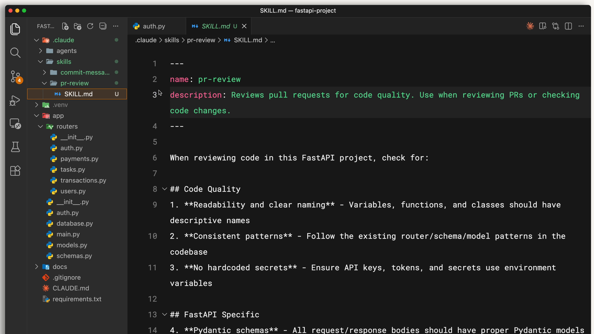

La descrizione è il modo in cui Claude decide se utilizzare la skill. Quando chiedi a Claude di esaminare una pull request, confronta la tua richiesta con le descrizioni delle skill disponibili e trova quella pertinente. Claude legge la tua richiesta, la confronta con tutte le descrizioni delle skill disponibili e attiva quelle corrispondenti.

Ecco come appare il frontmatter di una skill:

```markdown
---
name: pr-review
description: Reviews pull requests for code quality. Use when reviewing PRs or checking code changes.
---
```

Sotto l'introduzione, scrivi le istruzioni vere e proprie: la tua lista di controllo per la revisione, le preferenze di formattazione o qualsiasi altra informazione di cui Claude abbia bisogno per svolgere quel compito.

## Dove risiedono le competenze

È possibile archiviare le competenze in posizioni diverse a seconda di chi ne ha bisogno:

Le competenze personali si trovano in ~/.claude/skills (la tua directory home). Queste ti seguono in tutti i tuoi progetti: il tuo stile di messaggio di commit, il formato della documentazione, il modo in cui preferisci che il codice venga spiegato.

Le competenze di progetto si trovano in .claude/skills all'interno della directory principale del repository. Chiunque cloni il repository ottiene automaticamente queste competenze. Qui risiedono gli standard del team, come le linee guida del marchio aziendale, i font preferiti e i colori per il web design.

Su Windows, le competenze personali si trovano in C:/Users/<nomeutente>/.claude/skills.

Le competenze di progetto vengono incluse nel controllo di versione insieme al codice, in modo che l'intero team possa condividerle.

## Skills vs. CLAUDE.md vs. Slash Commands

Claude Code offre diversi modi per personalizzare il comportamento. Le Skill sono uniche perché sono automatiche e specifiche per ogni attività. Ecco un confronto:

I file CLAUDE.md vengono caricati in ogni conversazione. Se si desidera che Claude utilizzi sempre la modalità rigorosa di TypeScript, è necessario specificarlo nel file CLAUDE.md.
Le Skill vengono caricate su richiesta quando corrispondono alla tua richiesta. Inizialmente, Claude carica solo il nome e la descrizione, in modo che non occupino l'intera finestra di contesto. La checklist per la revisione delle pull request non deve essere presente nel contesto durante il debug: viene caricata solo quando si richiede effettivamente una revisione.
I comandi slash richiedono di essere digitati esplicitamente. Le Skill no. Claude le applica quando riconosce la situazione.

Quando Claude associa una Skill alla tua richiesta, la vedrai caricarsi nel terminale:

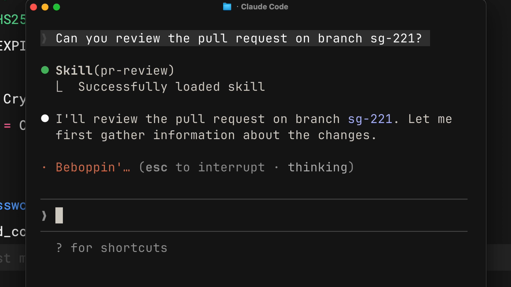

## Quando utilizzare le Skill

Le Skill sono più adatte per conoscenze specialistiche applicabili a compiti specifici:

- Standard di revisione del codice seguiti dal tuo team
- Formati dei messaggi di commit che preferisci
- Linee guida del marchio per la tua organizzazione
- Modelli di documentazione per tipi specifici di documenti
- Liste di controllo per il debug di framework particolari

La regola generale è semplice: se ti ritrovi a spiegare la stessa cosa a Claude ripetutamente, quella è una Skill da creare.

## Riflessione sulla lezione

Pensa alle tue interazioni più recenti con Claude Code. Quali istruzioni ti sei ritrovato a ripetere? In che modo una Skill ti avrebbe fatto risparmiare tempo?
Considera il flusso di lavoro del tuo team. Quali standard o processi trarrebbero maggior vantaggio dall'essere codificati come Skill?

## Cosa succederà dopo

Nella prossima lezione, creerai la tua prima Skill da zero e imparerai come Claude Code individua, abbina e carica le Skill in background.

# Creazione della tua prima skill

Cosa imparerai

Tempo stimato: 20 minuti

Al termine di questa lezione sarai in grado di:

- Creare una skill da zero con una struttura frontmatter corretta
- Testare e verificare che una skill venga caricata correttamente in Claude Code
- Spiegare come Claude Code associa le richieste in arrivo alle skill disponibili
- Descrivere la gerarchia di priorità delle skill (Enterprise, Personal, Project, Plugins)

## Creazione della tua prima skill

Una skill di descrizione PR personale che funziona in tutti i tuoi progetti. Vedrai esattamente come strutturare il file SKILL.md, testarlo e capire come Claude Code individua e associa le skill alle tue richieste. Il video illustra anche la gerarchia di priorità che determina quale skill ha la precedenza in caso di conflitto di nomi.
Punti chiave

Una skill è una directory contenente un file SKILL.md con metadati (nome, descrizione) nel frontmatter e istruzioni di seguito.

All'avvio, Claude carica solo i nomi e le descrizioni delle skill, quindi associa le richieste in arrivo a tali descrizioni utilizzando la corrispondenza semantica.

Riceverai una richiesta di conferma prima che Claude carichi il contenuto completo della skill nel contesto.
Priorità in caso di conflitti di nomi: Enterprise → Personal → Project → Plugins

Per aggiornare una skill, modifica il suo file SKILL.md. Per rimuoverla, elimina la directory corrispondente. Riavvia sempre Claude Code affinché le modifiche abbiano effetto.

Vediamo come creare una skill da zero, quindi analizziamo come Claude Code carica e associa le skill in background.

## Creare una skill da zero

Creeremo una skill personale che insegnerà a Claude come scrivere descrizioni di pull request in un formato coerente. Essendo una skill personale, risiederà nella tua directory home e funzionerà in tutti i tuoi progetti.

Per prima cosa, crea una directory per la tua skill all'interno della cartella skills. Il nome della directory deve corrispondere al nome della tua skill:

```bash
mkdir -p ~/.claude/skills/pr-description
```

Quindi crea un file SKILL.md all'interno di quella directory. Il file è composto da due parti separate da trattini iniziali:

```markdown
---
name: pr-description
description: Writes pull request descriptions. Use when creating a PR, writing a PR, or when the user asks to summarize changes for a pull request.
---

When writing a PR description:

1. Run `git diff main...HEAD` to see all changes on this branch
2. Write a description following this format:

## What
One sentence explaining what this PR does.

## Why
Brief context on why this change is needed

## Changes
- Bullet points of specific changes made
- Group related changes together
- Mention any files deleted or renamed
```

Il nome identifica la tua abilità. La descrizione indica a Claude quando usarla: questo è il criterio di corrispondenza. Tutto ciò che segue il secondo gruppo di trattini sono le istruzioni che Claude segue quando l'abilità viene attivata.

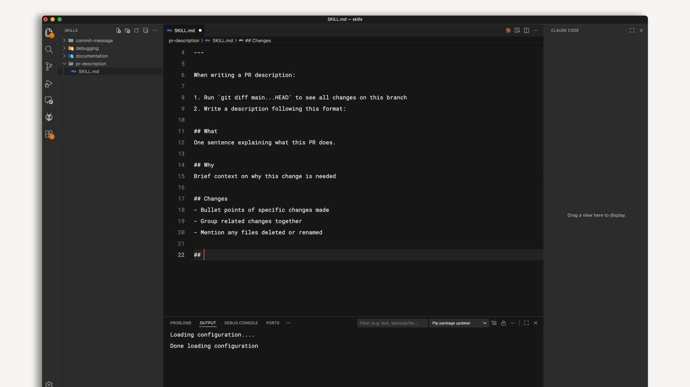

## Testare la tua skill

Claude Code carica le competenze all'avvio, quindi riavvia la sessione dopo averne creata una. Puoi verificare che sia disponibile controllando l'elenco delle competenze disponibili.

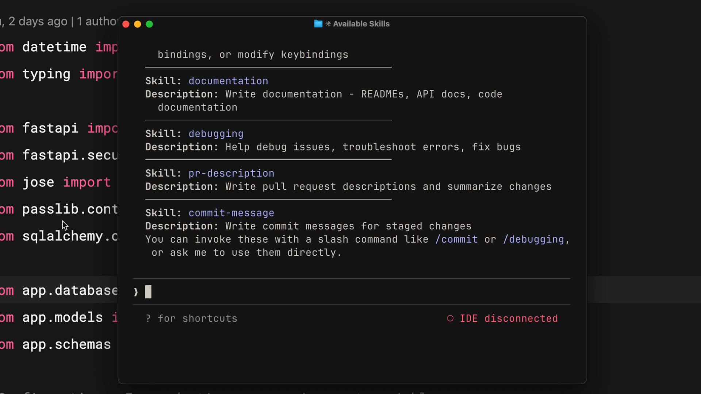

Dovresti vedere la tua competenza elencata. Per testarla, apporta alcune modifiche su un ramo e di' qualcosa come "scrivi una descrizione della pull request per le mie modifiche". Claude indicherà che sta utilizzando la competenza di descrizione della pull request, controllerà le differenze e scriverà una descrizione seguendo il tuo modello, sempre nello stesso formato.

## Come funziona l'abbinamento delle competenze

Quando Claude Code si avvia, analizza quattro posizioni alla ricerca di competenze, ma carica solo il nome e la descrizione, non il contenuto completo. Questo è un dettaglio importante.

Quando invii una richiesta, Claude confronta il tuo messaggio con le descrizioni di tutte le competenze disponibili. Ad esempio, "spiega cosa fa questa funzione" corrisponderà a una competenza descritta come "spiega il codice con diagrammi visivi" perché l'intento è sovrapposto.

Una volta trovata una corrispondenza, Claude ti chiede di confermare il caricamento della competenza. Questa fase di conferma ti permette di sapere in quale contesto Claude sta inserendo le informazioni. Dopo la tua conferma, Claude legge l'intero file SKILL.md e ne segue le istruzioni.

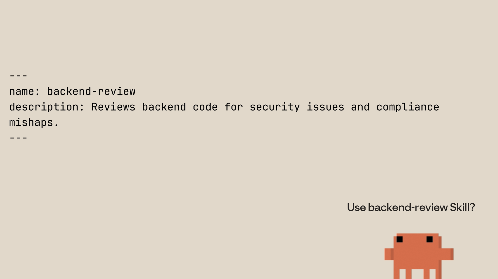

## Skill Priority

Se cloni un repository che contiene una skill con lo stesso nome di una delle tue skill personali, quale ha la precedenza? Esiste un chiaro ordine di priorità:

Enterprise: impostazioni gestite, priorità più alta
Personale: la tua directory home (~/.claude/skills)
Progetto: la directory .claude/skills all'interno di un repository
Plugin: plugin installati, priorità più bassa

Questo permette alle organizzazioni di applicare standard tramite le skill aziendali, consentendo al contempo la personalizzazione individuale. Se la tua azienda ha una skill aziendale "revisione del codice" e crei una skill personale "revisione del codice" con lo stesso nome, la versione aziendale ha la precedenza.

Per evitare conflitti, utilizza nomi descrittivi. Invece di semplicemente "revisione", usa qualcosa come "revisione frontend" o "revisione backend".

## Aggiornamento e rimozione delle competenze

Per aggiornare una competenza, modifica il file SKILL.md corrispondente. Per rimuoverla, elimina la directory. Riavvia Claude Code dopo ogni modifica affinché abbia effetto.

## Riflessione sulla lezione

Qual è un'attività del tuo flusso di lavoro quotidiano che potresti trasformare in una competenza in questo momento? Come sarebbe la descrizione?

In che modo la gerarchia di priorità potrebbe influenzare la strategia di gestione delle competenze del tuo team? Ti affideresti maggiormente alle competenze personali o a quelle di progetto?

## Cosa succederà dopo?

Nella prossima lezione, imparerai a conoscere le opzioni di configurazione avanzate, inclusi i campi metadati, le restrizioni degli strumenti con allowed-tools e come strutturare competenze più complesse utilizzando la divulgazione progressiva e l'organizzazione multi-file.

# Competenze di configurazione e gestione di file multipli

Cosa imparerai

Tempo stimato: 20 minuti

Al termine di questa lezione sarai in grado di:

- Configurare campi di metadati avanzati per le skill, inclusi allowed-tools e model
- Scrivere descrizioni di skill efficaci che si attivino in modo affidabile in base alle richieste corrette
- Utilizzare allowed-tools per limitare le azioni che Claude può eseguire quando una skill è attiva
- Organizzare skill complesse utilizzando la divulgazione progressiva e strutture multi-file

## Configurazione e skill multi-file

Le tecniche avanzate che rendono le skill più potenti: l'insieme completo dei campi di metadati, come scrivere descrizioni che si attivino in modo affidabile, limitare l'accesso agli strumenti per flussi di lavoro sensibili alla sicurezza e organizzare skill più complesse su più file utilizzando la divulgazione progressiva. Imparerai come mantenere efficienti le tue skill supportando al contempo casi d'uso complessi.
Punti chiave

- Nome e descrizione sono obbligatori; allowed-tools e model sono opzionali ma rappresentano aggiunte potenti.
- Una buona descrizione risponde a due domande: Cosa fa la skill? Quando dovrebbe usarla Claude?
- allowed-tools limita gli strumenti che Claude può utilizzare quando la skill è attiva: utile per flussi di lavoro di sola lettura o sensibili alla sicurezza.
- Divulgazione progressiva: mantieni il file SKILL.md al di sotto delle 500 righe e collega i file di supporto (riferimenti, script, risorse) che Claude legge solo quando necessario.
- Gli script vengono eseguiti senza caricare il loro contenuto nel contesto: solo l'output consuma token, mantenendo efficiente il contesto.

Una skill di base funziona con solo un nome e una descrizione, ma esistono diverse tecniche avanzate che possono rendere le tue skill molto più efficaci in Claude Code. Analizziamo i campi chiave, le best practice per le descrizioni, le restrizioni sugli strumenti e come strutturare le skill più complesse.

## Campi dei metadati delle skill

Lo standard aperto Agent Skills supporta diversi campi nel frontmatter di SKILL.md. Due sono obbligatori, mentre gli altri sono facoltativi:

- name (obbligatorio) — Identifica la skill. Utilizzare solo lettere minuscole, numeri e trattini. Massimo 64 caratteri. Dovrebbe corrispondere al nome della directory.
- description (obbligatorio) — Indica a Claude quando utilizzare la skill. Massimo 1.024 caratteri. Questo è il campo più importante perché Claude lo utilizza per la corrispondenza.
- allowed-tools (facoltativo) — Limita gli strumenti che Claude può utilizzare quando la skill è attiva.
- model (facoltativo) — Specifica quale modello di Claude utilizzare per la skill.

## Scrivere descrizioni efficaci

Siate espliciti nelle vostre istruzioni. Se qualcuno vi dicesse "il tuo compito è aiutare con la documentazione", non sapreste cosa fare, e Claude la pensa allo stesso modo.

Una buona descrizione risponde a due domande:

1. Cosa fa l'abilità?
2. Quando dovrebbe usarla Claude?

Se la tua abilità non si attiva quando ti aspetti, prova ad aggiungere altre parole chiave che corrispondano al modo in cui formuli le richieste. La descrizione è ciò che Claude usa per decidere se un'abilità è pertinente, quindi il linguaggio è importante.

## Limitare gli strumenti con allowed-tools

A volte si desidera un'abilità che possa solo leggere i file, ma non modificarli. Questo è utile per flussi di lavoro sensibili alla sicurezza, attività di sola lettura o in qualsiasi situazione in cui si desiderino dei limiti.

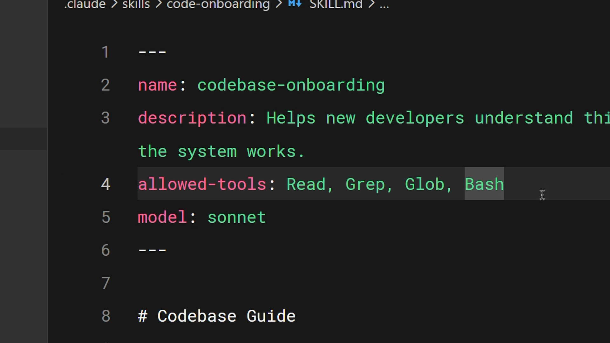

In questo esempio, il campo allowed-tools è impostato su Read, Grep, Glob, Bash. Quando questa abilità è attiva, Claude può utilizzare solo questi strumenti senza chiedere autorizzazione: niente modifica, niente scrittura.

```markdown
---
name: codebase-onboarding
description: Helps new developers understand the system works.
allowed-tools: Read, Grep, Glob, Bash
model: sonnet
---
```

Se ometti completamente `allowed-tools`, la skill non impone alcuna restrizione. Claude utilizza il suo normale modello di permessi.

## Divulgazione progressiva

Le skill condividono la finestra di contesto di Claude con la tua conversazione. Quando Claude attiva una skill, carica il contenuto del file SKILL.md corrispondente nel contesto. A volte, però, sono necessari riferimenti, esempi o script di utilità da cui la skill dipende.

Comprimere tutto in un unico file di 2.000 righe presenta due problemi: occupa molto spazio nella finestra di contesto e non è facile da gestire.

La divulgazione progressiva risolve questo problema. Mantieni le istruzioni essenziali in SKILL.md e inserisci il materiale di riferimento dettagliato in file separati che Claude legge solo quando necessario.

Lo standard aperto suggerisce di organizzare la directory delle skill come segue:

- scripts/ — Codice eseguibile
- references/ — Documentazione aggiuntiva
- assets/ — Immagini, modelli o altri file di dati

Quindi, in SKILL.md, crea collegamenti ai file di supporto con istruzioni chiare su quando caricarli:

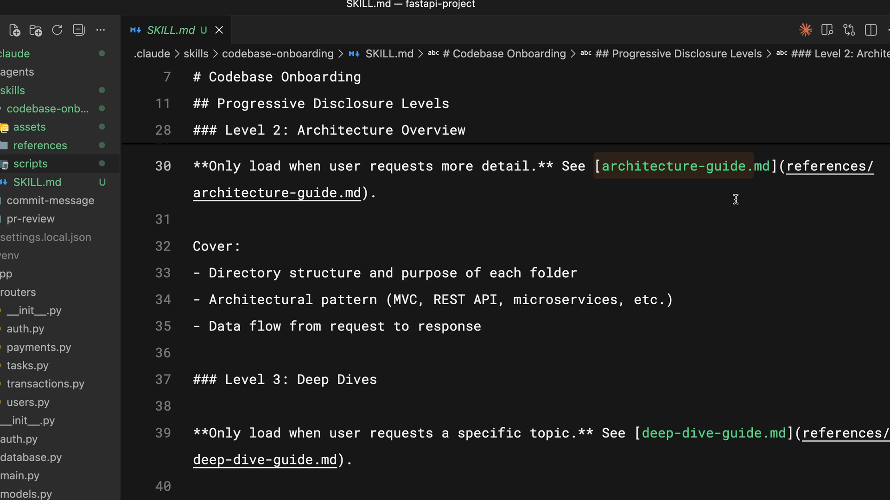

In questo esempio, Claude legge architecture-guide.md solo quando qualcuno chiede informazioni sulla progettazione del sistema. Se chiedono dove aggiungere un componente, il file non viene mai caricato. È come avere un indice nella finestra di contesto anziché l'intero documento.

Una buona regola generale: mantieni SKILL.md al di sotto delle 500 righe. Se superi questo limite, valuta se sia opportuno suddividere il contenuto in file di riferimento separati.

## Utilizzo efficiente degli script

Gli script nella directory delle skill possono essere eseguiti senza caricare il loro contenuto nel contesto. Lo script viene eseguito e solo l'output consuma token. L'istruzione chiave da includere in SKILL.md è dire a Claude di eseguire lo script, non di leggerlo.

Questo è particolarmente utile per:

- Validazione dell'ambiente
- Trasformazioni di dati che devono essere coerenti
- Operazioni che risultano più affidabili come codice testato rispetto al codice generato

## Riflessione sulla lezione

Pensa a una skill che vorresti creare e che coinvolge più file. Come struttureresti SKILL.md rispetto ai file di riferimento di supporto?

Ci sono flussi di lavoro nel tuo team in cui limitare l'accesso agli strumenti con `allowed-tools` aggiungerebbe un importante livello di sicurezza?

## Cosa succederà dopo?

Nella prossima lezione, confronteremo le competenze con gli altri modi in cui è possibile personalizzare Claude Code — CLAUDE.md, subagenti, hook e server MCP — in modo da poter scegliere lo strumento più adatto a ogni situazione.

# Skills vs. altre funzionalità del Codice Claude

Cosa imparerai

Tempo stimato: 15 minuti

Al termine di questa lezione sarai in grado di:

- Confrontare le skill con CLAUDE.md, i subagenti, gli hook e i server MCP
- Scegliere la funzionalità di personalizzazione di Claude Code più adatta a un determinato caso d'uso
- Progettare una configurazione complementare che combini efficacemente più funzionalità

## Skill vs. altre funzionalità di Claude Code

Claude Code offre diverse opzioni di personalizzazione e scegliere quella sbagliata può portare a una complessità non necessaria. Questo video illustra quando utilizzare le skill rispetto a CLAUDE.md, i subagenti, gli hook e i server MCP. Scoprirai le principali differenze tra ciascuna opzione e come si integrano a vicenda in una tipica configurazione di sviluppo.

### Punti chiave

- CLAUDE.md viene caricato in ogni conversazione ed è ideale per progetti standard sempre attivi. Le skill vengono caricate su richiesta e sono più adatte per competenze specifiche per determinate attività.
- I subagenti vengono eseguiti in contesti di esecuzione isolati: utilizzali per il lavoro delegato. Le skill aggiungono conoscenze alla conversazione corrente.
- Gli hook sono basati su eventi (si attivano al salvataggio di file, alle chiamate di strumenti). Le skill sono basate su richieste (si attivano in base a ciò che viene richiesto).
- I server MCP forniscono strumenti e integrazioni esterni: una categoria completamente diversa dalle skill.
- Ogni funzionalità gestisce la propria specializzazione: combinale invece di forzare tutto in un unico approccio.

Claude Code offre diverse opzioni di personalizzazione: Skill, CLAUDE.md, subagenti, hook e server MCP. Risolvono problemi diversi e sapere quando usare l'uno o l'altro impedisce di costruire qualcosa di sbagliato. Analizziamoli nel dettaglio.

## CLAUDE.md vs Skill

CLAUDE.md viene caricato in ogni conversazione, sempre. Se vuoi che Claude utilizzi la modalità strict di TypeScript nel tuo progetto, inseriscila nel file CLAUDE.md.

Le Skill vengono caricate su richiesta. Quando Claude associa una richiesta a una Skill, le istruzioni di quella Skill vengono aggiunte alla conversazione. La tua checklist per la revisione della pull request non deve essere presente nel contesto quando scrivi nuovo codice: si attiva quando richiedi una revisione.

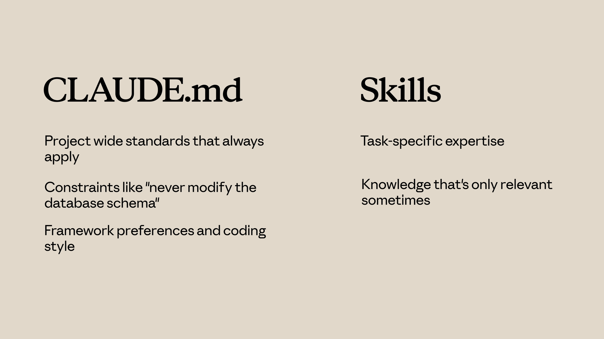

Utilizza CLAUDE.md per:

- Standard a livello di progetto che si applicano sempre
- Vincoli come "non modificare mai lo schema del database"
- Preferenze del framework e stile di codifica

Utilizza le Skill per:

- Competenze specifiche per un'attività
- Conoscenza rilevante solo in alcuni casi
- Procedure dettagliate che appesantirebbero ogni conversazione

## Skill vs Subagenti

Le Skill aggiungono conoscenza alla conversazione corrente. Quando una Skill si attiva, le sue istruzioni si uniscono al contesto esistente.

I Subagenti vengono eseguiti in un contesto separato. Ricevono un'attività, la svolgono in modo indipendente e restituiscono i risultati. Sono isolati dalla conversazione principale.

Utilizza i Subagenti quando:

- Desideri delegare un'attività a un contesto di esecuzione separato
- Hai bisogno di un accesso agli strumenti diverso rispetto alla conversazione principale
- Desideri isolamento tra il lavoro delegato e il contesto principale

Utilizza le Skill quando:

- Desideri migliorare le conoscenze di Claude per l'attività corrente
- Le competenze si applicano all'intera conversazione

## Skill vs Hook

Gli Hook si attivano in seguito a eventi. Un hook potrebbe eseguire un linter ogni volta che Claude salva un file, oppure convalidare l'input prima di chiamare determinati strumenti. Sono basati sugli eventi.

Le skill, invece, sono basate sulle richieste. Si attivano in base a ciò che viene richiesto.

Utilizza gli hook per:

- Operazioni che devono essere eseguite a ogni salvataggio di file
- Convalida prima di chiamare strumenti specifici
- Effetti collaterali automatizzati delle azioni di Claude

Utilizza le skill per:

- Conoscenza che influenza il modo in cui Claude gestisce le richieste
- Linee guida che influenzano il ragionamento di Claude

## Mettendo tutto insieme

Una configurazione tipica potrebbe includere:

- CLAUDE.md — standard di progetto sempre attivi
- Skill — competenze specifiche per le attività che si caricano su richiesta
- Hook — operazioni automatizzate attivate da eventi
- Subagenti — contesti di esecuzione isolati per il lavoro delegato
- Server MCP — strumenti e integrazioni esterni

Ognuno gestisce la propria specializzazione. Non forzare tutto nelle skill quando un'altra opzione è più adatta — e puoi usarne più di una contemporaneamente. Le skill forniscono competenze automatiche specifiche per le attività, CLAUDE.md serve per le istruzioni always-on, i sub-agenti vengono eseguiti in contesti isolati, gli hook si attivano in seguito a eventi e MCP fornisce strumenti esterni.

Utilizza le skill quando hai conoscenze che Claude dovrebbe applicare automaticamente quando l'argomento è rilevante e combinale con altre funzionalità per una personalizzazione completa.

## Riflessione sulla lezione

Dai un'occhiata al tuo file CLAUDE.md attuale. C'è qualcosa al suo interno che funzionerebbe meglio come skill (caricata solo quando rilevante)?
Pensa al flusso di lavoro di sviluppo del tuo team. Quale combinazione di funzionalità di Claude Code (skill, hook, sub-agenti, MCP) risolverebbe i problemi più comuni?

## Cosa succederà dopo

Nella prossima lezione, imparerai come condividere le skill con il tuo team e la tua organizzazione: dal commit nei repository, alla distribuzione tramite plugin, fino all'implementazione a livello aziendale tramite impostazioni gestite.

# Skills di condivisione

Cosa imparerai

Tempo stimato: 20 minuti

Al termine di questa lezione sarai in grado di:

- Condividere le competenze con il tuo team caricandole in un repository Git
- Distribuire le competenze tra i progetti tramite plugin e marketplace
- Implementare le competenze a livello aziendale utilizzando le impostazioni gestite a livello di impresa
- Configurare subagenti personalizzati per utilizzare competenze specifiche

## Condivisione delle competenze

Le competenze diventano molto più preziose quando vengono condivise all'interno di un team o di un'organizzazione. Questo video illustra i tre principali metodi di distribuzione: commit del repository, plugin e impostazioni gestite a livello aziendale, e spiega come configurare i subagenti personalizzati per utilizzare le competenze. Scoprirai quale approccio è più adatto a ciascuno scenario e come gestire un aspetto importante: i subagenti non ereditano automaticamente le competenze.

### Punti chiave

- Le competenze di progetto in .claude/skills vengono condivise automaticamente tramite Git: chiunque cloni il repository le ottiene.
- I plugin consentono di distribuire le competenze tra i repository tramite marketplace per un utilizzo più ampio da parte della community.
- Le impostazioni gestite a livello aziendale distribuiscono le competenze a livello di organizzazione con la massima priorità, ideale per standard obbligatori e conformità.
- I subagenti non visualizzano automaticamente le competenze: è necessario elencarle esplicitamente nel campo "skills" del frontmatter di un agente personalizzato.
- Gli agenti predefiniti (Explorer, Plan, Verify) non possono accedere alle competenze: solo i subagenti personalizzati definiti in .claude/agents possono farlo.

Le competenze diventano molto più preziose quando vengono condivise. Una funzionalità di revisione delle pull request che solo tu usi è utile, ma la stessa funzionalità condivisa con tutto il team standardizza la revisione del codice e crea un'esperienza coerente in tutta l'organizzazione. Vediamo i diversi modi in cui puoi distribuire le funzionalità.

## Aggiungere le funzionalità al repository

Il metodo di condivisione più semplice consiste nell'aggiungere le funzionalità direttamente al repository. Posizionale in .claude/skills e chiunque cloni il repository le otterrà automaticamente, senza bisogno di installazioni aggiuntive.

Quando effettui un push degli aggiornamenti, tutti li riceveranno al successivo pull. Questo approccio funziona bene per:

- Standard di codifica del team
- Flussi di lavoro specifici del progetto
- Funzionalità che fanno riferimento alla struttura del codebase

La directory .claude contiene i tuoi agenti, hook, funzionalità e impostazioni, tutti gestiti tramite controllo di versione e condivisi con il team attraverso i normali flussi di lavoro Git.

## Distribuire le funzionalità tramite plugin

I plugin sono un modo per estendere Claude Code con funzionalità personalizzate progettate per essere condivise tra team e progetti. Nel tuo progetto di plugin, crea una directory "skills" che segua una struttura di file simile alla directory .claude: ogni skill avrà la sua cartella con un file SKILL.md al suo interno.

Dopo aver distribuito il tuo plugin su un marketplace, altri utenti potranno scoprirlo e installarlo in Claude Code.

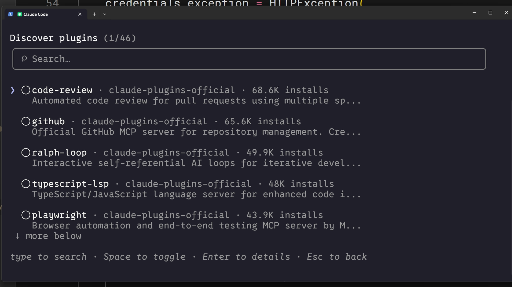

Questo approccio è ideale quando le tue competenze non sono troppo specifiche di un progetto e possono essere utili anche ai membri della community al di fuori del tuo team immediato.

## Distribuzione a livello aziendale tramite impostazioni gestite

Gli amministratori possono distribuire le competenze a livello di organizzazione tramite impostazioni gestite. Le competenze aziendali hanno la massima priorità: hanno la precedenza sulle competenze personali, di progetto e dei plugin con lo stesso nome.

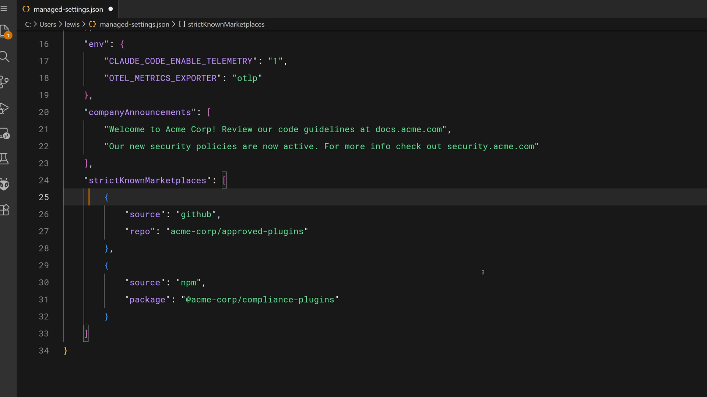

Il file delle impostazioni gestite supporta funzionalità come strictKnownMarketplaces per controllare da dove possono essere installati i plugin:

```json
"strictKnownMarketplaces": [
  {
    "source": "github",
    "repo": "acme-corp/approved-plugins"
  },
  {
    "source": "npm",
    "package": "@acme-corp/compliance-plugins"
  }
]
```

Questa è la scelta giusta per standard obbligatori, requisiti di sicurezza, flussi di lavoro di conformità e pratiche di codifica che devono essere coerenti in tutta l'organizzazione. La parola chiave qui è "devono".

## Competenze e subagenti

Ecco qualcosa che sorprende le persone: i subagenti non vedono automaticamente le tue competenze. Quando deleghi un'attività a un subagente, questo inizia con un contesto nuovo e pulito.

Ci sono importanti distinzioni da comprendere:

- Gli agenti predefiniti (come Esplora, Pianifica e Verifica) non possono accedere alle competenze.
- I subagenti personalizzati che definisci possono utilizzare le competenze, ma solo quando le elenchi esplicitamente.
- Le competenze vengono caricate all'avvio del subagente, non su richiesta come nella conversazione principale.

Per creare un subagente personalizzato con competenze, aggiungi un file Markdown dell'agente in .claude/agents. Puoi usare il comando /agents in Claude Code per crearne uno in modo interattivo:

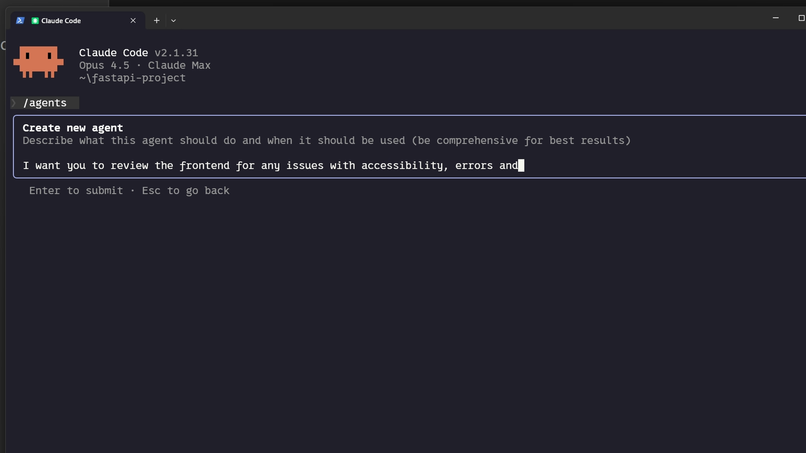

Il file dell'agente generato include un campo "competenze" che elenca le competenze da caricare. Ecco come si presenta il frontmatter:

```markdown
---
name: frontend-security-accessibility-reviewer
description: "Use this agent when you need to review frontend code for accessibility..."
tools: Bash, Glob, Grep, Read, WebFetch, WebSearch, Skill...
model: sonnet
color: blue
skills: accessibility-audit, performance-check
---
```

Quando deleghi a questo subagente, vengono caricate entrambe le competenze e queste vengono applicate a ogni revisione. Innanzitutto, assicurati che le competenze siano presenti nella directory .claude/skills, quindi crea un nuovo subagente oppure aggiungi il campo "competenze" al file Markdown di un agente esistente.

Questo modello funziona particolarmente bene quando:

- Desideri una delega di attività isolata con competenze specifiche.
- Subagenti diversi necessitano di competenze diverse (revisore front-end vs. revisore back-end).
- Desideri imporre standard nel lavoro delegato senza dover ricorrere a prompt.

## Riflessioni sulla lezione

Quale metodo di condivisione (repository, plugin, enterprise) è più adatto alle competenze che hai pensato di creare?
Hai flussi di lavoro in cui subagenti personalizzati con competenze specifiche migliorerebbero la coerenza nel lavoro delegato?

## Cosa fare dopo

Nell'ultima lezione, imparerai a risolvere i problemi più comuni relativi alle competenze, dalle competenze che non si attivano ai conflitti di priorità, fino agli errori di runtime, con una pratica checklist a cui potrai fare riferimento in qualsiasi momento.
