# Sviluppo con l'API di Claude

## Informazioni su questo corso

Questo corso offre una copertura completa dell'API di Claude, dall'utilizzo di base alle architetture avanzate degli agenti. Imparerai a integrare Claude nelle applicazioni, implementare la chiamata di strumenti, creare pipeline RAG e progettare flussi di lavoro deterministici e sistemi di agenti flessibili.

## Obiettivi di apprendimento

Al termine del corso, sarai in grado di:

Effettuare richieste API ai modelli di Claude e gestire le risposte
Implementare conversazioni multi-turno, streaming e generazione di output strutturato
Creare e valutare sistematicamente i prompt utilizzando pipeline di test automatizzate
Creare strumenti personalizzati e integrare Claude con servizi esterni
Progettare e implementare sistemi RAG con ricerca e riordinamento ibridi
Utilizzare MCP (Model Context Protocol) per connettere Claude a diverse fonti di dati
Comprendere i flussi di lavoro e le architetture degli agenti più comuni

## Prerequisiti

Competenza nella programmazione Python
Conoscenza di base della gestione dei dati JSON
Accesso a una chiave API di Anthropic

## A chi è rivolto questo corso

Ingegneri del software che necessitano di integrare Claude in applicazioni di produzione. Che tu stia creando chatbot, strumenti di automazione o funzionalità basate sull'intelligenza artificiale, questo corso illustra i modelli di implementazione di cui avrai bisogno.

Indice del corso:

- Introduzione a Claude: Inizia da qui per apprendere le basi. Tratta l'autenticazione API, le richieste di base, la gestione delle conversazioni, i prompt di sistema e la generazione di output strutturati.
- Progettazione e valutazione dei prompt: Impara a scrivere prompt che funzionano davvero. Si concentra su strategie di prompt, framework di valutazione e approcci di test sistematici.
- Utilizzo degli strumenti con Claude: Estendi Claude con strumenti e funzioni personalizzati. Crea app con chiamate di funzione, interazioni tra strumenti a più turni, chiamate di strumenti in batch e sfrutta le utilità integrate.
- Generazione aumentata per il recupero: Guida all'implementazione per sistemi RAG di produzione. Il corso tratta argomenti quali la suddivisione del testo in blocchi, gli embedding, la ricerca ibrida con BM25, le architetture multi-indice, il reranking e il recupero contestuale.
- Model Context Protocol (MCP): Il protocollo per la creazione di applicazioni di IA modulari. Definizione di strumenti e risorse personalizzati, implementazione di server e client MCP, gestione dell'intero ciclo di vita dell'integrazione.
- Claude Code e Computer Use: Due potenti strumenti di Anthropic in azione. Claude Code accelera i flussi di lavoro di sviluppo, Computer Use automatizza le interazioni con l'interfaccia utente. Include modelli di integrazione MCP.
- Agenti e flussi di lavoro: Modelli architetturali per sistemi di IA autonomi. Comprendere l'esecuzione parallela, l'incatenamento delle operazioni, il routing condizionale e le strategie di debug efficaci.

---

# Accesso all'API

Quando si sviluppano applicazioni con Claude, comprendere l'intero ciclo di vita della richiesta aiuta a prendere decisioni architetturali migliori e a eseguire il debug dei problemi in modo più efficace. Analizziamo cosa succede dal momento in cui un utente clicca su "Invia" nell'interfaccia di chat fino a quando la risposta di Claude appare sullo schermo.

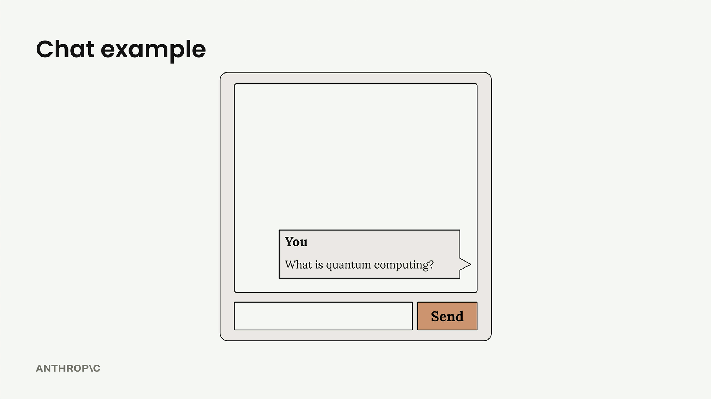

## Il flusso di richiesta in cinque fasi

Ogni interazione con Claude segue uno schema prevedibile con cinque fasi distinte: richiesta al server, richiesta all'API di Anthropic, elaborazione del modello, risposta al server e risposta al client.

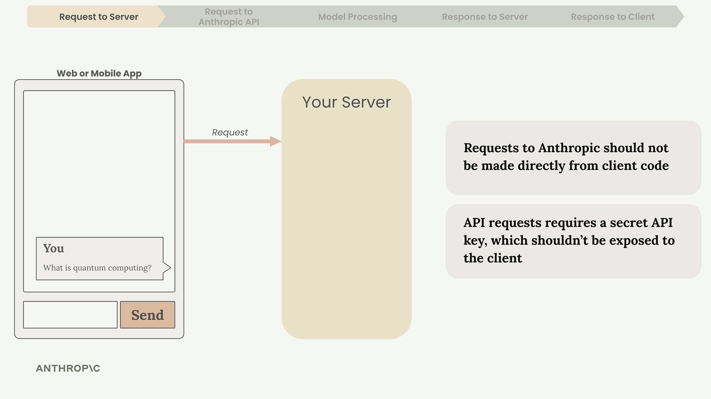

## Perché è necessario un server

Non si dovrebbero mai effettuare richieste all'API di Anthropic direttamente dal codice lato client. Ecco perché:

- Le richieste API richiedono una chiave API segreta per l'autenticazione.
- Esporre questa chiave nel codice client crea una grave vulnerabilità di sicurezza.
- Chiunque potrebbe estrarre la chiave ed effettuare richieste non autorizzate.

Invece, la tua app web o mobile invia le richieste al tuo server, che poi comunica con l'API di Anthropic utilizzando la chiave archiviata in modo sicuro.

## Effettuare richieste API

Quando il tuo server contatta l'API di Anthropic, puoi utilizzare un SDK ufficiale o effettuare semplici richieste HTTP. Anthropic fornisce SDK per Python, TypeScript, JavaScript, Go e Ruby.

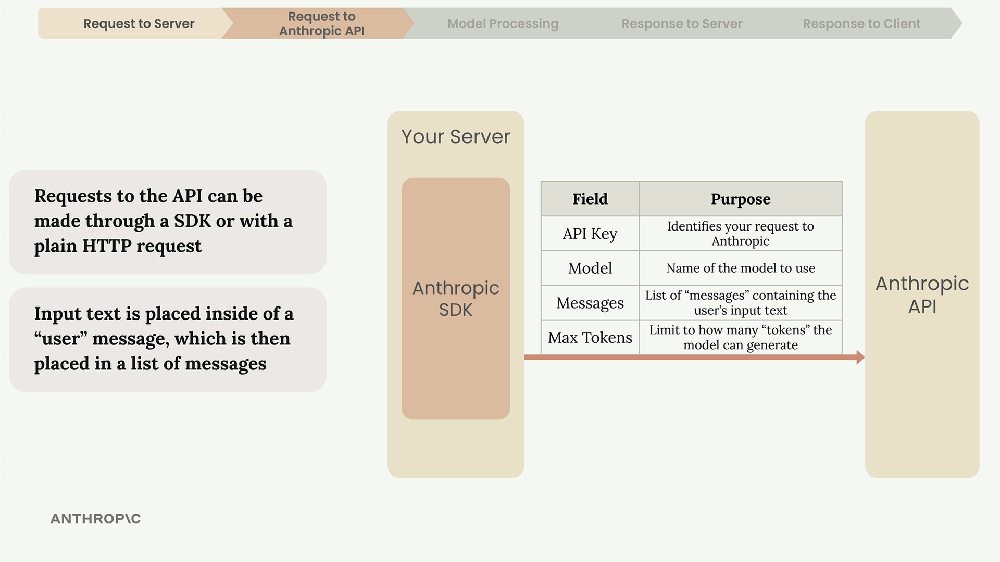

Ogni richiesta deve includere i seguenti campi essenziali:

- Chiave API - Identifica la tua richiesta ad Anthropic
- Modello - Nome del modello da utilizzare (ad esempio "claude-3-sonnet")
- Messaggi - Elenco contenente il testo inserito dall'utente
- Numero massimo di token - Limite massimo di token che Claude può generare

## Elaborazione interna di Claude

Una volta ricevuta la tua richiesta, Claude la elabora attraverso quattro fasi principali: tokenizzazione, incorporamento, contestualizzazione e generazione.

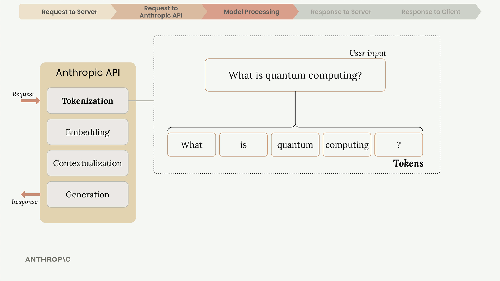

### Tokenizzazione

Claude suddivide innanzitutto il testo inserito in blocchi più piccoli chiamati token. Questi possono essere parole intere, parti di parole, spazi o simboli. Per semplicità, considera ogni parola come un token.

### Incorporamento

Ogni token viene convertito in un embedding, ovvero una lunga lista di numeri che rappresenta tutti i possibili significati di quella parola. Gli embedding possono essere considerati come definizioni numeriche che catturano le relazioni semantiche.

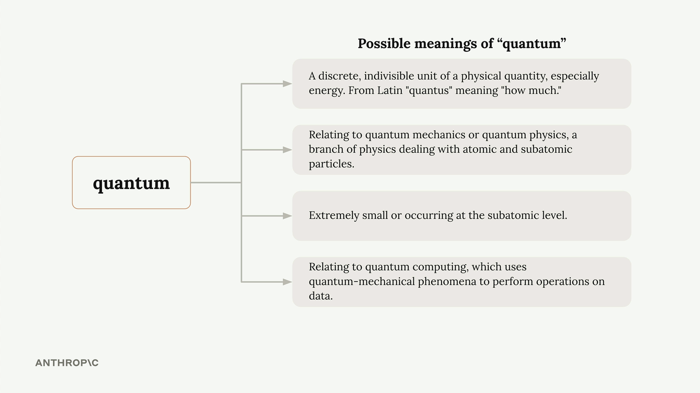

Le parole spesso hanno molteplici significati. Ad esempio, "quantico" potrebbe riferirsi a:

- Un'unità discreta di grandezza fisica (fisica)
- Concetti di meccanica quantistica o fisica quantistica
- Qualcosa di estremamente piccolo o subatomico
- Applicazioni del calcolo quantistico

### Contestualizzazione

Claude affina ogni embedding in base alle parole circostanti per determinare il significato più probabile nel contesto. Questo processo adatta le rappresentazioni numeriche per evidenziare la definizione appropriata.

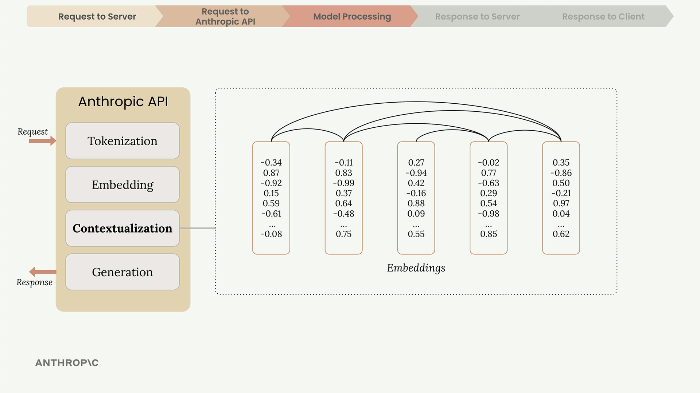

### Generazione

Gli embedding contestualizzati passano attraverso un livello di output che calcola le probabilità per ogni possibile parola successiva. Claude non sceglie sempre la parola con la probabilità più alta: utilizza una combinazione di probabilità e casualità controllata per creare risposte naturali e varie.

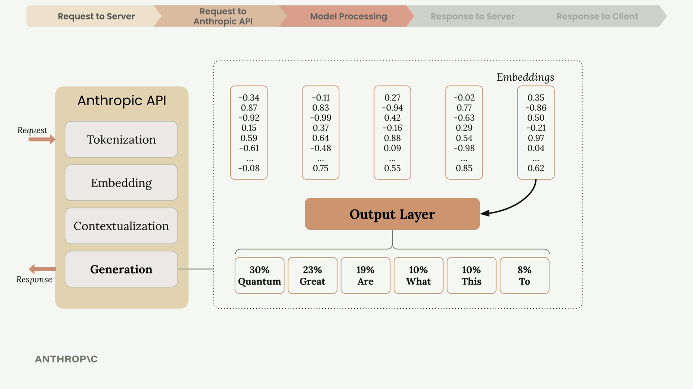

Dopo aver selezionato ogni parola, Claude la aggiunge alla sequenza e ripete l'intero processo per la parola successiva.

## Quando Claude interrompe la generazione

Dopo ogni token, Claude verifica diverse condizioni per decidere se continuare:

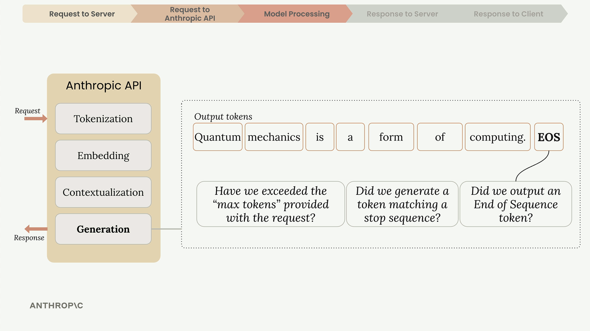

- Numero massimo di token raggiunto: è stato raggiunto il limite specificato?
- Terminazione naturale: è stato generato un token di fine sequenza?
- Sequenza di arresto: è stata rilevata una frase di arresto predefinita?

## Risposta dell'API

Al termine della generazione, l'API invia una risposta strutturata contenente:

- Messaggio: il testo generato
- Utilizzo: conteggio dei token di input e output
- Motivo dell'arresto: motivo per cui la generazione è terminata

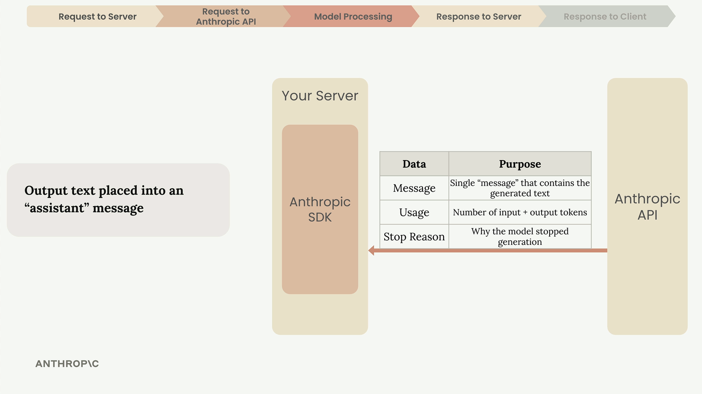

Il server riceve questa risposta e inoltra il testo generato all'applicazione client, dove viene visualizzato nell'interfaccia utente.

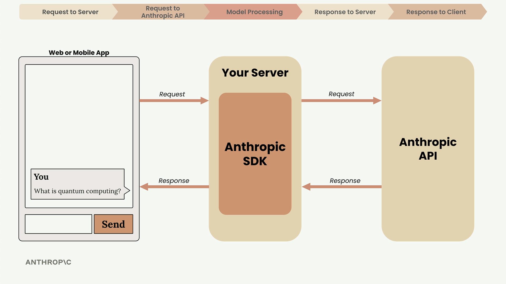

### Punti chiave

Comprendere questo flusso ti aiuta a:

- Progettare architetture sicure che proteggano le tue chiavi API
- Impostare limiti di token appropriati per il tuo caso d'uso
- Gestire diverse cause di interruzione nella logica della tua applicazione
- Eseguire il debug dei problemi comprendendo dove potrebbero verificarsi nella pipeline

Non preoccuparti di memorizzare ogni dettaglio: l'obiettivo è familiarizzare con la terminologia e il processo generale che incontrerai quando lavorerai con l'API di Claude.

---

# Ottenere una chiave API

Nel prossimo video effettueremo una richiesta all'API di Anthropic. Per farlo, avrai bisogno di una chiave API segreta. Questa guida ti illustrerà il processo di creazione di una chiave API.

## Passaggio uno: Accedi alla console API di Anthropic

Nel tuo browser, vai su https://console.anthropic.com/ ed effettua l'accesso al tuo account Anthropic. Vedrai una pagina simile a questa:


## Passaggio due: Fai clic sul pulsante "Ottieni chiavi API"

Questo pulsante si trova in alto a destra nella pagina principale della dashboard.


## Passaggio tre: Fai clic sul pulsante "Crea chiave"

In alto a destra della pagina, trova il pulsante "Crea chiave" e fai clic su di esso.


## Passaggio quattro: Inserisci un'area di lavoro e un nome per la tua chiave

Crea la chiave nell'area di lavoro "Default" e inserisci un nome per la tua chiave. Questo nome ti aiuterà a identificare le chiavi che generi. Utilizziamo il nome "Anthropic Course".


## Passaggio cinque: copia la chiave

La tua chiave API verrà visualizzata in una finestra a comparsa. Copia questa chiave e conservala: la useremo nel prossimo video. Questa chiave verrà visualizzata una sola volta, quindi assicurati di copiarla!

Se chiudi accidentalmente la finestra, elimina la vecchia chiave e generane una nuova.

---

# Effettuare una richiesta

Effettuare la prima richiesta all'API di Anthropic è semplice una volta compresa la configurazione e la struttura di base. Questa guida illustra i passaggi essenziali per far sì che Claude risponda alle tue richieste utilizzando Python.

## Configurazione dell'ambiente

Prima di effettuare qualsiasi chiamata API, è necessario installare i pacchetti richiesti e configurare la chiave API in modo sicuro.

Innanzitutto, installa le dipendenze necessarie nel tuo notebook Jupyter:

```python
%pip install anthropic python-dotenv
```

Successivamente, crea un file .env nella stessa directory del tuo notebook per memorizzare la chiave API in modo sicuro:

```env
ANTHROPIC_API_KEY="la-tua-chiave-API-qui"
```

Questo approccio mantiene la chiave API separata dal codice e impedisce di inserirla accidentalmente nel sistema di controllo versione. Aggiungi sempre .env al tuo file .gitignore.

Carica le variabili d'ambiente e crea il tuo client API:

```python
from dotenv import load_dotenv
load_dotenv()

from anthropic import Anthropic

client = Anthropic()
model = "claude-sonnet-4-0"
```

## La funzione Create

Il cuore delle richieste API è la funzione client.messages.create(). Questa funzione richiede tre parametri chiave:

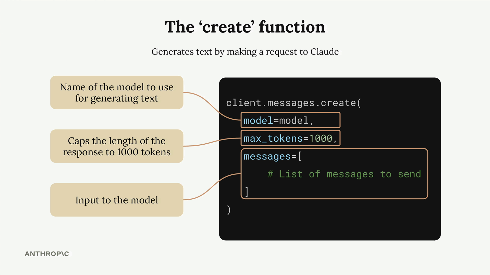

- model - Il nome del modello Claude che desideri utilizzare
- max_tokens - Un limite di sicurezza per la lunghezza della risposta (non un obiettivo)
- messages - La cronologia della conversazione che stai inviando a Claude

Il parametro max_tokens funge da meccanismo di sicurezza. Se lo imposti a 1000, Claude smetterà di generare dopo 1000 token, anche se ha altro da dire. Claude non cerca di raggiungere questo limite, scrive semplicemente ciò che ritiene appropriato e si ferma se raggiunge il massimo.

## Comprensione dei messaggi

I messaggi rappresentano la conversazione tra te e Claude, in modo simile a un'applicazione di chat. Esistono due tipi di messaggi:

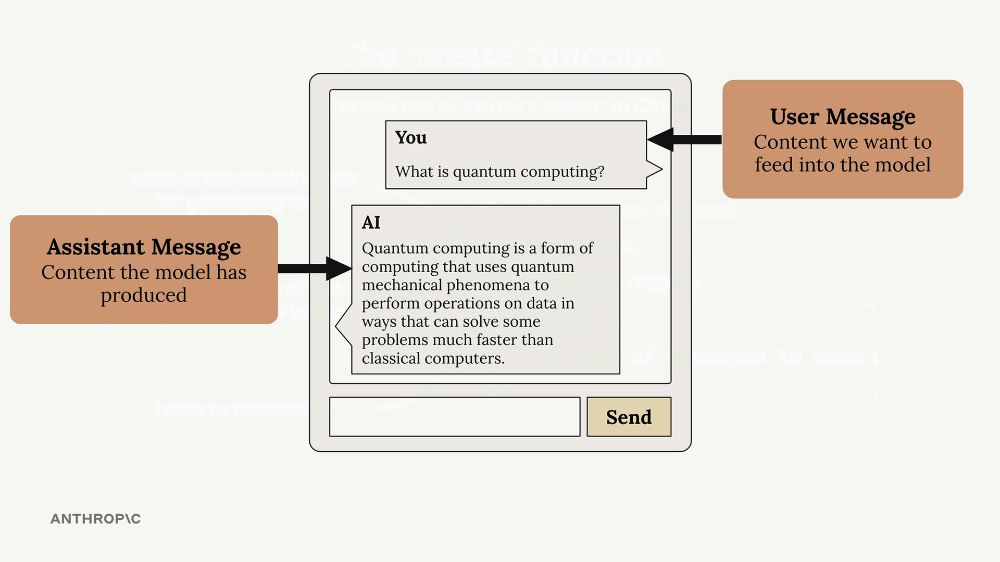

- Messaggi utente: contenuti che si desidera inviare a Claude (scritti da esseri umani)
- Messaggi assistente: risposte generate da Claude

Ogni messaggio è un dizionario con un ruolo ("utente" o "assistente") e un contenuto (il testo vero e proprio).

## Effettuare la prima richiesta

Ecco un esempio completo di come effettuare una richiesta a Claude:

```python
message = client.messages.create(
  model=model,
  max_tokens=1000,
  messages=[
    {
    "ruolo": "utente",
    "contenuto": "Cos'è il calcolo quantistico? Rispondi in una frase"
    }
  ]
)
```

Quando si esegue questo codice, Claude elaborerà la richiesta e restituirà un oggetto di risposta contenente il testo generato insieme ai metadati relativi alla richiesta.

## Estrazione della risposta

L'oggetto di risposta contiene molte informazioni, ma in genere si desidera solo il testo generato. È possibile accedervi tramite:

```python
message.content[0].text
```

Questo genera un output chiaro e leggibile, come ad esempio: "L'informatica quantistica è un tipo di calcolo che sfrutta i principi della meccanica quantistica, come la sovrapposizione e l'entanglement, per elaborare le informazioni utilizzando bit quantistici (qubit), risolvendo potenzialmente alcuni problemi complessi in modo esponenzialmente più veloce rispetto ai computer classici."

Con queste nozioni di base, puoi iniziare a sperimentare con diversi prompt e a creare interazioni più complesse con Claude.

---

# Conversazioni a più turni

Quando si lavora con l'API di Anthropic e Claude, c'è un concetto fondamentale da comprendere: Claude non memorizza la cronologia delle conversazioni. Ogni richiesta è completamente indipendente, senza alcuna memoria degli scambi precedenti.

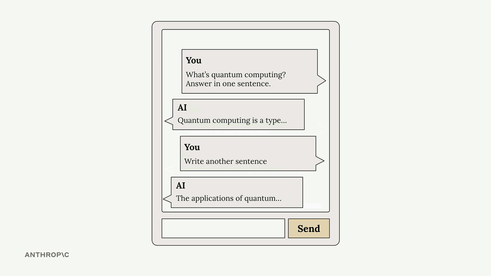

Questo significa che, se si desidera avere una conversazione a più turni in cui Claude ricordi il contesto dei messaggi precedenti, è necessario gestire autonomamente lo stato della conversazione.

## Il problema delle conversazioni senza stato

Supponiamo di chiedere a Claude "Cos'è il calcolo quantistico?" e ​​di ricevere una risposta valida. Poi si chiede "Scrivi un'altra frase": Claude non ha idea di cosa ci si riferisca. Scriverà una frase completamente casuale perché non ha memoria della discussione sul calcolo quantistico.

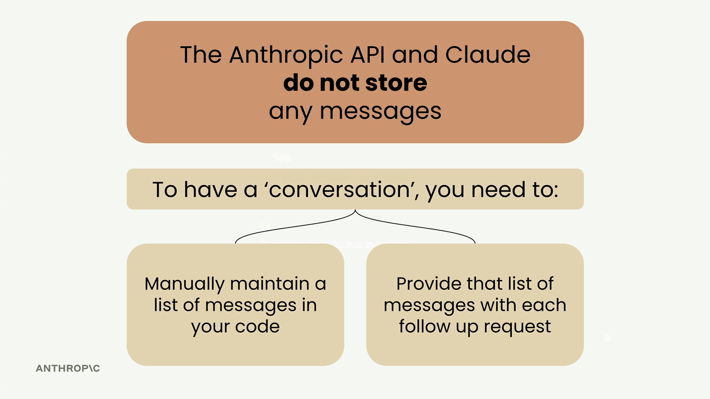


## Come funzionano le conversazioni a più turni

Per mantenere il contesto della conversazione, è necessario fare due cose:

- Gestire manualmente un elenco di tutti i messaggi nel codice
- Inviare la cronologia completa dei messaggi con ogni richiesta

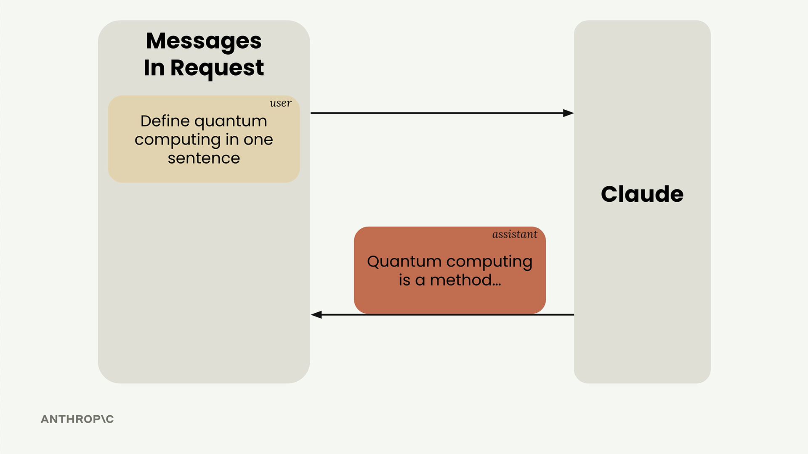

Ecco il flusso che funziona effettivamente:

1. Invia il tuo messaggio iniziale a Claude
2. Prendi la risposta di Claude e aggiungila al tuo elenco di messaggi come messaggio di assistenza
3. Aggiungi la tua domanda di approfondimento come un altro messaggio utente
4. Invia l'intera cronologia della conversazione a Claude

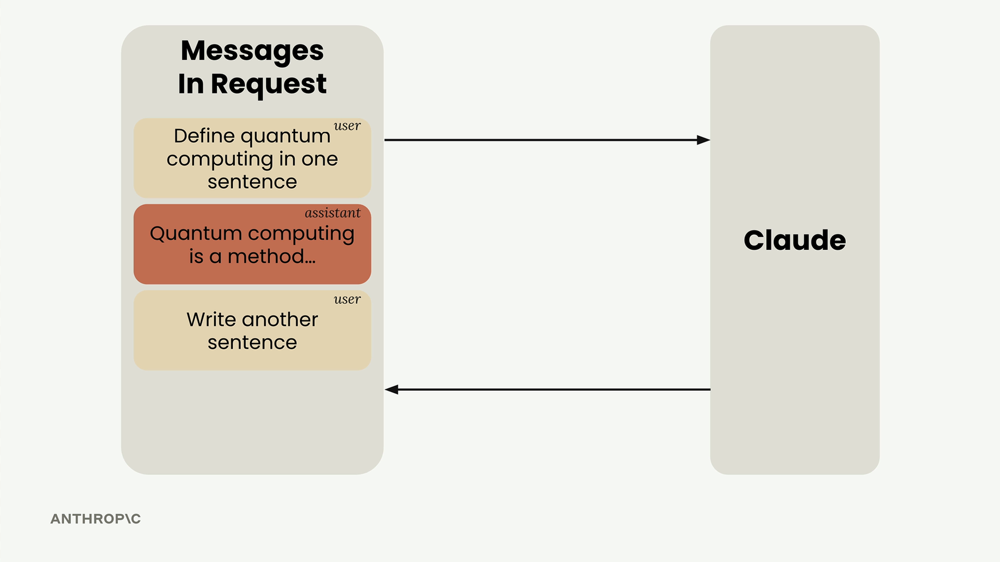

## Creazione di funzioni di supporto

Per semplificare la gestione delle conversazioni, puoi creare tre funzioni di supporto:

```python
def add_user_message(messages, text):
    user_message = {"role": "user", "content": text}
    messages.append(user_message)

def add_assistant_message(messages, text):
    assistant_message = {"role": "assistant", "content": text}
    messages.append(assistant_message)

def chat(messages):
    message = client.messages.create(
        model=model,
        max_tokens=1000,
        messages=messages,
    )
    return message.content[0].text
```

## Mettendo tutto insieme

Ecco come utilizzare queste funzioni per mantenere una conversazione:

```python
# Start with an empty message list
messages = []

# Add the initial user question
add_user_message(messages, "Define quantum computing in one sentence")

# Get Claude's response
answer = chat(messages)

# Add Claude's response to the conversation history
add_assistant_message(messages, answer)

# Add a follow-up question
add_user_message(messages, "Write another sentence")

# Get the follow-up response with full context
final_answer = chat(messages)
```

Ora Claude capirà che "Scrivi un'altra frase" si riferisce ad ampliare la definizione di calcolo quantistico, perché hai fornito il contesto completo della conversazione.

Queste funzioni di supporto si riveleranno utili durante tutto il tuo lavoro con Claude, semplificando notevolmente la creazione di applicazioni in grado di mantenere conversazioni significative attraverso molteplici scambi.

---

# Richieste di sistema

I prompt di sistema sono un modo efficace per personalizzare il modo in cui Claude risponde all'input dell'utente. Invece di ottenere risposte generiche, è possibile modellare il tono, lo stile e l'approccio di Claude per adattarli al caso d'uso specifico.


## Perché i prompt di sistema sono importanti

Si pensi alla creazione di un chatbot per tutor di matematica. Quando uno studente chiede "Come si risolve 5x + 2 = 3 per x?", si desidera che Claude si comporti come un vero tutor, non che si limiti a fornire la risposta. Un buon tutor di matematica dovrebbe:

- Fornire inizialmente suggerimenti anziché soluzioni complete
- Guidare pazientemente gli studenti passo dopo passo nella risoluzione dei problemi
- Mostrare soluzioni per problemi simili come esempi

Sicuramente non si desidera che Claude:

- Dare immediatamente risposte dirette
- Dire agli studenti di usare semplicemente una calcolatrice

## Come funzionano i prompt di sistema

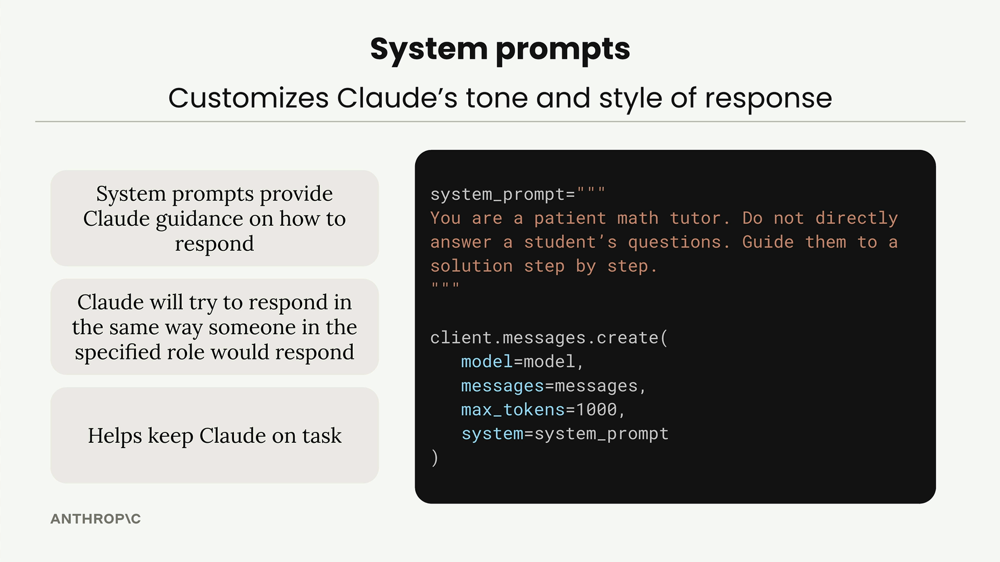

I prompt di sistema forniscono a Claude indicazioni su come rispondere. Si definiscono come semplici stringhe e si passano alla chiamata della funzione create. I principali vantaggi sono:

- I suggerimenti del sistema forniscono a Claude indicazioni su come rispondere
- Claude cercherà di rispondere nello stesso modo in cui risponderebbe una persona con il ruolo specificato
- Aiuta a mantenere Claude concentrato sul compito

Ecco la struttura di base:

```python
system_prompt = """
You are a patient math tutor.
Do not directly answer a student's questions.
Guide them to a solution step by step.
"""

client.messages.create(
    model=model,
    messages=messages,
    max_tokens=1000,
    system=system_prompt
)
```

## Vedere la differenza

Senza un prompt di sistema, Claude fornisce immediatamente una soluzione completa passo passo. Questo può essere utile, ma non incoraggia lo studente a ragionare autonomamente sul problema.

Con il prompt di sistema del tutor di matematica, la risposta di Claude cambia radicalmente. Invece di fornire la soluzione completa, Claude pone domande guida come "Quale pensi che sarebbe un buon primo passo per isolare x? Considera quale operazione potremmo dover eseguire su entrambi i lati per iniziare a spostare i termini."

## Creare una funzione di chat flessibile

Anziché inserire prompt di sistema fissi nel codice, puoi rendere la tua funzione di chat più riutilizzabile accettando i prompt di sistema come parametri:

```python
def chat(messages, system=None):
    params = {
        "model": model,
        "max_tokens": 1000,
        "messages": messages,
    }
    
    if system:
        params["system"] = system
    
    message = client.messages.create(**params)
    return message.content[0].text
```

Questo approccio risolve un dettaglio importante: l'API di Claude non accetta `system=None`, quindi è necessario includere il parametro `system` solo quando viene fornito.

Ora puoi chiamare la tua funzione di chat con o senza il prompt di sistema:

```python
# Without system prompt
answer = chat(messages)

# With system prompt
system = """
You are a patient math tutor.
Do not directly answer a student's questions.
Guide them to a solution step by step.
"""
answer = chat(messages, system=system)
```

I prompt di sistema sono essenziali per creare applicazioni di intelligenza artificiale che si comportino in modo coerente e appropriato allo scopo previsto. Trasformano le risposte generiche dell'IA in interazioni specializzate e adeguate al ruolo.

---

# Temperature

La temperatura è un parametro fondamentale che influenza la prevedibilità e la creatività delle risposte di Claude. Capire come utilizzarla efficacemente può migliorare notevolmente le vostre applicazioni di intelligenza artificiale.

Come Claude genera il testo

Prima di approfondire il concetto di temperatura, è utile comprendere il processo di generazione del testo di Claude. Quando gli si invia un prompt come "Cosa ne pensi?", il sistema segue tre fasi principali:

- Tokenizzazione: suddivisione dell'input in blocchi più piccoli
- Previsione: calcolo delle probabilità per le possibili parole successive
- Campionamento: selezione di un token in base a tali probabilità

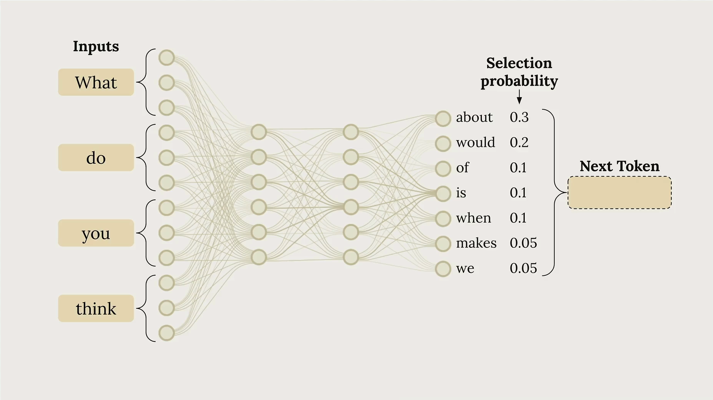

In questo esempio, Claude potrebbe assegnare una probabilità del 30% a "circa", del 20% a "sarebbe", del 10% a "di", e così via. Il modello seleziona quindi un token e ripete l'intero processo per costruire frasi complete.

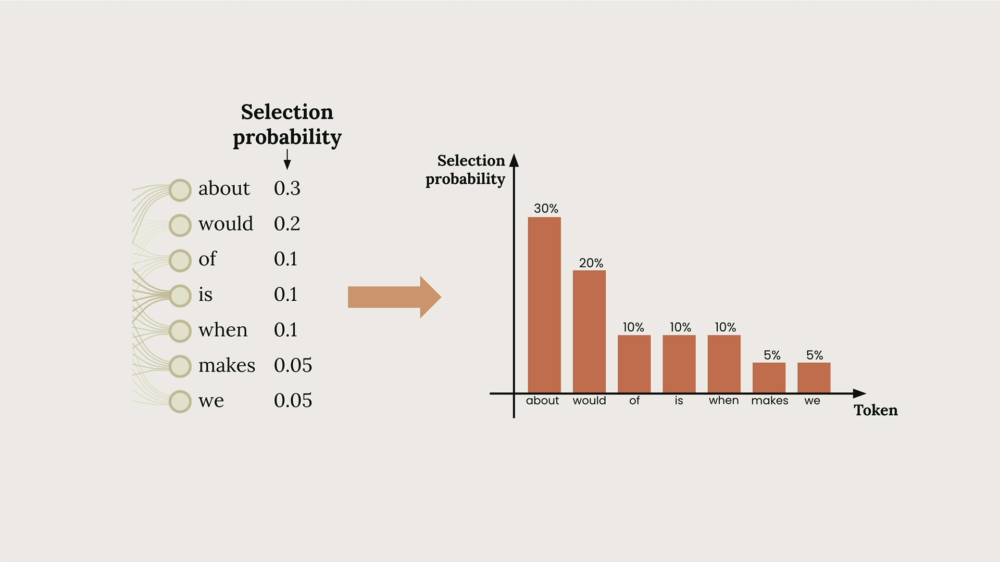

## Cosa fa la temperatura

La temperatura è un valore decimale compreso tra 0 e 1 che influenza direttamente queste probabilità di selezione. È come regolare la "manopola della creatività" delle risposte di Claude.

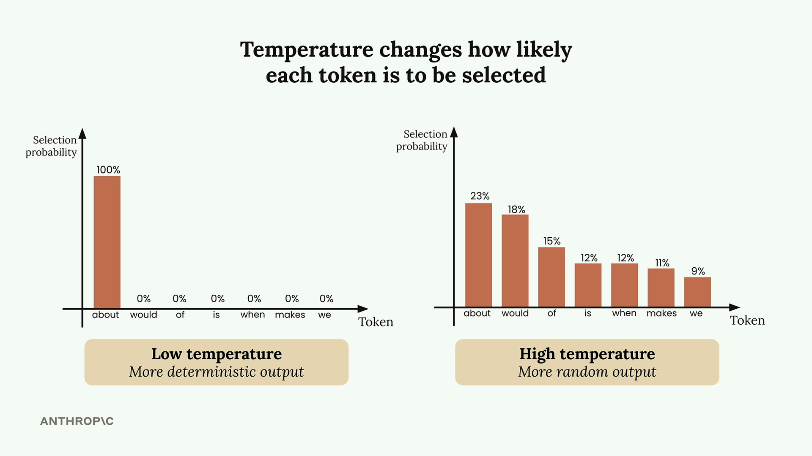

A basse temperature (vicine a 0), Claude diventa molto deterministico: sceglie quasi sempre il token con la probabilità più alta. Ad alte temperature (vicine a 1), Claude distribuisce la probabilità in modo più uniforme tra le opzioni, portando a risultati più vari e creativi.

## Demo interattiva della temperatura

Puoi vedere la temperatura in azione con la demo interattiva di Claude. Osserva come cambia la distribuzione di probabilità regolando il cursore della temperatura:

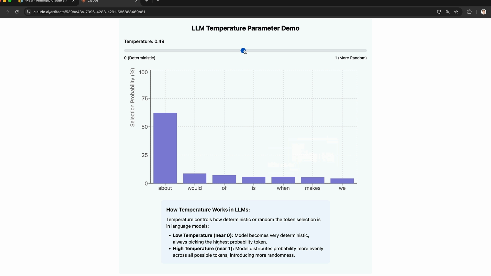

A una temperatura di 0,0, "circa" ha una probabilità del 100%: completamente deterministico. A una temperatura di 1,0, le probabilità si distribuiscono più uniformemente tra tutti i token possibili, introducendo casualità e creatività.

## Scegliere la temperatura giusta

Attività diverse richiedono intervalli di temperatura diversi:

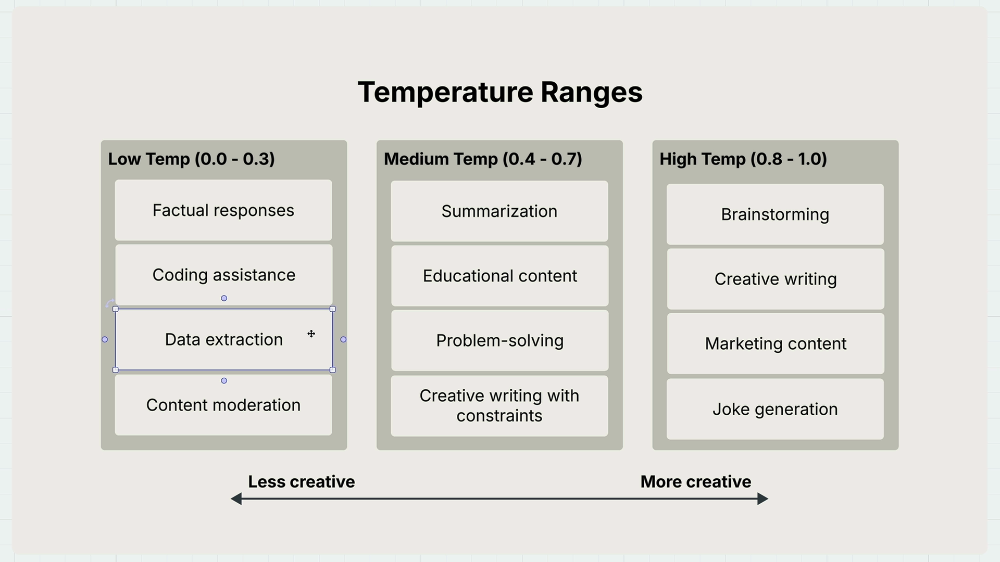

### Temperatura bassa (0,0 - 0,3)

- Risposte fattuali
- Assistenza alla programmazione
- Estrazione dati
- Moderazione dei contenuti

### Temperatura media (0,4 - 0,7)

- Riassunto
- Contenuti didattici
- Risoluzione dei problemi
- Scrittura creativa con vincoli

### Temperatura alta (0,8 - 1,0)

- Brainstorming
- Scrittura creativa
- Contenuti di marketing
- Generazione di battute

## Implementazione della temperatura nel codice

Aggiungere il supporto per la temperatura alla funzione di chat è semplice. Ecco come modificare la tua funzione esistente:

```python
def chat(messages, system=None, temperature=1.0):
    params = {
        "model": model,
        "max_tokens": 1000,
        "messages": messages,
        "temperature": temperature
    }
    
    if system:
        params["system"] = system
    
    message = client.messages.create(**params)
    return message.content[0].text
```

Le modifiche principali consistono nell'aggiungere temperature=1.0 come parametro e nell'includere "temperature": temperature nel dizionario params.

## Testare gli effetti della temperatura

Per vedere la temperatura in azione, prova a generare idee per film con impostazioni diverse:

```python
# Low temperature - more predictable
answer = chat(messages, temperature=0.0)

# High temperature - more creative  
answer = chat(messages, temperature=1.0)
```

A una temperatura di 0.0, potresti ottenere costantemente risposte come "Un archeologo viaggiatore nel tempo deve impedire che vengano rubati manufatti antichi." Con una temperatura di 1.0, noterai una maggiore varietà di temi, personaggi ed elementi della trama.

### Punti chiave

Ricorda che la temperatura non garantisce risultati diversi, ma ne modifica la probabilità. Anche a temperature elevate, Claude potrebbe occasionalmente produrre risposte simili. La chiave è scegliere la temperatura più adatta al tuo caso d'uso specifico:

- Hai bisogno di risposte coerenti e oggettive? Usa una temperatura bassa.
- Vuoi stimolare la creatività? Aumenta la temperatura.
- Una via di mezzo? Le temperature medie sono adatte alla maggior parte delle attività generali.

La temperatura è uno dei parametri più pratici che puoi regolare per ottimizzare il comportamento di Claude in base alle tue esigenze specifiche.

---

# Streaming di risposta

Quando si sviluppano applicazioni di chat con Claude, si presenta una sfida significativa in termini di esperienza utente: la generazione delle risposte può richiedere dai 10 ai 30 secondi, costringendo gli utenti a fissare un indicatore di caricamento. La soluzione è lo streaming delle risposte, che permette agli utenti di visualizzare il testo che appare gradualmente, blocco per blocco, man mano che Claude lo genera, offrendo un'esperienza molto più reattiva.

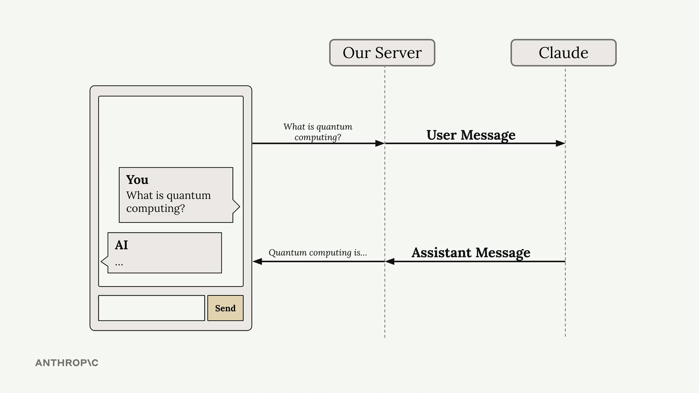

## Il problema delle risposte standard

In una tipica configurazione di chat, il server invia il messaggio dell'utente a Claude e attende la risposta completa prima di inviare qualsiasi informazione al client. Questo crea un fastidioso ritardo, durante il quale gli utenti non hanno alcun feedback sullo stato della risposta.

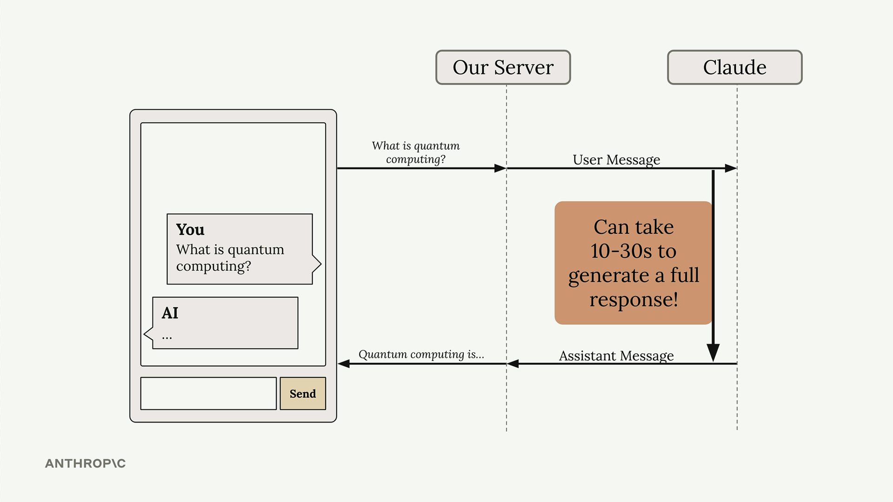

## Come funziona lo streaming

Con lo streaming abilitato, Claude invia immediatamente una risposta iniziale che indica di aver ricevuto la richiesta e di aver iniziato a generare il testo. Successivamente, si riceve una serie di eventi, ognuno dei quali contiene una piccola parte della risposta completa.

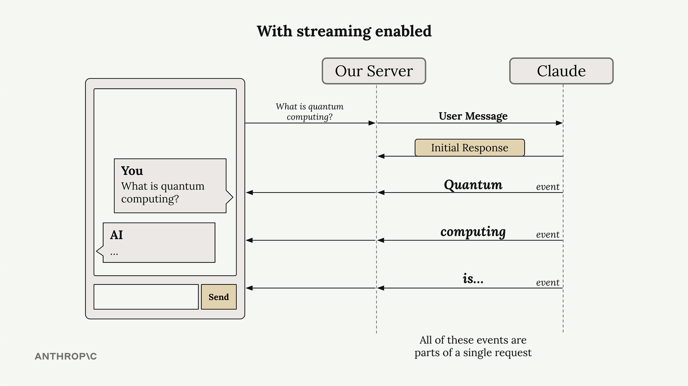

Il server può inoltrare questi blocchi di testo all'applicazione client man mano che arrivano, consentendo agli utenti di visualizzare la risposta che si compone parola per parola. Tutti questi eventi fanno parte di un'unica richiesta a Claude.


## Comprensione degli eventi di streaming

Quando si abilita lo streaming, Claude invia diversi tipi di eventi:

- MessageStart - Viene inviato un nuovo messaggio
- ContentBlockStart - Inizio di un nuovo blocco contenente testo, utilizzo di uno strumento o altro contenuto
- ContentBlockDelta - Frammenti del testo effettivamente generato
- ContentBlockStop - Il blocco di contenuto corrente è stato completato
- MessageDelta - Il messaggio corrente è completo
- MessageStop - Fine delle informazioni relative al messaggio corrente

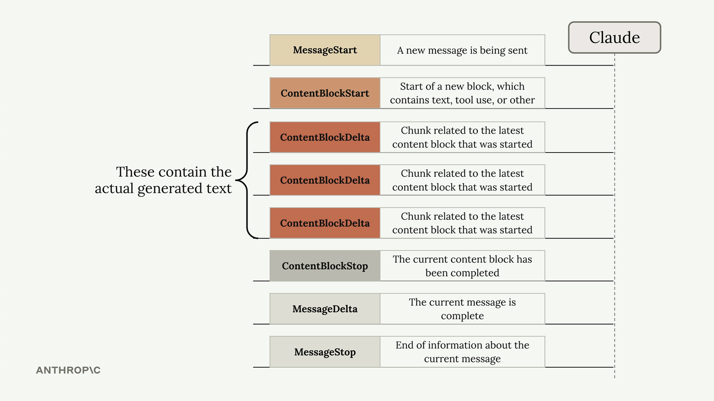

Gli eventi ContentBlockDelta contengono il testo effettivamente generato che si desidera visualizzare agli utenti.

## Implementazione di base dello streaming

Per abilitare lo streaming, aggiungi `stream=True` alla chiamata `messages.create`:

```python
messages = []
add_user_message(messages, "Write a 1 sentence description of a fake database")

stream = client.messages.create(
    model=model,
    max_tokens=1000,
    messages=messages,
    stream=True
)

for event in stream:
    print(event)
```

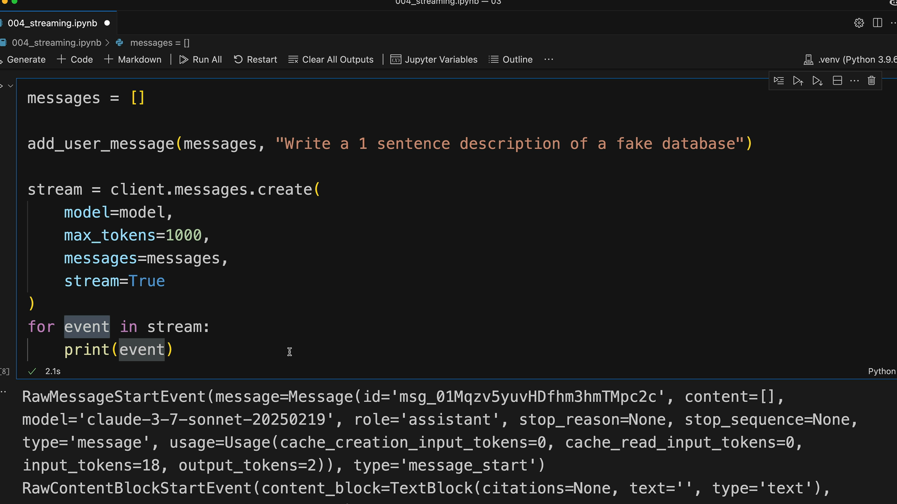

## Streaming di testo semplificato

Anziché analizzare manualmente gli eventi, puoi utilizzare l'interfaccia di streaming semplificata dell'SDK che estrae solo il contenuto testuale:`

```python
with client.messages.stream(
    model=model,
    max_tokens=1000,
    messages=messages
) as stream:
    for text in stream.text_stream:
        print(text, end="")
```

Questo approccio filtra automaticamente tutto tranne il contenuto testuale effettivo, che di solito è ciò che serve per visualizzare le risposte agli utenti.

## Ottenere il messaggio completo

Sebbene lo streaming di singoli frammenti sia ottimo per l'esperienza utente, spesso è necessario il messaggio completo per l'archiviazione o l'ulteriore elaborazione. Al termine dello streaming, è possibile ottenere il messaggio finale assemblato:

```python
with client.messages.stream(
    model=model,
    max_tokens=1000,
    messages=messages
) as stream:
    for text in stream.text_stream:
        # Send each chunk to your client
        pass
    
    # Get the complete message for database storage
    final_message = stream.get_final_message()
```

Questo ti offre il meglio di entrambi i mondi: streaming in tempo reale per gli utenti e un oggetto messaggio completo per la logica della tua applicazione.

---

# Struttura dati

Quando hai bisogno che Claude generi dati strutturati come JSON, codice Python o elenchi puntati, spesso ti imbatti in un problema comune: Claude vuole essere utile e aggiungere testo esplicativo attorno al contenuto. Sebbene questo sia solitamente un vantaggio, a volte hai bisogno solo dei dati grezzi, senza altro.

Immagina di creare un'applicazione web che generi regole per AWS EventBridge. Gli utenti inseriscono una descrizione, cliccano su "Genera" e si aspettano di vedere un JSON pulito che possono copiare e utilizzare immediatamente. Se Claude restituisce il JSON racchiuso in blocchi di codice Markdown con testo esplicativo, gli utenti non possono semplicemente copiare l'intera risposta, ma devono selezionare manualmente solo la parte JSON.

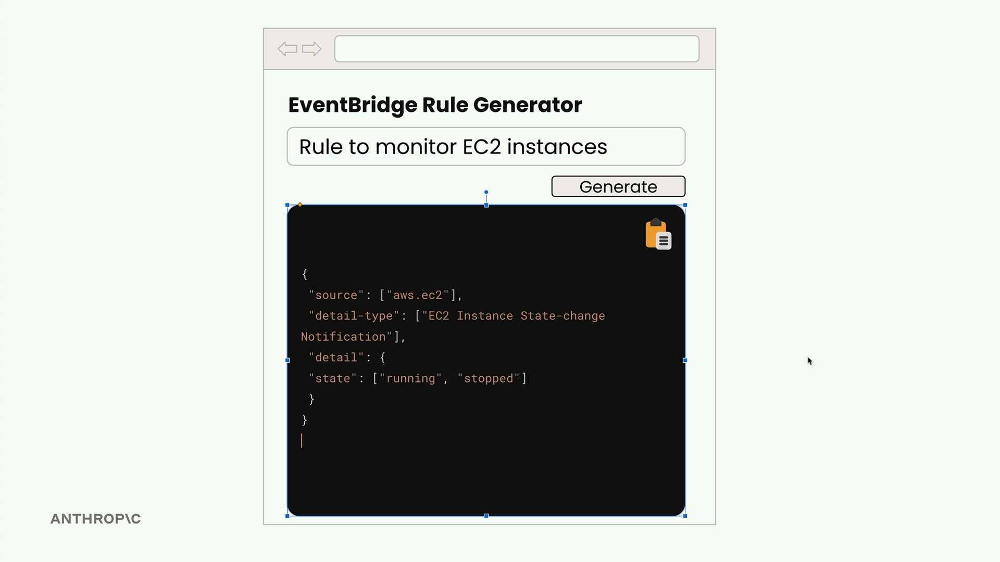

## Il problema delle risposte predefinite

Di default, quando chiedi a Claude di generare un file JSON, potresti ottenere qualcosa di simile a questo:

```json
{
  "source": ["aws.ec2"],
  "detail-type": ["EC2 Instance State-change Notification"],
  "detail": {
    "state": ["running"]
  }
}
```

Questa regola rileva le modifiche di stato delle istanze EC2 all'avvio delle stesse.

Il JSON è corretto, ma è racchiuso in una formattazione Markdown e include testo esplicativo. Per un'applicazione web in cui gli utenti devono copiare il JSON grezzo, questo crea attrito nell'esperienza utente.

## La soluzione: precompilazione dei messaggi dell'assistente + sequenze di interruzione

È possibile combinare la precompilazione dei messaggi dell'assistente con le sequenze di interruzione per ottenere esattamente il contenuto desiderato. Ecco come funziona:

```python
messages = []

add_user_message(messages, "Generate a very short event bridge rule as json")
add_assistant_message(messages, "```json")

text = chat(messages, stop_sequences=["```"])
```

This technique works by:

1. The user message tells Claude what to generate
2. The prefilled assistant message makes Claude think it already started a markdown code block
3. Claude continues by writing just the JSON content
4. When Claude tries to close the code block with ```, the stop sequence immediately ends generation

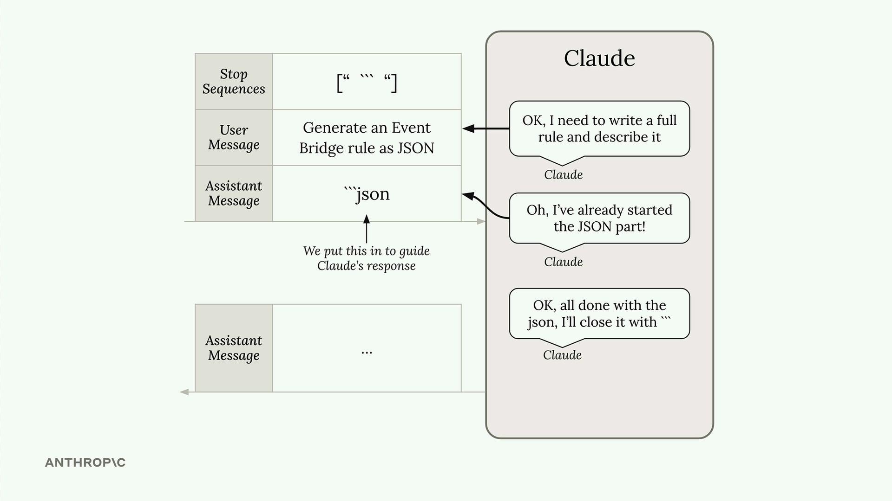

The result is clean JSON with no extra formatting:

```json
{
  "source": ["aws.ec2"],
  "detail-type": ["EC2 Instance State-change Notification"],
  "detail": {
    "state": ["running"]
  }
}
```

## Elaborazione della risposta

Potresti notare alcuni caratteri di nuova riga aggiuntivi nella risposta. Sono facili da gestire:

```python
import json

# Clean up and parse the JSON
clean_json = json.loads(text.strip())
```

## Oltre il JSON

Questa tecnica non si limita alla generazione di JSON. Usala ogni volta che hai bisogno di dati strutturati senza commenti:

- Snippet di codice Python
- Elenchi puntati
- Dati CSV
- Qualsiasi contenuto formattato in cui desideri solo il contenuto, senza spiegazioni

La chiave è identificare ciò che Claude tende naturalmente a utilizzare per racchiudere il tuo contenuto, quindi usarlo come sequenza di precompilazione e di chiusura. Per il codice, di solito si tratta di blocchi di codice Markdown. Per gli elenchi, potrebbero essere diversi marcatori di formattazione.

Questo approccio ti offre un controllo preciso sul formato di output di Claude, rendendo molto più semplice integrare contenuti generati dall'IA in applicazioni in cui dati puliti e strutturati sono essenziali.

---

# Valutazione Rapida

Quando si lavora con Claude, scrivere un buon prompt è solo l'inizio. Per creare applicazioni di IA affidabili, è necessario comprendere due concetti fondamentali: l'ingegneria dei prompt e la valutazione dei prompt. L'ingegneria dei prompt fornisce tecniche per scrivere prompt migliori, mentre la valutazione dei prompt aiuta a misurare l'efficacia effettiva di tali prompt.
Ingegneria dei prompt vs.

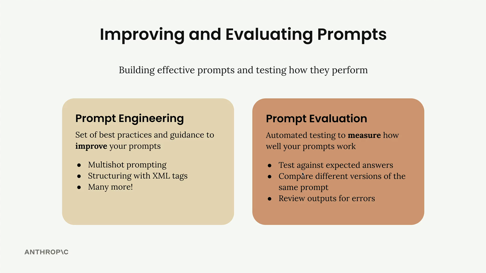

## Valutazione dei prompt

L'ingegneria dei prompt è il kit di strumenti per creare prompt efficaci. Include tecniche come:

- Minutili (multishot prompt)
- Struttura con tag XML
- Molte altre best practice

Queste tecniche aiutano Claude a capire esattamente cosa stai chiedendo e come desideri che risponda.

La valutazione dei prompt adotta un approccio diverso. Invece di concentrarsi su come scrivere i prompt, si concentra sulla misurazione della loro efficacia attraverso test automatizzati. È possibile:

- Testare rispetto alle risposte attese
- Confrontare diverse versioni dello stesso prompt
- Rivedere gli output per individuare eventuali errori

## Tre percorsi dopo aver scritto un prompt

Una volta redatto un prompt, in genere si hanno tre opzioni su cosa fare:

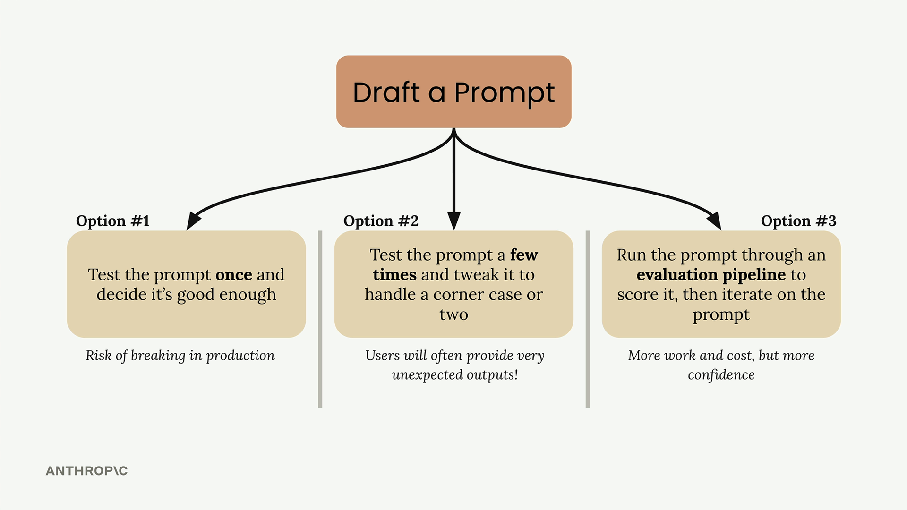

Opzione 1: Testare il prompt una volta e decidere se è sufficientemente buono. Questo comporta un rischio significativo di malfunzionamenti in produzione quando gli utenti forniscono input inaspettati.

Opzione 2: Testare il prompt più volte e modificarlo per gestire uno o due casi limite. Sebbene sia migliore dell'opzione 1, gli utenti spesso forniranno output del tutto inaspettati che non sono stati considerati.

Opzione 3: Eseguire un test del prompt tramite una pipeline di valutazione per assegnargli un punteggio, quindi iterare sul prompt in base a metriche oggettive. Questo approccio richiede più lavoro e costi, ma offre molta più sicurezza sull'affidabilità del prompt.

## Perché la maggior parte degli ingegneri cade nelle trappole dei test

Le opzioni 1 e 2 sono trappole comuni in cui cadono tutti gli ingegneri, me compreso. È naturale scrivere un prompt per un'applicazione seria e non testarlo a sufficienza. Tendiamo a sottovalutare quanti casi limite incontreranno gli utenti reali.

La realtà è che quando si implementa un prompt in produzione, gli utenti interagiranno con esso in modi che non si erano mai previsti. Ciò che sembrava un prompt solido durante i test limitati può rapidamente fallire di fronte alla varietà completa di input del mondo reale.

## L'approccio basato sulla valutazione

L'opzione 3 rappresenta un approccio più sistematico allo sviluppo di prompt. Eseguendo il prompt attraverso una pipeline di valutazione, si ottengono metriche oggettive sulle sue prestazioni in una gamma più ampia di casi di test. Questo approccio basato sui dati consente di:

- Identificare i punti deboli prima che diventino problemi in produzione
- Confrontare oggettivamente diverse versioni del prompt
- Iterare con sicurezza sulla base di miglioramenti misurabili
- Creare applicazioni di intelligenza artificiale più affidabili

Sebbene questo approccio richieda un maggiore investimento iniziale in termini di tempo e infrastrutture di test, ripaga ampiamente in termini di affidabilità e robustezza dell'applicazione finale. L'obiettivo è individuare i problemi durante lo sviluppo, anziché dopo che gli utenti li hanno riscontrati.

---

# Un tipico flusso di lavoro di valutazione

Un tipico flusso di lavoro per la valutazione dei prompt segue cinque fasi chiave che ti aiutano a migliorare sistematicamente i tuoi prompt attraverso una misurazione oggettiva. Sebbene esistano molti modi diversi per creare questi flussi di lavoro e vari strumenti open source e a pagamento disponibili, comprendere il processo di base ti aiuta a iniziare in piccolo e ad ampliarlo in base alle esigenze.

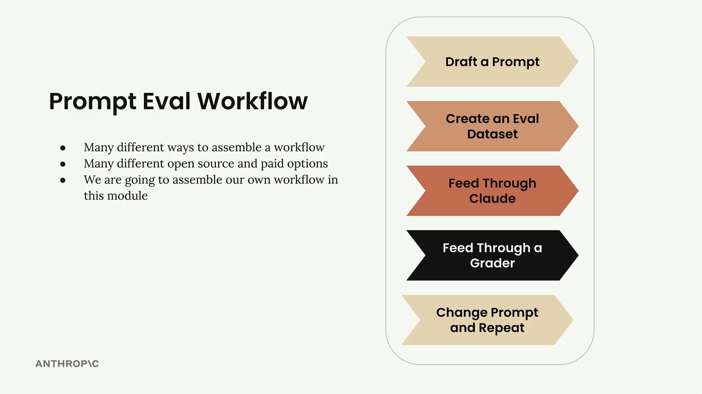

## Fase 1: Stesura di un prompt

Inizia scrivendo un prompt iniziale che desideri migliorare. Per questo esempio, useremo un prompt semplice:

```python
prompt = f"""
Please answer the user's question:

{question}
"""
```

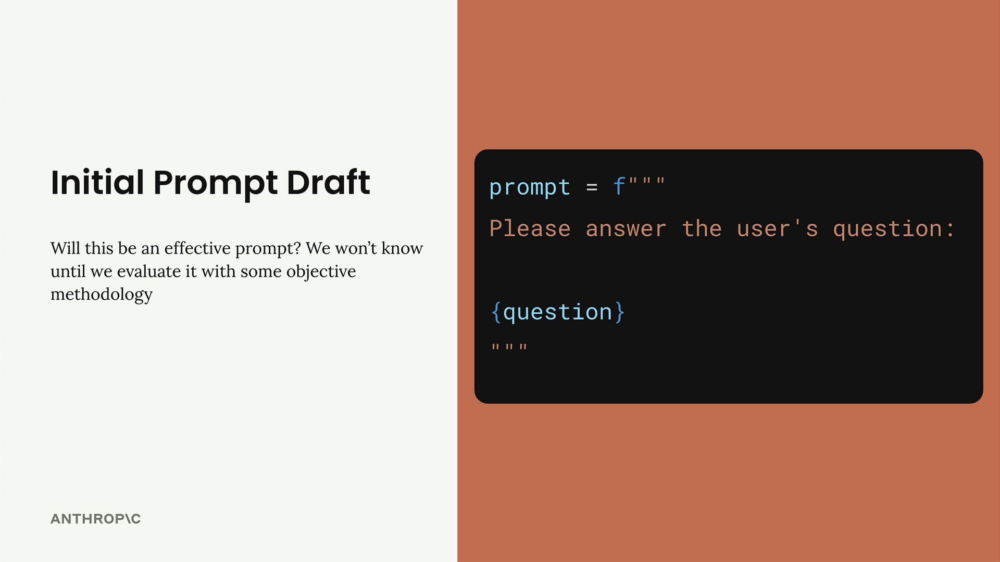

Questo prompt di base servirà come punto di partenza per i test e i miglioramenti.

## Fase 2: Creazione di un dataset di valutazione

Il tuo dataset di valutazione contiene input di esempio che rappresentano i tipi di domande o richieste che il tuo prompt gestirà in produzione. Il dataset dovrebbe includere domande che verranno interpolate nel modello del tuo prompt.

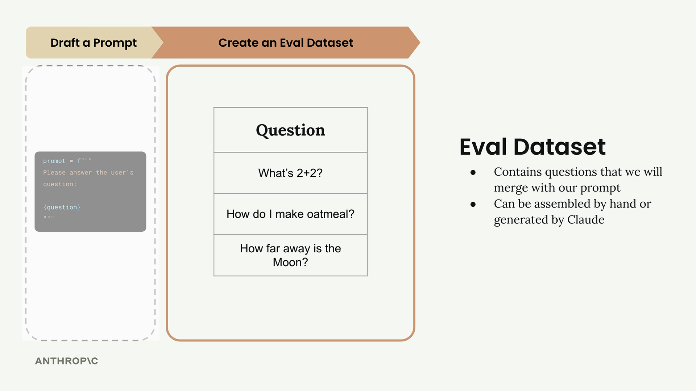

Per questo esempio, il nostro dataset include tre domande:

- "Quanto fa 2+2?"
- "Come si prepara il porridge?"
- "Quanto dista la Luna?"

Nelle valutazioni reali, potresti avere decine, centinaia o persino migliaia di record. Puoi assemblare questi set di dati manualmente o utilizzare Claude per generarli per te.

## Fase 3: Invia i dati a Claude

Prendi ogni domanda dal tuo set di dati e uniscila al tuo modello di prompt per creare prompt completi. Quindi invia ciascuno a Claude per ottenere le risposte.

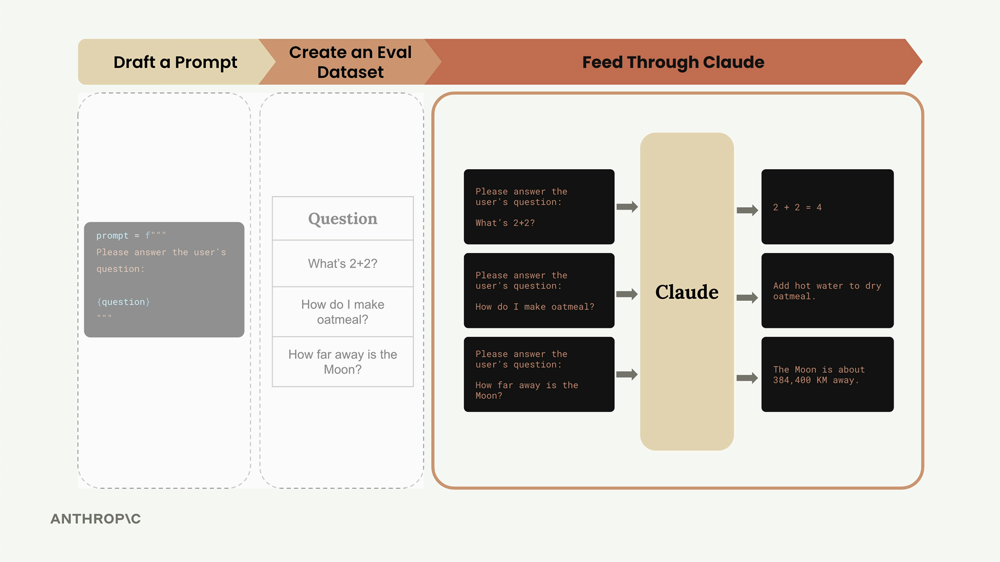

Ad esempio, la prima domanda diventa:

Rispondi alla domanda dell'utente:

```txt
Please answer the user's question:
What's 2+2?
```

Claude potrebbe rispondere con "2 + 2 = 4" per la domanda di matematica, fornire istruzioni per cucinare il porridge per la seconda domanda e indicare la distanza dalla Luna per la terza.

## Fase 4: Invia i dati a un valutatore

Il valutatore esamina la qualità delle risposte di Claude analizzando sia la domanda originale che la risposta di Claude. Questa fase fornisce un punteggio oggettivo, in genere su una scala da 1 a 10, dove 10 rappresenta una risposta perfetta e punteggi inferiori indicano margini di miglioramento.

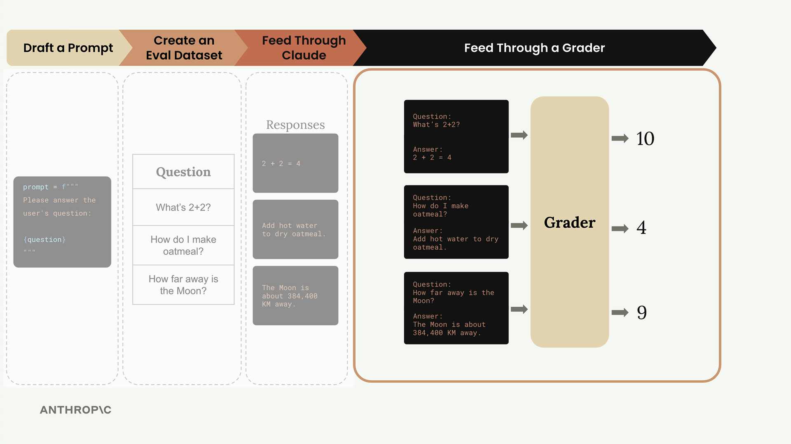

Nel nostro esempio, il valutatore potrebbe assegnare:

- Domanda di matematica: 10 (risposta perfetta)
- Domanda sulla farina d'avena: 4 (da migliorare)
- Domanda sulla luna: 9 (ottima risposta)

Il punteggio medio su tutte le domande fornisce una misurazione oggettiva: (10 + 4 + 9) ÷ 3 = 7,66

## Fase 5: Modificare la richiesta e ripetere

Ora che hai un punteggio di base, puoi modificare la richiesta ed eseguire nuovamente l'intero processo per verificare se le modifiche apportate migliorano le prestazioni.

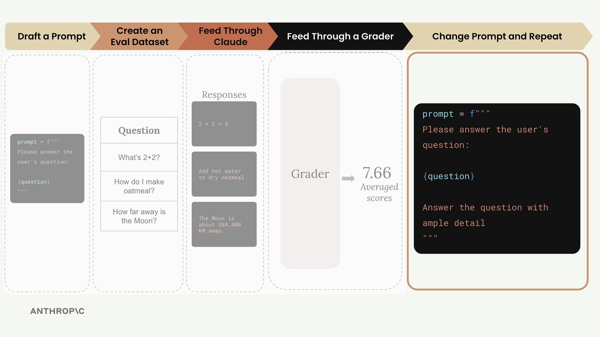

Ad esempio, potresti aggiungere maggiori indicazioni alla tua richiesta:

```python
prompt = f"""
Please answer the user's question:

{question}

Answer the question with ample detail
"""
```

Dopo aver eseguito questa richiesta migliorata attraverso lo stesso processo di valutazione, potresti ottenere un punteggio medio più alto, pari a 8,7, a indicare che le istruzioni aggiuntive hanno aiutato Claude a fornire risposte migliori.

## Valutazione della richiesta

Il vantaggio principale di questo flusso di lavoro è ottenere misurazioni oggettive delle prestazioni relative alla richiesta. È possibile:

- Confrontare numericamente diverse versioni dei prompt
- Utilizzare la versione con il punteggio migliore
- Continuare a iterare per trovare approcci ancora migliori

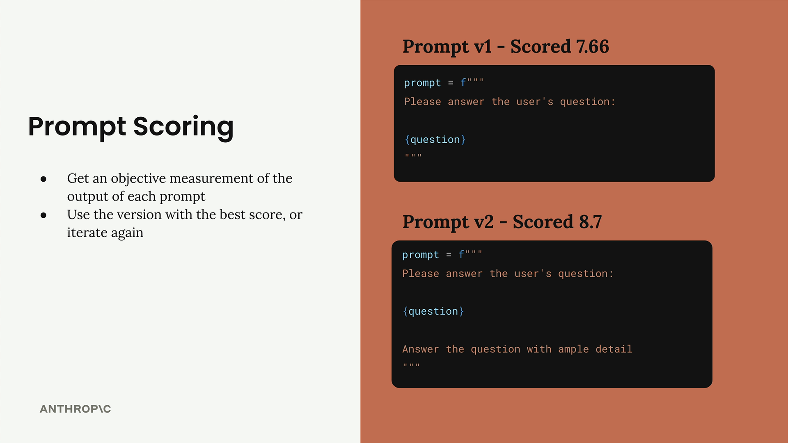

Questo approccio sistematico elimina le congetture dalla progettazione dei prompt e ti dà la certezza che le modifiche apportate rappresentino effettivamente dei miglioramenti, anziché semplici varianti.

---

# Generazione di set di dati di test

La creazione di un flusso di lavoro personalizzato per la valutazione di un prompt inizia con la definizione di un prompt efficace e la successiva generazione di dati di test per verificarne le prestazioni. Vediamo come configurare un sistema di valutazione per un prompt che aiuti gli utenti a scrivere codice specifico per AWS.

## Definizione dell'obiettivo

Il nostro prompt deve assistere gli utenti nella scrittura di tre tipi specifici di output per i casi d'uso di AWS:

- Codice Python
- File di configurazione JSON
- Espressioni regolari

Il requisito fondamentale è che, quando un utente richiede assistenza per un'attività, venga restituito un output pulito in uno di questi formati, senza spiegazioni aggiuntive, intestazioni o piè di pagina.

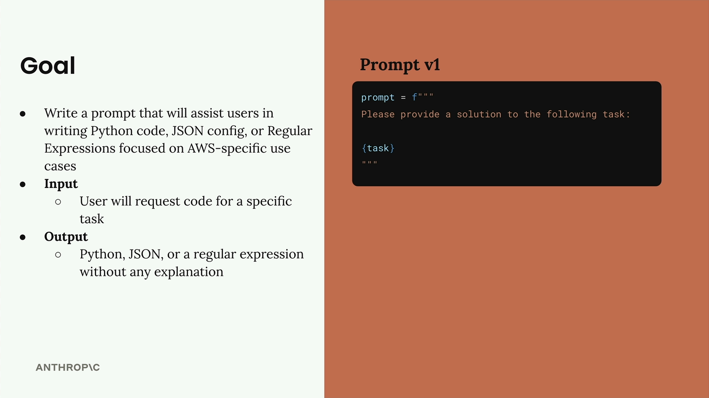

Ecco il nostro prompt iniziale (versione 1):

```python
prompt = f"""
Please provide a solution to the following task:
{task}
"""
```

## Creazione di un dataset di valutazione

Un dataset di valutazione contiene gli input che inseriremo nel nostro prompt. Per ogni combinazione di prompt e input, eseguiremo il prompt e analizzeremo i risultati.

Il nostro dataset sarà un array di oggetti JSON, dove ogni oggetto contiene una proprietà "task" che descrive cosa vogliamo che Claude realizzi. Possiamo creare questo dataset manualmente o generarlo automaticamente utilizzando Claude.

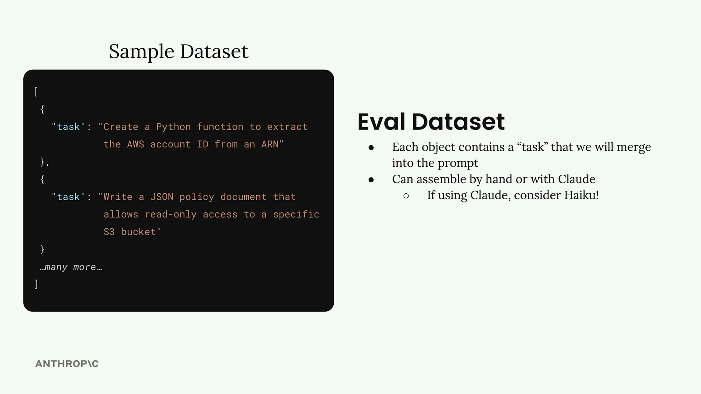

Dato che stiamo generando dati di test, questa è l'occasione perfetta per utilizzare un modello più veloce come Haiku invece del modello completo di Claude.

## Generazione di dati di test tramite codice

Creiamo una funzione che generi automaticamente il nostro dataset di test. Innanzitutto, avremo bisogno delle nostre funzioni di supporto per lavorare con Claude:

```python
def add_user_message(messages, text):
    user_message = {"role": "user", "content": text}
    messages.append(user_message)

def add_assistant_message(messages, text):
    assistant_message = {"role": "assistant", "content": text}
    messages.append(assistant_message)

def chat(messages, system=None, temperature=1.0, stop_sequences=[]):
    params = {
        "model": model,
        "max_tokens": 1000,
        "messages": messages,
        "temperature": temperature
    }
    if system:
        params["system"] = system
    if stop_sequences:
        params["stop_sequences"] = stop_sequences
    
    response = client.messages.create(**params)
    return response.content[0].text
```

Ora creeremo la nostra funzione di generazione del dataset:

```python
def generate_dataset():
    prompt = """
Generate an evaluation dataset for a prompt evaluation. The dataset will be used to evaluate prompts that generate Python, JSON, or Regex specifically for AWS-related tasks. Generate an array of JSON objects, each representing task that requires Python, JSON, or a Regex to complete.

Example output:
[
  {
    "task": "Description of task",
  },
  ...additional
]

* Focus on tasks that can be solved by writing a single Python function, a single JSON object, or a single regex
* Focus on tasks that do not require writing much code

Please generate 3 objects.
"""
```

Per analizzare correttamente la risposta JSON, utilizzeremo sequenze di precompilazione e di arresto:

```python
  messages = []
  add_user_message(messages, prompt)
  add_assistant_message(messages, "```json")
  text = chat(messages, stop_sequences=["```"])
  return json.loads(text)
```

## Test della generazione del dataset

Eseguiamo la nostra funzione e vediamo che tipo di casi di test otteniamo:

```python
dataset = generate_dataset()
print(dataset)
```

Questo dovrebbe restituire tre diversi casi di test che coprono i nostri output target: funzioni Python, configurazioni JSON ed espressioni regolari per attività specifiche di AWS.

## Salvataggio del dataset

Una volta ottenuto il nostro dataset, lo salveremo in un file in modo da poterlo caricare facilmente in seguito durante la valutazione:

```python
with open('dataset.json', 'w') as f:
    json.dump(dataset, f, indent=2)
```

Questo crea un file dataset.json nella stessa directory del notebook, contenente l'elenco delle attività pronte per la valutazione dei prompt.

Con queste basi, ora disponiamo di un metodo sistematico per generare dati di test per valutare le prestazioni dei nostri prompt in diversi tipi di attività di programmazione relative ad AWS.

---

# Esecuzione della valutazione

Ora che abbiamo a disposizione il nostro dataset di valutazione, è il momento di costruire la pipeline di valutazione principale. Questo processo prevede di prendere ogni caso di test, unirlo al nostro prompt, inviarlo a Claude e infine valutare i risultati.


Il processo di valutazione segue un flusso di lavoro chiaro: prendiamo il nostro dataset di casi di test, combiniamo ciascuno di essi con il nostro modello di prompt, lo inviamo a Claude per l'elaborazione e infine valutiamo l'output utilizzando un sistema di valutazione.

## Creazione delle funzioni principali

La pipeline di valutazione è composta da tre funzioni principali, ognuna con una responsabilità specifica. Iniziamo con la più semplice: la funzione che gestisce i singoli prompt.

### La funzione run_prompt

Questa funzione prende un caso di test e lo unisce al nostro modello di prompt:

```python
def run_prompt(test_case):
    """Merges the prompt and test case input, then returns the result"""
    prompt = f"""
Please solve the following task:

{test_case["task"]}
"""
    
    messages = []
    add_user_message(messages, prompt)
    output = chat(messages)
    return output
```

Al momento, abbiamo mantenuto il prompt estremamente semplice. Non abbiamo incluso alcuna istruzione di formattazione, quindi è probabile che Claude restituisca un output più prolisso del necessario. Lo perfezioneremo in seguito, man mano che perfezioneremo il design del prompt.

### La funzione run_test_case

Questa funzione gestisce l'esecuzione di un singolo caso di test e la valutazione del risultato:

```python
def run_test_case(test_case):
    """Calls run_prompt, then grades the result"""
    output = run_prompt(test_case)
    
    # TODO - Grading
    score = 10
    
    return {
        "output": output,
        "test_case": test_case,
        "score": score
    }
```

Per ora, utilizziamo un punteggio fisso di 10. La logica di valutazione è l'aspetto su cui ci concentreremo maggiormente nelle sezioni successive, ma questo segnaposto ci permette di testare l'intero processo.

### La funzione run_eval

Questa funzione coordina l'intero processo di valutazione:

```python
def run_eval(dataset):
    """Loads the dataset and calls run_test_case with each case"""
    results = []
    
    for test_case in dataset:
        result = run_test_case(test_case)
        results.append(result)
    
    return results
```

Questa funzione elabora ogni caso di test nel nostro dataset e raccoglie tutti i risultati in un unico elenco.

## Esecuzione della valutazione

Per eseguire la nostra pipeline di valutazione, carichiamo il dataset e lo elaboriamo tramite le nostre funzioni:

```python
with open("dataset.json", "r") as f:
    dataset = json.load(f)

results = run_eval(dataset)
```

La prima volta che lo eseguite, aspettatevi che richieda un po' di tempo: anche con Claude Haiku, l'elaborazione di un set di dati completo può richiedere circa 30 secondi. Tratteremo le tecniche di ottimizzazione più avanti.

## Analisi dei risultati

La valutazione restituisce un array JSON strutturato in cui ogni oggetto rappresenta il risultato di un caso di test:

```python
print(json.dumps(results, indent=2))
```

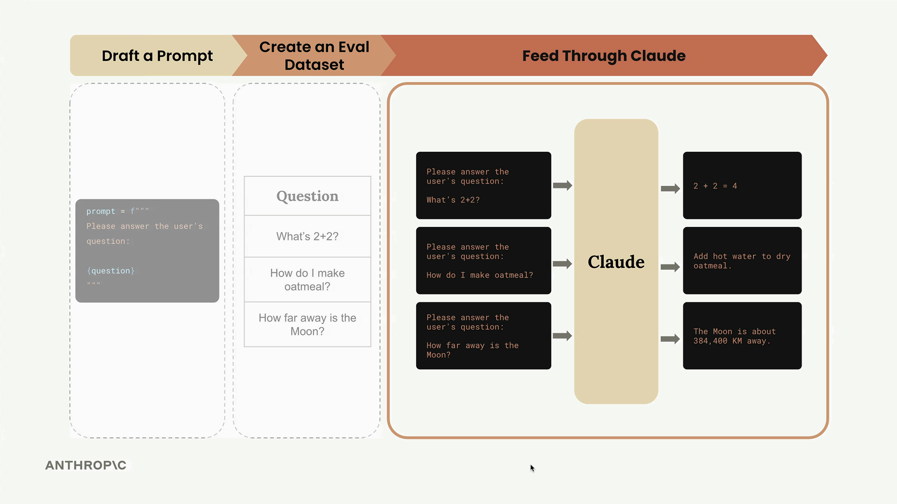

Ogni risultato contiene tre informazioni chiave:

- **output**: la risposta completa di Claude
- **test_case**: il caso di test originale elaborato
- **score**: il punteggio di valutazione (attualmente codificato in modo fisso)

Come puoi vedere nell'output, Claude genera risposte piuttosto prolisse poiché non abbiamo ancora fornito istruzioni di formattazione specifiche. Questo è esattamente il tipo di problema che affronteremo man mano che perfezioneremo i nostri prompt.


## Cosa abbiamo realizzato

A questo punto, abbiamo costruito con successo la pipeline di valutazione principale. Possiamo prendere il nostro dataset, elaborarlo tramite Claude e raccogliere risultati strutturati. L'elemento principale mancante è il sistema di valutazione: il punteggio fisso di 10 deve essere sostituito con una logica di valutazione effettiva.

Questa pipeline rappresenta il fondamento della maggior parte dei sistemi di valutazione basati sull'IA. Sebbene possa sembrare semplice, abbiamo appena costruito la maggior parte di ciò che una pipeline di valutazione effettivamente fa. La complessità sta nei dettagli: prompt migliori, valutazione sofisticata e ottimizzazione delle prestazioni.

Successivamente, approfondiremo l'argomento cruciale dei valutatori, che trasformeranno i nostri punteggi fissi in valutazioni significative delle prestazioni di Claude.

---

# Valutazione basata su modelli

Quando si creano flussi di lavoro di valutazione rapida, i sistemi di valutazione forniscono segnali oggettivi sulla qualità dell'output. Un sistema di valutazione prende l'output del modello e restituisce un feedback misurabile, in genere un numero compreso tra 1 e 10, dove 10 rappresenta un'alta qualità e 1 una qualità scadente.

## Tipi di sistemi di valutazione

Esistono tre approcci principali per la valutazione degli output dei modelli:

1. Valutatori di codice: valutano programmaticamente gli output utilizzando una logica personalizzata
2. Valutatori di modelli: utilizzano un altro modello di intelligenza artificiale per valutare la qualità
3. Valutatori umani: fanno revisionare e assegnare un punteggio manualmente gli output a persone

### Valutatori di codice

I valutatori di codice consentono di implementare qualsiasi controllo programmatico immaginabile. Gli usi comuni includono:

- Verifica della lunghezza dell'output
- Verifica della presenza o assenza di determinate parole nell'output
- Validazione della sintassi per JSON, Python o espressioni regolari
- Punteggi di leggibilità

L'unico requisito è che il codice restituisca un segnale utilizzabile, solitamente un numero compreso tra 1 e 10.

### Valutatori di modelli

I valutatori di modelli inviano l'output originale a un'altra chiamata API per la valutazione. Questo approccio offre un'enorme flessibilità per la valutazione di:

- Qualità della risposta
- Qualità della comprensione delle istruzioni
- Completezza
- Utilità
- Sicurezza

### Valutatori umani

I valutatori umani offrono la massima flessibilità, ma sono dispendiosi in termini di tempo e laboriosi. Sono utili per valutare:

- Qualità generale della risposta
- Completezza
- Profondità
- Concisione
- Pertinenza

## Definizione dei criteri di valutazione

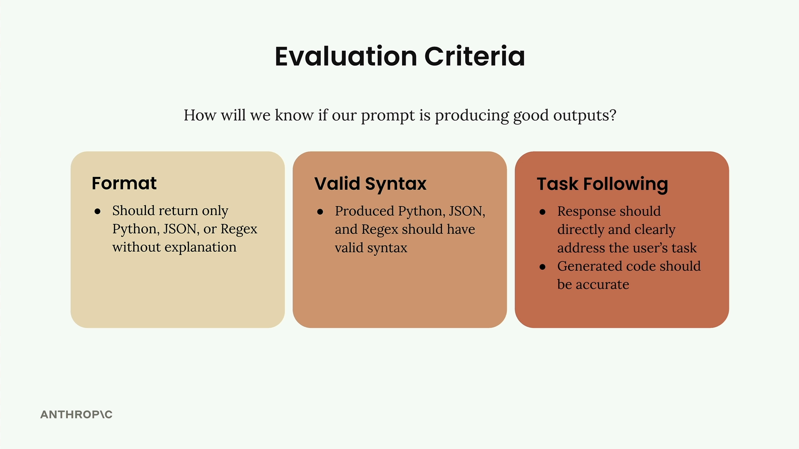

Prima di implementare qualsiasi valutatore, è necessario definire criteri di valutazione chiari. Per una richiesta di generazione di codice, ci si potrebbe concentrare su:

- Formato: deve restituire solo codice Python, JSON o Regex senza spiegazioni
- Sintassi valida: il codice prodotto deve avere una sintassi valida
- Conformità al compito: la risposta deve affrontare direttamente il compito dell'utente con codice accurato

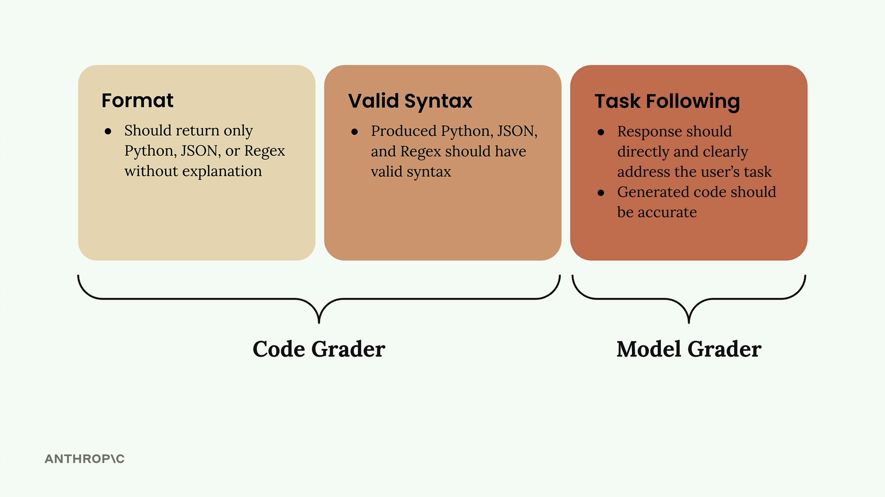

I primi due criteri funzionano bene con i valutatori di codice, mentre la conformità al compito è più adatta ai valutatori di modelli grazie alla loro flessibilità.

## Implementazione di un valutatore di modelli

Ecco come creare una funzione di valutazione di modelli:

```python
def grade_by_model(test_case, output):
    # Create evaluation prompt
    eval_prompt = """
    You are an expert code reviewer. Evaluate this AI-generated solution.
    
    Task: {task}
    Solution: {solution}
    
    Provide your evaluation as a structured JSON object with:
    - "strengths": An array of 1-3 key strengths
    - "weaknesses": An array of 1-3 key areas for improvement  
    - "reasoning": A concise explanation of your assessment
    - "score": A number between 1-10
    """
    
    messages = []
    add_user_message(messages, eval_prompt)
    add_assistant_message(messages, "```json")
    
    eval_text = chat(messages, stop_sequences=["```"])
    return json.loads(eval_text)
```

L'aspetto fondamentale è chiedere, insieme al punteggio, punti di forza, punti deboli e motivazioni. Senza questo contesto, i modelli tendono ad assegnare punteggi medi intorno a 6.

## Integrare la valutazione nel flusso di lavoro

Aggiorna il tuo esecutore di casi di test per richiamare il sistema di valutazione:

```python
def run_test_case(test_case):
    output = run_prompt(test_case)
    
    # Grade the output
    model_grade = grade_by_model(test_case, output)
    score = model_grade["score"]
    reasoning = model_grade["reasoning"]
    
    return {
        "output": output, 
        "test_case": test_case, 
        "score": score,
        "reasoning": reasoning
    }
```

Infine, calcola il punteggio medio su tutti i casi di test:

```python
from statistics import mean

def run_eval(dataset):
    results = []
    
    for test_case in dataset:
        result = run_test_case(test_case)
        results.append(result)
    
    average_score = mean([result["score"] for result in results])
    print(f"Average score: {average_score}")
    
    return results
```

Questo ti fornisce una metrica oggettiva da monitorare durante le iterazioni sul prompt. Sebbene i valutatori di modelli possano essere a volte capricciosi, forniscono una base di riferimento coerente per misurare i miglioramenti.

---

# Valutazione basata sul codice

Quando si valutano modelli di IA che generano codice, non basta verificare se la risposta ha senso. È necessario anche accertarsi che il codice generato abbia una sintassi valida e segua il formato corretto. È qui che entra in gioco la valutazione basata sul codice.

## Come funziona la valutazione del codice

La valutazione del codice convalida due aspetti chiave delle risposte generate dall'IA:


- Formato: la risposta deve restituire solo il tipo di codice richiesto (Python, JSON o Regex) senza spiegazioni.
- Sintassi valida: il codice generato deve essere analizzabile correttamente come linguaggio previsto.
- Conformità al compito: la risposta deve rispondere direttamente alla richiesta ed essere accurata.

I primi due criteri sono gestiti dal valutatore del codice, mentre la conformità al compito è valutata dal valutatore del modello. Insieme, forniscono una valutazione completa.

## Funzioni di validazione della sintassi

Per verificare se il codice generato ha una sintassi valida, è possibile creare tre funzioni di supporto che tentano di analizzare l'output:

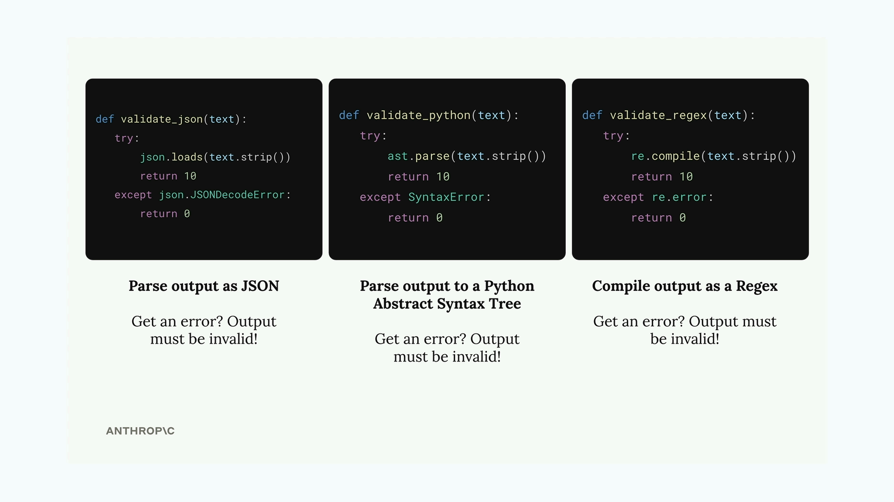

```python
def validate_json(text):
    try:
        json.loads(text.strip())
        return 10
    except json.JSONDecodeError:
        return 0

def validate_python(text):
    try:
        ast.parse(text.strip())
        return 10
    except SyntaxError:
        return 0

def validate_regex(text):
    try:
        re.compile(text.strip())
        return 10
    except re.error:
        return 0
```

Ogni funzione tenta di analizzare il testo nel rispettivo formato. Se l'analisi sintattica ha successo, viene restituito un punteggio perfetto di 10. Se fallisce con un errore, la sintassi non è valida e viene restituito 0.

## Requisiti di formato del dataset

Affinché il valutatore del codice sappia quale validatore utilizzare, i casi di test devono specificare il formato di output previsto:

```json
{
  "task": "Crea una funzione Python per convalidare un nome utente AWS IAM",
  "format": "python"
}
```

È possibile aggiornare il prompt di generazione del dataset per includere automaticamente questo campo di formato aggiungendolo alla struttura di output di esempio.

## Migliorare la chiarezza dei prompt

Per ottenere risultati migliori dal tuo modello di IA, rendi le istruzioni dei prompt più specifiche sul formato di output previsto:

```python
* Rispondi solo con Python, JSON o una semplice espressione regolare (Regex)
* Non aggiungere commenti, spiegazioni o commenti
```

Puoi anche utilizzare un messaggio assistente precompilato con blocchi di codice per incoraggiare il modello a restituire solo il codice sorgente:

```python
add_assistant_message(messages, "```code")
```

Questo indica a Claude di iniziare a generare il contenuto del codice senza dover specificare in anticipo se si tratta di Python, JSON o espressioni regolari (Regex).

## Combinazione dei punteggi

Il passaggio finale consiste nell'unire il punteggio del valutatore del modello con il punteggio del valutatore del codice. Un approccio semplice consiste nel calcolare la media:

```python
model_grade = grade_by_model(test_case, output)
model_score = model_grade["score"]
syntax_score = grade_syntax(output, test_case)

score = (model_score + syntax_score) / 2
```

Questo attribuisce uguale peso sia alla qualità del contenuto che alla correttezza tecnica. È possibile regolare questi pesi in base a ciò che è più importante per il proprio caso d'uso specifico.

## Testare l'implementazione

Una volta implementata la valutazione del codice, eseguire la valutazione per ottenere un punteggio di riferimento. Il punteggio in sé non è intrinsecamente buono o cattivo: ciò che conta è se è possibile migliorarlo perfezionando i prompt. Questo fornisce un metodo quantitativo per misurare i progressi nell'ingegneria dei prompt, anziché affidarsi a valutazioni soggettive.

---

# Prompt engineering

L'ingegneria dei prompt consiste nel prendere un prompt che hai scritto e migliorarlo per ottenere risultati più affidabili e di qualità superiore. Questo processo prevede un perfezionamento iterativo: si parte da un prompt di base, se ne valutano le prestazioni e si applicano sistematicamente tecniche di ingegneria per migliorarlo.

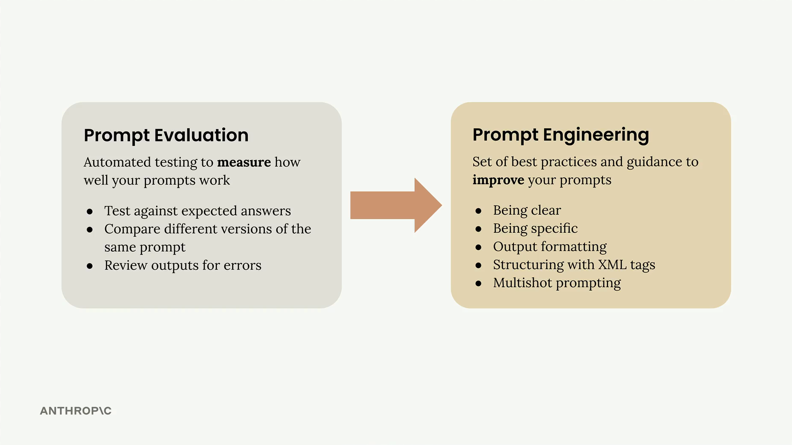

## Il processo di miglioramento iterativo

L'approccio segue un ciclo chiaro che puoi ripetere fino a raggiungere i risultati desiderati:

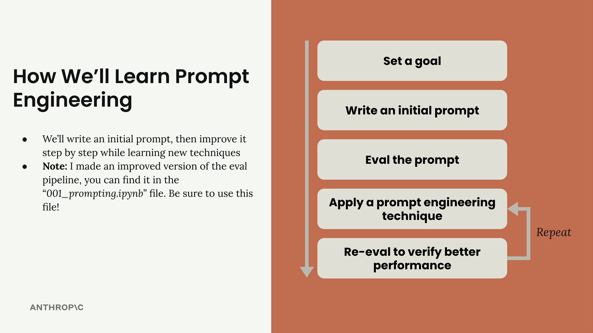

1. Definisci un obiettivo: stabilisci cosa vuoi che il tuo prompt realizzi
2. Scrivi un prompt iniziale: crea un primo tentativo di base
3. Valuta il prompt: testalo rispetto ai tuoi criteri
4. Applica le tecniche di ingegneria dei prompt: utilizza metodi specifici per migliorare le prestazioni
5. Rivaluta: verifica che le modifiche apportate abbiano effettivamente migliorato i risultati

Ripeti gli ultimi due passaggi finché non sei soddisfatto delle prestazioni. Ogni iterazione dovrebbe mostrare un miglioramento misurabile nei punteggi di valutazione.

## Impostazione della pipeline di valutazione

Per illustrare questo processo, lavoreremo con un esempio pratico: creare un prompt che generi piani alimentari giornalieri per atleti. Il prompt deve tenere conto dell'altezza, del peso, degli obiettivi e delle restrizioni dietetiche di un atleta, per poi generare un piano alimentare completo.

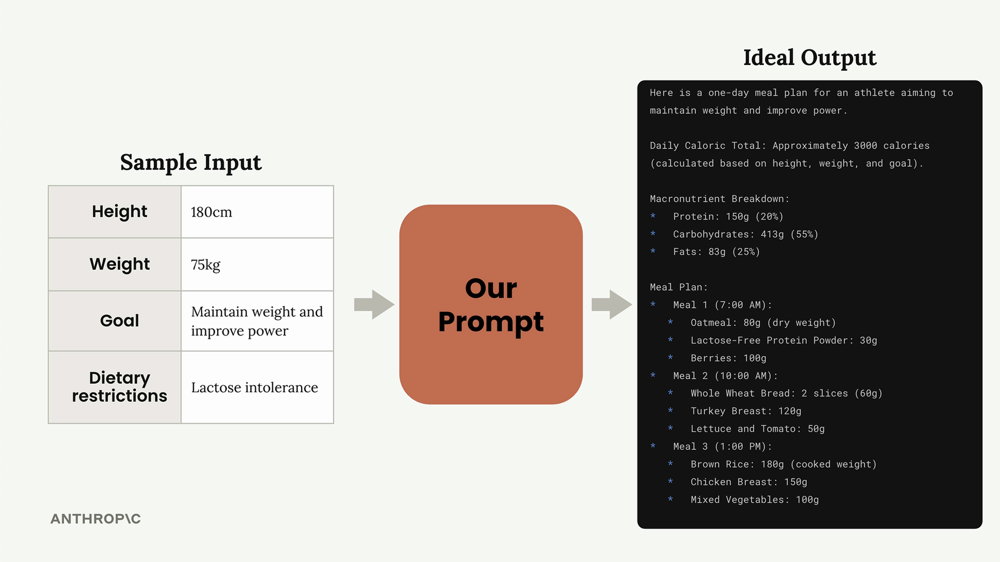

La configurazione della valutazione utilizza una classe PromptEvaluator che gestisce la generazione del dataset e la valutazione del modello. Quando si crea l'istanza dell'evaluator, è possibile controllare la concorrenza con il parametro max_concurrent_tasks:

```python
evaluator = PromptEvaluator(max_concurrent_tasks=5)
```

Iniziare con un valore di concorrenza basso (ad esempio 3) per evitare errori di limite di richieste. È possibile aumentarlo se la quota API consente un'elaborazione più rapida.

## Generazione dei dati di test

Il sistema di valutazione può generare automaticamente casi di test in base ai requisiti specificati. È possibile definire gli input necessari:

```python
dataset = evaluator.generate_dataset(
    task_description="Write a compact, concise 1 day meal plan for a single athlete",
    prompt_inputs_spec={
        "height": "Athlete's height in cm",
        "weight": "Athlete's weight in kg", 
        "goal": "Goal of the athlete",
        "restrictions": "Dietary restrictions of the athlete"
    },
    output_file="dataset.json",
    num_cases=3
)
```

Durante lo sviluppo, mantieni basso il numero di casi di test (2-3) per velocizzare il ciclo di iterazione. Puoi aumentarlo per la validazione finale.

## Scrivere il prompt iniziale

Inizia con un prompt semplice e ingenuo per stabilire un punto di partenza. Ecco un esempio di un primo tentativo volutamente basilare:

```python
def run_prompt(prompt_inputs):
    prompt = f"""
What should this person eat?

- Height: {prompt_inputs["height"]}
- Weight: {prompt_inputs["weight"]}
- Goal: {prompt_inputs["goal"]}
- Dietary restrictions: {prompt_inputs["restrictions"]}
"""
    
    messages = []
    add_user_message(messages, prompt)
    return chat(messages)
```

Questo prompt di base probabilmente produrrà risultati scarsi, ma fornisce un punto di partenza per misurare i miglioramenti.

## Aggiunta di criteri di valutazione

Durante l'esecuzione della valutazione, è possibile specificare ulteriori criteri che il modello di valutazione dovrebbe considerare:

```python
results = evaluator.run_evaluation(
    run_prompt_function=run_prompt,
    dataset_file="dataset.json",
    extra_criteria="""
The output should include:
- Daily caloric total
- Macronutrient breakdown  
- Meals with exact foods, portions, and timing
"""
)
```

Questo aiuta a garantire che la tua richiesta venga valutata in base ai requisiti specifici rilevanti per il tuo caso d'uso.

## Analisi dei risultati

Dopo aver eseguito una valutazione, riceverai sia un punteggio numerico che un report HTML dettagliato. Il report mostra esattamente come si è comportato ciascun caso di test, inclusa la motivazione del modello per ogni punteggio.


Non scoraggiarti per i punteggi iniziali bassi: un punteggio di 2,3 su 10 è tipico per un primo tentativo. L'obiettivo è quello di osservare un miglioramento costante applicando le tecniche ingegneristiche.

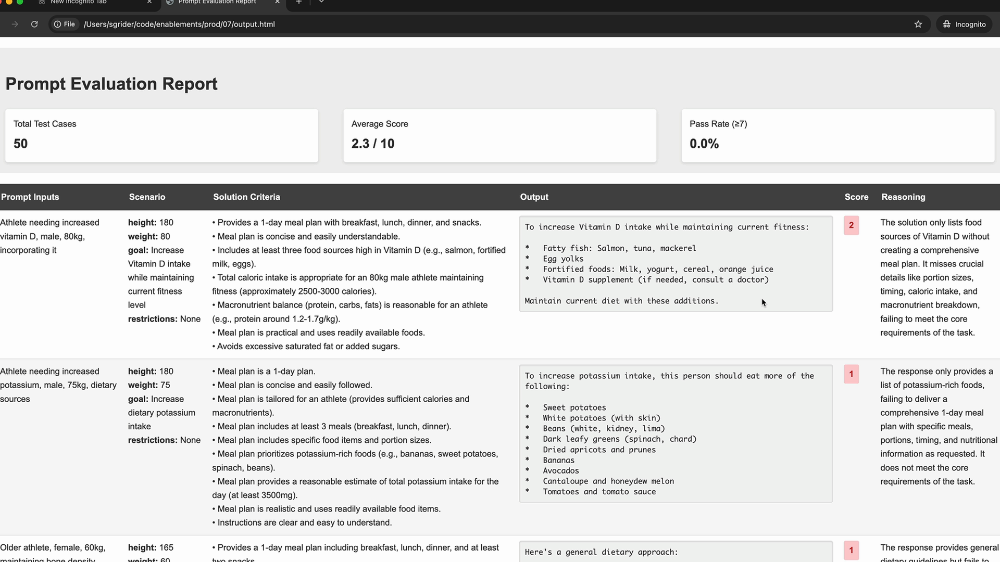

Il report di valutazione dettagliato ti aiuta a capire esattamente dove il tuo prompt non funziona e quali miglioramenti sono necessari. Utilizza questo feedback per guidare la tua prossima iterazione.

## Passaggi successivi

Una volta definito il tuo punto di partenza, sei pronto per iniziare ad applicare tecniche specifiche di ingegneria dei prompt. Ogni tecnica che apprenderai dovrebbe portare a un miglioramento misurabile nei punteggi di valutazione, trasformando gradualmente il tuo prompt di base in uno strumento affidabile e performante.

Ricorda che l'ingegneria dei prompt è un processo iterativo. La chiave è apportare una modifica alla volta, valutarne l'impatto e basarsi su ciò che funziona. Questo approccio sistematico ti garantisce di comprendere quali tecniche offrono il maggior valore per il tuo caso d'uso specifico.

---

# Essere chiari e diretti

La prima riga della tua richiesta è la parte più importante di tutta la tua richiesta. È qui che poni le basi per tutto ciò che seguirà, e scriverla correttamente può migliorare drasticamente i risultati.

## Chiarezza e immediatezza

Quando scrivi quella cruciale prima riga, devi concentrarti su due principi chiave: chiarezza e immediatezza. Ciò significa usare un linguaggio semplice che non lasci spazio ad ambiguità su ciò che vuoi che Claude faccia.

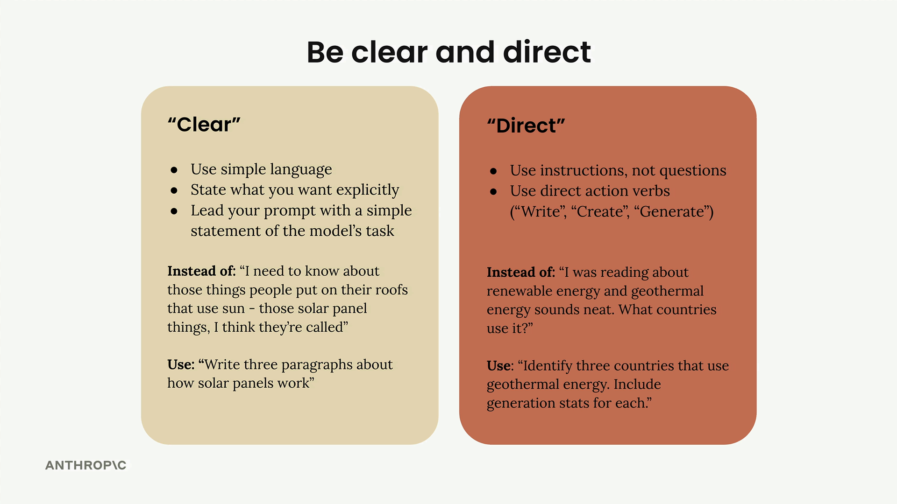

## Comunicazione chiara

Essere "chiari" significa:

- Usare un linguaggio semplice che chiunque possa capire
- Affermare esattamente cosa vuoi senza giri di parole
- Iniziare con una dichiarazione diretta del compito di Claude

Invece di scrivere qualcosa di vago come "Ho bisogno di sapere qualcosa su quei dispositivi che le persone mettono sui tetti che sfruttano l'energia solare - quei pannelli solari, credo si chiamino così", sii diretto e scrivi: "Scrivi tre paragrafi su come funzionano i pannelli solari".

## Istruzioni dirette

Essere "diretti" si concentra su come strutturare la richiesta:

- Usate istruzioni, non domande.
- Iniziate con verbi d'azione diretti come "Scrivere", "Creare" o "Generare".

Invece di chiedere "Stavo leggendo di energie rinnovabili e l'energia geotermica sembra interessante. Quali paesi la utilizzano?", provate con: "Individua tre paesi che utilizzano l'energia geotermica. Includi i dati di produzione per ciascuno."

## Mettere in pratica

Vediamo questa tecnica in azione. Partendo da una richiesta debole che chiedeva semplicemente "Cosa dovrebbe mangiare questa persona?", possiamo applicare il nostro approccio chiaro e diretto.

La versione migliorata diventa: Genera un piano alimentare di un giorno per un atleta che rispetti le sue restrizioni dietetiche.

Questa revisione comunica immediatamente a Claude:

- Quale azione intraprendere (generare)
- Cosa creare (un piano alimentare)
- Vincoli principali (un giorno, per un atleta, rispetto delle restrizioni dietetiche)

## I risultati contano

Questo semplice cambiamento può avere un impatto significativo sulle prestazioni. Nel nostro esempio, il punteggio di valutazione è balzato da 2,32 a 3,92: un miglioramento sostanziale ottenuto semplicemente ristrutturando la frase iniziale.

Il punto fondamentale è che Claude risponde meglio quando lo si tratta come un assistente competente che necessita di istruzioni chiare, piuttosto che come qualcuno che deve indovinare cosa si desidera. Iniziate con un verbo d'azione diretto, siate specifici sul compito e vedrete risultati migliori fin da subito.

---

# Essere specifici

Quando si lavora con Claude, uno dei modi più efficaci per migliorare i risultati è essere specifici su ciò che si desidera. Invece di lasciare tutto all'interpretazione del modello, è possibile fornire linee guida o passaggi chiari che indirizzino Claude verso il tipo di output desiderato.

Pensateci: se chiedete a Claude di "scrivere un racconto breve su un personaggio che scopre un talento nascosto", Claude potrebbe prendere innumerevoli direzioni. Il racconto potrebbe essere di 200 parole o di 2.000. Potrebbe avere un solo personaggio o cinque. Potrebbe concentrarsi su qualsiasi tipo di scenario di scoperta di un talento.

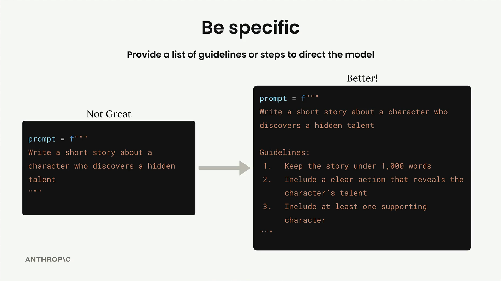

Aggiungendo linee guida specifiche, si fornisce a Claude un obiettivo più chiaro da raggiungere. Questo migliora notevolmente sia la coerenza che la qualità dell'output.

## Due tipi di linee guida

Esistono due approcci principali per essere specifici nelle richieste, e spesso li vedrete utilizzati insieme nelle applicazioni professionali.


### Linee guida sulla qualità dell'output

Il primo tipo si concentra sull'elenco delle qualità che l'output dovrebbe avere. Queste linee guida ti aiutano a controllare:

- La lunghezza della risposta
- La struttura e il formato
- Gli attributi o gli elementi specifici da includere
- I requisiti di tono o stile

Ad esempio, potresti specificare che una storia non debba superare le 1.000 parole, debba includere un'azione chiara che riveli il talento del personaggio e debba presentare almeno un personaggio secondario.

### Fasi del processo

Il secondo tipo di linee guida fornisce a Claude passaggi specifici da seguire. Questo approccio è particolarmente utile quando vuoi che Claude rifletta su un problema in modo sistematico o consideri diverse prospettive prima di giungere a una risposta definitiva.

Invece di passare direttamente alla scrittura, potresti chiedere a Claude di:

1. Trovare tre talenti che creerebbero tensione drammatica
2. Scegliere il talento più interessante
3. Delineare una scena cruciale che riveli il talento
4. Trovare tipi di personaggi secondari che potrebbero aumentarne l'impatto

## Impatto nel mondo reale

La differenza che fa la specificità è notevole. Durante un test su una richiesta di pianificazione dei pasti, l'aggiunta di linee guida ha migliorato il punteggio di valutazione da 3,92 a 7,86, più che raddoppiando la qualità del risultato semplicemente indicando a Claude esattamente quali elementi includere.

Linee guida:

1. Includere l'apporto calorico giornaliero preciso
2. Indicare le quantità di proteine, grassi e carboidrati
3. Specificare quando consumare ogni pasto
4. Utilizzare solo alimenti che rientrano nelle restrizioni
5. Elencare tutte le porzioni in grammi
6. Se menzionato, mantenere un budget contenuto

## Quando utilizzare ciascun approccio

Ecco una guida pratica su quando utilizzare ciascun tipo di specificità:

### Utilizzare sempre le linee guida per l'output

È consigliabile includere linee guida di qualità in quasi ogni richiesta che si scrive. Sono la vostra rete di sicurezza per ottenere risultati coerenti e utili.

### Utilizzare le fasi del processo per problemi complessi

Aggiungere istruzioni dettagliate passo passo quando si affrontano:

- Risoluzione di problemi complessi
- Scenari decisionali
- Attività di pensiero critico
- Qualsiasi situazione in cui si desidera che Claude consideri più punti di vista


Ad esempio, se si chiede a Claude di analizzare il motivo del calo delle prestazioni di un team di vendita, è opportuno guidarlo attraverso l'esame di metriche di mercato, cambiamenti del settore, prestazioni individuali, cambiamenti organizzativi e feedback dei clienti, piuttosto che consentirgli di concentrarsi su una sola potenziale causa.

## Combinazione di entrambi gli approcci

Nel prompting professionale, si vedono spesso entrambe le tecniche utilizzate insieme. Potresti avere delle linee guida che regolano il formato e il contenuto del tuo output, oltre a delle fasi che assicurano che Claude rifletta a fondo sul problema prima di rispondere.

Questa combinazione ti garantisce sia la coerenza dei risultati sia la certezza che Claude abbia considerato tutti i fattori importanti per giungere alla sua conclusione.

---

# Struttura con tag XML

Quando si creano prompt che includono molti contenuti, Claude a volte può avere difficoltà a capire quali parti di testo appartengono allo stesso gruppo o cosa dovrebbero rappresentare le diverse sezioni. I tag XML offrono un modo semplice per aggiungere struttura e chiarezza ai prompt, soprattutto quando si interpolano grandi quantità di dati.

## Perché la struttura è importante

Si consideri un prompt in cui è necessario analizzare 20 pagine di record di vendita. Senza confini chiari, Claude potrebbe avere difficoltà a distinguere tra le istruzioni e i dati effettivi da analizzare.


L'esempio precedente mostra come confini poco chiari possano rendere difficile per Claude interpretare l'intento. Racchiudendo i record di vendita in tag XML come `<record_di_vendita>` e `</record_di_vendita>`, si creano delimitatori chiari che aiutano Claude a comprendere la struttura del prompt.


## Esempio pratico: codice e documentazione

Ecco un esempio più eclatante del perché i tag XML sono importanti. Se chiedete a Claude di eseguire il debug del codice utilizzando la documentazione fornita, mescolare tutto insieme crea confusione:


La versione "Non ottimale" rende quasi impossibile distinguere il codice dalla documentazione. La versione "Migliore" utilizza i tag `<my_code>` e `<docs>` per creare confini chiari.

## Nomi dei tag personalizzati

Non è necessario utilizzare i tag XML ufficiali. Create nomi descrittivi che abbiano senso per il vostro contenuto:

`<sales_records>` è meglio di `<data>`
`<athlete_information>` identifica chiaramente i dettagli dell'utente
`<my_code>` e `<docs>` separano diversi tipi di contenuto

Più specifici e descrittivi sono i nomi dei tag, meglio Claude potrà comprendere lo scopo di ogni sezione.

## Quando utilizzare i tag XML

I tag XML sono particolarmente utili quando:

- Si includono grandi quantità di contesto o dati
- Si mescolano diversi tipi di contenuto (codice, documentazione, dati)
- Si desidera definire con chiarezza i confini del contenuto
- Si lavora con prompt complessi che includono più variabili

Anche per contenuti più brevi, i tag XML possono fungere da delimitatori, rendendo la struttura del prompt più chiara a Claude.

## Applicazione pratica

In pratica, si potrebbe strutturare un prompt in questo modo:

```xml
<informazioni_atleta>
- Altezza: 188 cm
- Peso: 82 kg
- Obiettivo: Aumentare la massa muscolare
- Restrizioni alimentari: Vegetariano
</informazioni_atleta>
```

Genera un piano alimentare basato sulle informazioni dell'atleta sopra riportate.

Questo chiarisce in modo inequivocabile che altezza, peso, obiettivo e restrizioni sono tutti dati correlati dell'atleta che devono essere considerati insieme durante la generazione del piano alimentare.

Sebbene con prompt semplici i miglioramenti potrebbero non essere evidenti, i tag XML diventano sempre più utili man mano che i prompt diventano più complessi e includono una maggiore quantità di contenuti diversi.

---

# Esempi di Providing

Esempi di Providing nei prompt è una delle tecniche di prompt engineering più efficaci che possiate utilizzare. Questo approccio, noto come prompting "one-shot" o "multi-shot", consiste nel fornire a Claude coppie input/output di esempio per guidarne le risposte.

## Come funzionano gli esempi

Prendiamo come esempio l'analisi del sentiment. Supponiamo di voler che Claude classifichi se un tweet è positivo o negativo:


La difficoltà in questo caso è il sarcasmo. Un tweet come "Sì, certo, è stato il miglior film che ho visto da 'Plan 9 from Outer Space'" appare positivo in superficie, ma in realtà è sarcastico e negativo (Plan 9 è notoriamente uno dei peggiori film mai realizzati).

## Aggiungere esempi per gestire i casi limite

Per risolvere questo problema, è possibile aggiungere esempi che mostrino a Claude come gestire i casi più complessi:


Il prompt migliorato include:

- Un chiaro esempio positivo: "Ottima partita stasera!" → "Positivo"
- Un esempio sarcastico: "Oh sì, avevo proprio bisogno di un ritardo del volo stasera! Ottimo!" → "Negativo"
- Contesto che spiega perché il sarcasmo va trattato con cautela

Notate come gli esempi siano racchiusi in tag XML come `<sample_input>` e `<ideal_output>`. Questa struttura rende assolutamente chiaro a Claude cosa rappresenta ogni parte.

## Quando usare gli esempi

Gli esempi sono particolarmente utili per:

- Catturare casi limite o scenari particolari
- Definire formati di output complessi (come specifiche strutture JSON)
- Mostrare lo stile o il tono desiderato
- Dimostrare come gestire input ambigui

## Esempio singolo vs. Esempi multipli

Esempio singolo: Fornire un singolo esempio per stabilire il modello

Esempi multipli: Fornire più esempi per coprire diversi scenari

Utilizzare esempi multipli quando è necessario gestire vari casi limite o si desidera mostrare diversi tipi di risposte valide.

## Trovare buoni esempi dalle valutazioni

Quando esegui le valutazioni dei prompt, cerca gli output con il punteggio più alto da utilizzare come esempi:


Trova le risposte che hanno ottenuto un punteggio di 10 (o il punteggio massimo disponibile) e usa queste coppie input/output come esempi nel tuo prompt. Questo aiuta Claude a capire come appare un output "perfetto" per il tuo caso d'uso specifico.

## Aggiungere contesto agli esempi

Non limitarti a fornire la coppia input/output, ma spiega perché l'output è valido:

```xml
<output_ideale>
[Il tuo esempio di output qui]
</output_ideale>
```

Questo esempio è ben strutturato, fornisce informazioni dettagliate
sulle scelte e le quantità degli alimenti ed è in linea con gli obiettivi e le restrizioni dell'atleta.

Questo contesto aggiuntivo aiuta Claude a comprendere il ragionamento alla base delle buone risposte, non solo il formato.

## Procedure consigliate

- Utilizza sempre i tag XML per strutturare chiaramente i tuoi esempi.
- Sii esplicito su ciò che stai mostrando: "Ecco un esempio di input con una risposta ideale".
- Includi esempi che affrontino i casi di errore più comuni.
- Spiega perché gli output dei tuoi esempi sono considerati ideali.
- Assicurati che gli esempi siano pertinenti al tuo compito specifico.

Gli esempi sono particolarmente efficaci perché mostrano anziché descrivere. Invece di cercare di descrivere esattamente ciò che desideri a parole, lo dimostri direttamente. Questo rende i tuoi prompt molto più affidabili e aiuta Claude a comprendere requisiti sottili che potrebbero essere difficili da esprimere solo con le istruzioni.

---

# Introduzione all'uso dei tool

Gli strumenti consentono a Claude di accedere a informazioni dal mondo esterno, estendendo le sue capacità oltre quanto appreso durante l'addestramento. Per impostazione predefinita, Claude conosce solo le informazioni derivanti dai dati di addestramento e non può accedere a eventi attuali, dati in tempo reale o sistemi esterni. L'utilizzo degli strumenti risolve questa limitazione creando un metodo strutturato che permette a Claude di richiedere e ricevere informazioni aggiornate.

## Il problema senza strumenti

Quando gli utenti chiedono a Claude informazioni aggiornate, il sistema si scontra con un ostacolo. Ad esempio, se qualcuno chiede "Che tempo fa a San Francisco, in California?", Claude deve rispondere con qualcosa come "Mi dispiace, ma non ho accesso a informazioni meteo aggiornate".


Questo crea un'esperienza utente frustrante quando le persone hanno bisogno di dati in tempo reale che Claude potrebbe teoricamente fornire se solo avesse accesso a informazioni aggiornate.

## Come funziona l'utilizzo degli strumenti

L'utilizzo degli strumenti segue uno schema di scambio specifico tra la tua applicazione e Claude. Ecco il flusso completo:


1. Richiesta iniziale: Invii a Claude una domanda insieme alle istruzioni su come ottenere dati aggiuntivi da fonti esterne.
2. Richiesta dello strumento: Claude analizza la domanda e decide di aver bisogno di informazioni aggiuntive, quindi chiede dettagli specifici sui dati necessari.
3. Recupero dei dati: Il tuo server esegue il codice per recuperare le informazioni richieste da API o database esterni.
4. Risposta finale: Invii i dati recuperati a Claude, che genera una risposta completa utilizzando sia la domanda originale che i dati aggiornati.

## Esempio pratico con le previsioni del tempo

Vediamo come funziona con una domanda sulle previsioni del tempo. Il processo diventa molto più specifico:


Quando un utente chiede informazioni sulle condizioni meteorologiche attuali, includi nel prompt le istruzioni su come recuperare i dati meteorologici. Claude riconosce di aver bisogno di informazioni aggiornate e richiede i dati meteorologici per la località specifica. Il tuo server chiama quindi un'API meteo per ottenere le condizioni in tempo reale e invia questi dati a Claude. Infine, Claude combina i dati meteorologici aggiornati con la domanda dell'utente per fornire una risposta accurata e aggiornata.

## Vantaggi principali

- Informazioni in tempo reale: accesso a dati aggiornati non disponibili durante la fase di addestramento di Claude
- Integrazione con sistemi esterni: connessione di Claude a database, API e altri servizi
- Risposte dinamiche: fornitura di risposte basate sulle informazioni più recenti disponibili
- Interazione strutturata: Claude sa esattamente di quali informazioni ha bisogno e come richiederle

L'utilizzo di questo strumento trasforma Claude da una base di conoscenza statica in un assistente dinamico in grado di lavorare con dati in tempo reale. Ciò apre nuove possibilità per la creazione di applicazioni che necessitano di informazioni aggiornate, come dati meteorologici, quotazioni di borsa, query di database o qualsiasi altra informazione in tempo reale di cui i tuoi utenti potrebbero aver bisogno.

---

# Project overview

Realizzeremo un progetto pratico che insegnerà a Claude come impostare promemoria per date future. A prima vista potrebbe sembrare semplice, ma rivela diverse sfide interessanti che risolveremo utilizzando strumenti personalizzati.


L'obiettivo è semplice: vogliamo poter dire a Claude "Imposta un promemoria per la mia visita dal medico. È tra giovedì della prossima settimana" e ricevere come risposta "OK, te lo ricorderò". Ma per far sì che funzioni, dobbiamo affrontare alcune limitazioni nel modo in cui Claude gestisce il tempo e i promemoria.

## Perché è una sfida

Sebbene Claude conosca la data corrente, ci sono tre problemi specifici che dobbiamo risolvere:

- Consapevolezza temporale limitata: Claude potrebbe conoscere la data corrente, ma non l'ora esatta.
- Problemi di calcolo delle date: Claude non gestisce sempre bene le addizioni basate sul tempo, soprattutto quando si tratta di date a molti giorni di distanza.
- Nessuna funzionalità di promemoria: Claude non sa come impostare un promemoria: non ha un meccanismo integrato per questo.

Ognuna di queste limitazioni rappresenta una lacuna tra ciò che Claude può fare naturalmente e ciò di cui abbiamo bisogno per il nostro sistema di promemoria. Gli strumenti sono il modo in cui colmiamo queste lacune.

## Strumenti necessari


Creeremo tre strumenti separati per affrontare ciascuna sfida:

- Ottenere la data e l'ora correnti: Claude ha bisogno di conoscere con precisione la data e l'ora correnti.
- Aggiungere la durata alla data e all'ora: Claude non è perfetto con l'addizione di data e ora, quindi gli forniremo uno strumento affidabile per questo.
- Impostare un promemoria: Abbiamo bisogno di un modo per impostare effettivamente un promemoria nel sistema.

Implementeremo questi strumenti uno alla volta, iniziando dal più semplice. Questo approccio ci permette di capire come funziona la chiamata degli strumenti prima di costruire funzionalità più complesse. Alla fine, Claude sarà in grado di gestire richieste in linguaggio naturale come "ricordami tra una settimana" combinando questi strumenti per calcolare l'ora esatta e impostare il promemoria.

Questo progetto dimostra un principio chiave del lavoro con l'IA: quando il modello ha dei limiti, ne estendiamo le capacità attraverso gli strumenti anziché cercare di aggirare tali limiti nei nostri prompt.

---

# Tool functions

Quando si sviluppano applicazioni di intelligenza artificiale con Claude, spesso è necessario consentirgli di accedere a informazioni in tempo reale o di eseguire azioni. È qui che entrano in gioco le funzioni di strumento: si tratta di funzioni Python che Claude può richiamare quando ha bisogno di dati aggiuntivi per aiutare gli utenti.


L'immagine qui sopra mostra tre strumenti essenziali che implementeremo: ottenere la data e l'ora correnti, aggiungere la durata alle date e impostare promemoria. Iniziamo con il primo.

## Cosa sono le funzioni di strumento?

Una funzione di strumento è una semplice funzione Python che viene eseguita automaticamente quando Claude decide di aver bisogno di informazioni aggiuntive per aiutare un utente. Ad esempio, se qualcuno chiede "Che ore sono?", Claude richiamerà lo strumento per la data e l'ora per ottenere l'ora corrente.


Ecco un esempio di una funzione di strumento per le previsioni del tempo. Notate come convalida gli input e fornisce messaggi di errore chiari: queste sono importanti best practice.

## Procedure consigliate per le funzioni degli strumenti

Quando si scrivono funzioni per gli strumenti, seguire queste linee guida:

- Utilizzare nomi descrittivi: sia il nome della funzione che i nomi dei parametri devono indicare chiaramente il loro scopo.
- Convalidare gli input: verificare che i parametri obbligatori non siano vuoti o non validi e generare errori in caso contrario.
- Fornire messaggi di errore significativi: Claude può visualizzare i messaggi di errore e potrebbe riprovare a chiamare la funzione con i parametri corretti.

La convalida è particolarmente importante perché Claude impara dagli errori. Se si genera un errore chiaro come "La posizione non può essere vuota", Claude potrebbe provare a chiamare nuovamente la funzione con un valore di posizione corretto.

## Creazione della prima funzione per gli strumenti

Creiamo una funzione per ottenere la data e l'ora correnti. Questa funzione accetta un parametro di formato data, consentendo a Claude di richiedere l'ora in diversi formati:

```python
def get_current_datetime(date_format="%Y-%m-%d %H:%M:%S"):
    if not date_format:
        raise ValueError("date_format cannot be empty")
    return datetime.now().strftime(date_format)
```

Questa funzione utilizza il modulo datetime di Python per ottenere l'ora corrente e formattarla secondo la stringa di formato fornita. Il formato predefinito è anno-mese-giorno ora:minuto:secondo.

È possibile testarla con diversi formati:

```python
# Default format: "2024-01-15 14:30:25"
get_current_datetime()

# Just hour and minute: "14:30"
get_current_datetime("%H:%M")
```

Il controllo di validazione garantisce che Claude non possa passare una stringa vuota per il formato data. Sebbene questo specifico errore sia improbabile, dimostra lo schema di convalida degli input e la fornitura di messaggi di errore utili da cui Claude può imparare.

## Prossimi passi

Creare la funzione è solo il primo passo. Successivamente, dovrai scrivere uno schema JSON che descriva la funzione a Claude, quindi integrarlo nel tuo sistema di chat. Questo approccio basato sulle funzioni di utilità offre a Claude potenti funzionalità, mantenendo al contempo il codice organizzato e gestibile.

---

# Tool schemas

Dopo aver scritto la funzione del tuo strumento, il passo successivo è creare uno schema JSON che indichi a Claude quali argomenti si aspetta la tua funzione e come utilizzarla. Questo schema funge da documentazione che Claude legge per capire quando e come richiamare i tuoi strumenti.

## Comprendere lo schema JSON

Lo schema JSON non è specifico dell'IA o della chiamata di strumenti: è una specifica di validazione dei dati ampiamente utilizzata da anni. La comunità dell'IA l'ha adottata perché è un modo pratico per descrivere i parametri delle funzioni e validare i dati.


La specifica completa di uno strumento è composta da tre parti principali:

- nome - Un nome chiaro e descrittivo per il tuo strumento (ad esempio "get_weather")
- descrizione - Cosa fa lo strumento, quando usarlo e cosa restituisce
- schema_di_input - Lo schema JSON vero e proprio che descrive gli argomenti della funzione

## Scrivere descrizioni efficaci

La descrizione del tuo strumento è fondamentale per aiutare Claude a capire quando utilizzare la tua funzione. Le best practice includono:

- Punta a 3-4 frasi che spieghino cosa fa lo strumento
- Descrivi quando Claude dovrebbe usarlo
- Spiega che tipo di dati restituisce
- Fornisci descrizioni dettagliate per ogni argomento


## Il modo più semplice per generare gli schemi

Invece di scrivere gli schemi JSON da zero, puoi usare Claude stesso per generarli. Ecco la procedura:

1. Copia il codice della funzione del tuo strumento
2. Vai a Claude e chiedigli di scrivere uno schema JSON per la chiamata dello strumento
3. Includi la documentazione di Anthropic sull'utilizzo dello strumento come contesto
4. Lascia che Claude generi uno schema formattato correttamente seguendo le best practice

Il messaggio dovrebbe essere simile a: "Scrivi una specifica di schema JSON valida ai fini della chiamata dello strumento per questa funzione. Segui le best practice elencate nella documentazione allegata."


## Implementazione dello schema nel codice

Una volta che Claude ha generato lo schema, copialo nel tuo file di codice. Ecco un buon modello di denominazione da seguire:

```python
def get_current_datetime(date_format="%Y-%m-%d %H:%M:%S"):
    if not date_format:
        raise ValueError("date_format cannot be empty")
    return datetime.now().strftime(date_format)

get_current_datetime_schema = {
    "name": "get_current_datetime",
    "description": "Returns the current date and time formatted according to the specified format",
    "input_schema": {
        "type": "object",
        "properties": {
            "date_format": {
                "type": "string",
                "description": "A string specifying the format of the returned datetime. Uses Python's strftime format codes.",
                "default": "%Y-%m-%d %H:%M:%S"
            }
        },
        "required": []
    }
}
```

Utilizza il pattern `function_name` seguito da `function_name_schema` per mantenere gli schemi organizzati e facili da abbinare alle rispettive funzioni.

## Aggiunta di sicurezza dei tipi

Per un controllo dei tipi più accurato, importa e utilizza il tipo ToolParam dalla libreria Anthropic:

```python
from anthropic.types import ToolParam

get_current_datetime_schema = ToolParam({
    "name": "get_current_datetime",
    "description": "Returns the current date and time formatted according to the specified format",
    # ... rest of schema
})
```

Sebbene non sia strettamente necessario per la funzionalità, questo previene errori di tipo quando si utilizza lo schema con l'API di Claude e rende il codice più robusto.

---

# Gestione dei blocchi di messaggi

Quando si utilizza la funzionalità degli strumenti di Claude, si incontrerà un nuovo tipo di struttura di risposta, diversa dalle semplici risposte di testo viste in precedenza. Invece di ricevere un singolo blocco di testo, Claude ora può restituire messaggi multi-blocco che contengono sia testo che informazioni sull'utilizzo degli strumenti.

## Effettuare chiamate API con supporto per gli strumenti

Per consentire a Claude di utilizzare gli strumenti, è necessario includere un parametro `tools` nella chiamata API. Ecco come strutturare la richiesta:

```python
messages = []
messages.append({
    "role": "user",
    "content": "What is the exact time, formatted as HH:MM:SS?"
})

response = client.messages.create(
    model=model,
    max_tokens=1000,
    messages=messages,
    tools=[get_current_datetime_schema],
)
```

Il parametro `tools` accetta un elenco di schemi JSON che descrivono le funzioni disponibili che Claude può richiamare.

## Comprensione dei messaggi a blocchi multipli

Quando Claude decide di utilizzare uno strumento, restituisce un messaggio di assistenza con più blocchi nell'elenco dei contenuti. Questo rappresenta un cambiamento significativo rispetto alle semplici risposte di solo testo con cui avete lavorato in precedenza.


Un messaggio a blocchi multipli in genere contiene:

- Blocco di testo: testo leggibile dall'utente che spiega cosa sta facendo Claude (ad esempio "Posso aiutarti a scoprire l'ora corrente. Lascia che trovi questa informazione per te")
- Blocco ToolUse: istruzioni per il tuo codice su quale strumento chiamare e quali parametri utilizzare

Il blocco ToolUse include:

- Un ID per tracciare la chiamata allo strumento
- Il nome della funzione da chiamare (ad esempio "get_current_datetime")
- Parametri di input formattati come un dizionario
- La designazione del tipo "tool_use"

## Gestione della cronologia delle conversazioni con i messaggi a blocchi multipli

Ricorda che Claude non memorizza la cronologia delle conversazioni: devi gestirla manualmente. Quando lavori con le risposte degli strumenti, devi preservare l'intera struttura del contenuto, inclusi tutti i blocchi.

Ecco come aggiungere correttamente un messaggio assistente multi-blocco alla cronologia della conversazione:

```python
messages.append({
    "role": "assistant",
    "content": response.content
})
```

In questo modo vengono preservati sia il blocco di testo che il blocco di utilizzo dello strumento, elementi cruciali per mantenere il contesto della conversazione durante le successive chiamate API.

## Flusso completo di utilizzo dello strumento


Il processo di utilizzo dello strumento segue questo schema:

1. Invio del messaggio utente con lo schema dello strumento a Claude
2. Ricezione del messaggio assistente con il blocco di testo e il blocco di utilizzo dello strumento
3. Estrazione delle informazioni sullo strumento ed esecuzione della funzione
4. Invio del risultato dello strumento a Claude insieme alla cronologia completa della conversazione
5. Ricezione della risposta finale da Claude

Ogni passaggio richiede un'attenta gestione della struttura del messaggio per garantire che Claude disponga del contesto completo necessario per fornire risposte accurate.

## Aggiornamento delle funzioni di supporto

Se hai utilizzato funzioni di supporto come `add_user_message()` e `add_assistant_message()`, dovrai aggiornarle per gestire i contenuti multi-blocco. Le versioni attuali probabilmente supportano solo blocchi di testo singoli, ma ora devono essere in grado di gestire strutture di contenuto più complesse che includono blocchi di utilizzo degli strumenti.

Questa gestione dei messaggi multi-blocco è essenziale per la creazione di applicazioni robuste in grado di integrare perfettamente le funzionalità degli strumenti di Claude, mantenendo al contempo un flusso di conversazione regolare.

---

# Invio dei risultati dello strumento

Dopo che Claude richiede l'utilizzo di uno strumento, è necessario eseguire la funzione e inviare i risultati. Questo completa il flusso di lavoro di utilizzo dello strumento, fornendo a Claude le informazioni richieste.

## Esecuzione della funzione dello strumento

Quando Claude risponde con un blocco di utilizzo dello strumento, è necessario estrarre i parametri di input e chiamare la funzione. Ecco come accedere ai parametri dello strumento:

```python
response.content[1].input
```

Questo restituisce un dizionario degli argomenti che Claude desidera passare alla funzione. Poiché la funzione si aspetta argomenti con nome anziché un dizionario, si utilizza la sintassi di decompressione di Python:

```python
get_current_datetime(**response.content[1].input)
```


## Blocco dei risultati dello strumento

Dopo aver eseguito la funzione dello strumento, è necessario inviare i risultati a Claude utilizzando un blocco dei risultati dello strumento. Questo blocco si trova all'interno di un messaggio utente e comunica a Claude cosa è successo quando è stato eseguito lo strumento.


Il blocco dei risultati dello strumento ha diverse proprietà importanti:

- tool_use_id - Deve corrispondere all'ID del blocco ToolUse a cui corrisponde questo ToolResult
- content - Output dell'esecuzione dello strumento, serializzato come stringa
- is_error - Vero se si è verificato un errore

## Gestione di più chiamate allo strumento

Claude può richiedere più chiamate allo strumento in una singola risposta. Ad esempio, se un utente chiede "Quanto fa 10 + 10 e quanto fa 30 + 30?", Claude potrebbe rispondere con due blocchi ToolUse separati.


Ogni chiamata allo strumento riceve un ID univoco ed è necessario che questi ID corrispondano quando si inviano i risultati. Ciò garantisce che Claude sappia quale risultato corrisponde a quale richiesta, anche se i risultati arrivano in un ordine diverso.


## Creazione della richiesta di follow-up

La richiesta di follow-up a Claude deve includere la cronologia completa della conversazione più il nuovo risultato dello strumento. Ecco la struttura:

```python
messages.append({
    "role": "user",
    "content": [{
        "type": "tool_result",
        "tool_use_id": response.content[1].id,
        "content": "15:04:22",
        "is_error": False
    }]
})
```

La cronologia completa dei messaggi ora contiene:

- Messaggio originale dell'utente
- Messaggio dell'assistente con il blocco di utilizzo dello strumento
- Messaggio dell'utente con il blocco di risultato dello strumento

## Invio della richiesta finale

Quando si invia la richiesta di follow-up, è comunque necessario includere lo schema dello strumento, anche se non ci si aspetta che Claude effettui un'altra chiamata allo strumento. Claude ha bisogno dello schema per comprendere i riferimenti allo strumento nella cronologia della conversazione.

```python
client.messages.create(
    model=model,
    max_tokens=1000,
    messages=messages,
    tools=[get_current_datetime_schema]
)
```


Claude risponderà quindi con un messaggio finale che integrerà i risultati dello strumento in una risposta naturale per l'utente. Il flusso di lavoro per l'utilizzo dello strumento è ora completo: hai abilitato correttamente Claude ad accedere alle informazioni in tempo reale tramite la tua funzione personalizzata.

---

# Conversazioni a più turni con Tools

Quando si sviluppano applicazioni con più strumenti, è necessario gestire scenari in cui Claude potrebbe dover richiamare diversi strumenti in sequenza per rispondere a una singola domanda dell'utente. Ad esempio, se un utente chiede "Che giorno sarà tra 103 giorni?", Claude deve prima ottenere la data corrente e poi aggiungere 103 giorni.


Questo crea uno schema di conversazione a più turni in cui Claude effettua diverse richieste agli strumenti prima di fornire una risposta definitiva. La tua applicazione deve gestire questo processo automaticamente.

## Lo schema di conversazione a più turni

Ecco cosa succede dietro le quinte quando Claude ha bisogno di più strumenti:

1. L'utente chiede: "Che giorno sarà tra 103 giorni?"
2. Claude risponde con un blocco di utilizzo dello strumento che richiede get_current_datetime.
3. Il server chiama la funzione e restituisce il risultato.
4. Claude si rende conto di aver bisogno di ulteriori informazioni e richiede add_duration_to_datetime.
5. Il server chiama questa funzione e restituisce il risultato.
6. Ora Claude ha informazioni sufficienti per fornire la risposta finale.


## Creazione di un ciclo di conversazione

Per gestire questo schema, è necessario un ciclo di conversazione che continui finché Claude non smette di richiedere strumenti:

```python
def run_conversation(messages):
    while True:
        response = chat(messages)
        
        add_user_message(messages, response)
        
        # Pseudo code
        if response isn't asking for a tool:
            break
            
        tool_result_blocks = run_tools(response)
        add_user_message(tool_result_blocks)
        
    return messages
```


## Refactoring delle funzioni helper

Prima di implementare il ciclo di conversazione, è necessario aggiornare le funzioni helper per gestire correttamente più blocchi di messaggi.

### Aggiornamento dei gestori di messaggi

Le funzioni `add_user_message` e `add_assistant_message` attualmente presuppongono che si lavori sempre con testo semplice. Aggiornatele per gestire oggetti messaggio completi:

```python
from anthropic.types import Message

def add_user_message(messages, message):
    user_message = {
        "role": "user",
        "content": message.content if isinstance(message, Message) else message
    }
    messages.append(user_message)
```

Questo permette di passare una stringa, un elenco di blocchi o un oggetto messaggio completo.

### Aggiornamento della funzione di chat

Modifica la tua funzione di chat in modo che accetti un elenco di strumenti e restituisca il messaggio completo anziché solo il testo:

```python
def chat(messages, system=None, temperature=1.0, stop_sequences=[], tools=None):
    params = {
        "model": model,
        "max_tokens": 1000,
        "messages": messages,
        "temperature": temperature,
        "stop_sequences": stop_sequences,
    }
    
    if tools:
        params["tools"] = tools
        
    if system:
        params["system"] = system
        
    message = client.messages.create(**params)
    return message
```

### Estrazione del testo dai messaggi

Dato che ora restituisci oggetti messaggio completi, crea una funzione di supporto per estrarre il testo quando necessario:

```python
def text_from_message(message):
    return "\n".join(
        [block.text for block in message.content if block.type == "text"]
    )
```

Questa funzione individua tutti i blocchi di testo in un messaggio e li unisce, risultando utile quando è necessario visualizzare la risposta finale agli utenti.

## Miglioramenti chiave

Questi passaggi di refactoring preparano il codice per una gestione robusta degli strumenti:

- Gestione flessibile dei messaggi: le funzioni di supporto ora possono funzionare con diversi formati di messaggio.
- Supporto degli strumenti nella chat: la funzione di chat può ricevere e trasmettere gli schemi degli strumenti.
- Restituzione completa del messaggio: si ottengono oggetti messaggio completi anziché solo testo, preservando tutti i blocchi.
- Utilità di estrazione del testo: un modo semplice per ottenere testo leggibile da messaggi complessi.

Con queste basi, è possibile implementare il ciclo di conversazione che gestisce automaticamente più chiamate agli strumenti, creando un'esperienza fluida in cui Claude può utilizzare tutti gli strumenti necessari per rispondere alle domande degli utenti.

---

# Implementazione di più turni

La creazione di un sistema di conversazione con strumenti richiede l'implementazione di un ciclo che continua a chiamare Claude finché non smette di richiedere l'utilizzo di strumenti. Quando Claude non richiede più strumenti, significa che ha una risposta finale pronta per l'utente.

## Rilevamento delle richieste di strumenti

La chiave per capire se Claude desidera utilizzare uno strumento risiede nel campo "stop_reason" del messaggio di risposta. Quando Claude decide di dover chiamare uno strumento, questo campo viene impostato su "tool_use". Questo ci fornisce un modo semplice per verificare se è necessario continuare il ciclo di conversazione:

```python
if response.stop_reason != "tool_use":
    break  # Claude is done, no more tools needed
```

## Ciclo di conversazione

La funzione principale di conversazione segue uno schema semplice:

```python
def run_conversation(messages):
    while True:
        response = chat(messages, tools=[get_current_datetime_schema])
        add_assistant_message(messages, response)
        print(text_from_message(response))
        
        if response.stop_reason != "tool_use":
            break
            
        tool_results = run_tools(response)
        add_user_message(messages, tool_results)
    
    return messages
```

Questo ciclo continua finché Claude non fornisce una risposta finale senza richiedere alcuno strumento.

## Gestione di più richieste di strumenti

Claude può richiedere più strumenti in una singola risposta. Il contenuto del messaggio contiene un elenco di blocchi e dobbiamo elaborare ciascun blocco di utilizzo dello strumento separatamente:


```python
def run_tools(message):
    tool_requests = [
        block for block in message.content if block.type == "tool_use"
    ]
    tool_result_blocks = []
    
    for tool_request in tool_requests:
        # Process each tool request...
```

## Blocchi di risultato dello strumento

Ogni blocco di utilizzo dello strumento deve essere gestito con un blocco di risultato dello strumento corrispondente. La connessione tra di essi viene mantenuta tramite ID corrispondenti:


La struttura del blocco di risultato dello strumento include:

```python
tool_result_block = {
    "type": "tool_result",
    "tool_use_id": tool_request.id,
    "content": json.dumps(tool_output),
    "is_error": False
}
```

## Gestione degli errori

Un'esecuzione robusta dello strumento richiede la gestione di potenziali errori. Quando uno strumento fallisce, dobbiamo comunque fornire un blocco di risultati a Claude:

```python
try:
    tool_output = run_tool(tool_request.name, tool_request.input)
    tool_result_block = {
        "type": "tool_result",
        "tool_use_id": tool_request.id,
        "content": json.dumps(tool_output),
        "is_error": False
    }
except Exception as e:
    tool_result_block = {
        "type": "tool_result", 
        "tool_use_id": tool_request.id,
        "content": f"Error: {e}",
        "is_error": True
    }
```

## Routing degli strumenti scalabile

Per supportare più strumenti, crea una funzione di routing che mappa i nomi degli strumenti alle loro implementazioni:

```python
def run_tool(tool_name, tool_input):
    if tool_name == "get_current_datetime":
        return get_current_datetime(**tool_input)
    elif tool_name == "another_tool":
        return another_tool(**tool_input)
    # Add more tools as needed
```

Questo approccio semplifica l'aggiunta di nuovi strumenti senza modificare la logica di conversazione principale.

## Flusso di lavoro completo

La conversazione completa a più turni funziona in questo modo:

1. Invia un messaggio all'utente a Claude con gli strumenti disponibili
2. Claude risponde con richieste di testo e/o strumenti
3. Esegui tutti gli strumenti richiesti e crea blocchi di risultati
4. Invia i risultati degli strumenti come messaggio all'utente
5. Ripeti finché Claude non fornisce una risposta definitiva

Questo crea un'esperienza fluida in cui Claude può utilizzare più strumenti in diversi turni per rispondere in modo completo a richieste complesse dell'utente. La cronologia della conversazione mantiene il contesto completo, consentendo a Claude di basarsi sui risultati degli strumenti precedenti per fornire risposte esaustive.

---

# Utilizzo di più tools

Aggiungere più strumenti alla tua implementazione di Claude diventa semplice una volta che hai implementato l'infrastruttura di base per la gestione degli strumenti. Questo tutorial mostra come integrare strumenti aggiuntivi seguendo uno schema semplice.


## Gli strumenti che aggiungeremo

Abbiamo bisogno di tre funzionalità principali per il nostro sistema di promemoria:

- Ottenere data e ora correnti: Claude deve conoscere la data e l'ora correnti
- Aggiungere durata a data e ora: Claude non è perfetto nell'addizione di data e ora
- Impostare un promemoria: abbiamo bisogno di un modo per impostare un promemoria

La buona notizia è che la maggior parte del lavoro di implementazione è già stato fatto. Le funzioni `get_current_datetime`, `add_duration_to_datetime` e `set_reminder` sono fornite, insieme ai relativi schemi.

## Aggiunta di strumenti alla conversazione

Innanzitutto, aggiorna la funzione `run_conversation` per includere i nuovi schemi degli strumenti nell'elenco degli strumenti:

```python
response = chat(messages, tools=[
    get_current_datetime_schema,
    add_duration_to_datetime_schema,
    set_reminder_schema
])
```

Questo comunica a Claude tutti e tre gli strumenti disponibili che può utilizzare durante la conversazione.

## Aggiornamento del router degli strumenti

Successivamente, modifica la funzione `run_tool` per gestire le nuove chiamate agli strumenti. Aggiungi i casi elif per ogni nuovo strumento:

```python
def run_tool(tool_name, tool_input):
    if tool_name == "get_current_datetime":
        return get_current_datetime(**tool_input)
    elif tool_name == "add_duration_to_datetime":
        return add_duration_to_datetime(**tool_input)
    elif tool_name == "set_reminder":
        return set_reminder(**tool_input)
```

Lo schema è semplice: controlla il nome dello strumento, chiama la funzione corrispondente con l'input fornito e restituisce il risultato.

## Test dell'utilizzo di più strumenti

Per testare il sistema, prova una richiesta che richiede più strumenti: "Imposta un promemoria per la mia visita medica. Sono 177 giorni dopo il 1° gennaio 2050."

Questa richiesta obbliga Claude a:

1. Calcolare la data (utilizzando `add_duration_to_datetime`)
2. Impostare il promemoria (utilizzando `set_reminder`)


Claude gestisce la situazione spiegando prima cosa deve fare, quindi eseguendo le chiamate agli strumenti appropriati in sequenza. La conversazione mostra Claude che calcola il 27 giugno 2050 come data di destinazione, quindi imposta il promemoria per quella data.

## Comprensione del flusso dei messaggi

Esaminando la cronologia della conversazione, si può osservare la struttura completa del messaggio:

- Messaggio dell'utente con la richiesta
- Messaggio dell'assistente contenente sia testo che blocchi di utilizzo degli strumenti
- Messaggi con i risultati degli strumenti
- Messaggi di follow-up dell'assistente


Questo dimostra come Claude possa includere più blocchi in un singolo messaggio, combinando testo esplicativo con richieste di utilizzo degli strumenti.

## Schema semplice per l'aggiunta di strumenti

Una volta creata l'infrastruttura di base degli strumenti, l'aggiunta di nuovi strumenti segue questo schema:

1. Crea l'implementazione della funzione dello strumento
2. Definisci lo schema dello strumento
3. Aggiungi lo schema all'elenco degli strumenti in `run_conversation`
4. Aggiungi un caso per lo strumento in `run_tool`

Questo approccio modulare semplifica l'espansione delle funzionalità del tuo assistente AI senza dover ristrutturare il codice esistente. Ogni nuovo strumento si integra perfettamente con il flusso di conversazione e la logica di gestione degli strumenti esistenti.

---

# Richiamo degli strumenti a livello granulare

Quando si combina l'utilizzo degli strumenti con lo streaming in Claude, si ottengono aggiornamenti in tempo reale man mano che l'IA genera gli argomenti degli strumenti. Questo crea un'esperienza utente più reattiva, ma è importante comprendere alcuni dettagli sul suo funzionamento interno.

## Streaming di base degli strumenti

Con lo streaming abilitato, Claude invia diversi tipi di eventi durante l'elaborazione della richiesta. Avrete già familiarità con eventi come ContentBlockDelta per la normale generazione di testo. Per l'utilizzo degli strumenti, dovrete gestire anche un nuovo tipo di evento chiamato InputJsonEvent.


Ogni InputJsonEvent contiene due proprietà chiave:

- partial_json - Un blocco JSON che rappresenta una parte degli argomenti dello strumento
- snapshot - Il JSON cumulativo formato da tutti i blocchi ricevuti finora

Ecco come gestire questi eventi nella pipeline di streaming:

for chunk in stream:

```python
for chunk in stream:
    if chunk.type == "input_json":
        # Process the partial JSON chunk
        print(chunk.partial_json)
        # Or use the complete snapshot so far
        current_args = chunk.snapshot
```


## Come funziona la validazione JSON

Ecco dove le cose si fanno interessanti. L'API di Anthropic non invia immediatamente ogni blocco non appena Claude lo genera. Invece, memorizza i blocchi in un buffer e li valida prima.


L'API attende coppie chiave-valore di primo livello complete prima di inviare qualsiasi cosa. Ad esempio, se il tuo strumento si aspetta questa struttura:

```json
{
    "abstract": "Questo articolo presenta un nuovo...",
    "meta": {
        "word_count": 847,
        "review": "Questo articolo introduce QuanNet..."
    }
}
```

L'API eseguirà le seguenti operazioni:

1. Attenderà che l'intero valore dell'abstract sia completo
2. Convaliderà la coppia chiave-valore rispetto al tuo schema
3. Invierà tutti i blocchi di testo memorizzati nel buffer per l'abstract in una sola volta
4. Ripeterà il processo per l'oggetto meta


Questo processo di convalida spiega perché si verificano ritardi seguiti da raffiche di testo, anche con lo streaming abilitato. I blocchi vengono trattenuti finché non è pronta una coppia chiave-valore di primo livello completa e valida.


## Chiamata dello strumento a livello granulare

Se hai bisogno di uno streaming più veloce e granulare, ad esempio per mostrare agli utenti aggiornamenti immediati o iniziare rapidamente l'elaborazione di risultati parziali, puoi abilitare la chiamata dello strumento a livello granulare.


La chiamata dello strumento a livello granulare ha una funzione principale: disabilita la convalida JSON lato API. Questo significa:

- Riceverai i blocchi non appena Claude li genera
- Nessun ritardo di buffering tra le chiavi di livello superiore
- Comportamento di streaming più tradizionale
- Critico: la convalida JSON è disabilitata: il tuo codice deve gestire JSON non valido

Abilitala aggiungendo `fine_grained=True` alla tua chiamata API:

```python
run_conversation(
    messages, 
    tools=[save_article_schema], 
    fine_grained=True
)
```

Con la chiamata agli strumenti a grana fine, potresti ricevere un valore word_count molto prima nello stream, senza attendere il completamento dell'intero oggetto meta.

## Gestione di JSON non valido

Quando si utilizza la chiamata agli strumenti a grana fine, Claude potrebbe generare JSON non valido come "word_count": undefined invece di un numero valido. La tua applicazione deve gestire questi casi in modo appropriato:

```python
try:
    parsed_args = json.loads(chunk.snapshot)
except json.JSONDecodeError:
    # Handle invalid JSON appropriately
    print("Received invalid JSON, continuing...")
```

Senza la chiamata di strumenti granulare, la convalida dell'API intercetterebbe questo errore e potrebbe incapsulare i valori problematici in stringhe, che potrebbero non corrispondere allo schema previsto.

## Quando utilizzare la chiamata di strumenti granulare

Considera di abilitare la chiamata di strumenti granulare quando:

- Devi mostrare agli utenti l'avanzamento in tempo reale della generazione degli argomenti dello strumento
- Desideri iniziare a elaborare i risultati parziali dello strumento il più rapidamente possibile
- I ritardi di buffering influiscono negativamente sull'esperienza utente
- Hai familiarità con l'implementazione di una gestione robusta degli errori JSON

Per la maggior parte delle applicazioni, il comportamento predefinito con la convalida è perfettamente adeguato. Ma quando hai bisogno di una maggiore reattività, la chiamata di strumenti granulare ti offre il controllo per ottenere i chunk alla stessa velocità con cui Claude li genera.

---

# Strumento di modifica del testo

Nota importante: le stringhe di versione dello strumento per tutte le versioni del modello sono disponibili [qui](https://docs.anthropic.com/en/docs/agents-and-tools/tool-use/text-editor-tool)

Claude include uno strumento integrato che non è necessario creare da zero: l'editor di testo. Questo strumento consente a Claude di lavorare con file e directory proprio come in un normale editor di testo.

## Cosa può fare l'editor di testo

L'editor di testo fornisce a Claude una serie completa di funzionalità per la manipolazione dei file:

- Visualizzare il contenuto di file o directory
- Visualizzare intervalli specifici di righe in un file
- Sostituire il testo in un file
- Creare nuovi file
- Inserire testo in righe specifiche di un file
- Annullare le modifiche recenti ai file


Questo amplia notevolmente le capacità di Claude e gli conferisce, in sostanza, la capacità di agire come un ingegnere del software fin da subito.

## Comprendere i requisiti di implementazione

Ecco dove le cose si complicano un po': sebbene lo schema dello strumento sia integrato in Claude, è comunque necessario fornire l'implementazione effettiva. Pensala in questo modo: Claude sa come richiedere operazioni sui file, ma tu devi scrivere il codice che effettivamente esegue tali operazioni.


Quando usi altri strumenti, devi scrivere sia lo schema JSON che l'implementazione delle funzioni. Con l'editor di testo, Claude fornisce le informazioni sullo schema, ma devi scrivere le funzioni per gestire le richieste di Claude di creare file, leggere directory, sostituire testo e così via.

## Versioni dello schema

Sebbene lo schema principale sia integrato in Claude, è necessario includere un piccolo stub dello schema quando si effettuano le richieste. Lo schema esatto dipende dal modello di Claude che stai utilizzando:

```python
def get_text_edit_schema(model):
    if model.startswith("claude-3-7-sonnet"):
        return {
            "type": "text_editor_20250124",
            "name": "str_replace_editor",
        }
    elif model.startswith("claude-3-5-sonnet"):
        return {
            "type": "text_editor_20241022", 
            "name": "str_replace_editor",
        }
```


Claude interpreta questo piccolo schema e lo espande automaticamente nella specifica completa dello strumento di modifica del testo.

## Esempio pratico

Vediamo lo strumento di modifica del testo in azione. Quando chiedi a Claude di lavorare con i file, utilizzerà lo strumento per leggere, modificare e creare file secondo necessità.

Ad esempio, se chiedi a Claude di "Aprire il file ./main.py e riassumerne il contenuto", Claude farà quanto segue:

1. Utilizzerà l'editor di testo per visualizzare il file
2. Leggerà il contenuto
3. Ti fornirà un riepilogo

Puoi spingerti oltre chiedendo a Claude di modificare i file. Ad esempio: "Apri il file ./main.py e scrivi una funzione per calcolare pi greco fino alla quinta cifra decimale. Quindi crea un file ./test.py per testare la tua implementazione."

Claude farà quanto segue:

1. Visualizza il file main.py esistente
2. Sostituirà il suo contenuto con una nuova implementazione che includa la funzione di calcolo di pi greco
3. Creerà un nuovo file test.py con i test unitari appropriati

## Perché usare l'editor di testo?

Potreste chiedervi perché esista questo strumento quando i moderni editor di codice hanno già assistenti basati sull'IA integrati. Lo strumento di modifica del testo diventa utile in scenari in cui:

- State sviluppando applicazioni che necessitano di modificare i file a livello di codice.
- Lavorate in ambienti senza accesso a editor di codice completi.
- Volete integrare funzionalità di modifica dei file direttamente nelle vostre applicazioni basate su Claude.

In sostanza, lo strumento di modifica del testo vi permette di replicare gran parte delle funzionalità di un sofisticato editor di codice basato sull'IA all'interno delle vostre applicazioni, offrendovi un controllo preciso su come Claude interagisce con il vostro file system.

---

# Strumento di ricerca web

Nota importante: la tua organizzazione deve abilitare lo strumento di ricerca web nella console delle impostazioni prima di poterlo utilizzare. Puoi trovare questa impostazione [qui](https://console.anthropic.com/settings/privacy).

Claude include uno strumento di ricerca web integrato che consente di cercare in Internet informazioni attuali o specializzate per rispondere alle domande degli utenti. A differenza di altri strumenti in cui è necessario fornire l'implementazione, Claude gestisce automaticamente l'intero processo di ricerca: è sufficiente fornire un semplice schema per abilitarlo.


## Configurazione dello strumento di ricerca web

Per utilizzare lo strumento di ricerca web, è necessario creare un oggetto schema con i seguenti campi obbligatori:

```python
web_search_schema = {
    "type": "web_search_20250305",
    "name": "web_search", 
    "max_uses": 5
}
```

Il campo `max_uses` limita il numero di ricerche che Claude può eseguire. Claude potrebbe eseguire ricerche di approfondimento in base ai risultati iniziali, quindi questo impedisce un numero eccessivo di chiamate API. Una singola ricerca restituisce più risultati, ma Claude potrebbe decidere che sono necessarie ulteriori ricerche.

## Come funziona la risposta

Quando Claude utilizza lo strumento di ricerca web, la risposta contiene diversi tipi di blocchi:

- Blocchi di testo: la spiegazione di Claude su cosa sta facendo lo strumento
- Blocco utilizzo strumento server: mostra la query di ricerca esatta utilizzata da Claude
- Blocco risultati strumento ricerca web: contiene i risultati della ricerca
- Blocco risultati ricerca web: singoli risultati della ricerca con titoli e URL
- Blocchi di citazione: testo a supporto delle affermazioni di Claude


La struttura della risposta consente di vedere esattamente cosa ha cercato Claude e quali fonti ha trovato. Le citazioni includono il testo specifico utilizzato da Claude a supporto delle sue risposte, insieme agli URL delle fonti.

## Limitazione dei domini di ricerca

È possibile limitare le ricerche a domini specifici utilizzando il campo allowed_domains. Questo è particolarmente utile quando si desiderano fonti affidabili e autorevoli:

```python
web_search_schema = {
    "type": "web_search_20250305",
    "name": "web_search",
    "max_uses": 5,
    "allowed_domains": ["nih.gov"]
}
```

Ad esempio, quando si cercano consigli medici o sull'esercizio fisico, limitare la ricerca a domini come PubMed (nih.gov) garantisce di ottenere informazioni basate su prove scientifiche anziché contenuti casuali di blog.


## Visualizzazione dei risultati di ricerca

I diversi tipi di blocco nella risposta sono progettati per una specifica visualizzazione dell'interfaccia utente:

- Visualizzazione dei blocchi di testo come contenuto normale
- Visualizzazione dei risultati della ricerca web come elenco di fonti nella parte superiore
- Visualizzazione delle citazioni in linea con il testo, inclusi il dominio della fonte, il titolo della pagina, l'URL e il testo citato


Questa struttura aiuta gli utenti a capire come Claude è giunto alle sue risposte e fornisce trasparenza sulle fonti utilizzate. Il formato delle citazioni chiarisce quali informazioni specifiche provengono da quali fonti, rafforzando la fiducia nelle risposte dell'IA.

## Utilizzo pratico

Lo strumento di ricerca web è ideale per:

- Attualità e sviluppi recenti
- Informazioni specializzate non presenti nei dati di addestramento di Claude
- Verifica dei fatti e ricerca di fonti autorevoli
- Attività di ricerca che richiedono informazioni aggiornate

È sufficiente includere lo schema nell'array degli strumenti quando si effettuano chiamate API e Claude deciderà automaticamente quando una ricerca web può essere utile per rispondere alla domanda dell'utente.

---

# Introduzione al RAG (Retrieval-Augmented Generation)

Il RAG (Retrieval-Augmented Generation) è una tecnica che aiuta a gestire documenti di grandi dimensioni, troppo voluminosi per essere inseriti in un singolo prompt. Invece di comprimere tutto in un unico prompt, il RAG suddivide i documenti in blocchi e include solo le parti più rilevanti quando si risponde alle domande.

## Il problema dei documenti di grandi dimensioni

Immagina di avere un documento finanziario di 800 pagine e di voler porre a Claude domande specifiche al riguardo, come ad esempio "Quali fattori di rischio presenta questa azienda?". Devi in ​​qualche modo fornire a Claude le informazioni rilevanti dal documento, ma ci sono dei limiti alla quantità di testo che puoi includere in un prompt.


## Opzione 1: Includere tutto nel prompt

Il primo approccio è semplice: estrai tutto il testo dal documento e inseriscilo nel prompt insieme alla domanda dell'utente. Il tuo prompt potrebbe apparire così:

Rispondi alla domanda dell'utente sul documento finanziario.

```xml
<domanda_utente>
{domanda_utente}
</domanda_utente>

<documento_finanziario>
{documento_finanziario}
</documento_finanziario>
```


Questo approccio presenta seri limiti:

- Esiste un limite rigido alla lunghezza dei prompt: il documento potrebbe essere troppo lungo.
- Claude diventa meno efficace con prompt molto lunghi.
- I prompt più lunghi costano di più da elaborare.
- I prompt più lunghi richiedono più tempo per essere elaborati.

## Opzione 2: Suddividere i documenti in blocchi

RAG adotta un approccio più intelligente. Innanzitutto, si suddivide il documento in blocchi più piccoli durante una fase di pre-elaborazione. Quindi, quando un utente pone una domanda, si individuano i blocchi più pertinenti alla sua domanda e si includono solo quelli nel prompt.


Ecco come funziona: se qualcuno chiede "Quali rischi deve affrontare questa azienda?", si cerca tra i blocchi, si trova la sezione "Fattori di rischio" e si include solo quel blocco pertinente nel prompt.


## Vantaggi di RAG

- Claude può concentrarsi solo sul contenuto più rilevante
- Scalabile anche per documenti molto grandi
- Funziona con più documenti
- I prompt più piccoli costano meno e sono più veloci

## Sfide di RAG

- Richiede una fase di pre-elaborazione per suddividere i documenti in blocchi
- Necessita di un meccanismo di ricerca per trovare i blocchi "pertinenti"
- I blocchi inclusi potrebbero non contenere tutto il contesto di cui Claude ha bisogno
- Esistono molti modi per suddividere il testo in blocchi: qual è l'approccio migliore?

Ad esempio, è possibile suddividere i documenti in porzioni di dimensioni uguali oppure creare blocchi basati sulla struttura del documento, come intestazioni e sezioni. Ogni approccio presenta dei compromessi che è necessario valutare in base al proprio caso d'uso specifico.

## Quando utilizzare RAG

RAG implica molte decisioni tecniche e richiede più lavoro rispetto alla semplice inclusione di tutto in un prompt. È necessario analizzare se i vantaggi superano la complessità per la propria applicazione specifica. È particolarmente utile quando si lavora con documenti molto grandi, più documenti o quando è necessario ottimizzare costi e prestazioni.

L'intuizione fondamentale è che RAG sacrifica la semplicità in favore della scalabilità e dell'efficienza. Sebbene richieda un lavoro iniziale maggiore per essere implementato correttamente, consente di lavorare con raccolte di documenti che sarebbero impossibili da gestire con il semplice riempimento automatico dei prompt.

---

# Strategia del Chunking Testuale

La suddivisione del testo in blocchi (chunking) è uno dei passaggi più critici nella creazione di una pipeline RAG (Retrieval Augmented Generation). Il modo in cui si suddividono i documenti ha un impatto diretto sulla qualità dell'intero sistema. Una strategia di chunking inadeguata può portare all'inserimento di informazioni irrilevanti nei prompt, causando risposte completamente errate da parte dell'IA.


Consideriamo questo esempio: si ha un documento con sezioni sulla ricerca medica e sull'ingegneria del software. Se la suddivisione in blocchi è errata, un utente che chiede "Quanti bug hanno corretto gli ingegneri quest'anno?" potrebbe ricevere informazioni sulla ricerca medica anziché sull'ingegneria del software, semplicemente perché la sezione medica contiene la parola "bug" in un contesto diverso.


Ecco perché la scelta della giusta strategia di chunking è così importante. Esploriamo tre approcci principali.

## Suddivisione in blocchi basata sulla dimensione


La suddivisione in blocchi basata sulla dimensione è l'approccio più semplice: si divide il testo in stringhe di uguale lunghezza. Se si ha un documento di 325 caratteri, si potrebbe dividerlo in tre blocchi di circa 108 caratteri ciascuno.


Questo metodo è facile da implementare e funziona con qualsiasi tipo di documento, ma presenta degli svantaggi evidenti:

- Le parole vengono troncate a metà frase
- I blocchi di testo perdono il contesto importante dal testo circostante
- Le intestazioni di sezione potrebbero essere separate dal loro contenuto


Per ovviare a questi problemi, è possibile aggiungere una sovrapposizione tra i blocchi di testo. Ciò significa che ogni blocco include alcuni caratteri dei blocchi adiacenti, fornendo un contesto migliore e garantendo parole e frasi complete.


Ecco un'implementazione di base:

```python
def chunk_by_char(text, chunk_size=150, chunk_overlap=20):
    chunks = []
    start_idx = 0
    
    while start_idx < len(text):
        end_idx = min(start_idx + chunk_size, len(text))
        chunk_text = text[start_idx:end_idx]
        chunks.append(chunk_text)
        
        start_idx = (
            end_idx - chunk_overlap if end_idx < len(text) else len(text)
        )
    
    return chunks
```

## Suddivisione in blocchi basata sulla struttura

La suddivisione in blocchi basata sulla struttura divide il testo in base alla struttura naturale del documento: intestazioni, paragrafi e sezioni. Funziona benissimo con documenti ben formattati come i file Markdown.


Per un documento Markdown, è possibile suddividere il testo in base ai marcatori di intestazione:

```python
def chunk_by_section(document_text):
    pattern = r"\n## "
    return re.split(pattern, document_text)
```

Questo approccio produce blocchi più puliti e significativi, poiché ognuno rappresenta una sezione completa. Tuttavia, funziona solo se si hanno certezze sulla struttura del documento. Molti documenti reali sono in formato testo semplice o PDF, senza marcatori strutturali chiari.

## Suddivisione in blocchi basata sulla semantica

La suddivisione in blocchi basata sulla semantica è l'approccio più sofisticato. Si divide il testo in frasi, quindi si utilizza l'elaborazione del linguaggio naturale per determinare il grado di correlazione tra frasi consecutive. I blocchi vengono creati a partire da gruppi di frasi correlate.

Questo metodo è computazionalmente oneroso, ma produce i blocchi più pertinenti. Richiede la comprensione del significato delle singole frasi ed è più complesso da implementare rispetto alle altre strategie.

## Suddivisione in blocchi basata sulle frasi

Una soluzione intermedia pratica è la suddivisione in blocchi basata sulle frasi. Dividi il testo in singole frasi usando le espressioni regolari, quindi raggruppale in blocchi con sovrapposizione opzionale:

```python
def chunk_by_sentence(text, max_sentences_per_chunk=5, overlap_sentences=1):
    sentences = re.split(r"(?<=[.!?])\s+", text)
    
    chunks = []
    start_idx = 0
    
    while start_idx < len(sentences):
        end_idx = min(start_idx + max_sentences_per_chunk, len(sentences))
        current_chunk = sentences[start_idx:end_idx]
        chunks.append(" ".join(current_chunk))
        
        start_idx += max_sentences_per_chunk - overlap_sentences
        
        if start_idx < 0:
            start_idx = 0
    
    return chunks
```

## Scelta del tuo Strategia

La scelta dipende interamente dal caso d'uso e dalle garanzie del documento:

- Basata sulla struttura: Risultati migliori quando si ha il controllo della formattazione del documento (come i report aziendali interni)
- Basata sulle frasi: Un buon compromesso per la maggior parte dei documenti di testo
- Basata sulle dimensioni: L'alternativa più affidabile che funziona con qualsiasi tipo di contenuto, incluso il codice

La suddivisione in blocchi basata sulle dimensioni con sovrapposizione è spesso la scelta preferita in produzione perché è semplice, affidabile e funziona con qualsiasi tipo di documento. Sebbene possa non fornire risultati perfetti, produce costantemente blocchi di dimensioni ragionevoli che non interrompono la pipeline.

Ricorda: non esiste un'unica strategia di suddivisione in blocchi "migliore". L'approccio giusto dipende dai documenti specifici, dai casi d'uso e dal compromesso che si è disposti ad accettare tra complessità di implementazione e qualità dei blocchi.

---

# Incorporamento del testo

Dopo aver suddiviso un documento in blocchi, il passo successivo in una pipeline RAG consiste nell'individuare i blocchi più pertinenti alla domanda dell'utente. Si tratta essenzialmente di un problema di ricerca: è necessario esaminare tutti i blocchi di testo e identificare quelli correlati alla domanda dell'utente.


## Ricerca semantica

L'approccio più comune per trovare i blocchi pertinenti è la ricerca semantica. A differenza della ricerca basata su parole chiave, che cerca corrispondenze esatte, la ricerca semantica utilizza gli incorporamenti del testo per comprendere il significato e il contesto sia della domanda dell'utente sia di ciascun blocco di testo.


## Incorporamento del testo

Un incorporamento del testo è una rappresentazione numerica del significato contenuto in un testo. Si può pensare a questo processo come alla conversione di parole e frasi in un formato che i computer possono elaborare matematicamente.


Ecco come funziona il processo:

- Si inserisce del testo in un modello di embedding.
- Il modello restituisce un lungo elenco di numeri (l'embedding).
- Ogni numero va da -1 a +1.
- Questi numeri rappresentano diverse qualità o caratteristiche del testo di input.

## Comprendere i numeri

Ogni numero in un embedding è essenzialmente un "punteggio" per una qualche qualità del testo di input. Tuttavia, ecco un'avvertenza importante: non sappiamo con precisione cosa rappresenti ogni numero.


Sebbene sia utile immaginare che un numero possa rappresentare "quanto è allegro il testo" o "quanto il testo parla di oceani", questi sono solo esempi concettuali. Il significato effettivo di ogni dimensione viene appreso dal modello durante l'addestramento e non è direttamente interpretabile dagli esseri umani.

## VoyageAI per gli embedding

Poiché Anthropic al momento non fornisce la generazione di embedding, il fornitore consigliato è VoyageAI. Dovrai:

- Registrarti per un account VoyageAI separato
- Ottenere una chiave API (gratuita per iniziare)
- Aggiungere la chiave alle variabili d'ambiente


Nel tuo file `.env`, aggiungi:

```python
VOYAGE_API_KEY="la_tua_chiave_qui"
```

## Implementazione

Innanzitutto, installa la libreria VoyageAI:

```bash
%pip install voyageai
```

Quindi configura il client e crea una funzione per generare gli embedding:

```python
from dotenv import load_dotenv
import voyageai

load_dotenv()
client = voyageai.Client()

def generate_embedding(text, model="voyage-3-large", input_type="query"):
    result = client.embed([text], model=model, input_type=input_type)
    return result.embeddings[0]
```


Quando esegui questa funzione su un blocco di testo, otterrai un elenco di numeri in virgola mobile. che rappresenta l'embedding. Il processo è rapido e semplice: la vera sfida sta nel capire come utilizzare efficacemente questi embedding nella pipeline RAG per trovare i contenuti più pertinenti.


Il passo successivo è imparare a confrontare gli embedding per determinare quali chunk sono più simili alla domanda di un utente, che costituisce il nucleo del processo di ricerca semantica.

---

# Il flusso completo di RAG

Ora che abbiamo trattato le basi di RAG, la suddivisione del testo in blocchi e gli embedding, analizziamo passo passo l'intero processo RAG. Questo esempio mostrerà esattamente come tutti questi elementi lavorano insieme per recuperare informazioni rilevanti e generare risposte.

## Fase 1: Suddividere il testo sorgente in blocchi

Innanzitutto, prendiamo il nostro documento sorgente e lo suddividiamo in blocchi gestibili. Per questo esempio, useremo due semplici sezioni di testo:

- Sezione 1: Ricerca medica - "Quest'anno abbiamo compiuto progressi significativi nella nostra comprensione di XDR-47, un 'bug' che non avevamo mai visto prima."
- Sezione 2: Ingegneria del software - "Questa divisione ha dedicato notevoli sforzi allo studio di vari vettori di infezione nei nostri sistemi distribuiti."

## Fase 2: Generare gli embedding

Successivamente, convertiamo ogni blocco di testo in embedding numerici utilizzando un modello di embedding. Per semplificare la comprensione, immaginiamo di avere un modello di embedding perfetto che restituisce sempre esattamente due numeri, e sappiamo cosa rappresenta ciascun numero.


Nel nostro modello immaginario:

- Il primo numero rappresenta la quantità di testo che tratta il campo medico.
- Il secondo numero rappresenta la quantità di testo che tratta l'ingegneria del software.

Per la sezione sulla ricerca medica, potremmo ottenere [0,97, 0,34] - molto focalizzata sulla medicina, ma con alcuni elementi software dovuti alla parola "bug". Per la sezione sull'ingegneria del software, otteniamo [0,30, 0,97] - fortemente focalizzata sul software, ma con sfumature mediche dovute ai "vettori di infezione".

## Normalizzazione

L'API di embedding in genere esegue una fase di normalizzazione che scala ciascun vettore in modo che abbia un valore di 1,0. Non è necessario preoccuparsi dei calcoli in questo caso: vengono gestiti automaticamente. Questo ci fornisce vettori normalizzati come [0,944, 0,331] e [0,295, 0,955].


Possiamo visualizzare questi embedding su un cerchio unitario, dove ogni punto rappresenta uno dei nostri blocchi di testo.


## Fase 3: Archiviazione nel database vettoriale

Memorizziamo questi embedding in un database vettoriale, un database specializzato ottimizzato per archiviare, confrontare e ricercare lunghe liste di numeri come i nostri embedding.


A questo punto, ci fermiamo. Tutto il lavoro svolto finora è stato di pre-elaborazione. Ora attendiamo che un utente invii una query.

## Fase 4: Elaborazione della query dell'utente

Quando un utente pone una domanda come "Sono curioso di sapere qualcosa sull'azienda. In particolare, cosa ha fatto il reparto di ingegneria del software quest'anno?", elaboriamo la sua query con lo stesso modello di embedding.


Questa query viene embedding come qualcosa del tipo [0,1, 0,89] - punteggio medico basso, punteggio di ingegneria del software alto. Dopo la normalizzazione, otteniamo [0,112, 0,993].

## Fase 5: Ricerca di embedding simili

Inviamo l'embedding della query dell'utente al nostro database vettoriale e gli chiediamo di trovare gli embedding memorizzati più simili.


Il database restituisce la sezione relativa all'ingegneria del software perché è la corrispondenza più vicina a ciò che l'utente ha richiesto.

## Come funziona la similarità: similarità del coseno

Il database vettoriale utilizza la similarità del coseno per determinare quali embedding sono più simili. Questa misura il coseno dell'angolo tra due vettori.


Punti chiave sulla similarità del coseno:

- I risultati vanno da -1 a 1
- Valori vicini a 1 indicano un'elevata similarità
- Valori vicini a -1 indicano una grande differenza
- 0 indica perpendicolarità (nessuna relazione)

Nel nostro esempio, la similarità del coseno tra la query dell'utente e il blocco di dati relativo all'ingegneria del software è 0,983 - una similarità molto elevata. La similarità con il blocco di dati relativo alla ricerca medica è solo 0,398 - molto inferiore.

## Distanza del coseno

Spesso troverai la "distanza del coseno" nella documentazione dei database vettoriali. Questa viene semplicemente calcolata come (1 - similarità del coseno). Con la distanza del coseno:

- Valori vicini a 0 indicano un'elevata similarità
- Valori più alti indicano una minore similarità

Questa regolazione rende i numeri più facili da interpretare in molti contesti.

## Fase 6: Creazione del prompt finale

Infine, prendiamo la domanda dell'utente e il frammento di testo più rilevante che abbiamo trovato, li combiniamo in un prompt e lo inviamo a Claude per una risposta.


Il prompt potrebbe essere simile a questo:

Rispondi alla domanda dell'utente sul documento finanziario.

```xml
<domanda_utente>
Quanti bug hanno corretto gli ingegneri quest'anno?

</domanda_utente>

<report>
## Sezione 2: Ingegneria del software
Questa divisione ha dedicato notevoli sforzi allo studio di vari vettori di infezione nei nostri sistemi distribuiti
</report>
```

E questa è la pipeline RAG completa! Il sistema ha recuperato con successo le informazioni più rilevanti in base alla similarità semantica e le ha fornite come contesto per generare una risposta accurata.

---

# Implementazione del flusso RAG

Ora che abbiamo compreso il flusso RAG a livello concettuale, implementiamolo passo dopo passo. Analizzeremo un esempio completo che dimostra come suddividere il testo in blocchi, generare gli embedding, memorizzarli in un database vettoriale ed eseguire ricerche di similarità.

## L'implementazione RAG in cinque fasi

La nostra implementazione segue gli stessi cinque passaggi che abbiamo discusso in precedenza:

1. Suddividere il testo in sezioni
2. Generare gli embedding per ogni blocco
3. Creare un archivio vettoriale e aggiungere ogni embedding al suo interno
4. Generare un embedding per la domanda dell'utente
5. Cercare nell'archivio i blocchi più pertinenti


Questo diagramma mostra come trasformiamo le query dell'utente in embedding e come cerchiamo nel nostro database vettoriale per trovare i contenuti più pertinenti.

## Passaggio 1: Suddivisione del testo in blocchi

Innanzitutto, carichiamo il documento e lo suddividiamo in sezioni gestibili:

```python
with open("./report.md", "r") as f:
    text = f.read()

chunks = chunk_by_section(text)
chunks[2]  # Test to see the table of contents
```

Utilizziamo la stessa funzione `chunk_by_section` vista in precedenza per suddividere il documento in sezioni logiche.

## Passaggio 2: Generazione degli embedding

Successivamente, creiamo gli embedding per tutti i blocchi contemporaneamente:

```python
embedding = generate_embedding(blocchi)
```

La funzione di embedding è stata aggiornata per gestire sia singole stringhe che elenchi di stringhe, rendendola più efficiente per l'elaborazione in batch.

## Passaggio 3: Memorizzazione nel database vettoriale

Ora creiamo il nostro archivio vettoriale e lo popoliamo con gli embedding e il testo associato:

```python
store = VectorIndex()

for embedding, chunk in zip(embeddings, chunks):
    store.add_vector(embedding, {"content": chunk})
```

Notate che memorizziamo sia l'embedding che il contenuto testuale originale. Questo è fondamentale perché quando effettueremo una ricerca in seguito, dovremo restituire il testo effettivo, non solo i valori numerici dell'embedding.

## Perché memorizzare il testo originale?

Quando interroghiamo il nostro database vettoriale, ottenere solo i numeri degli embedding non è utile. Abbiamo bisogno del testo effettivo utilizzato per generare quegli embedding. Ecco perché includiamo il testo originale del chunk (o almeno un riferimento ad esso) insieme a ciascun embedding nel nostro database.

## Passaggio 4: Elaborazione delle query degli utenti

Quando un utente pone una domanda, generiamo un embedding per la sua query:

```python
user_embedding = generate_embedding("What did the software engineering dept do last year?")
```

## Passaggio 5: Ricerca di contenuti pertinenti

Infine, cerchiamo nel nostro archivio vettoriale i chunk più simili:

```python
results = store.search(user_embedding, 2)

for doc, distance in results:
    print(distance, "\n", doc["content"][0:200], "\n")
```

Questa ricerca restituisce i due chunk più pertinenti insieme ai loro punteggi di similarità (distanze del coseno).


I risultati della ricerca ci mostrano quali sezioni del nostro documento sono più pertinenti alla domanda dell'utente, insieme ai punteggi di similarità.

## Interpretazione dei risultati

Eseguendo la nostra query di esempio sul dipartimento di ingegneria del software, otteniamo i seguenti risultati:

- Sezione 2: Ingegneria del software con una distanza di 0,71 (corrispondenza più vicina)
- Sezione Metodologia con una distanza di 0,72 (seconda corrispondenza più vicina)

Valori di distanza inferiori indicano una maggiore similarità, quindi la Sezione 2 è la più rilevante per la nostra query.

## Cosa fare ora?

Questa implementazione funziona bene per i casi base, ma ci sono scenari in cui non si comporta come previsto. Nelle sezioni successive, esploreremo i miglioramenti per rendere il nostro sistema RAG più robusto e preciso.

Il concetto chiave è che RAG si basa fondamentalmente sulla conversione del testo in numeri (embedding), sulla memorizzazione efficiente di questi numeri e sull'utilizzo della similarità matematica per trovare contenuti pertinenti quando gli utenti pongono domande.

---

# Ricerca lessicale BM25

Quando si creano pipeline RAG, ci si accorge presto che la sola ricerca semantica non sempre restituisce i risultati migliori. A volte è necessario trovare corrispondenze esatte che la ricerca semantica potrebbe non rilevare. La soluzione consiste nel combinare la ricerca semantica con la ricerca lessicale utilizzando una tecnica chiamata BM25.

## Il problema della sola ricerca semantica

Supponiamo di cercare un ID di incidente specifico, come "INC-2023-Q4-011", all'interno di un documento. Sebbene la ricerca semantica eccella nella comprensione del contesto e del significato, potrebbe restituire sezioni semanticamente correlate ma che in realtà non contengono il termine esatto che si sta cercando.


Nell'esempio precedente, la ricerca semantica ha restituito la sezione sulla sicurezza informatica (che contiene l'ID dell'incidente), ma anche una sezione sull'analisi finanziaria che non menziona affatto l'incidente. Questo accade perché la ricerca semantica si concentra sulla similarità concettuale piuttosto che sulla corrispondenza esatta dei termini.

## Strategia di ricerca ibrida

La soluzione consiste nell'eseguire in parallelo sia la ricerca semantica che quella lessicale, per poi unire i risultati. Questo ti offre il meglio di entrambi i mondi:

- La ricerca semantica trova contenuti concettualmente correlati utilizzando gli embedding
- La ricerca lessicale trova corrispondenze esatte dei termini utilizzando la classica ricerca testuale
- I risultati uniti combinano entrambi gli approcci per una maggiore precisione

## Come funziona BM25

BM25 (Best Match 25) è un algoritmo popolare per la ricerca lessicale nei sistemi RAG. Ecco come elabora una query di ricerca:


### Fase 1: Tokenizzazione della query

Suddividere la domanda dell'utente in singoli termini. Ad esempio, "a INC-2023-Q4-011" diventa ["a", "INC-2023-Q4-011"].

### Fase 2: Conteggio della frequenza dei termini

Verificare con quale frequenza ciascun termine appare in tutti i documenti. Parole comuni come "a" potrebbero apparire 5 volte, mentre termini specifici come "INC-2023-Q4-011" potrebbero apparire solo una volta.

### Fase 3: Assegnazione di un peso ai termini in base all'importanza

Ai termini che appaiono meno frequentemente vengono assegnati punteggi di importanza più elevati. La parola "a" ha bassa importanza perché è comune, mentre "INC-2023-Q4-011" ha alta importanza perché è rara.

### Fase 4: Trova le corrispondenze migliori

Restituisci i documenti che contengono più occorrenze dei termini con peso maggiore.

## Implementazione della ricerca BM25

Ecco come configurare un sistema di ricerca BM25 di base:

```python
# 1. Chunk your text by sections
chunks = chunk_by_section(text)

# 2. Create a BM25 store and add documents
store = BM25Index()
for chunk in chunks:
    store.add_document({"content": chunk})

# 3. Search the store
results = store.search("What happened with INC-2023-Q4-011?", 3)

# Print results
for doc, distance in results:
    print(distance, "\n", doc["content"][:200], "\n----\n")
```

Eseguendo questa ricerca, otterrai risultati molto migliori rispetto alla sola ricerca semantica. L'algoritmo BM25 dà priorità alle sezioni che contengono effettivamente i termini di ricerca specifici, in particolare i termini rari come gli ID degli incidenti. Nota come i risultati ora diano la giusta priorità alla sezione Ingegneria del software e alla sezione Sicurezza informatica, entrambe contenenti l'ID dell'incidente che stai cercando.


## Perché funziona meglio

BM25 eccelle nel trovare corrispondenze esatte perché:

- Attribuisce maggiore importanza ai termini rari e specifici
- Ignora le parole comuni che non aggiungono valore alla ricerca
- Si concentra sulla frequenza dei termini piuttosto che sul significato semantico
- Funziona particolarmente bene per termini tecnici, ID e frasi specifiche

L'intuizione chiave è che entrambi i metodi di ricerca hanno punti di forza complementari. La ricerca semantica comprende il contesto e il significato, mentre la ricerca lessicale garantisce che non vengano perse le corrispondenze esatte dei termini. Combinandoli, si crea un sistema di ricerca più robusto che gestisce efficacemente sia le query concettuali che le ricerche specifiche.

Nel passaggio successivo, imparerai come unire i risultati di entrambi i sistemi di ricerca per creare un'esperienza di ricerca ibrida unificata.

---

# Una pipeline RAG multi-indice

Abbiamo creato implementazioni separate per la ricerca semantica (utilizzando gli embedding vettoriali) e per la ricerca lessicale (utilizzando BM25). Ora è il momento di combinarle in una pipeline di ricerca unificata che sfrutti i punti di forza di entrambi gli approcci.

## L'architettura multi-indice

Le nostre classi VectorIndex e BM25Index condividono API quasi identiche: entrambe dispongono dei metodi `add_document()` e `search()`. Questa coerenza semplifica l'integrazione in una nuova classe chiamata Retriever.


Retriever funge da coordinatore che inoltra le query degli utenti a entrambi gli indici, raccoglie i risultati e li unisce utilizzando una tecnica chiamata fusione di ranghi reciproci.

## Comprendere la fusione di ranghi reciproci

Unire i risultati di diversi metodi di ricerca non è semplice come concatenare le liste. Ogni metodo utilizza sistemi di punteggio diversi, quindi abbiamo bisogno di un modo per normalizzare e combinare i loro ranghi in modo equo.


Ecco come funziona la fusione di ranghi reciproci con un esempio. Supponiamo di cercare informazioni su "INC-2023-Q4-011" e di ottenere i seguenti risultati:

- VectorIndex restituisce: Sezione 2 (posizione 1), Sezione 7 (posizione 2), Sezione 6 (posizione 3)
- BM25Index restituisce: Sezione 6 (posizione 1), Sezione 2 (posizione 2), Sezione 7 (posizione 3)


Combiniamo questi risultati in un'unica tabella che mostra la posizione di ciascun blocco di testo in base a entrambi gli indici, quindi applichiamo la formula RRF:

```python
RRF_score(d) = Σ(1 / (k + rank_i(d)))
```

Dove k è una costante (spesso 60, ma useremo 1 per maggiore chiarezza) e rank_i(d) è la posizione del documento d nella i-esima classifica.


Per il nostro esempio:

- Sezione 2: 1,0/(1+1) + 1,0/(1+2) = 0,833
- Sezione 7: 1,0/(1+2) + 1,0/(1+3) = 0,583
- Sezione 6: 1,0/(1+3) + 1,0/(1+1) = 0,75


La classifica finale diventa: Sezione 2 (0,833), Sezione 6 (0,75), Sezione 7 (0,583). Questo ha un senso intuitivo: la Sezione 2 ha ottenuto buoni risultati in entrambi gli indici, quindi si posiziona al primo posto.

## Dettagli di implementazione

La classe Retriever incapsula più indici di ricerca e fornisce un'interfaccia unificata:

```python
class Retriever:
    def __init__(self, *indexes: SearchIndex):
        if len(indexes) == 0:
            raise ValueError("At least one index must be provided")
        self._indexes = list(indexes)
    
    def add_document(self, document: Dict[str, Any]):
        for index in self._indexes:
            index.add_document(document)
    
    def search(self, query_text: str, k: int = 1, k_rrf: int = 60):
        # Get results from all indexes
        all_results = []
        for idx, results in enumerate(all_results):
            for rank, (doc, _) in enumerate(results):
                # Track document ranks across indexes
                # Apply RRF scoring formula
        # Return merged and sorted results
```

L'intuizione chiave è che, mantenendo API coerenti tra le diverse implementazioni di ricerca, possiamo facilmente combinarle senza un accoppiamento stretto.

## Test dell'approccio ibrido

Ricordate il nostro problema precedente in cui la ricerca di "cosa è successo con INC-2023-Q4-011?" restituiva risultati inaspettati con l'approccio basato solo su vettori? L'incidente di sicurezza informatica (Sezione 10) veniva visualizzato per primo, ma l'analisi finanziaria (Sezione 3) veniva visualizzata per seconda, invece della sezione di ingegneria del software, che era più pertinente.

Con il nostro retriever ibrido, ora otteniamo risultati molto migliori:

- Sezione 10: Analisi della sicurezza informatica - Rapporto di risposta all'incidente (più pertinente)
- Sezione 2: Ingegneria del software - Miglioramenti della stabilità del progetto Phoenix (seconda più pertinente)
- Sezione 5: Sviluppi legali (terza)

Questo dimostra come la combinazione della ricerca semantica e lessicale possa superare i limiti di ciascun approccio utilizzato singolarmente.

## Estensibilità


Il bello di questa architettura è la sua estensibilità. Poiché tutti gli indici implementano lo stesso protocollo SearchIndex con i metodi `add_document()` e `search()`, è possibile aggiungere facilmente nuove metodologie di ricerca:


Desiderate aggiungere un indice basato su parole chiave? Una ricerca basata su grafi? Un indice di dominio specializzato? È sufficiente implementare la stessa interfaccia e il Retriever la integrerà automaticamente nel processo di fusione.

Questo approccio modulare mantiene ogni implementazione di ricerca focalizzata e testabile, fornendo al contempo un modo semplice per combinarne i punti di forza nel sistema finale.

---

# Extended Thinking

Nota importante: Extended Thinking non è compatibile con alcune altre funzionalità, in particolare con il precompilazione dei messaggi e la temperatura. Consulta l'elenco completo delle limitazioni [qui](https://docs.anthropic.com/en/docs/build-with-claude/extended-thinking#feature-compatibility)

Extended Thinking è la funzionalità di ragionamento avanzato di Claude che concede al modello il tempo necessario per elaborare problemi complessi prima di generare una risposta finale. Immaginalo come il "foglio di brutta copia" di Claude: puoi vedere il processo di ragionamento che porta alla risposta, il che contribuisce alla trasparenza e spesso si traduce in risposte di qualità superiore.

## Come funziona il Pensiero Esteso

Quando il Pensiero Esteso è abilitato, la risposta di Claude passa da un semplice blocco di testo a una risposta strutturata composta da due parti:


Con il pensiero abilitato, si ottengono sia il processo di ragionamento che la risposta finale:


I principali vantaggi includono:

- Migliori capacità di ragionamento per compiti complessi
- Maggiore precisione nella risoluzione di problemi difficili
- Trasparenza nel processo di pensiero di Claude

Tuttavia, ci sono importanti compromessi:

- Costi più elevati (si pagano i token di pensiero)
- Latenza maggiore (il pensiero richiede tempo)
- Gestione della risposta più complessa nel codice

## Quando utilizzare il Pensiero Esteso

La decisione è semplice: utilizzare le valutazioni dei prompt. Eseguire prima i prompt senza pensare e, se la precisione non soddisfa i requisiti dopo aver già ottimizzato il prompt, valutare l'abilitazione del Pensiero Esteso. È uno strumento da utilizzare quando i prompt standard non sono sufficienti.

## Struttura e sicurezza della risposta

Le risposte con Pensiero Esteso includono uno speciale sistema di firma per la sicurezza:


La firma è un token crittografico che garantisce che il testo del ragionamento non sia stato modificato. Questo impedisce agli sviluppatori di manomettere il processo di ragionamento di Claude, il che potrebbe potenzialmente portare il modello in direzioni non sicure.

## Pensiero oscurato

A volte, invece del testo leggibile del ragionamento, riceverai un blocco di pensiero oscurato:


Questo accade quando il processo di ragionamento di Claude viene segnalato dai sistemi di sicurezza interni. Il contenuto oscurato contiene il ragionamento effettivo in forma crittografata, consentendoti di trasmettere il messaggio completo a Claude nelle conversazioni future senza perdere il contesto.

## Implementazione

Per abilitare il pensiero esteso nel tuo codice, devi aggiungere due parametri alla tua funzione chat:

```python
def chat(
    messages,
    system=None,
    temperature=1.0,
    stop_sequences=[],
    tools=None,
    thinking=False,
    thinking_budget=1024
):
```

Il budget di ragionamento imposta il numero massimo di token che Claude può utilizzare per il ragionamento. Il valore minimo è 1024 token e il parametro max_tokens deve essere maggiore del budget di ragionamento.

Aggiungi la configurazione di "thinking" ai parametri dell'API:

```python
if thinking:
    params["thinking"] = {
        "type": "enabled",
        "budget": thinking_budget
    }
```

Quindi, chiamala con "thinking" abilitato:

```python
chat(messages, thinking=True)
```

## Test delle risposte oscurate

A scopo di test, puoi forzare Claude a restituire un blocco di "thinking" oscurato inviando una stringa di attivazione speciale. Questo aiuta a garantire che l'applicazione gestisca correttamente le risposte oscurate senza bloccarsi.

Il "thinking" esteso è una funzionalità potente quando hai bisogno che Claude affronti attività di ragionamento complesse, ma usala con giudizio considerando i costi e le implicazioni in termini di latenza. Inizia con la richiesta standard, ottimizza a fondo, quindi aggiungi "thinking" quando hai bisogno di quella capacità di ragionamento aggiuntiva.

---

# Supporto per le immagini

Le funzionalità di visione di Claude ti consentono di includere immagini nei tuoi messaggi e di chiedere a Claude di analizzarle in innumerevoli modi. Puoi chiedere a Claude di descrivere il contenuto di un'immagine, confrontare più immagini, contare oggetti o eseguire complesse analisi visive.

## Nozioni di base sulla gestione delle immagini


Ci sono alcune importanti limitazioni da tenere a mente quando si lavora con le immagini:

- Fino a 100 immagini in un'unica richiesta, distribuite su tutti i messaggi
- Dimensione massima di 5 MB per immagine
- Quando si invia una singola immagine: altezza/larghezza massima di 8000 pixel
- Quando si inviano più immagini: altezza/larghezza massima di 2000 pixel
- Le immagini possono essere incluse tramite codifica Base64 o come URL dell'immagine
- Ogni immagine viene conteggiata come token in base alle sue dimensioni: token = (larghezza in pixel × altezza in pixel) / 750

Per inviare un'immagine a Claude, è necessario includere un blocco immagine nel messaggio utente insieme ai blocchi di testo. Ecco la struttura:

```python
with open("image.png", "rb") as f:
    image_bytes = base64.standard_b64encode(f.read()).decode("utf-8")

add_user_message(messages, [
    # Image Block
    {
        "type": "image",
        "source": {
            "type": "base64",
            "media_type": "image/png",
            "data": image_bytes,
        }
    },
    # Text Block
    {
        "type": "text",
        "text": "What do you see in this image?"
    }
])
```

## Flusso dei messaggi


La conversazione funziona esattamente come le interazioni solo testuali. Il server invia un messaggio utente contenente sia un blocco immagine che un blocco di testo a Claude, e Claude risponde con un blocco di testo contenente la sua analisi.

## Tecniche di prompting


La chiave per ottenere buoni risultati con le immagini è applicare le stesse tecniche di prompting che si userebbero con il testo. Spesso, domande semplici portano a risultati insoddisfacenti. Ad esempio, chiedere "Quante biglie ci sono in questa immagine?" potrebbe restituire un conteggio errato.

Puoi migliorare notevolmente la precisione di Claude in questo modo:

- Fornendo istruzioni dettagliate e passaggi di analisi
- Utilizzando esempi singoli o multipli
- Suddividendo compiti complessi in passaggi più piccoli

### Analisi passo passo


Invece di una semplice domanda, fornisci a Claude una metodologia:

```txt
Analizza questa immagine di biglie e determina il numero esatto utilizzando questa metodologia:

1. Inizia identificando ogni singola biglia. Assegna un numero a ciascuna man mano che la identifichi.
2. Verifica il risultato contando con un metodo diverso. Inizia dall'angolo in basso a sinistra e procedi riga per riga, da sinistra a destra.

Qual è il numero esatto e verificato di biglie in questa immagine?
```

### Esempi singoli


Puoi anche migliorare la precisione fornendo esempi all'interno del messaggio. Includi un'immagine con un conteggio noto, indica la risposta corretta e poi chiedi informazioni sull'immagine di riferimento. Questo fornisce a Claude un punto di riferimento per il tipo di analisi che desideri.

## Esempio pratico: Valutazione del rischio di incendio


Ecco un'applicazione concreta: automatizzare le valutazioni del rischio di incendio per le assicurazioni sulla casa. Invece di inviare ispettori a ogni immobile, le compagnie assicurative possono utilizzare immagini satellitari e l'analisi di Claude.

Il sistema analizza le immagini satellitari per identificare:

- Alberi fitti e ravvicinati vicino all'abitazione
- Percorsi di accesso difficili per i servizi di emergenza
- Rami che sporgono sull'abitazione

Anziché un semplice messaggio come "fornisci un punteggio di rischio incendio", un messaggio ben strutturato suddivide l'analisi in passaggi specifici:

```txt
Analizza l'immagine satellitare allegata di una proprietà seguendo questi passaggi specifici:

1. Identificazione dell'abitazione: Individua l'abitazione principale sulla proprietà cercando:

- La struttura con tetto più grande

- Caratteristiche tipiche di un'abitazione (accesso carrabile, geometria regolare)

- Distinzione da altre strutture (garage, capannoni, piscine)

2. Analisi della sporgenza degli alberi: Esamina tutti gli alberi vicino all'abitazione principale:

- Identifica gli alberi la cui chioma si estende direttamente su qualsiasi parte del tetto

- Stima la percentuale di tetto coperta da rami sporgenti (0-25%, 25-50%, 50-75%, 75%+)

- Prendi nota delle aree di sporgenza particolarmente dense

3. Valutazione del rischio incendio: Per qualsiasi sporgenza Alberi, valutare:

- Potenziale vulnerabilità agli incendi boschivi (punti di propagazione delle braci, percorsi continui di combustibile verso la struttura)

- Vicinanza a camini, prese d'aria o altre aperture del tetto, se visibili

- Aree in cui i rami creano un "ponte" tra la vegetazione selvatica e la struttura

4. Identificazione dello spazio difendibile: Valutare la struttura vegetativa complessiva della proprietà:

- Identificare se gli alberi si collegano a formare una chioma continua sopra o vicino alla casa

- Annotare eventuali scale di combustibile evidenti (vegetazione che può trasportare il fuoco dal terreno agli alberi e al tetto)

5. Valutazione del rischio di incendio: In base all'analisi, assegnare una valutazione del rischio di incendio da 1 a 4:

- Valutazione 1 (Basso rischio): Nessun ramo d'albero che sporge sul tetto, buon spazio difendibile intorno alla casa

- Valutazione 2 (Rischio moderato): Sporgenza minima (<25% del tetto), una certa separazione tra le chiome degli alberi

- Valutazione 3 (Alto rischio): Sporgenza significativa (25-50% del tetto), chiome degli alberi collegate, molteplici punti di vulnerabilità

- Valutazione 4 (Grave rischio) Rischio): Sporgenze estese (>50% del tetto), vegetazione fitta a ridosso della struttura

Per ogni elemento sopra (1-5), scrivi una frase che riassuma le tue osservazioni, indicando come risposta finale il punteggio numerico.
```

Questa richiesta dettagliata guida Claude attraverso un'analisi sistematica, consentendo valutazioni molto più accurate e utili rispetto a una semplice domanda.

Ricorda: le stesse tecniche di formulazione delle richieste che funzionano per il testo si applicano anche alle immagini. Se desideri risultati affidabili, dedica del tempo alla creazione di richieste dettagliate e strutturate, piuttosto che affidarti a semplici domande.

---

# Supporto per i pdf

Claude è in grado di leggere e analizzare direttamente i file PDF, il che lo rende un potente strumento per l'elaborazione dei documenti. Questa funzionalità funziona in modo simile all'elaborazione delle immagini, ma con alcune differenze fondamentali nella struttura del codice.

## Configurazione dell'elaborazione PDF

Per elaborare un file PDF con Claude, utilizzerai un codice pressoché identico a quello che useresti per le immagini. Le principali differenze riguardano le specifiche del tipo di file e i nomi delle variabili, per una maggiore chiarezza.

Ecco come modificare il codice di elaborazione delle immagini esistente per i PDF:

```python
with open("earth.pdf", "rb") as f:
    file_bytes = base64.standard_b64encode(f.read()).decode("utf-8")

messages = []

add_user_message(
    messages,
    [
        {
            "type": "document",
            "source": {
                "type": "base64",
                "media_type": "application/pdf",
                "data": file_bytes,
            },
        },
        {"type": "text", "text": "Summarize the document in one sentence"},
    ],
)

chat(messages)
```

## Modifiche principali rispetto all'elaborazione delle immagini

Quando si adatta il codice di elaborazione delle immagini per i PDF, è necessario aggiornare diversi elementi:

- Modificare l'estensione del file da .png a .pdf
- Aggiornare il nome della variabile da image_bytes a file_bytes per chiarezza
- Impostare il tipo su "document"
- Modifica il tipo di media da "image/png" a "application/pdf"

## Cosa può estrarre Claude dai PDF

Le capacità di elaborazione PDF di Claude vanno oltre la semplice estrazione di testo. Può analizzare e comprendere:

- Il contenuto testuale dell'intero documento
- Immagini e grafici incorporati nel PDF
- Tabelle e le relative relazioni tra i dati
- Struttura e formattazione del documento

Questo rende Claude una soluzione completa per estrarre qualsiasi tipo di informazione da documenti PDF, che si tratti di riepiloghi, analisi dei dati o estrazione di contenuti specifici.


L'esempio sopra mostra come Claude elabora con successo un articolo di Wikipedia sulla Terra salvato in formato PDF, dimostrando la sua capacità di comprendere e riassumere contenuti complessi in una singola frase.

---

# Citazioni

Quando Claude risponde alle domande basandosi sui documenti che gli fornisci, gli utenti potrebbero pensare che si limiti a utilizzare i dati di addestramento. Ma cosa succederebbe se Claude potesse mostrare esattamente dove ha trovato informazioni specifiche? È qui che entrano in gioco le citazioni: una potente funzionalità che permette a Claude di fare riferimento a parti specifiche dei tuoi documenti di origine e di mostrare agli utenti la provenienza esatta di ogni informazione.

## Perché le citazioni sono importanti

Immagina di chiedere a Claude come si è formata l'atmosfera terrestre e di ricevere una risposta dettagliata. Senza citazioni, gli utenti non avrebbero modo di verificare le informazioni o di capire che Claude sta effettivamente facendo riferimento a un documento specifico che hai fornito. Le citazioni risolvono questo problema di trasparenza creando una traccia chiara che collega la risposta di Claude al materiale di origine.


## Come abilitare le citazioni

Per abilitare le citazioni, è necessario modificare la struttura del messaggio del documento. Aggiungi due nuovi campi al blocco del tuo documento:

```json
{
    "type": "document", 
    "source": {
        "type": "base64",
        "media_type": "application/pdf",
        "data": file_bytes,
    },
    "title": "earth_article",
    "citations": { "enabled": True }
}
```

Il campo `"title"` assegna un nome leggibile al documento, mentre `"citations": {"enabled": True}` indica a Claude di tenere traccia delle fonti delle informazioni.

## Comprendere la struttura delle citazioni

Quando le citazioni sono abilitate, la risposta di Claude diventa più complessa. Invece di un semplice testo, si ottengono dati strutturati che includono informazioni sulle citazioni per ogni affermazione.

Ogni citazione contiene diverse informazioni chiave:

- `cited_text` - Il testo esatto del tuo documento che supporta l'affermazione di Claude
- `document_index` - Il documento a cui Claude fa riferimento (utile quando fornisci più documenti)
- `document_title` - Il titolo che hai assegnato al documento
- `start_page_number` - Il punto in cui inizia il testo citato
- `end_page_number` - Il punto in cui termina il testo citato


## Creazione di interfacce utente con le citazioni

Il vero vantaggio delle citazioni risiede nella creazione di interfacce utente che rendano queste informazioni accessibili. Puoi creare elementi interattivi in ​​cui gli utenti possono passare il mouse sopra i marcatori di citazione per vedere esattamente da dove proviene l'informazione.


Questo crea un'esperienza trasparente in cui gli utenti possono:

- Constatare che le risposte di Claude si basano su fonti reali
- Verificare le informazioni consultando il documento originale
- Comprendere il contesto di ogni informazione citata

## Citazioni con testo semplice

Le citazioni non sono limitate ai documenti PDF. Puoi utilizzarle anche con fonti di testo semplice. Quando lavori con il testo, modifica la struttura del documento in questo modo:

```json
{
    "type": "document", 
    "source": {
        "type": "text",
        "media_type": "text/plain",
        "data": article_text,
    },
    "title": "earth_article",
    "citations": { "enabled": True }
}
```

Con le fonti in testo semplice, invece dei numeri di pagina, otterrai le posizioni dei caratteri che indicano esattamente dove Claude ha trovato ciascuna informazione nel testo.

## Quando usare le citazioni

Le citazioni sono particolarmente utili quando:

- Gli utenti devono verificare l'accuratezza delle informazioni
- Stai lavorando con documenti autorevoli che gli utenti dovrebbero essere in grado di consultare
- La trasparenza sulle fonti di informazione è fondamentale per la tua applicazione
- Gli utenti potrebbero voler esplorare il contesto più ampio relativo a fatti specifici

Implementando le citazioni, trasformi Claude da una "scatola nera" che fornisce risposte in un assistente di ricerca trasparente che mostra il suo lavoro. Questo aumenta la fiducia degli utenti e consente loro di approfondire le tue fonti quando necessario.

---

# Prompt caching

La memorizzazione nella cache dei prompt è una funzionalità che velocizza le risposte di Claude e riduce i costi di generazione del testo riutilizzando il lavoro computazionale delle richieste precedenti. Invece di scartare tutto il lavoro di elaborazione dopo ogni richiesta, Claude può salvarlo e riutilizzarlo quando invii nuovamente contenuti simili.

## Come Claude elabora normalmente le richieste

Per comprendere la memorizzazione nella cache dei prompt, vediamo prima cosa succede durante una tipica richiesta senza la cache abilitata.


Quando invii un messaggio a Claude, non inizia immediatamente a generare una risposta. Al contrario, Claude esegue un'enorme quantità di lavoro di pre-elaborazione sul tuo input:


- Tokenizza il prompt in parti più piccole
- Crea degli embedding per ogni token
- Aggiunge contesto in base al testo circostante
- Solo a questo punto genera il testo di output effettivo

Dopo averti inviato la risposta, Claude scarta tutto questo lavoro computazionale: la tokenizzazione, gli embedding e l'analisi del contesto vengono tutti eliminati.


## Il problema dello scarto del lavoro

Questo diventa inefficiente quando effettui richieste successive che includono lo stesso contenuto. Ad esempio, in una conversazione in cui chiedi a Claude di perfezionare un riassunto dello stesso lungo testo:


Claude deve ripetere tutto il lavoro di pre-elaborazione sul contenuto che ha appena analizzato pochi istanti prima. Come potrebbe pensare Claude: "Ho appena elaborato quel messaggio e ho buttato via tutto il lavoro che ho fatto: avrei potuto riutilizzarlo!"


## Come la cache dei prompt risolve questo problema

La cache dei prompt modifica questo flusso di lavoro salvando il lavoro di pre-elaborazione invece di scartarlo:


Quando effettui la richiesta iniziale, Claude esegue tutta la normale pre-elaborazione ma memorizza i risultati in una cache invece di buttarli via. La cache funge da tabella di ricerca che dice: "Se dovessi rivedere questo messaggio, riutilizzerò il lavoro che ho già fatto".


## Principali vantaggi e limitazioni


La memorizzazione nella cache dei prompt offre diversi vantaggi:

- Risposte più rapide: le richieste che utilizzano contenuti memorizzati nella cache vengono eseguite più velocemente
- Costi inferiori: si paga meno per le parti delle richieste memorizzate nella cache
- Ottimizzazione automatica: la richiesta iniziale scrive nella cache, le richieste successive leggono da essa

Tuttavia, è importante tenere presente alcune limitazioni:

- Durata della cache: i contenuti memorizzati nella cache rimangono disponibili solo per un'ora
- Casi d'uso limitati: è vantaggioso solo quando si invia ripetutamente lo stesso contenuto
- Elevata frequenza richiesta: è più efficace quando lo stesso contenuto compare molto frequentemente nelle richieste

La memorizzazione nella cache dei prompt funziona al meglio in scenari come i flussi di lavoro di analisi dei documenti, in cui si pongono più domande sullo stesso documento di grandi dimensioni, o in attività di modifica iterativa in cui il contenuto di base rimane costante mentre si perfezionano aspetti specifici.

---

# Regole di prompt caching

La cache di elaborazione in Claude funziona memorizzando il lavoro computazionale svolto sui messaggi, in modo che possa essere riutilizzato nelle richieste successive. Questo rende le richieste successive più veloci ed economiche da eseguire, ma solo quando si invia ripetutamente lo stesso contenuto.


Il processo è semplice: la richiesta iniziale scrive il lavoro di elaborazione nella cache e le richieste successive possono leggere da tale cache anziché rielaborare lo stesso contenuto. La cache ha una durata di un'ora, quindi questa funzionalità è utile solo se si invia ripetutamente lo stesso contenuto entro tale intervallo di tempo.

## Punti di interruzione della cache

La cache non è abilitata automaticamente: è necessario aggiungere manualmente punti di interruzione della cache a blocchi specifici nei messaggi. Ecco come funziona:

- Il lavoro svolto sui messaggi non viene memorizzato automaticamente nella cache.
- È necessario aggiungere manualmente un "punto di interruzione della cache" a un blocco.
- Il lavoro svolto prima del punto di interruzione verrà memorizzato nella cache.
- La cache verrà utilizzata nelle richieste successive solo se il contenuto fino al punto di interruzione incluso è identico.


Per aggiungere un punto di interruzione della cache, è necessario utilizzare il formato esteso per la scrittura dei blocchi di testo anziché quello abbreviato:


Il formato abbreviato non prevede un campo per il controllo della cache, quindi è necessario utilizzare il formato esteso con il campo `cache_control` impostato su `{"type": "ephemeral"}`.

## Come funzionano i punti di interruzione della cache

Quando si inserisce un punto di interruzione della cache in un messaggio, Claude memorizza nella cache tutto il lavoro di elaborazione fino a quel punto di interruzione incluso. Il contenuto dopo il punto di interruzione viene elaborato normalmente senza essere memorizzato nella cache.


Affinché la cache sia utile nelle richieste successive, il contenuto deve essere identico fino al punto di interruzione. Anche piccole modifiche, come l'aggiunta della parola "per favore", invalideranno la cache e costringeranno Claude a rielaborare tutto.


## Memorizzazione nella cache tra messaggi

I breakpoint della cache possono estendersi su più messaggi e tipi di messaggio. Se si imposta un breakpoint in un messaggio successivo, tutti i messaggi precedenti (utente, assistente, ecc.) saranno inclusi nel contenuto memorizzato nella cache.


Questo è particolarmente utile per le conversazioni in cui si desidera memorizzare nella cache l'intero contesto fino a un determinato punto.

## Messaggi di sistema e strumenti

Non ci si limita ai blocchi di testo: è possibile aggiungere breakpoint della cache a:

- Messaggi di sistema
- Definizioni degli strumenti
- Blocchi immagine
- Blocchi di utilizzo e risultati degli strumenti


I messaggi di sistema e le definizioni degli strumenti sono ottimi candidati per la memorizzazione nella cache, poiché raramente cambiano tra una richiesta e l'altra. È spesso in questi casi che si ottiene il massimo vantaggio dalla memorizzazione nella cache dei prompt.

## Ordine della cache

Dietro le quinte, Claude elabora i componenti della richiesta in un ordine specifico: prima gli strumenti, poi i messaggi di sistema e infine i messaggi. Comprendere questo ordine aiuta a posizionare i breakpoint in modo efficace.


È possibile aggiungere fino a quattro breakpoint della cache in totale. Ad esempio, è possibile memorizzare nella cache gli strumenti e poi aggiungere un altro breakpoint a metà della cronologia della conversazione. Questo ti offre flessibilità nella gestione della cache in base alle modifiche apportate alle diverse parti della tua richiesta.


## Lunghezza minima del contenuto

Esiste una soglia minima per la memorizzazione nella cache: il contenuto deve essere lungo almeno 1024 token per poter essere memorizzato. Questa è la somma di tutti i messaggi e blocchi che si tenta di memorizzare nella cache, non dei singoli blocchi.


Un semplice messaggio "Ciao!" non raggiungerà questa soglia, ma se duplichi quel contenuto 500 volte (o se hai un prompt effettivamente lungo), supererà i 1024 token e sarà idoneo per la memorizzazione nella cache.

La chiave per una memorizzazione efficace nella cache dei prompt è identificare quali parti delle richieste rimangono costanti in più chiamate e posizionare i breakpoint in modo strategico per massimizzare il riutilizzo e ridurre al minimo l'invalidazione della cache.

---

# Prompt caching in azione

La memorizzazione nella cache dei prompt è una potente funzionalità di ottimizzazione che rende le richieste API più veloci ed economiche quando si invia ripetutamente lo stesso contenuto a Claude. Vediamo come implementarla efficacemente nelle vostre applicazioni.


## Come funziona la memorizzazione nella cache dei prompt

Quando si abilita la memorizzazione nella cache dei prompt, la prima richiesta scrive il contenuto in una cache che rimane attiva per un'ora. Le richieste successive possono quindi leggere da questa cache anziché elaborare nuovamente lo stesso contenuto. Questo è particolarmente utile quando si inviano:

- Prompt di sistema di grandi dimensioni (come un prompt dell'assistente di programmazione da 6.000 token)
- Schemi di strumenti complessi (circa 1.700 token per più strumenti)
- Contenuto dei messaggi ripetuto

Il punto chiave è che la memorizzazione nella cache è utile solo se si invia ripetutamente contenuto identico, ma in molte applicazioni questo accade con estrema frequenza.

## Configurazione della memorizzazione nella cache degli schemi degli strumenti

Per memorizzare nella cache gli schemi degli strumenti, è necessario aggiungere un campo di controllo della cache all'ultimo strumento nell'elenco. Ecco il modo corretto per farlo senza modificare le definizioni originali degli strumenti:

```python
if tools:
    tools_clone = tools.copy()
    last_tool = tools_clone[-1].copy()
    last_tool["cache_control"] = {"type": "ephemeral"}
    tools_clone[-1] = last_tool
    params["tools"] = tools_clone
```

Questo approccio crea copie sia dell'elenco degli strumenti che dello schema dell'ultimo strumento prima di aggiungere il campo di controllo della cache. Sebbene sia possibile modificare direttamente `tools[-1]["cache_control"]`, l'approccio con la copia previene problemi qualora si riordinino successivamente gli strumenti.

##  Memorizzazione nella cache dei prompt di sistema

Per i prompt di sistema, è necessario strutturarli come un blocco di testo con controllo della cache:

```python
if system:
    params["system"] = [
        {
            "type": "text",
            "text": system,
            "cache_control": {"type": "ephemeral"}
        }
    ]
```

Questo converte il prompt di sistema da una semplice stringa in un formato strutturato che supporta la memorizzazione nella cache.

## Comprensione del comportamento della cache

Quando si eseguono richieste con la cache abilitata, si osserveranno diversi modelli di utilizzo nella risposta:

- Prima richiesta: cache_creation_input_tokens=1772 - Claude scrive nella cache
- Richieste successive: cache_read_input_tokens=1772 - Claude legge dalla cache
- Contenuto modificato: vengono visualizzati i nuovi token di creazione della cache

La cache è estremamente sensibile: la modifica anche di un solo carattere negli strumenti o nel prompt di sistema invalida l'intera cache per quel componente.

## Ordinamento della cache e breakpoint

È possibile impostare più breakpoint della cache in una singola richiesta. L'ordine è importante:

1. Strumenti (se forniti)
2. Prompt di sistema (se fornito)
3. Messaggi

Se si modifica il prompt di sistema mantenendo gli stessi strumenti, si noterà una lettura parziale della cache (per gli strumenti) e una scrittura nella cache (per il nuovo prompt di sistema). Questa granularità della cache significa che si paga solo per l'elaborazione delle parti effettivamente modificate.

## Considerazioni pratiche

La memorizzazione nella cache dei prompt è più efficace quando si dispone di:

- Schemi degli strumenti coerenti tra le richieste
- Prompt di sistema stabili
- Applicazioni che effettuano più richieste con un contesto simile

Ricorda che la cache dura solo un'ora, quindi è progettata per applicazioni con un utilizzo relativamente frequente delle API piuttosto che per l'archiviazione a lungo termine.

---

# Esecuzione del codice e i files API

L'API di Anthropic offre due potenti funzionalità che funzionano eccezionalmente bene insieme: l'API File e l'esecuzione di codice. Sebbene a prima vista possano sembrare separate, la loro combinazione apre a possibilità davvero interessanti per delegare attività complesse a Claude.

## API File

L'API File offre un modo alternativo per gestire il caricamento dei file. Invece di codificare immagini o PDF direttamente nei messaggi come dati base64, è possibile caricare i file in anticipo e farvi riferimento in seguito.


Ecco come funziona:

- Carica il tuo file (immagine, PDF, testo, ecc.) su Claude tramite una chiamata API separata.
- Ricevi un oggetto di metadati del file contenente un ID univoco.
- Fai riferimento a quell'ID del file nei messaggi successivi invece di includere i dati grezzi del file.


Questo approccio è particolarmente utile quando si desidera fare riferimento allo stesso file più volte o quando si lavora con file di grandi dimensioni che sarebbero difficili da includere in ogni richiesta.

## Strumento di esecuzione di codice

L'esecuzione di codice è uno strumento basato sul server che non richiede la fornitura di un'implementazione. È sufficiente includere uno schema di strumento predefinito nella richiesta e Claude può, facoltativamente, eseguire codice Python in un container Docker isolato.


Caratteristiche principali dell'ambiente di esecuzione del codice:

- Esegue in un container Docker isolato
- Nessun accesso alla rete (non può effettuare chiamate API esterne)
- Claude può eseguire codice più volte durante una singola conversazione
- I risultati vengono acquisiti e interpretati da Claude per la risposta finale

## Combinazione dell'API File e dell'esecuzione del codice

La vera potenza deriva dall'utilizzo combinato di queste funzionalità. Poiché i container Docker non hanno accesso alla rete, l'API File diventa il metodo principale per importare ed esportare dati dall'ambiente di esecuzione.


Ecco un flusso di lavoro tipico:

1. Carica il tuo file di dati (ad esempio un CSV) utilizzando l'API File
2. Includi un blocco di caricamento del container nel tuo messaggio con l'ID del file
3. Chiedi a Claude di analizzare i dati
4. Claude scrive ed esegue il codice per elaborare il tuo file
5. Claude può generare output (come grafici) che puoi scaricare

## Esempio pratico

Vediamo un esempio reale utilizzando i dati di un servizio di streaming. Il file CSV contiene informazioni sugli utenti, tra cui il tipo di abbonamento, le abitudini di visualizzazione e se hanno disdetto l'abbonamento.


Innanzitutto, carica il file utilizzando una funzione di supporto:

```python
file_metadata = upload('streaming.csv')
```

Quindi crea un messaggio che includa sia il file caricato che una richiesta di analisi:

```python
messages = []
add_user_message(
    messages,
    [
        {
            "type": "text",
            "text": """Run a detailed analysis to determine major drivers of churn.
            Your final output should include at least one detailed plot summarizing your findings."""
        },
        {"type": "container_upload", "file_id": file_metadata.id},
    ],
)

chat(
    messages,
    tools=[{"type": "code_execution_20250522", "name": "code_execution"}]
)
```

## Comprensione della risposta

Quando Claude utilizza l'esecuzione di codice, la risposta contiene diversi tipi di blocchi:

- Blocchi di testo - Analisi e spiegazioni di Claude
- Blocchi di utilizzo degli strumenti del server - Il codice effettivo che Claude ha deciso di eseguire
- Blocchi di risultati dello strumento di esecuzione del codice - Output dell'esecuzione del codice


Claude potrebbe eseguire il codice più volte durante una singola risposta, costruendo iterativamente la sua analisi. Ogni ciclo di esecuzione include il codice e i relativi risultati.

## Download dei file generati

Una delle funzionalità più potenti di Claude è la possibilità di generare file (come grafici o report) e renderli disponibili per il download. Quando Claude crea una visualizzazione, questa viene memorizzata nel container ed è possibile scaricarla utilizzando l'API File.

Cerca i blocchi con `type: "code_execution_output"` nella risposta: questi contengono gli ID dei file per i contenuti generati:

```python
download_file("file_id_from_response")
```


Il risultato è un'analisi completa con visualizzazioni professionali che altrimenti avrebbe richiesto un notevole lavoro di programmazione manuale.

## Oltre l'analisi dei dati

Sebbene l'analisi dei dati sia un'applicazione naturale, la combinazione dell'API File e dell'esecuzione del codice apre a numerose possibilità:

- Elaborazione e manipolazione di immagini
- Analisi e trasformazione di documenti
- Calcoli matematici e modellazione
- Generazione di report con formattazione personalizzata

Il punto chiave è la possibilità di delegare attività computazionali complesse a Claude, mantenendo al contempo il controllo sugli input e sugli output tramite l'API File. Questo crea un flusso di lavoro efficace in cui Claude diventa il tuo assistente di programmazione, in grado di eseguire e iterare sulle soluzioni.

---

# Introduzione MCP (Model Context Protocol)

Il Model Context Protocol (MCP) è un livello di comunicazione che fornisce a Claude contesto e strumenti senza richiedere la scrittura di un'ingente quantità di codice di integrazione. Si può pensare a questo protocollo come a un modo per spostare l'onere della definizione e dell'esecuzione degli strumenti dal server a server MCP specializzati.


Quando si incontra MCP per la prima volta, si vedono diagrammi che mostrano l'architettura di base: un client MCP (il server) che si connette a server MCP che contengono strumenti, prompt e risorse. Ogni server MCP funge da interfaccia per un servizio esterno.

## Comprendere MCP attraverso un esempio concreto

Immaginiamo di star creando un'interfaccia di chat in cui gli utenti possono chiedere a Claude informazioni sui loro dati GitHub. Un utente potrebbe chiedere: "Quali pull request sono aperte in tutti i miei repository?". Per rispondere a questa domanda, Claude ha bisogno di strumenti per accedere all'API di GitHub.


Senza MCP, sarebbe necessario creare autonomamente tutti gli strumenti di integrazione con GitHub. Ciò significa scrivere schemi e funzioni per ogni singola funzionalità di GitHub che si desidera supportare.

## Il problema delle funzionalità degli strumenti

GitHub offre una vasta gamma di funzionalità: repository, pull request, issue, progetti e molto altro. Per creare un chatbot completo per GitHub, sarebbe necessario sviluppare un numero incredibile di strumenti:


Ogni strumento richiede sia una definizione dello schema che un'implementazione funzionale. Questo si traduce in una grande quantità di codice che uno sviluppatore deve scrivere, testare e manutenere.

## Come MCP risolve questo problema

MCP sposta l'onere della definizione e dell'esecuzione degli strumenti dal server dello sviluppatore ai server MCP. Invece di dover scrivere tutti questi strumenti per GitHub, questi vengono creati ed eseguiti all'interno di un server MCP dedicato.


Il server MCP funge da wrapper per le funzionalità di GitHub, fornendo strumenti predefiniti che è possibile utilizzare senza doverli implementare autonomamente.


I server MCP forniscono accesso a dati o funzionalità implementati da servizi esterni. Raggruppano integrazioni complesse in componenti riutilizzabili a cui qualsiasi applicazione può connettersi.

## Domande frequenti su MCP


### Chi crea i server MCP?

Chiunque può creare un'implementazione di un server MCP. Spesso, i fornitori di servizi stessi creano le proprie implementazioni ufficiali di MCP. Ad esempio, AWS potrebbe rilasciare un server MCP ufficiale con strumenti per i suoi vari servizi.

### In cosa si differenzia MCP dalle chiamate API dirette?

I server MCP forniscono schemi e funzioni degli strumenti già definiti. Se si chiama un'API direttamente, è responsabilità dell'utente definire autonomamente tali strumenti. MCP evita questo lavoro di implementazione.

### MCP non è solo utilizzo di strumenti?

Questo è un equivoco comune. I server MCP e l'utilizzo di strumenti sono concetti complementari ma distinti. MCP riguarda chi si occupa della creazione e della manutenzione degli strumenti. Con MCP, qualcun altro ha già scritto per l'utente le funzioni e gli schemi degli strumenti, che sono inclusi nel server MCP.

Il punto chiave è che i server MCP forniscono schemi e funzioni degli strumenti già definiti, eliminando la necessità di creare e gestire autonomamente integrazioni complesse.

---

# MCP clients

Il client MCP funge da ponte di comunicazione tra il server e i server MCP. Pensatelo come il vostro punto di accesso a tutti gli strumenti forniti da un server MCP. Quando dovete utilizzare strumenti o servizi esterni, il client gestisce per voi tutti i dettagli relativi al protocollo e allo scambio di messaggi.

## Comunicazione indipendente dal protocollo di trasporto

Uno dei principali punti di forza di MCP è la sua indipendenza dal protocollo di trasporto: in altre parole, client e server possono comunicare tra loro utilizzando diversi metodi di comunicazione. La configurazione più comune prevede l'esecuzione del client e del server MCP sulla stessa macchina, dove comunicano tramite input/output standard.


Ma non siete limitati a questo approccio. Client e server MCP possono connettersi anche tramite:

- HTTP
- WebSocket
- Vari altri protocolli di rete


## Tipi di messaggio

Una volta connessi, client e server si scambiano specifici tipi di messaggio definiti nella specifica MCP. I principali tipi di messaggio con cui lavorerete sono:


ListToolsRequest/ListToolsResult: il client chiede al server "quali strumenti offrite?" e riceve in risposta un elenco degli strumenti disponibili.


CallToolRequest/CallToolResult: Il client chiede al server di eseguire uno strumento specifico con determinati argomenti, quindi riceve i risultati.

## Esempio di flusso completo

Ecco come tutti i componenti interagiscono in uno scenario reale. Supponiamo che un utente chieda "Quali repository ho a disposizione?" - ecco il flusso di comunicazione completo:


Il processo inizia quando un utente invia una query al server. Il server si rende conto di dover fornire a Claude un elenco degli strumenti disponibili prima di effettuare la richiesta.


Il server chiede al client MCP gli strumenti, che invia una ListToolsRequest al server MCP e riceve in risposta una ListToolsResult.


Ora il server ha tutto il necessario per effettuare la richiesta iniziale a Claude: sia la domanda dell'utente che gli strumenti disponibili.


Claude esamina gli strumenti e decide di doverne richiamare uno per rispondere alla domanda. Risponde con una richiesta di utilizzo dello strumento.


Il server chiede al client MCP di eseguire lo strumento richiesto da Claude. Il client MCP invia una CallToolRequest al server MCP, che a sua volta effettua la richiesta effettiva a GitHub.


GitHub restituisce i dati del repository, che vengono ritrasmessi al server MCP come CallToolResult, quindi al client MCP e infine al tuo server.


Il tuo server invia i risultati dello strumento a Claude in un messaggio di follow-up. Claude ora dispone di tutte le informazioni necessarie per formulare una risposta completa.


Infine, Claude risponde con la risposta formattata, che il tuo server inoltra all'utente.

Sì, questo flusso prevede molti passaggi, ma ogni componente ha una chiara responsabilità. Il client MCP astrae la complessità della comunicazione con il server, permettendoti di concentrarti sulla creazione della logica della tua applicazione. Man mano che implementeremo il nostro client e server MCP, vedrai come ogni componente si integra nella pratica.

---

# Configurazione progetto MCP

Realizzeremo un chatbot basato su CLI per comprendere meglio come interagiscono client e server MCP. Questo progetto pratico vi fornirà un'esperienza concreta con entrambi i lati dell'architettura MCP.

## Cosa realizzeremo

Il nostro chatbot permetterà agli utenti di interagire con una raccolta di documenti tramite un'interfaccia a riga di comando. Il sistema è composto da due componenti principali:

- Un client MCP che gestisce le interazioni con gli utenti
- Un server MCP personalizzato che gestisce le operazioni sui documenti


Il server fornirà due strumenti essenziali: uno per leggere il contenuto dei documenti e un altro per aggiornarli. Per semplicità, tutti i documenti saranno memorizzati in memoria, senza necessità di un database.

## Nota importante sull'architettura

Nei progetti reali, in genere si implementa un client MCP o un server MCP, non entrambi. Potreste creare:

- Un server MCP per esporre il vostro servizio ad altri sviluppatori
- Un client MCP per connettersi a server MCP esistenti


In questo progetto realizzeremo entrambi i componenti esclusivamente a scopo didattico, per comprendere come comunicano e interagiscono.

## Configurazione del progetto

Scarica il file `cli_project.zip` allegato a questa lezione ed estrailo nella directory di sviluppo che preferisci. Apri il tuo editor di codice nella cartella del progetto.

Il progetto include un file README completo con le istruzioni di configurazione. Segui questi passaggi:

1. Aggiungi la tua chiave API di Anthropic al file `.env`
2. Installa le dipendenze utilizzando UV (consigliato) o pip
3. Esegui l'applicazione di esempio per verificare che tutto funzioni correttamente

## Esecuzione dell'applicazione

Accedi alla directory del progetto tramite il terminale. Vedrai i file principali del progetto, tra cui `main.py`, `mcp_client.py` e `mcp_server.py`.

Per avviare l'applicazione, usa uno di questi comandi:

```python
# If using UV (recommended)
uv run main.py

# If using standard Python
python main.py
```

Quando l'applicazione si avvia correttamente, vedrai una finestra di chat. Provala ponendo una semplice domanda come "quanto fa 1+1?" - dovresti ricevere una risposta rapida da Claude.

Completata la configurazione di base, siamo pronti per iniziare a implementare le funzionalità di MCP ed esplorare come client e server comunicano tramite il Model Control Protocol.

---

# Definizione degli strumenti con MCP

Creare un server MCP diventa molto più semplice quando si utilizza l'SDK ufficiale di Python. Invece di scrivere manualmente complessi schemi JSON per gli strumenti, l'SDK gestisce tutta questa complessità per voi tramite decoratori e suggerimenti di tipo.

In questo esempio, creeremo un server MCP che gestisce i documenti memorizzati in memoria. Il server fornirà due strumenti essenziali: uno per leggere il contenuto dei documenti e un altro per aggiornarli tramite operazioni di ricerca e sostituzione.

## Configurazione del server MCP

L'SDK Python di MCP rende la creazione di server incredibilmente semplice. È possibile inizializzare un server MCP completo con una sola riga di codice:

```python
from mcp.server.fastmcp import FastMCP

mcp = FastMCP("DocumentMCP", log_level="ERROR")
```

In questa implementazione, i documenti vengono memorizzati in un semplice dizionario Python in cui le chiavi sono gli ID dei documenti e i valori contengono il contenuto del documento:

```python
docs = {
    "deposition.md": "This deposition covers the testimony of Angela Smith, P.E.",
    "report.pdf": "The report details the state of a 20m condenser tower.",
    "financials.docx": "These financials outline the project's budget and expenditure",
    "outlook.pdf": "This document presents the projected future performance of the",
    "plan.md": "The plan outlines the steps for the project's implementation.",
    "spec.txt": "These specifications define the technical requirements for the equipment"
}
```

## Definizione degli strumenti con i decoratori


L'SDK trasforma la creazione di strumenti da un processo prolisso a qualcosa di pulito e leggibile. Invece di scrivere lunghi schemi JSON, si utilizzano decoratori Python e suggerimenti di tipo.

## Creazione dello strumento di lettura documenti

Il primo strumento permette a Claude di leggere qualsiasi documento tramite il suo ID. Ecco l'implementazione completa:

```python
@mcp.tool(
    name="read_doc_contents",
    description="Read the contents of a document and return it as a string."
)
def read_document(
    doc_id: str = Field(description="Id of the document to read")
):
    if doc_id not in docs:
        raise ValueError(f"Doc with id {doc_id} not found")
    
    return docs[doc_id]
```

Il decoratore `@mcp.tool` genera automaticamente lo schema JSON di cui Claude ha bisogno. La classe `Field` di Pydantic fornisce descrizioni dei parametri che aiutano Claude a capire cosa si aspetta ciascun argomento.

## Creazione dello strumento di modifica documenti

Il secondo strumento esegue semplici operazioni di ricerca e sostituzione sui documenti:

```python
@mcp.tool(
    name="edit_document",
    description="Edit a document by replacing a string in the documents content with a new string."
)
def edit_document(
    doc_id: str = Field(description="Id of the document that will be edited"),
    old_str: str = Field(description="The text to replace. Must match exactly, including whitespace."),
    new_str: str = Field(description="The new text to insert in place of the old text.")
):
    if doc_id not in docs:
        raise ValueError(f"Doc with id {doc_id} not found")
    
    docs[doc_id] = docs[doc_id].replace(old_str, new_str)
```

Questo strumento accetta tre parametri: l'ID del documento, il testo da trovare e il testo di sostituzione. L'implementazione utilizza il metodo `replace()` integrato di Python per semplicità.

## Gestione degli errori

Entrambi gli strumenti includono una gestione degli errori di base per gestire i casi in cui Claude richiede un documento inesistente. Quando viene fornito un ID documento non valido, gli strumenti generano un `ValueError` con un messaggio descrittivo che Claude può comprendere e su cui può eventualmente intervenire.

## Vantaggi principali dell'approccio SDK

- Generazione automatica dello schema JSON da suggerimenti di tipo Python
- Codice pulito, leggibile e di facile manutenzione
- Validazione dei parametri integrata tramite Pydantic
- Riduzione del codice ripetitivo rispetto alla scrittura manuale dello schema
- Sicurezza dei tipi e supporto IDE per lo sviluppo

L'SDK Python di MCP trasforma quello che un tempo era un processo complesso di scrittura delle definizioni degli strumenti in qualcosa di naturale per gli sviluppatori Python. Ci si concentra sulla logica di business mentre l'SDK gestisce i dettagli del protocollo.

---

# Il server inspector

Quando si sviluppano server MCP, è necessario un modo per testare le funzionalità senza connettersi a un'applicazione completa. L'SDK Python MCP include un inspector integrato basato su browser che consente di eseguire il debug e testare il server in tempo reale.

## Avvio dell'Inspector

Innanzitutto, assicurarsi che l'ambiente Python sia attivato (consultare il file README del progetto per il comando esatto). Quindi, eseguire l'inspector con:

```python
mcp dev mcp_server.py
```

Questo comando avvia un server di sviluppo sulla porta 6277 e fornisce un URL locale da aprire nel browser. Verrà caricata l'interfaccia dell'inspector, che mostrerà la dashboard di MCP Inspector.


### Nota importante sull'interfaccia

MCP Inspector è in fase di sviluppo attivo, quindi l'interfaccia visualizzata potrebbe essere diversa dagli screenshot attuali. Tuttavia, le funzionalità principali per testare strumenti, risorse e prompt dovrebbero rimanere simili.

## Connessione e test degli strumenti

Fare clic sul pulsante "Connetti" a sinistra per avviare il server MCP. Una volta stabilita la connessione, verrà visualizzata una barra di navigazione con sezioni dedicate a Risorse, Richieste, Strumenti e altre funzionalità.


Per testare i tuoi strumenti:

- Vai alla sezione Strumenti
- Fai clic su "Elenca strumenti" per visualizzare tutti gli strumenti disponibili
- Seleziona uno strumento per aprire la relativa interfaccia di test
- Inserisci i parametri richiesti
- Fai clic su "Esegui strumento" per eseguirlo e visualizzare i risultati


## Test delle operazioni sui documenti

Ad esempio, per testare uno strumento di lettura documenti, è sufficiente inserire l'ID del documento (come "deposition.md") ed eseguire lo strumento. L'inspector mostrerà il risultato, inclusi eventuali contenuti restituiti o messaggi di successo.


È possibile concatenare le operazioni per verificarne la funzionalità. Ad esempio, dopo aver modificato un documento sostituendo il testo, è possibile eseguire immediatamente di nuovo lo strumento di lettura per confermare che le modifiche siano state applicate correttamente.

## Flusso di lavoro di sviluppo

L'inspector crea un ciclo di sviluppo efficiente:

- Apporta modifiche al codice del tuo server MCP
- Testa i singoli strumenti tramite l'inspector
- Verifica i risultati senza dover configurare l'intera applicazione
- Esegui il debug dei problemi in modo isolato

Questo strumento diventa essenziale man mano che si creano server MCP più complessi. Elimina la necessità di collegare il server a Claude o ad altre applicazioni solo per testare le funzionalità di base, rendendo lo sviluppo molto più rapido e mirato.

---

# Implementazione di un client

Ora che il nostro server MCP è funzionante, è il momento di costruire il lato client. Il client è ciò che permette alla nostra applicazione di comunicare con il server MCP e di accedere alle sue funzionalità.

## Comprendere l'architettura del client

Nella maggior parte dei progetti reali, si implementa un client MCP OPPURE un server MCP, non entrambi. In questo progetto li stiamo costruendo entrambi solo per mostrarvi come interagiscono.


Il client MCP è composto da due componenti principali:

- `Client MCP`: una classe personalizzata che creiamo per semplificare l'utilizzo della sessione
- `Sessione client`: la connessione effettiva al server (parte dell'SDK Python di MCP)


La sessione client richiede una corretta pulizia delle risorse al termine dell'utilizzo. Ecco perché la incapsuliamo nella nostra classe `Client MCP` personalizzata, per gestire automaticamente tutta la pulizia.

## Come il client si integra nella nostra applicazione

Ricordate il flusso della nostra applicazione? Il nostro codice CLI deve eseguire due operazioni principali con il server MCP:


1. Ottenere un elenco degli strumenti disponibili da inviare a Claude
2. Eseguire gli strumenti quando Claude li richiede

Il client MCP fornisce queste funzionalità tramite semplici chiamate di metodo che il nostro codice applicativo può utilizzare.

## Implementazione dei metodi principali

Dobbiamo implementare due metodi chiave nel nostro client: `list_tools()` e `call_tool()`.

### Metodo List Tools

Questo metodo recupera tutti gli strumenti disponibili dal server:

```python
async def list_tools(self) -> list[types.Tool]:
    result = await self.session().list_tools()
    return result.tools
```

È semplice: accediamo alla nostra sessione (la connessione al server), chiamiamo la funzione integrata `list_tools()` e restituiamo gli strumenti dal risultato.

### Metodo Call Tool

Questo metodo esegue uno strumento specifico sul server:

```python
async def call_tool(
    self, tool_name: str, tool_input: dict
) -> types.CallToolResult | None:
    return await self.session().call_tool(tool_name, tool_input)
```

Passiamo il nome dello strumento e i parametri di input (forniti da Claude) al server e restituiamo il risultato.

## Test del client

Per testare la nostra implementazione, possiamo eseguire il client direttamente. Il file include un framework di test che si connette al nostro server MCP e chiama i nostri metodi:

```python
async with MCPClient(
    command="uv", args=["run", "mcp_server.py"]
) as client:
    result = await client.list_tools()
    print(result)
```

Quando eseguiamo questo test, dovremmo vedere stampate le definizioni dei nostri strumenti, inclusi gli strumenti `read_doc_contents` e `edit_document` che abbiamo creato in precedenza.

## Mettere tutto insieme

Ora che il nostro client può elencare gli strumenti e chiamarli, possiamo testare il flusso completo. Quando eseguiamo la nostra applicazione principale e chiediamo a Claude informazioni su un documento:

1. Il nostro codice utilizza il client per ottenere gli strumenti disponibili.
2. Questi strumenti vengono inviati a Claude insieme alla domanda dell'utente.
3. Claude decide di utilizzare lo strumento `read_doc_contents`.
4. Il nostro codice utilizza il client per eseguire tale strumento.
5. Il risultato viene inviato a Claude, che a sua volta risponde all'utente.

Ad esempio, chiedendo "Qual è il contenuto del documento report.pdf?", Claude utilizzerà il nostro strumento di lettura documenti e riceveremo in risposta informazioni sul documento relativo alla torre di condensazione da 20 m che abbiamo configurato sul nostro server.

Il client funge da ponte tra la logica della nostra applicazione e il server MCP, semplificando l'accesso alle funzionalità del server senza doversi preoccupare dei dettagli di connessione sottostanti.

---

# Definizione delle risorse

Le risorse nei server MCP consentono di esporre dati ai client, in modo simile ai gestori di richieste GET in un tipico server HTTP. Sono perfette per scenari in cui è necessario recuperare informazioni anziché eseguire azioni.

## Comprendere le risorse attraverso un esempio

Supponiamo di voler creare una funzionalità di menzione di documenti in cui gli utenti possano digitare `@nome_documento` per fare riferimento ai file. Ciò richiede due operazioni:

- Ottenere un elenco di tutti i documenti disponibili (per il completamento automatico)
- Recuperare il contenuto di un documento specifico (quando viene menzionato)


Quando un utente digita @, è necessario mostrare i documenti disponibili. Quando invia un messaggio con una menzione, il contenuto di quel documento viene automaticamente inserito nel prompt inviato a Claude.


## Come funzionano le risorse

Le risorse seguono un modello richiesta-risposta. Il client invia una ReadResourceRequest con un URI e il server MCP risponde con i dati. L'URI funge da indirizzo per la risorsa a cui si desidera accedere.


## Tipi di risorse

Esistono due tipi di risorse:


- Risorse dirette: URI statici che non cambiano, come `docs://documents`
- Risorse con template: URI con parametri, come `docs://documents/{doc_id}`

Per le risorse con template, l'SDK Python analizza automaticamente i parametri dall'URI e li passa come argomenti con parola chiave alla funzione.

## Implementazione delle risorse

Le risorse vengono definite utilizzando il decoratore @mcp.resource(). Ecco come creare entrambi i tipi:
Risorsa diretta (Elenco documenti)

```python
@mcp.resource(
    "docs://documents",
    mime_type="application/json"
)
def list_docs() -> list[str]:
    return list(docs.keys())
```

Risorsa con template (Recupera documento)

```python
@mcp.resource(
    "docs://documents/{doc_id}",
    mime_type="text/plain"
)
def fetch_doc(doc_id: str) -> str:
    if doc_id not in docs:
        raise ValueError(f"Doc with id {doc_id} not found")
    return docs[doc_id]
```

## Tipi MIME

Le risorse possono restituire qualsiasi tipo di dato: stringhe, JSON, dati binari, ecc. Il parametro mime_type fornisce ai client un'indicazione sul tipo di dati che vengono restituiti:

- application/json - Dati JSON strutturati
- text/plain - Contenuto in testo semplice
- Qualsiasi altro tipo MIME valido per diversi formati di dati

L'SDK Python di MCP serializza automaticamente i valori restituiti. Non è necessario convertirli manualmente in stringhe JSON.

## Test delle risorse

È possibile testare le risorse utilizzando l'Inspector di MCP. Avviare il server con:

```python
uv run mcp dev mcp_server.py
```

Quindi, connettersi all'Inspector nel browser. Verranno visualizzati:


- Risorse: Elenca le risorse dirette/statiche
- Modelli di risorse: Mostra le risorse con modelli che accettano parametri

Fare clic su una risorsa qualsiasi per testarla e visualizzare l'esatta struttura della risposta che il client riceverà.


## Punti chiave

- Le risorse espongono i dati, gli strumenti eseguono le azioni
- Utilizzare risorse dirette per dati statici e risorse con modelli per query parametrizzate
- I tipi MIME aiutano i client a comprendere il formato della risposta
- L'SDK gestisce automaticamente la serializzazione
- I nomi dei parametri negli URI con modelli diventano argomenti delle funzioni

Le risorse offrono un modo semplice per rendere i dati disponibili ai client MCP, abilitando funzionalità come menzioni di documenti, esplorazione di file o qualsiasi scenario in cui sia necessario recuperare informazioni dal server.

---

# Accesso alle risorse

Le risorse in MCP consentono al server di esporre dati che possono essere inclusi direttamente nei prompt, senza richiedere chiamate a strumenti per accedere alle informazioni. Questo crea un modo più efficiente per fornire contesto ai modelli di IA come Claude.

## Comprensione delle richieste di risorse

Dopo aver definito le risorse sul server MCP, il client necessita di un modo per richiederle e utilizzarle. Il client funge da ponte tra l'applicazione e il server MCP, gestendo automaticamente la comunicazione e l'analisi dei dati.


Il flusso è semplice: quando un utente desidera fare riferimento a un documento (ad esempio digitando "@report.pdf"), l'applicazione utilizza il client MCP per recuperare la risorsa dal server e includerne il contenuto direttamente nel prompt inviato a Claude.

## Implementazione della lettura delle risorse

La funzionalità principale richiede una funzione `read_resource` nel client MCP. Questa funzione accetta un parametro URI che identifica la risorsa da recuperare:

```python
async def read_resource(self, uri: str) -> Any:
    result = await self.session().read_resource(AnyUrl(uri))
    resource = result.contents[0]
```

La risposta dal server MCP contiene un elenco di contenuti. In genere è necessario solo il primo elemento, che contiene i dati effettivi della risorsa insieme ai metadati come il tipo MIME.

## Gestione di diversi tipi di contenuto

Le risorse possono restituire diversi tipi di contenuto, quindi il client deve analizzarli in modo appropriato. Il tipo MIME indica come gestire i dati:

```python
if isinstance(resource, types.TextResourceContents):
    if resource.mimeType == "application/json":
        return json.loads(resource.text)
    
    return resource.text
```

Questo approccio garantisce che le risorse JSON vengano analizzate correttamente in oggetti Python, mentre le risorse di testo semplice vengono restituite come stringhe. Il tipo MIME funge da suggerimento per determinare la corretta strategia di parsing.

## Importazioni necessarie

Per un corretto funzionamento, sono necessarie le seguenti importazioni nel client MCP:

```python
import json
from pydantic import AnyUrl
```

Il modulo `json` gestisce il parsing delle risposte JSON, mentre AnyUrl garantisce la corretta gestione del tipo per il parametro URI.

## Test dell'accesso alle risorse

Una volta implementato, è possibile testare la funzionalità tramite l'applicazione CLI. Quando si digita qualcosa come "Cosa contiene il documento @report.pdf?", il sistema dovrebbe:

- Mostrare le risorse disponibili in un elenco di completamento automatico
- Consentire di selezionare una risorsa
- Recuperare automaticamente il contenuto della risorsa
- Includere tale contenuto nel prompt per Claude


Il vantaggio principale è che Claude riceve il contenuto del documento direttamente nel prompt, eliminando la necessità di chiamate a strumenti per accedere alle informazioni. Ciò rende le interazioni più rapide ed efficienti.

## Integrazione con l'applicazione

Ricorda che il codice client MCP che scrivi viene utilizzato da altre parti dell'applicazione. La funzione `read_resource` diventa un elemento costitutivo che altri componenti possono richiamare per recuperare il contenuto dei documenti, elencare le risorse disponibili o integrare i dati delle risorse nei prompt.

Questa separazione delle responsabilità mantiene il codice pulito: il client MCP gestisce la comunicazione con il server, mentre la logica dell'applicazione si concentra su come utilizzare efficacemente tali dati.

---

# Definizione dei prompt

I prompt nei server MCP consentono di definire istruzioni predefinite di alta qualità che i client possono utilizzare invece di scriverle da zero. Pensateli come modelli accuratamente elaborati che offrono risultati migliori rispetto a quelli che gli utenti potrebbero ottenere autonomamente.

## Perché utilizzare i prompt?

Supponiamo di voler che Claude riformatti un documento in Markdown. Un utente potrebbe semplicemente digitare "converti report.pdf in Markdown" e funzionerebbe correttamente. Tuttavia, probabilmente otterrebbe risultati molto migliori con un prompt accuratamente testato che includa istruzioni specifiche su formattazione, struttura e requisiti di output.


Il punto chiave è che, sebbene gli utenti possano svolgere queste attività autonomamente, otterranno risultati più coerenti e di qualità superiore utilizzando prompt che sono stati attentamente sviluppati e testati dagli autori del server MCP.

## Come funzionano i prompt

I prompt definiscono una serie di messaggi per l'utente e per l'assistente che i client possono utilizzare direttamente. Quando un client richiede un prompt, il server restituisce un elenco di messaggi che possono essere inviati direttamente a Claude.


La struttura di base è la seguente:

- Definisci i prompt utilizzando il decoratore @mcp.prompt()
- Aggiungi un nome e una descrizione per ogni prompt
- Restituisci un elenco di messaggi che compongono il prompt completo
- Questi prompt devono essere di alta qualità, ben testati e pertinenti allo scopo del tuo server MCP

## Creazione di un comando di formattazione

Ecco come implementare un prompt di formattazione del documento. Innanzitutto, è necessario importare i tipi di messaggio base:

```python
from mcp.server.fastmcp import base
```

Quindi, definisci la tua funzione prompt:

```python
@mcp.prompt(
    name="format",
    description="Rewrites the contents of the document in Markdown format."
)
def format_document(
    doc_id: str = Field(description="Id of the document to format")
) -> list[base.Message]:
    prompt = f"""
Your goal is to reformat a document to be written with markdown syntax.

The id of the document you need to reformat is:

{doc_id}


Add in headers, bullet points, tables, etc as necessary. Feel free to add in extra formatting.
Use the 'edit_document' tool to edit the document. After the document has been reformatted...
"""
    
    return [
        base.UserMessage(prompt)
    ]
```

## Test dei prompt

È possibile testare i prompt utilizzando l'MCP Inspector. Accedere alla sezione Prompt, selezionare il prompt desiderato e fornire i parametri richiesti. L'Inspector mostrerà i messaggi generati che verrebbero inviati a Claude.


Questo permette di verificare che il prompt interpoli correttamente le variabili e produca la struttura del messaggio prevista prima di utilizzarlo in un'applicazione reale.

## Procedure consigliate

Quando si creano prompt per il server MCP:

- Concentrarsi sulle attività centrali per lo scopo del server
- Scrivere istruzioni dettagliate e specifiche anziché richieste vaghe
- Testare a fondo i prompt con input diversi
- Includere descrizioni chiare in modo che gli utenti comprendano la funzione di ciascun prompt
- Considerare come il prompt interagirà con gli strumenti e le risorse del server

Ricordare che i prompt hanno lo scopo di fornire un valore aggiunto che gli utenti non potrebbero ottenere facilmente da soli: dovrebbero rappresentare la propria competenza nel dominio coperto dal server MCP.

---

# Prompt nel client

I prompt in MCP definiscono un insieme di messaggi per l'utente e per l'assistente che possono essere utilizzati dal client. Questi prompt devono essere di alta qualità, ben testati e pertinenti allo scopo generale del server MCP.


## Implementazione dei prompt di elenco

Il primo passo consiste nell'implementare il metodo `list_prompts` nel client MCP. Questo metodo recupera tutti i prompt disponibili dal server:

```python
async def list_prompts(self) -> list[types.Prompt]:
    result = await self.session().list_prompts()
    return result.prompts
```

Questa semplice implementazione chiama il metodo list_prompts della sessione e restituisce l'array di prompt dal risultato.

## Recupero di singoli prompt

Il metodo `get_prompt` recupera un prompt specifico con gli argomenti interpolati al suo interno. Quando si richiede un prompt, si forniscono degli argomenti che vengono passati alla funzione prompt come argomenti con parola chiave:

```python
async def get_prompt(self, prompt_name, args: dict[str, str]):
    result = await self.session().get_prompt(prompt_name, args)
    return result.messages
```

Il metodo restituisce i messaggi dal risultato, che formano una conversazione che può essere inserita direttamente in Claude.

## Come funzionano gli argomenti del prompt

Quando si definisce una funzione prompt lato server, questa può accettare parametri. Ad esempio, un prompt di formattazione del documento potrebbe prevedere un parametro `doc_id`:

```python
def format_document(doc_id: str):
    # The doc_id gets interpolated into the prompt
```

Quando il client chiama `get_prompt`, il dizionario degli argomenti dovrebbe contenere le chiavi previste. Il server MCP le passerà come argomenti con parola chiave alla funzione prompt, consentendo l'inserimento di contenuti dinamici nel modello del prompt.

## Test dei prompt nella CLI

Una volta implementati, è possibile testare i prompt tramite l'interfaccia a riga di comando. Quando si digita una barra, i prompt disponibili vengono visualizzati come comandi. Selezionando un prompt, potrebbe essere richiesto di scegliere tra le opzioni disponibili (come gli ID dei documenti), dopodiché il prompt completo viene inviato a Claude.


Il flusso di lavoro è il seguente:

1. L'utente seleziona un prompt (ad esempio "formatta")
2. Il sistema richiede gli argomenti necessari (ad esempio, quale documento formattare)
3. Il prompt viene inviato a Claude con i valori interpolati
4. Claude può quindi utilizzare gli strumenti per recuperare dati aggiuntivi e completare l'attività


## Best practice per i prompt

Quando si creano prompt per il server MCP:

- Assicurarsi che siano pertinenti allo scopo del server
- Testarli accuratamente prima della distribuzione
- Utilizzare istruzioni chiare e specifiche
- Progettarli in modo che funzionino bene con gli strumenti disponibili
- Considerare quali argomenti gli utenti dovranno fornire

I prompt colmano il divario tra funzionalità predefinite ed esigenze dinamiche dell'utente, fornendo a Claude punti di partenza strutturati per attività complesse, pur mantenendo la flessibilità tramite la parametrizzazione.

---

# Anthropic apps

In questo modulo, esploreremo due potenti applicazioni create da Anthropic: Claude Code e Computer Use. Non si tratta solo di strumenti utili di per sé, ma di esempi perfetti di agenti di intelligenza artificiale in azione. Comprendendo il loro funzionamento, acquisirete solide basi per la creazione dei vostri agenti in futuro.

## Il nostro piano


Seguiremo un percorso che vi permetterà di acquisire gradualmente le seguenti nozioni:

- Claude Code - Iniziate con questo assistente di programmazione basato su agenti che funziona nel vostro terminale
- Computer Use - Esplorate questa serie di strumenti che consentono a Claude di interagire con le applicazioni desktop
- Agenti - Comprendete cosa rende queste applicazioni efficaci come agenti

## Claude Code

Claude Code è un assistente di programmazione basato su terminale che può aiutarvi in ​​diverse attività di programmazione. Immaginate di avere Claude a disposizione direttamente nella riga di comando, pronto a:

- Modificare file e correggere bug
- Rispondere a domande di programmazione
- Aiutarvi con i flussi di lavoro di sviluppo

Vi illustreremo l'intero processo di configurazione e poi utilizzeremo Claude Code su un piccolo progetto di esempio, in modo che possiate vedere esattamente come funziona nella pratica.

## Utilizzo del computer

Utilizzo del computer amplia notevolmente le capacità di Claude. Si tratta di una raccolta di strumenti che consentono a Claude di interagire con un ambiente desktop completo. Questo significa che Claude può:

- Accedere a siti web e navigare in internet
- Interagire con applicazioni desktop
- Eseguire attività che richiedono la navigazione tramite interfaccia visiva

Questo espande drasticamente le possibilità rispetto alle interazioni basate esclusivamente sul testo.

## Perché questi elementi sono importanti per gli agenti

Sia Claude Code che Utilizzo del computer rappresentano eccellenti casi di studio per comprendere gli agenti. Dimostrano i principi chiave che rendono gli agenti efficaci:

- Integrazione e utilizzo degli strumenti
- Esecuzione di attività in più fasi
- Interazione con l'ambiente
- Risoluzione autonoma dei problemi

Esaminando queste implementazioni reali, acquisirete informazioni preziose su ciò che rende Claude Code e Utilizzo del computer efficaci, informazioni che saranno utili per il vostro lavoro di sviluppo di agenti.

Iniziamo con il processo di configurazione di Claude Code nella prossima sezione.

---

# Installazione di Claude Code

Claude Code è un assistente di programmazione basato su terminale che funziona direttamente nella riga di comando. Immagina di avere Claude sempre a disposizione nel tuo terminale per aiutarti in qualsiasi attività di programmazione.


## Cosa può fare Claude Code

Claude Code include una suite completa di strumenti per agevolare il tuo flusso di lavoro di sviluppo:

- Gestione dei file: cerca, leggi e modifica i file nel tuo progetto
- Accesso al terminale: esegui comandi direttamente dalla finestra di dialogo
- Accesso al web: cerca documentazione, scarica esempi di codice e molto altro
- Supporto per server MCP: aggiungi strumenti aggiuntivi collegando i server MCP

L'integrazione con MCP è particolarmente potente perché ti permette di estendere le funzionalità di Claude Code aggiungendo strumenti specifici per database, API o qualsiasi altro servizio con cui lavori.

Claude Code funziona su macOS, Windows WSL e Linux, quindi puoi utilizzarlo indipendentemente dal tuo ambiente di sviluppo.

## Installazione


Configurare Claude Code richiede solo tre passaggi:

1. Installa Node.js da nodejs.org/en/download (verifica se lo hai già installato eseguendo `npm help` nel terminale)
2. Installa Claude Code con il comando: `npm install -g @anthropic-ai/claude-code`
3. Avvia e accedi eseguendo `claude` nel terminale

Quando esegui il comando `claude` per la prima volta, ti verrà chiesto di accedere al tuo account Anthropic. La guida completa alla configurazione è disponibile su docs.anthropic.com se hai bisogno di istruzioni più dettagliate.

Una volta completata la configurazione, Claude sarà disponibile direttamente nel tuo terminale, pronto ad aiutarti in qualsiasi progetto o attività di programmazione.

---

# Claude Code in azione

Claude Code non è solo uno strumento per scrivere codice: è progettato per affiancarti in ogni fase di un progetto software. Immaginalo come un altro ingegnere del tuo team, in grado di gestire tutto, dalla configurazione iniziale al deployment e all'assistenza.


## Il comando `/init`

Quando inizi a lavorare con Claude Code su un progetto, la prima cosa da fare è eseguire il comando `/init`. Questo comando indica a Claude di analizzare l'intero codice sorgente e di comprenderne la struttura, le dipendenze, lo stile di programmazione e l'architettura.

Claude riassume tutte le informazioni raccolte in un file speciale chiamato `CLAUDE.md`. Questo file viene automaticamente incluso come contesto in tutte le conversazioni successive, in modo che Claude ricordi i dettagli importanti del tuo progetto.

È possibile avere più file `CLAUDE.md` per ambiti diversi:

- Progetto - Condiviso tra tutti gli ingegneri che lavorano al progetto
- Locale - Note personali non incluse nel repository Git
- Utente - Utilizzato in tutti i progetti

Quando si esegue `/init`, è possibile aggiungere istruzioni specifiche per le aree su cui si desidera che Claude si concentri. Il file generato includerà comandi di compilazione, linee guida di codifica e modelli specifici del progetto che Claude dovrà seguire.


È anche possibile aggiungere rapidamente note al file CLAUDE.md utilizzando il comando `#`. Ad esempio, digitando `# Utilizzare sempre nomi di variabili descrittivi` verrà richiesto di aggiungere questa linea guida alla memoria del progetto, locale o utente.

## Flussi di lavoro comuni

Claude funziona al meglio quando lo si considera un moltiplicatore di sforzo. Maggiore è il contesto e la struttura forniti, migliori saranno i risultati. Ecco il flusso di lavoro più efficace:


### Fase 1: Fornire il contesto a Claude

Prima di chiedere a Claude di compilare qualcosa, identificare i file nel codice sorgente pertinenti alla funzionalità che si desidera creare. Chiedere a Claude di leggere e analizzare prima questi file. Questo fornisce a Claude esempi dei tuoi modelli di programmazione e delle funzionalità esistenti su cui basarsi.

### Fase 2: Chiedi a Claude di pianificare una soluzione

Invece di passare direttamente all'implementazione, chiedi a Claude di analizzare il problema e creare un piano. Specificagli di non scrivere ancora codice, ma di concentrarsi solo sull'approccio e sui passaggi necessari.

### Fase 3: Chiedi a Claude di implementare la soluzione

Una volta definito un piano solido, chiedi a Claude di implementarlo. Claude scriverà il codice basandosi sul contesto e sulla pianificazione già effettuati insieme.

## Flusso di lavoro di sviluppo guidato dai test (TDD)

Per risultati ancora migliori, è possibile utilizzare un approccio TDD:


1. Fornisci il contesto a Claude - Come prima, mostra a Claude i file pertinenti
2. Chiedi a Claude di pensare ai casi di test - Chiedi a Claude di ideare quali test convaliderebbero la tua nuova funzionalità
3. Chiedi a Claude di implementare questi test - Seleziona i test più pertinenti e chiedi a Claude di scriverli
4. Chiedi a Claude di scrivere il codice che supera i test - Claude itererà sull'implementazione finché tutti i test non saranno superati

Questo approccio spesso produce codice più robusto perché Claude ha chiari criteri di successo a cui puntare.

## Esempio pratico

Ecco come appaiono questi flussi di lavoro nella pratica. Supponiamo di voler aggiungere uno strumento di conversione di documenti a un progetto esistente:

```txt
// First, ask Claude to read relevant files
> Read the math.py and document.py files

// Then ask for planning (not implementation)
> Plan to implement document_path_to_markdown tool:
1. Create a function that:
   - Takes a file path parameter
   - Validates the file exists  
   - Determines file type from extension
   - Reads binary data from file
   - Leverages existing binary_document_to_markdown function
   - Returns markdown string
2. Add appropriate documentation
3. Register the tool with MCP server
4. Add tests

// Finally, ask for implementation
> Implement the plan
```

Claude creerà quindi la funzione, aggiornerà i file necessari, scriverà i test ed eseguirà anche la suite di test per verificare che tutto funzioni correttamente.

## Comandi aggiuntivi

Claude Code include diversi comandi utili:

- `/clear` - Cancella la cronologia della conversazione e reimposta il contesto
- `/init` - Analizza il codice sorgente e crea la documentazione CLAUDE.md
- `#` - Aggiunge note al file CLAUDE.md

Claude può anche gestire attività di sviluppo di routine come la creazione e il commit delle modifiche su Git, l'esecuzione dei test e la gestione delle dipendenze. Invece di passare continuamente dall'editor al terminale, puoi chiedere a Claude di occuparsi di queste attività mentre ti concentri sul quadro generale.

La chiave del successo con Claude Code è ricordare che è progettato per essere un partner collaborativo, non solo un generatore di codice. Più contesto e struttura fornisci, più efficacemente Claude può aiutarti a costruire e mantenere i tuoi progetti.

---

# Miglioramenti con i server MCP

Claude Code include un client MCP integrato, il che significa che è possibile connettere server MCP per espandere notevolmente le funzionalità di Claude. Questo apre la strada a possibilità davvero potenti per personalizzare il flusso di lavoro di sviluppo.

## Come MCP estende Claude

Il Model Context Protocol (MCP) consente a Claude Code di connettersi a servizi e strumenti esterni tramite server MCP. Invece di essere limitati alle funzionalità integrate di Claude, è possibile aggiungere funzionalità personalizzate connettendo server che forniscono strumenti, risorse o integrazioni specifici.


Ogni server MCP può esporre diversi tipi di funzionalità a Claude attraverso tre componenti principali: Strumenti (per eseguire azioni), Prompt (per i modelli) e Risorse (per accedere ai dati).

## Configurazione di un server MCP

Aggiungere un server MCP a Claude Code è semplice. Per registrare il server, si utilizza la riga di comando:

```python
claude mcp add [nome-server] [comando-per-avviare-il-server]
```

Ad esempio, se si dispone di un server di elaborazione documenti che si avvia con `uv run main.py`, il comando da eseguire sarà:

```python
claude mcp add documents uv run main.py
```

Una volta registrato, Claude Code si connetterà automaticamente al server all'avvio.

## Esempio: Elaborazione documenti

Un esempio pratico è la creazione di uno strumento che consenta a Claude di leggere documenti PDF e Word. Creando un server MCP con uno strumento "document_path_to_markdown", è possibile chiedere a Claude di convertire il contenuto del documento in formato Markdown.


Quando si chiede a Claude di "Convertire il file tests/fixtures/mcp_docs.docx in Markdown", utilizzerà automaticamente lo strumento personalizzato per leggere il documento e restituire il contenuto convertito.


## Integrazioni MCP popolari

L'ecosistema MCP include server per molti strumenti e servizi di sviluppo comuni:


- sentry-mcp - Rileva e corregge automaticamente i bug registrati in Sentry
- playwright-mcp - Offre a Claude funzionalità di automazione del browser per test e risoluzione dei problemi
- figma-context-mcp - Espone i progetti Figma a Claude
- mcp-atlassian - Consente a Claude di accedere a Confluence e Jira
- firecrawl-mcp-server - Aggiunge funzionalità di web scraping a Claude
- slack-mcp - Consente a Claude di pubblicare messaggi o rispondere a discussioni specifiche

## Creazione del flusso di lavoro di sviluppo

La vera potenza deriva dalla combinazione di più server MCP che si adattano al tuo specifico processo di sviluppo. Potresti configurare:

- Un server Sentry per recuperare i dettagli degli errori di produzione
- Un server Jira per leggere i requisiti dei ticket
- Un server Slack per notificare al tuo team il completamento del lavoro
- Server personalizzati per i tuoi strumenti interni e le API

Questo crea un ambiente di sviluppo in cui Claude può integrarsi perfettamente con tutti gli strumenti e i servizi che già utilizzi, diventando un assistente di programmazione molto più potente e personalizzato per il tuo specifico flusso di lavoro.

---

# Agenti e workflow

I flussi di lavoro e gli agenti sono strategie per gestire le attività degli utenti che non possono essere completate da Claude con una singola richiesta. In realtà, li avete creati entrambi durante questo corso: quando avete utilizzato degli strumenti e lasciato che Claude capisse come completare le attività, stavate usando un agente.

## Quando usare i flussi di lavoro e quando gli agenti


La decisione dipende da quanto bene si comprende l'attività:

- Usate i flussi di lavoro quando riuscite a visualizzare esattamente il flusso o i passaggi che Claude dovrebbe seguire per risolvere un problema, oppure quando l'esperienza utente della vostra app vincola gli utenti a una serie di attività.
- Usate gli agenti quando non siete sicuri di quale attività o quali parametri di attività assegnerete a Claude.

I flussi di lavoro sono una serie di chiamate a Claude, pensate per risolvere un problema specifico attraverso una serie di passaggi predeterminati. Gli agenti, invece, forniscono a Claude un obiettivo e una serie di strumenti, aspettandosi che Claude capisca come raggiungere l'obiettivo utilizzando gli strumenti forniti.

## Esempio: Flusso di lavoro da immagine a CAD

Vediamo un esempio pratico di flusso di lavoro. Immaginate di creare un'applicazione web in cui gli utenti trascinano e rilasciano l'immagine di un componente metallico, e voi create un file STEP (uno standard di settore per i modelli 3D) a partire da essa.

Dato che abbiamo un'idea abbastanza precisa di cosa fare quando un utente fornisce un file immagine, e possiamo facilmente implementare tutto questo tramite codice, definendo una serie di passaggi predefiniti, questo rappresenta un perfetto candidato per un flusso di lavoro.


Ecco come si articola il flusso di lavoro:

1. Inserire un'immagine in Claude, chiedendogli di descrivere l'oggetto.
2. In base alla descrizione, chiedere a Claude di utilizzare la libreria CadQuery per modellare l'oggetto.
3. Creare un rendering.
4. Chiedere a Claude di valutare il rendering rispetto all'immagine originale. Se ci sono problemi, correggerli.

## Il pattern Valutatore-Ottimizzatore


Questo flusso di lavoro di modellazione è un esempio di pattern Valutatore-Ottimizzatore. Ecco come funziona:

Produttore: riceve l'input e crea l'output (Claude usa CadQuery per modellare il pezzo e creare un rendering)
Valutatore: valuta l'output in base a determinati criteri
Ciclo di feedback: se il valutatore non accetta l'output, il feedback viene inviato al produttore per apportare miglioramenti

Iterazione: il ciclo si ripete finché il valutatore non accetta l'output

## Perché imparare i modelli di flusso di lavoro

L'obiettivo di identificare diversi flussi di lavoro è quello di fornirti una serie di ricette ripetibili per implementare le tue funzionalità. Il modello Valutatore-Ottimizzatore è un modello di flusso di lavoro che ha funzionato bene per altri ingegneri: valuta la possibilità di utilizzarlo nella tua applicazione!

Ricorda, identificare i flussi di lavoro non ci fa nulla di per sé: dobbiamo comunque scrivere il codice per implementarli. Ma questi modelli si sono dimostrati efficaci per molti ingegneri, quindi vale la pena comprenderli e applicarli ai tuoi progetti.

---

# Flussi di lavoro di parallelizzazione

Quando si sviluppano applicazioni di intelligenza artificiale, spesso ci si imbatte in attività che sembrano semplici in superficie ma che diventano complesse quando si cerca di implementarle efficacemente. Esploriamo un potente modello chiamato flussi di lavoro di parallelizzazione, che può aiutare a suddividere attività complesse in parti gestibili e mirate.

## Il problema dei prompt complessi e singoli

Immagina di dover sviluppare un'applicazione per la progettazione di materiali in cui gli utenti caricano immagini di componenti e ricevono suggerimenti sul materiale migliore da utilizzare. Il primo istinto potrebbe essere quello di inviare l'immagine a Claude con un semplice prompt che gli chiede di scegliere tra metallo, polimero, ceramica, composito, elastomero o legno.


Sebbene questo approccio possa funzionare, si chiede a Claude di svolgere un lavoro molto impegnativo in un'unica richiesta. Senza criteri specifici per ogni tipo di materiale, i risultati non saranno affidabili come potrebbero essere.

Si potrebbe pensare di migliorare la situazione aggiungendo criteri dettagliati per ogni materiale in un unico prompt. Ma questo crea un nuovo problema: Claude deve gestire simultaneamente tutte queste diverse considerazioni, il che può portare a confusione e risultati non ottimali.


## Un approccio migliore: la parallelizzazione

Invece di concentrare tutto in un'unica richiesta, è possibile suddividere l'attività in più richieste parallele. Ogni richiesta si concentra sulla valutazione del componente per un singolo tipo di materiale con criteri specifici.


Ecco come funziona:

- Invia la stessa immagine a Claude più volte simultaneamente.
- Ogni richiesta include criteri specifici per un materiale (criteri per metalli, criteri per polimeri, criteri per ceramiche, ecc.).
- Claude valuta l'idoneità del componente per ciascun materiale in modo indipendente.
- Raccogli tutti i risultati delle analisi e inviali a una fase di aggregazione finale.


La fase finale invia tutti i risultati delle singole analisi a Claude con la richiesta di confrontarli e formulare una raccomandazione finale sul materiale.

## Come funzionano i flussi di lavoro di parallelizzazione

Il modello di parallelizzazione segue una struttura semplice:


- Suddividere un'unica attività in più sotto-attività: scomporre la decisione complessa in valutazioni mirate e specializzate.
- Eseguire le sotto-attività in parallelo: eseguire tutte le valutazioni simultaneamente per un'elaborazione più rapida.
- Aggregare i risultati: combinare le analisi specializzate in una decisione finale.
- Le sotto-attività parallelizzate non devono essere identiche: ognuna può avere un prompt, un set di strumenti o criteri di valutazione specifici.

## Vantaggi di questo approccio

I flussi di lavoro di parallelizzazione offrono diversi vantaggi chiave:

Maggiore attenzione: Claude può concentrarsi su un aspetto specifico alla volta, anziché cercare di bilanciare simultaneamente più considerazioni contrastanti. Ciò si traduce in un'analisi più approfondita e accurata per ogni tipo di materiale.

Ottimizzazione più semplice: è possibile migliorare e testare i prompt per la valutazione di ciascun materiale in modo indipendente. Se l'analisi del metallo non funziona correttamente, è possibile perfezionare solo quel prompt senza influenzare gli altri.

Maggiore scalabilità: aggiungere nuovi materiali da valutare è semplice: basta aggiungere un'altra richiesta parallela. Non è necessario riscrivere i prompt esistenti o preoccuparsi di come i nuovi criteri possano interferire con quelli attuali.

Affidabilità migliorata: suddividendo il compito complesso, si riduce il carico cognitivo sul modello di IA e si ottengono risultati più coerenti e affidabili.

## Quando utilizzare la parallelizzazione

Questo schema funziona bene quando si ha una decisione complessa che può essere scomposta in valutazioni indipendenti. Cercate situazioni in cui chiedete a un'IA di considerare più criteri, confrontare diverse opzioni o prendere decisioni che coinvolgono diversi ambiti di competenza.

La chiave è identificare i compiti che possono essere separati in modo significativo: ogni sotto-compito parallelo dovrebbe essere in grado di operare in modo indipendente e contribuire con un'analisi distinta alla decisione finale.

---

# Concatenamento dei flussi di lavoro

A prima vista, concatenare i flussi di lavoro potrebbe sembrare ovvio, ma in realtà è uno degli schemi più utili che incontrerai lavorando con Claude. Questo approccio si rivela particolarmente prezioso quando si ha a che fare con attività complesse o prompt lunghi che Claude fatica a gestire in modo coerente.

## Cos'è la concatenazione dei flussi di lavoro?

Un flusso di lavoro concatenato scompone un'attività ampia e complessa in sottoattività più piccole e sequenziali. Invece di chiedere a Claude di fare tutto in una volta, si suddivide il lavoro in passaggi mirati che si basano l'uno sull'altro.


Ecco un esempio pratico: immagina di dover creare uno strumento di social media marketing che crea e pubblica video automaticamente. Invece di chiedere a Claude di gestire tutto in un unico prompt, potresti suddividerlo in questo modo:

- Trova argomenti di tendenza correlati su Twitter
- Seleziona l'argomento più interessante (usando Claude)
- Fai ricerche sull'argomento (usando Claude)
- Scrivi una sceneggiatura per un video di breve formato (usando Claude)
- Usa un avatar AI e la sintesi vocale per creare un video
- Pubblica il video sui social media

## Perché concatenare i flussi di lavoro invece di un unico prompt?

Potreste chiedervi perché non combinare semplicemente tutti i compiti di Claude in un unico prompt. Il vantaggio principale è la concentrazione: quando si assegna a Claude un compito specifico alla volta, può concentrarsi sull'esecuzione di quel compito in modo efficace, anziché dover gestire contemporaneamente più requisiti.


L'approccio a catena offre diversi vantaggi:

- Suddividere i compiti più grandi in sottocompiti più piccoli e non parallelizzabili
- Eseguire, facoltativamente, elaborazioni non LLM tra un compito e l'altro
- Mantenere Claude concentrato su un aspetto del compito complessivo

## Il problema del prompt lungo

È qui che l'approccio a catena diventa davvero prezioso. Spesso ci si imbatte in situazioni in cui è necessario che Claude scriva contenuti con molti vincoli specifici. Supponiamo di voler che Claude scriva un articolo tecnico e di specificare che debba:


- Non menzionare che è scritto da un'IA
- Evitare l'uso di emoji
- Evitare un linguaggio banale o eccessivamente informale
- Scrivere con un tono professionale e tecnico

Anche con tutti questi vincoli chiaramente indicati, Claude potrebbe comunque produrre contenuti che violano alcune delle regole. Potresti ricevere un articolo che utilizza ancora emoji, menziona l'IA come autore o sembra poco professionale.


## La soluzione a catena

Invece di affrontare un unico, lungo prompt, utilizza un approccio a catena in due fasi:

Fase 1: Invia il prompt iniziale e accetta che il primo risultato potrebbe non essere perfetto. Claude genererà un articolo, ma potrebbe violare alcuni dei tuoi vincoli.


Fase 2: Invia una richiesta di follow-up focalizzata specificamente sulla correzione dei problemi. Fornisci l'articolo appena scritto da Claude e dai istruzioni di revisione mirate:


Rivedi l'articolo fornito di seguito. Segui questi passaggi per riscrivere l'articolo: 1. Individua e rimuovi tutti i punti in cui il testo identifica l'autore come IA. 2. Trova e rimuovi tutte le emoji. 3. Individua e sostituisci qualsiasi passaggio di scrittura poco professionale con un testo che verrebbe scritto da un redattore tecnico.

Questo approccio funziona perché Claude può concentrarsi interamente sulla revisione, anziché dover bilanciare la creazione di contenuti con il rispetto dei vincoli.

## Quando utilizzare il concatenamento

I flussi di lavoro concatenati sono particolarmente utili quando:

- Si hanno attività complesse con requisiti multipli
- Claude ignora sistematicamente alcuni vincoli in prompt lunghi
- È necessario elaborare o convalidare gli output tra una fase e l'altra
- Si desidera mantenere ogni interazione focalizzata e gestibile

Sebbene il concatenamento possa sembrare un lavoro extra, spesso produce risultati migliori rispetto al tentativo di comprimere tutto in un singolo prompt. La chiave è riconoscere quando un'attività è sufficientemente complessa da trarre vantaggio dall'essere suddivisa in fasi sequenziali e mirate.

---

# Instradamento dei flussi di lavoro

I flussi di lavoro di routing risolvono un problema comune nelle applicazioni di intelligenza artificiale: diversi tipi di richieste utente richiedono approcci di gestione differenti. Invece di utilizzare un prompt generico, è possibile categorizzare le richieste in entrata e instradarle a pipeline di elaborazione specializzate.

## Il problema dei prompt generici

Si consideri uno strumento di marketing sui social media che genera script video a partire dagli argomenti inseriti dagli utenti. Un utente potrebbe inserire "programmazione" o "surf" come argomento, ma questi dovrebbero produrre contenuti di tipo molto diverso:


Gli argomenti di programmazione richiedono contenuti didattici con spiegazioni e definizioni chiare. Gli argomenti di surf funzionano meglio con script incentrati sull'intrattenimento, che enfatizzano l'emozione e l'impatto visivo. Un singolo prompt generico non può gestire entrambi in modo efficace.

## Impostazione delle categorie di contenuto

Il primo passo consiste nel definire i diversi tipi di contenuto che l'applicazione potrebbe dover generare. Potresti classificare le richieste in generi come:

- Intrattenimento - Contenuti dinamici e culturalmente rilevanti con un linguaggio di tendenza
- Contenuti educativi - Spiegazioni chiare e coinvolgenti con esempi pertinenti
- Commedia - Contenuti brillanti e inaspettati con osservazioni intelligenti e un tempismo perfetto
- Vlog personale - Contenuti autentici e intimi con una narrazione colloquiale
- Recensioni - Contenuti decisi e basati sull'esperienza che evidenziano punti di forza e di debolezza
- Storytelling - Contenuti coinvolgenti che utilizzano dettagli vividi e un forte coinvolgimento emot


Ogni categoria ha il suo modello di richiesta specifico. Ad esempio, la richiesta per i contenuti educativi potrebbe chiedere a Claude di "sviluppare una sceneggiatura chiara e coinvolgente che trasformi informazioni complesse in spunti comprensibili, utilizzando esempi pertinenti e domande stimolanti".

Come funziona il routing nella pratica

Il processo di routing si articola in due fasi:

1. Categorizzazione: invia l'argomento dell'utente a Claude con la richiesta di categorizzarlo in uno dei generi predefiniti.
2. Elaborazione specializzata: utilizza il risultato della categorizzazione per selezionare il modello di prompt appropriato e generare il contenuto.


Ad esempio, se un utente inserisce "Funzioni Python" come argomento, per prima cosa chiedi a Claude di categorizzarlo:

```xml
Categorizza l'argomento di un video in una delle categorie elencate:
<argomento>Funzioni Python</argomento>

<categorie>
- Didattica
- Intrattenimento
- Commedia
- Vlog personale
- Recensioni
- Storytelling
</categorie>
```

Claude risponde con "Didattica", quindi utilizzi il modello di prompt didattico per generare il contenuto effettivo dello script.


## Architettura del flusso di lavoro di routing

Un flusso di lavoro di routing segue questo schema:


- L'input dell'utente viene prima elaborato da un componente router.
- Il router categorizza la richiesta tramite una chiamata iniziale a Claude.
- In base alla categoria, l'input viene inoltrato a una specifica pipeline di elaborazione.
- Ogni pipeline può avere il proprio flusso di lavoro, i propri prompt o strumenti ottimizzati per quella categoria.

L'aspetto fondamentale è che l'input dell'utente viene elaborato da una sola pipeline specializzata, non da tutte. Ciò consente di ottimizzare al massimo ogni pipeline per il suo specifico caso d'uso.

## Quando utilizzare il routing

I flussi di lavoro di routing funzionano bene quando:

- L'applicazione gestisce diversi tipi di richieste che richiedono approcci differenti.
- È possibile definire chiaramente le categorie che coprono i casi d'uso.
- La fase di categorizzazione può essere gestita in modo affidabile da Claude.
- Il vantaggio in termini di prestazioni derivante dall'elaborazione specializzata supera il sovraccarico della fase di routing.

Questo schema è particolarmente utile per i bot di assistenza clienti, gli strumenti di generazione di contenuti e qualsiasi applicazione in cui la risposta "corretta" dipende fortemente dalla comprensione del tipo di richiesta effettuata.

---

# Agenti e Tools

Gli agenti rappresentano un cambiamento rispetto ai flussi di lavoro strutturati con cui abbiamo lavorato finora. Mentre i flussi di lavoro sono perfetti quando si conoscono i passaggi esatti necessari per completare un'attività, gli agenti danno il meglio di sé quando non si è certi di quali debbano essere questi passaggi. Invece di definire una sequenza rigida, si fornisce a Claude un obiettivo e un insieme di strumenti, lasciandogli poi il compito di capire come combinarli per raggiungere l'obiettivo.


Questa flessibilità rende gli agenti interessanti per la creazione di applicazioni che devono gestire attività varie e imprevedibili. È possibile creare un agente una sola volta, assicurarsi che funzioni in modo ragionevolmente efficiente e poi distribuirlo per risolvere un'ampia gamma di problemi. Tuttavia, questa flessibilità comporta dei compromessi in termini di affidabilità e costi, che analizzeremo in seguito.

## Come gli strumenti creano l'agente

Il vero potere degli agenti risiede nella loro capacità di combinare strumenti semplici in modi inaspettati. Consideriamo un set base di strumenti per la gestione di date e orari:


- get_current_datetime - Ottiene la data e l'ora correnti
- add_duration_to_datetime - Aggiunge tempo a una data specificata
- set_reminder - Crea un promemoria per un orario specifico

Questi strumenti sembrano semplici singolarmente, ma Claude può concatenarli per gestire richieste sorprendentemente complesse:


Per "Che ore sono?", Claude chiama semplicemente get_current_datetime. Ma per "Che giorno della settimana sarà tra 11 giorni?", concatena get_current_datetime seguito da add_duration_to_datetime. Per impostare un promemoria per la palestra il prossimo mercoledì, potrebbe utilizzare tutti e tre gli strumenti in sequenza.

Claude è persino in grado di riconoscere quando ha bisogno di ulteriori informazioni. Se chiedi "Quando scade la mia garanzia di 90 giorni?", sa che deve chiedere quando hai acquistato l'articolo prima di calcolare la data di scadenza.

## Gli strumenti dovrebbero essere astratti

L'intuizione chiave per costruire agenti efficaci è fornire strumenti ragionevolmente astratti piuttosto che strumenti iper-specializzati. Claude Code dimostra perfettamente questo principio.


Claude Code ha accesso a strumenti generici e flessibili come:

- bash - Esegue qualsiasi comando
- read - Legge qualsiasi file
- write - Crea qualsiasi file
- edit - Modifica i file
- glob - Trova file
- grep - Cerca nel contenuto dei file

In particolare, non dispone di strumenti specializzati come "refactoring del codice" o "installazione delle dipendenze". Al contrario, Claude capisce come utilizzare gli strumenti di base per svolgere questi compiti complessi. Questa astrazione gli consente di gestire innumerevoli scenari di programmazione che gli sviluppatori non avevano esplicitamente previsto.

## Buona pratica: Strumenti combinabili

Quando si progettano agenti, è importante fornire strumenti che Claude possa combinare in modo creativo. Ad esempio, un agente per video sui social media potrebbe includere:


- bash - Accesso a FFMPEG per l'elaborazione video
- generate_image - Crea immagini da prompt
- text_to_speech - Converte il testo in audio
- post_media - Carica contenuti sulle piattaforme social

Questo set di strumenti consente sia flussi di lavoro semplici (crea e pubblica un video) sia esperienze più interattive in cui l'agente potrebbe prima generare un'immagine di esempio, ottenere l'approvazione dell'utente e poi procedere con la creazione del video.


L'agente può adattare il proprio approccio in base al feedback e alle preferenze dell'utente, cosa difficile da ottenere con un flusso di lavoro rigido. Questa flessibilità è ciò che rende gli agenti uno strumento potente per la creazione di applicazioni dinamiche e reattive all'utente.

---

# Ispezione dell'ambiente

Quando si creano agenti di intelligenza artificiale, un concetto cruciale viene spesso trascurato: l'ispezione dell'ambiente. Claude opera alla cieca: per funzionare efficacemente, ha bisogno di poter osservare e comprendere i risultati delle sue azioni.

## Perché l'ispezione dell'ambiente è importante

Pensate a come Claude interagisce con il computer. Ogni volta che Claude esegue un'azione, come digitare del testo o cliccare su un pulsante, riceve immediatamente uno screenshot per capire cosa è successo. Questa non è solo una funzionalità utile, è essenziale.


Dal punto di vista di Claude, cliccare su un pulsante potrebbe navigare verso una nuova pagina, aprire un menu o attivare una serie di modifiche. Senza poter vedere i risultati, Claude non ha modo di capire se la sua azione ha avuto successo o quale sia il nuovo stato dell'ambiente.

## Leggere prima di scrivere

Lo stesso principio si applica alle operazioni sui file. Prima che Claude possa modificare un file, deve comprenderne il contenuto attuale. Può sembrare ovvio, ma è uno schema da seguire sempre quando si creano agenti.


Nell'esempio precedente, quando gli viene chiesto di aggiungere un nuovo percorso a un file Python, Claude legge prima il codice esistente per comprenderne la struttura attuale. Solo allora può apportare in sicurezza le modifiche richieste senza compromettere le funzionalità esistenti.

## Richieste di sistema per l'ispezione dell'ambiente

È possibile guidare Claude nell'ispezione dell'ambiente tramite richieste di sistema. Per attività complesse come la generazione di video, questo diventa particolarmente importante.


Consideriamo un agente per la creazione di video che deve:

- Generare contenuti video utilizzando strumenti come FFmpeg
- Verificare che i dialoghi audio siano posizionati correttamente
- Controllare che gli elementi visivi appaiano come previsto

Potresti includere istruzioni di sistema come:

- Utilizzare lo strumento bash per eseguire whisper.cpp e generare file di sottotitoli con timestamp per verificare il posizionamento dei dialoghi
- Utilizzare FFmpeg per estrarre screenshot dal video a intervalli regolari e ispezionare visivamente l'output
- Confrontare il contenuto generato con i requisiti originali

## Vantaggi dell'ispezione dell'ambiente

Quando Claude può ispezionare il suo ambiente, diversi aspetti migliorano:

- Migliore monitoraggio dei progressi: Claude può valutare quanto è vicino al completamento di un'attività
- Gestione degli errori: i risultati imprevisti possono essere rilevati e corretti
- Garanzia di qualità: l'output può essere verificato prima di considerare un'attività completata
- Comportamento adattivo: Claude può adattare il suo approccio in base a ciò che osserva

## Implementazione pratica

Quando progetti i tuoi agenti, chiediti sempre: "Come farà Claude a sapere se questa azione ha funzionato?" Che si tratti di file, API o interfacce utente, è fondamentale fornire a Claude strumenti e istruzioni che gli consentano di osservare i risultati delle proprie azioni.

Questo potrebbe significare:

- Leggere il contenuto dei file prima di apportare modifiche
- Acquisire screenshot dopo le interazioni con l'interfaccia utente
- Verificare la corrispondenza tra le risposte delle API e i dati attesi
- Convalidare il contenuto generato rispetto ai requisiti

L'ispezione dell'ambiente trasforma Claude da un semplice esecutore di comandi in un agente in grado di comprendere e adattarsi realmente al proprio contesto operativo.

---

# Workflows vs agents

Quando si sviluppano applicazioni basate sull'intelligenza artificiale, spesso è necessario scegliere tra due diversi approcci architetturali: flussi di lavoro e agenti. Ciascuno presenta vantaggi e svantaggi distinti che lo rendono adatto a scenari diversi.

## Cosa sono i flussi di lavoro?

I flussi di lavoro sono una serie predefinita di chiamate a Claude, progettate per risolvere un problema noto o un insieme di problemi. Si utilizzano i flussi di lavoro quando è possibile visualizzare in anticipo la sequenza dei passaggi, ovvero quando si conosce l'esatta sequenza necessaria per completare un'attività.

Si possono immaginare i flussi di lavoro come la suddivisione di un'attività complessa in sotto-attività molto più piccole e specifiche. Ogni passaggio si concentra su una singola area, consentendo a Claude di lavorare con maggiore precisione.

## Cosa sono gli agenti?

Con gli agenti, Claude riceve un set di strumenti di base e deve formulare un piano per utilizzarli al fine di completare un'attività. A differenza dei flussi di lavoro, non si sa esattamente quali attività verranno assegnate, quindi il sistema deve essere più adattabile.

Gli agenti possono trovare soluzioni creative per affrontare un'ampia varietà di sfide combinando gli strumenti in modi inaspettati.

## Vantaggi dei flussi di lavoro

- Claude può concentrarsi su una sottoattività alla volta, ottenendo generalmente una maggiore precisione.
- Molto più facile da valutare e testare, poiché si conosce ogni singolo passaggio.
- Esecuzione più prevedibile e affidabile.
- Più adatto alla risoluzione di problemi specifici e ben definiti.

## Vantaggi degli agenti

- Consentono un'esperienza utente più flessibile.
- Completamento delle attività molto più flessibile: Claude può combinare strumenti in modi inaspettati per completare un'ampia varietà di attività.
- Può gestire situazioni nuove non previste durante lo sviluppo.
- Può richiedere input aggiuntivi agli utenti quando necessario.

## Svantaggi dei flussi di lavoro

- Molto meno flessibile: dedicato alla risoluzione di tipi specifici di attività.
- Esperienza utente generalmente più limitata: è necessario conoscere gli input esatti del flusso.
- Richiede una maggiore pianificazione e progettazione preliminare.

## Svantaggi degli agenti

- Minore tasso di successo nel completamento delle attività rispetto ai flussi di lavoro.
- Più difficile da strumentare, testare e valutare, poiché spesso non si conosce la sequenza di passaggi che un agente eseguirà.
- Comportamento meno prevedibile.

## Quando utilizzare ciascun approccio

Il tuo obiettivo principale come ingegnere è risolvere i problemi. In modo affidabile. Probabilmente agli utenti non importa che tu abbia creato un agente sofisticato: vogliono un prodotto che funzioni in modo coerente.

Il consiglio generale è di concentrarsi sempre sull'implementazione di flussi di lavoro laddove possibile e di ricorrere agli agenti solo quando sono realmente necessari. I flussi di lavoro offrono l'affidabilità e la prevedibilità di cui la maggior parte delle applicazioni in produzione ha bisogno, mentre gli agenti offrono flessibilità per scenari in cui i requisiti esatti non possono essere predeterminati.

Considera i flussi di lavoro quando hai processi ben definiti e gli agenti quando devi gestire richieste utente imprevedibili e variegate che richiedono soluzioni creative.
